# Row-Level Security

> **Warning:**
>
> #### Workshop - Row-Level Security
>
> Secure the OrderStarCustomer model at three levels: who may use the model at all, who may see a sensitive column, and which rows each role gets back. Then sign in as two users and watch the same report give two answers.
>
> **What you'll do**
>
> * Connect the Metadata Editor to the Pentaho Server's security service
> * Give the Power User role access to the model, and let the categories inherit it
> * Restrict the **Credit Limit** column to the `admin` user
> * Add row-level Data Constraints: Power User sees EMEA customers only, `admin` sees every row
> * Publish, refresh the server's metadata, and test as `admin` and as `suzy`
>
> **Prerequisites:**
>
> * The [Concept Editor](../09-concepts-concept-editor/guide.md) workshop, or `OrderStarCustomer-concepts.xmi` from **Lab Files** below
> * The Pentaho Server running (see [Before You Start](../00-before-you-start/guide.md)), and its users `admin` and `suzy`
>
> **Estimated time:** 75 minutes

<div align="center">
<figure>
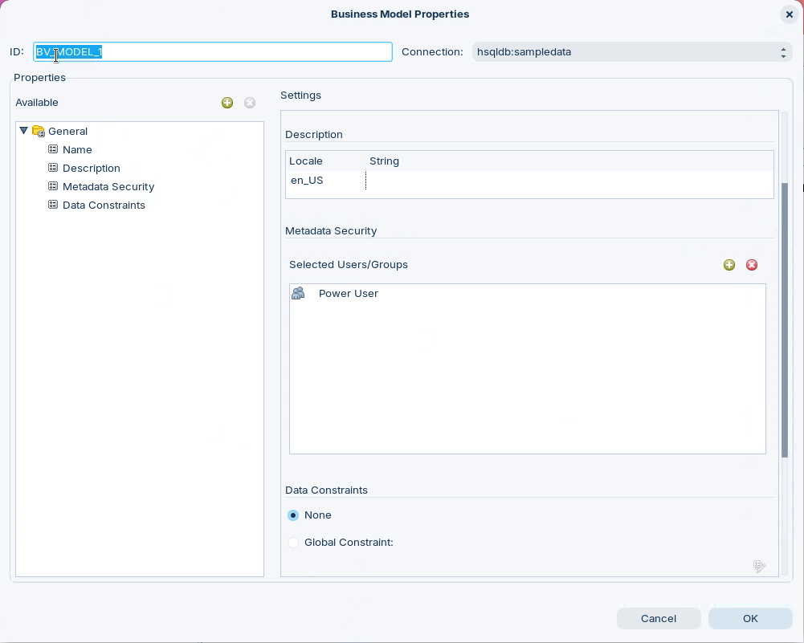
<figcaption>What you build: security on the business model</figcaption>
</figure>
</div>

:::: tabs

### 1. Security Service

> **Note:**
>
> #### Connect to the Security Service
>
> To list users and roles in its security properties, the Metadata Editor asks the Pentaho Server for them. Point it at the server's user and role list, `http://localhost:8080/pentaho/api/userrolelist`, the example the dialog itself gives.

1. Start the Metadata Editor with the **Open Metadata Editor** button below, or from a terminal:

::: tabs

### Windows (PowerShell)

```powershell
Set-Location C:\Pentaho\design-tools\metadata-editor
.\metadata-editor.bat
```

### macOS / Linux

```bash
cd ~/Pentaho/design-tools/metadata-editor
./metadata-editor.sh
```

:::

<button data-launch="metadata-editor">Open Metadata Editor</button>

2. Make sure the Pentaho Server is running. On a lab VM it is already running. On your own machine, start it:

::: tabs

### Windows (PowerShell)

```powershell
Set-Location C:\Pentaho\server\pentaho-server
.\start-pentaho.bat
```

### macOS / Linux

```bash
cd ~/Pentaho/server/pentaho-server
./start-pentaho.sh
```

:::

3. Select **Tools > Security**. The **Security Service** dialog opens on its **Service** tab.
4. Set:

| Setting | Value |
| --- | --- |
| **Service URL** | `http://localhost:8080/pentaho/api/userrolelist` |
| **Detail Type** | All |
| **Username** | `admin` |
| **Password** | `password` |

**Detail Type** decides what comes back: **All**, **Users** or **Roles**. On a server with hundreds of users, choose **Roles** and secure by role. The access control lists come back with all three.

<div align="center">
<figure>
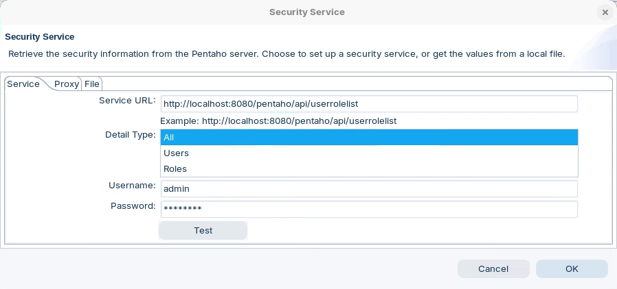
<figcaption>The server's user and role list</figcaption>
</figure>
</div>

5. Select **Test**.

<div align="center">
<figure>
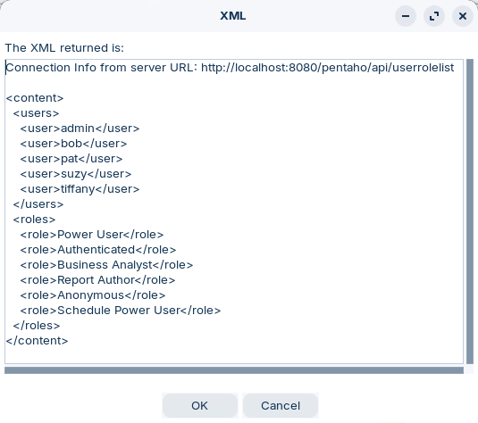
<figcaption>The users and roles the server returned</figcaption>
</figure>
</div>

> **Success:** Checkpoint: the **XML** dialog shows what the server returned: five users (`admin`, `bob`, `pat`, `suzy`, `tiffany`) and six roles (`Power User`, `Authenticated`, `Business Analyst`, `Report Author`, `Anonymous`, `Schedule Power User`). The list has no Administrator role, which matters in part 4.

6. Select **OK** to close the **XML** dialog, then select **OK** to close **Security Service**.

To work without the server later, save this XML to a file: copy everything from `<content>` to `</content>` in the **XML** dialog into a text editor, save it as `metadata_security.xml`, then on the **File** tab of **Security Service**, select **Browse** and choose the file. The editor then reads users and roles from the file.

7. Select **File > Open** (`Ctrl+O`), select **OrderStarCustomer** in the **Select a Domain** dialog, and select **OK**. Starting from the Lab Files instead? Select **File > Import from XMI File** (`Ctrl+I`), open `OrderStarCustomer-concepts.xmi`, and in the **Save Model** dialog enter `OrderStarCustomer` and select **OK**.

### 2. Model Access

> **Note:**
>
> #### Metadata Security on the Model
>
> A model with no **Metadata Security** is visible to the administrator only: the server lets an administrator through every Metadata Security check, and refuses everyone else when the list is empty. Give the Power User role, which `suzy` holds, read access to the model.

1. Right-click **OrderStarCustomer (hsqldb:sampledata)** and select **Edit**.

<div align="center">
<figure>
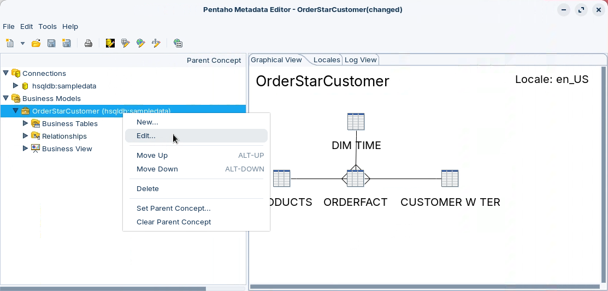
<figcaption>Edit the business model</figcaption>
</figure>
</div>

2. In the **Business Model Properties** dialog, select **General > Metadata Security** in the **Available** pane.
3. In **Settings**, select **Add New Users/Groups**, the green plus icon to the right of **Selected Users/Groups**. The **Add Permissions** dialog opens.
4. Under **Available Users/Roles**, select **Power User**, select the right arrow, and select **OK**.
5. Select **General > Data Constraints** and check that **None** is selected.

<div align="center">
<figure>
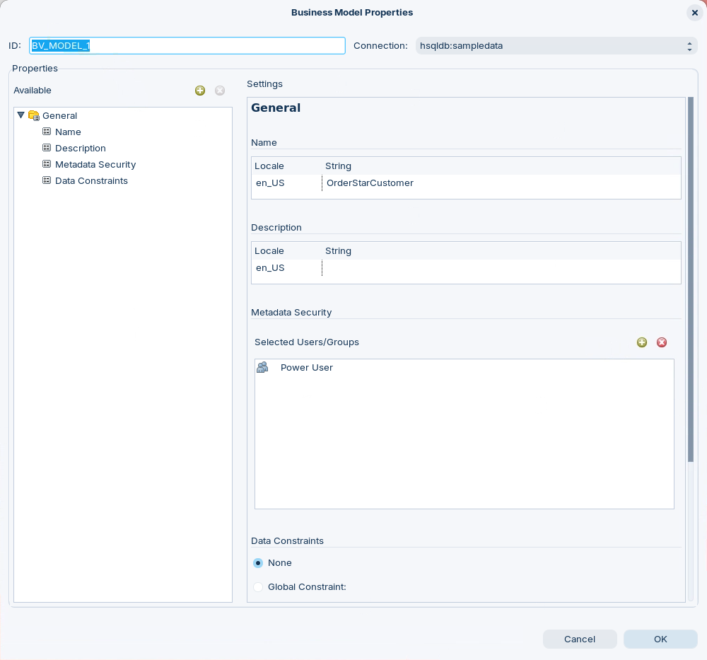
<figcaption>Power User may read the model; no row constraint yet</figcaption>
</figure>
</div>

6. Select **OK**.
7. Under **Business View**, double-click **Orders**. The **Business Category Properties** dialog opens.

> **Success:** Checkpoint: the category's **Metadata Security** list is empty. The category was created with its own, empty Metadata Security, and that empty list overrides the model's: as it stands, no one but the administrator could see the category.

8. Select the **Stop Override** icon to the right of **Metadata Security**.

<div align="center">
<figure>
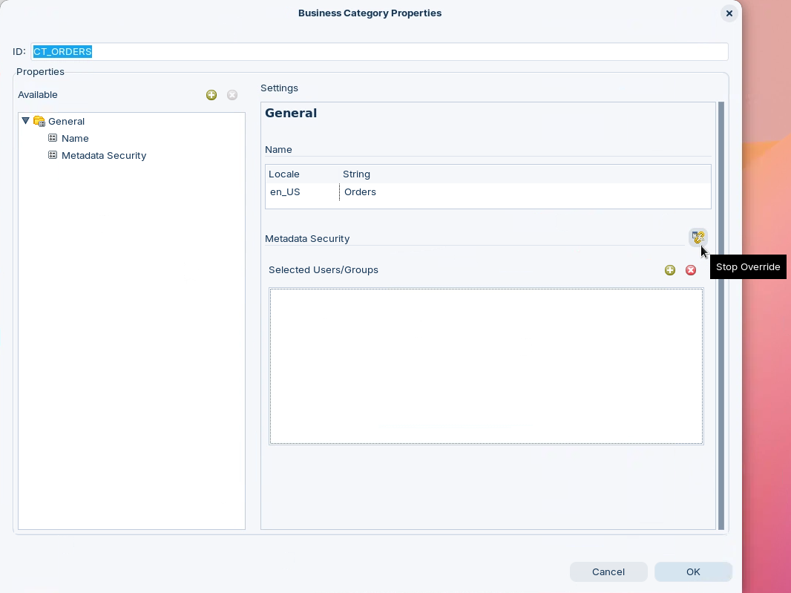
<figcaption>Stop Override</figcaption>
</figure>
</div>

<div align="center">
<figure>
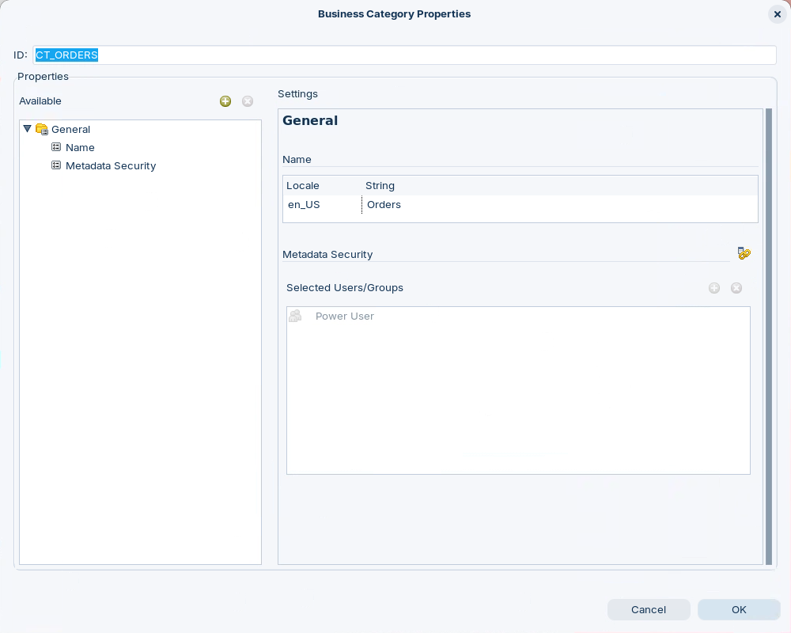
<figcaption>The category now inherits Power User from the model</figcaption>
</figure>
</div>

9. Select **OK**.
10. Repeat steps 7 to 9 for the **Customers**, **Products** and **Time** categories.
11. Save the domain (`Ctrl+S`).

> **Under the hood:**
>
> #### Metadata Security is inherited like any property
>
> Metadata Security is a property: a list of users and roles, each with
> rights. The engine passes it down through the security parent the way
> other properties travel, so a category or column without its own
> setting takes its model's; overriding it on a category, as these
> categories did, replaces the inherited list.
>
> The server checks it for the logged-in user before listing a model,
> category or column, which is why an object Suzy can't read disappears
> from the Interactive Report's field list instead of returning empty.
>
> **Why it matters:** set access once, on the model, and override it
> only where a category or column needs less. An override left in place
> by accident hides the object from everyone but the administrator.

12. Select **File > Publish To Server** and publish with the settings of the Concept Editor workshop: **Web Publish URL** `http://localhost:8080/pentaho/plugin/data-access/api/metadata/import`, **Server Userid** `admin`, **Server Password** `password`, **Domain Name** `OrdersStarCustomer`. When the editor asks whether to overwrite the published domain, confirm.

> **Success:** Checkpoint: an **Action Successful** message reads `File - OrdersStarCustomer: Successfully saved to the server`.

13. Select **OK**.

<details>
<summary>Reference: who may view and manage data sources</summary>

The server's own data source permissions are in `settings.xml`, in `C:\Pentaho\server\pentaho-server\pentaho-solutions\system\data-access\` (macOS / Linux: `~/Pentaho/server/pentaho-server/pentaho-solutions/system/data-access/`). By default every authenticated user can view data sources, and the Administrator role manages them:

```xml
<data-access-roles>Administrator</data-access-roles>
<data-access-users></data-access-users>
<data-access-view-roles>Authenticated,Administrator</data-access-view-roles>
<data-access-view-users>suzy</data-access-view-users>
```

Whether `suzy` sees OrderStarCustomer is decided by the model's Metadata Security, which you just set. Change these lines only to widen who may create and manage data sources, for example `<data-access-roles>Authenticated</data-access-roles>`, then restart the Pentaho Server.

</details>

### 3. Refresh & Test

> **Note:**
>
> #### Refresh the Server's Metadata
>
> The server caches published models. After every publish, refresh its reporting metadata, or reports keep using the old model.

1. Open the Pentaho User Console with the button below and log in as `admin` (password `password`).

<button data-launch="puc">Open Pentaho User Console</button>

2. Select **Tools > Refresh > Reporting Metadata**.

<div align="center">
<figure>
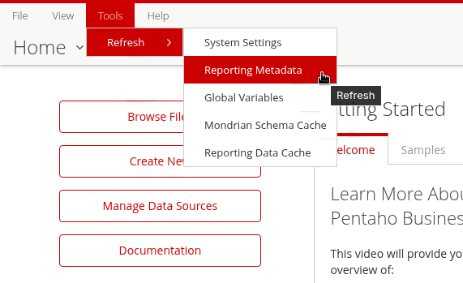
<figcaption>Tools > Refresh > Reporting Metadata</figcaption>
</figure>
</div>

<div align="center">
<figure>
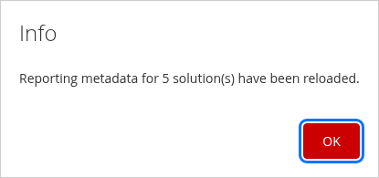
<figcaption>The server reloaded its metadata</figcaption>
</figure>
</div>

> **Success:** Checkpoint: an **Info** message reads *Reporting metadata for N solution(s) have been reloaded*, where N is the number of published domains on your server.

3. Select **OK**.
4. Log out: select `admin` at the top right, then **Log Out**. Log back in as `suzy` (password `password`).
5. Select **Create New > Interactive Report**.

<div align="center">
<figure>
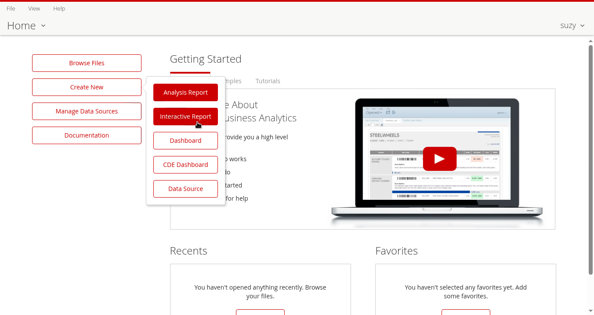
<figcaption>suzy creates an Interactive Report</figcaption>
</figure>
</div>

6. In **Select Data Source**, select **OrderStarCustomer** and select **OK**.

<div align="center">
<figure>
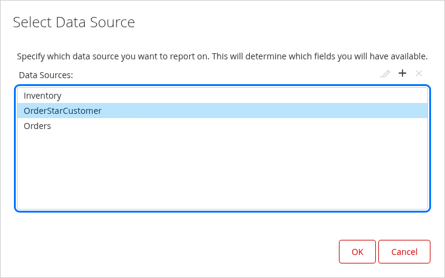
<figcaption>suzy's data sources include OrderStarCustomer</figcaption>
</figure>
</div>

7. On the **Data** tab, double-click **Territory** under **Customers**.

<div align="center">
<figure>
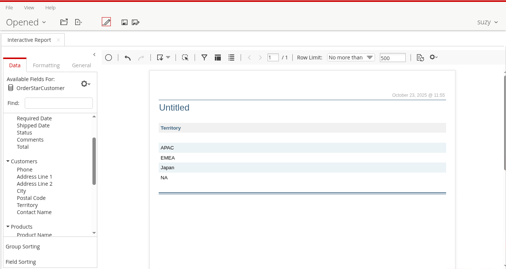
<figcaption>Every territory, before the row constraint</figcaption>
</figure>
</div>

> **Success:** Checkpoint: **OrderStarCustomer** is in `suzy`'s list, and **Territory** shows five rows: `APAC`, `EMEA`, `Japan`, `NA`, and an empty one for the 22 customers with no territory. Nothing filters her rows yet.

8. Close the **Interactive Report** tab without saving.

### 4. Column & Row Security

> **Note:**
>
> #### Column-Level and Row-Level Security
>
> Restrict a sensitive column, **Credit Limit**, to the `admin` user, so sales representatives such as `suzy` never see it. Then filter rows: `suzy`, through the Power User role, gets only the EMEA customers.
>
> Row-level security is a **Data Constraint** on the **business model**: the engine reads it from the model only, and ignores one added to a business table or column. In **Role Based Constraints** mode each role or user gets its own formula. A user who matches several entries gets their formulas joined with OR, and **a user who matches no entry sees no rows at all**, so `admin` needs an entry too.

1. In the Metadata Editor, expand **Business Tables > CUSTOMER W TER**, right-click **Credit Limit**, and select **Edit**. The **Business Table Properties** dialog opens with **Credit Limit** selected.

<div align="center">
<figure>
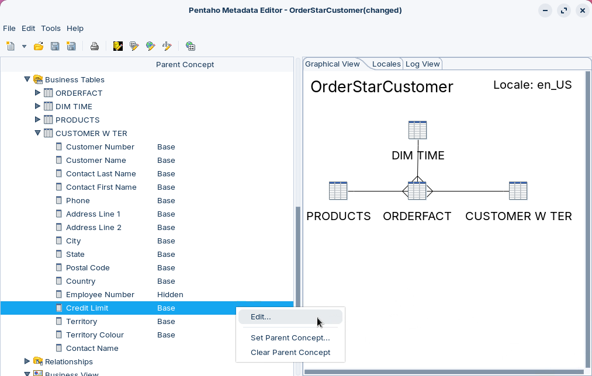
<figcaption>Edit the Credit Limit column</figcaption>
</figure>
</div>

2. Select **General > Metadata Security** in the **Available** pane, and select its **Override** icon in **Settings**.
3. Select **Add New Users/Groups**, the green plus icon to the right of **Selected Users/Groups**.

<div align="center">
<figure>
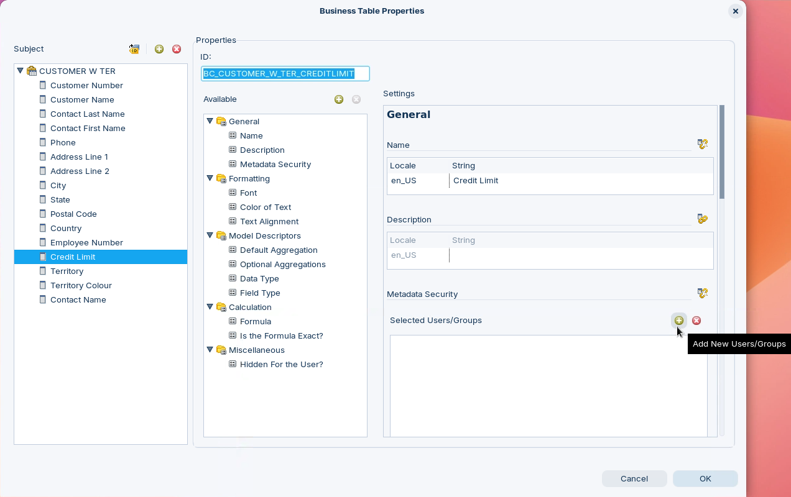
<figcaption>Override Metadata Security on the column</figcaption>
</figure>
</div>

4. In **Add Permissions**, select the user **admin** under **Available Users/Roles**.

<div align="center">
<figure>
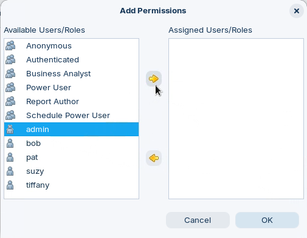
<figcaption>Roles first, then users</figcaption>
</figure>
</div>

5. Select the right arrow, then select **OK**.

<div align="center">
<figure>
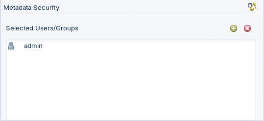
<figcaption>Only admin may see Credit Limit</figcaption>
</figure>
</div>

6. Select **OK** to close **Business Table Properties**.
7. Right-click **OrderStarCustomer (hsqldb:sampledata)** and select **Edit**.
8. Select **General > Data Constraints**, then select **Role Based Constraints**.
9. Add an entry: select the green plus icon for the role-based list, and in the **Add Role Based Constraint** dialog select the role **Power User**, enter this in **Constraint Formula**, and select **OK**:

```text
[BT_CUSTOMER_W_TER_CUSTOMER_W_TER.BC_CUSTOMER_W_TER_TERRITORY] = "EMEA"
```

10. Add a second entry the same way, for the user **admin**, with this **Constraint Formula**:

```text
TRUE()
```

11. Select **OK**, then save the domain (`Ctrl+S`).

> **Success:** Checkpoint: the model's **Data Constraints** are **Role Based Constraints** with two entries: **Power User** with the EMEA formula, and **admin** with `TRUE()`. The same two entries are in `security-order-constraints.txt`, under **Lab Files**.

The formulas follow these rules:

* A formula names a business column as `[business table ID.business column ID]`, the IDs you met when you built the relationships.
* The security service lists the `admin` user but no Administrator role, so the entry for `admin` is a user entry.
* The server has no administrator bypass for row-level security, unlike Metadata Security: without its entry, `admin` would see no rows either.
* `ROLES()` and `USER()` are expanded only in a **Global Constraint** (one formula for everyone), not in role-based entries, which is why each role gets its own entry here.

12. Publish the domain again, with the same settings as in part 2. Confirm the overwrite.
13. In the User Console, log out, log back in as `admin`, and select **Tools > Refresh > Reporting Metadata**, then **OK**.
14. Create an Interactive Report on **OrderStarCustomer** and double-click **Territory** under **Customers**.

> **Success:** Checkpoint: as `admin`, **Territory** shows all five rows: `APAC`, `EMEA`, `Japan`, `NA` and the empty one. **Customers** lists **Credit Limit**.

15. Log out, log back in as `suzy`, and create the same report.

<div align="center">
<figure>
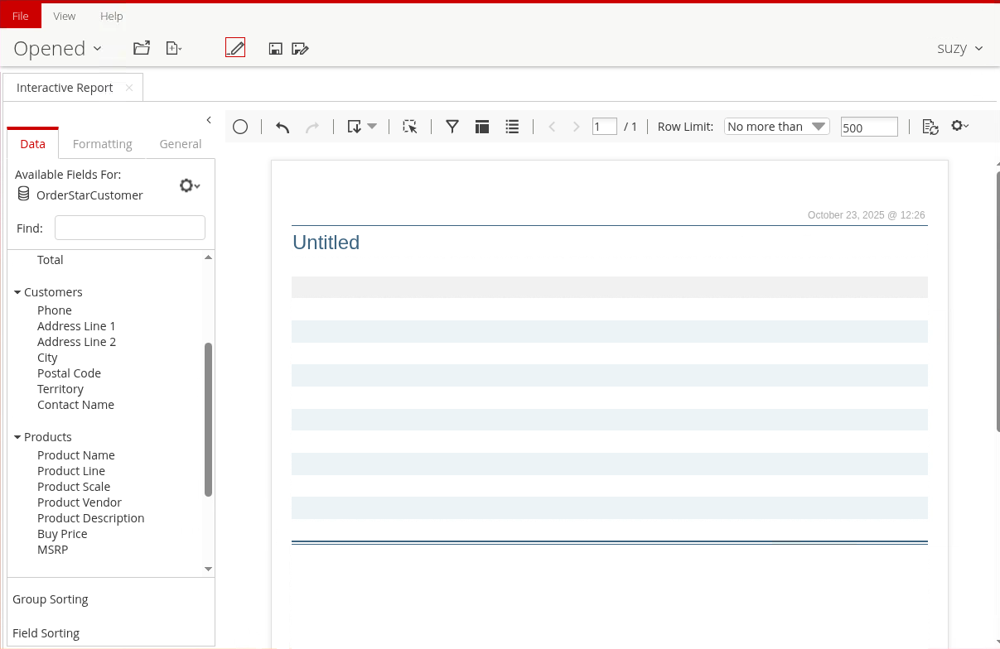
<figcaption>suzy's field list: no Credit Limit</figcaption>
</figure>
</div>

> **Success:** Checkpoint: as `suzy`, **Customers** doesn't list **Credit Limit**, and **Territory** shows one row: `EMEA`.

16. Close the **Interactive Report** tab without saving.

> **Under the hood:**
>
> #### What the engine did with each role
>
> Before generating SQL, the engine asks the domain repository, which on
> the server knows the logged-in user and roles, for the constraint, and
> takes the entry for the user's role. For Power User that is the EMEA
> formula, translated to WHERE TERRITORY = 'EMEA', and the Territory
> query returns one row. admin's TRUE() becomes WHERE TRUE and
> returns all five territory values, including the customers with no
> territory. A role with no entry gets FALSE(): WHERE FALSE, and no rows
> at all.
>
> Because the condition is part of the SQL itself, it filters every
> query built on the model, whatever columns it selects.
>
> **Why it matters:** the filter lives in one place, the model, and
> every report and tool that queries the domain gets it, with no
> per-report SQL or database views to maintain.

::::

## Troubleshooting <!-- no-step -->

<details>
<summary>"Unable to display dialog" when adding a role-based constraint</summary>

The Metadata Editor couldn't reach the security service. Check that the Pentaho Server is running, then select **Tools > Security** and select **Test** again.

</details>

<details>
<summary>suzy doesn't see OrderStarCustomer, or sees a category without columns</summary>

A category still overrides Metadata Security with an empty list. Edit each category and select **Stop Override**, publish again, and refresh the reporting metadata.

</details>

<details>
<summary>The report still shows every territory to suzy</summary>

The server is serving the old model. As `admin`, select **Tools > Refresh > Reporting Metadata**, then create the report again.

</details>

## Lab Files

Click a file to download it.

The two row-level constraints, ready to copy into the **Constraint Formula** fields:

[security-order-constraints.txt](../_assets/data/security-order-constraints.txt)

The starting domain, the result of the [Concept Editor](../09-concepts-concept-editor/guide.md) workshop:

[OrderStarCustomer-concepts.xmi](../_assets/files/OrderStarCustomer-concepts.xmi)

### Solution <!-- no-step -->

The finished domain, with this workshop's model, category, column and row-level security. Load it with **File > Import from XMI File**.

[OrderStarCustomer-security.xmi](../_assets/files/OrderStarCustomer-security.xmi)
