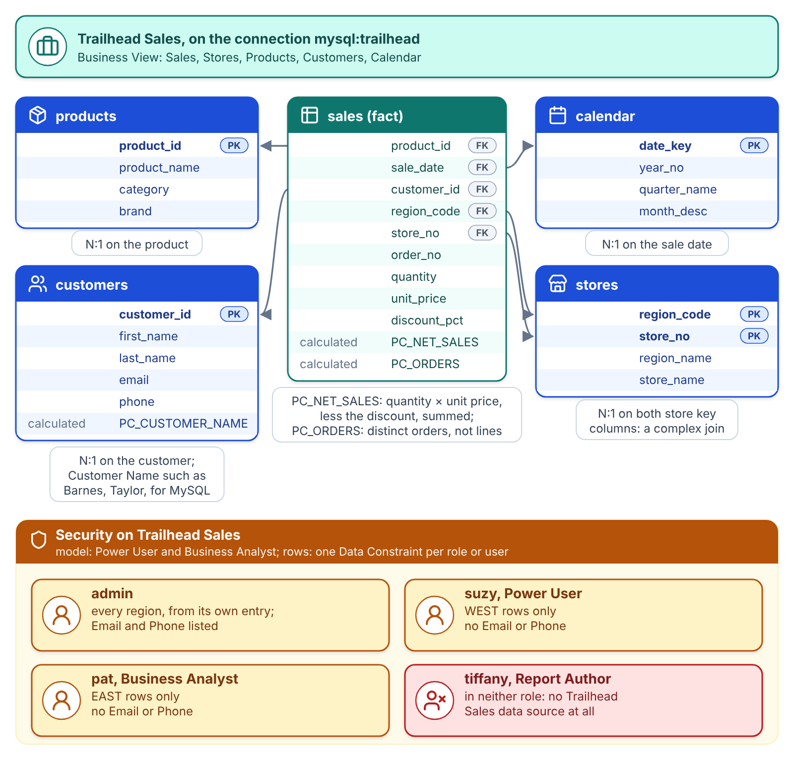

# Capstone: Trailhead Outfitters

> **Capstone Project — bring it all together.**

Trailhead Outfitters sells outdoor gear from twelve stores in four US
regions. Its sales live in a MySQL database, `trailhead`, which sits
beside Steel Wheels in the lab's **sampledata MySQL** container. The
regional managers want to build their own reports in Interactive
Reports, each seeing only their own region, and finance wants customer
contact details kept to administrators.

You build the metadata domain that makes this possible, from an empty
domain to a published, secured data source. Every stage uses a
workshop from this course, named beside its heading in case you want
to look back.

> **Objectives:**
>
> - Model a second database, on MySQL, from an empty domain to a published data source.
> - Join a fact table to a dimension on two columns with a complex join.
> - Add calculated columns, including one that MySQL needs written its own way.
> - Format with concepts, organize with categories, and secure the model, its columns and its rows.
> - Prove it: three users, three different answers from the same report.
>
> **Prerequisites:** Workshops 03 to 11; Pentaho Metadata Editor and Pentaho Server installed; the sampledata MySQL container (the MySQL lab kit in `C:\MySQL`).
>
> **Estimated time:** 90 mins.

---

> **Warning:**
>
> #### Required for your course accreditation: five checks on your own folders
>
> The course accreditation is issued only when all five of these checks
> pass. They read your workshop folder, so put your work in exactly
> these places **before you take the exam**:
>
> | # | What must be there | Where |
> | --- | --- | --- |
> | 1 | Your domain, exported as `Trailhead.xmi`, on the `mysql:trailhead` connection | `C:\Workshop-ME-Associate\capstone\solution\` |
> | 2 | In it, the Stores relationship joined on both store key columns | the same file |
> | 3 | In it, a Customer Name column written the way MySQL needs | the same file |
> | 4 | In it, the West region's row-level constraint | the same file |
> | 5 | The published domain, exported from the User Console as `Trailhead.xmi` | `C:\Workshop-ME-Associate\capstone\out\` |
>
> File 1 is **File > Export to XMI File** in Metadata Editor. File 5 is
> the copy the server holds, from **Manage Data Sources** (stage 9). Use
> these names exactly: the checks look for them. Select **Run checks**
> under **Verification checks** to see where you stand.

## Inputs

| Table | Rows | What it holds |
| --- | --- | --- |
| `sales` | 4,286 | One row per order line, 2024 and 2025: `sale_id`, `order_no`, `line_no`, `sale_date`, `region_code`, `store_no`, `customer_id`, `product_id`, `quantity`, `unit_price`, `discount_pct` |
| `stores` | 12 | `region_code` + `store_no` (the key), `region_name`, `store_name`, `city`, `state`, `store_type`, `opened_date`, `square_feet` |
| `customers` | 540 | `customer_id`, `first_name`, `last_name`, `email`, `phone`, `city`, `state`, `home_region_code`, `loyalty_tier`, `joined_date` |
| `products` | 56 | `product_id`, `sku`, `product_name`, `category`, `brand`, `unit_cost`, `list_price` |
| `calendar` | 731 | One row per day of 2024 and 2025: `date_key`, `year_no`, `quarter_no`, `quarter_name`, `month_no`, `month_name`, `month_desc`, `day_name`, `is_weekend`, `season` |

> **Note:** Store numbers restart in each region: West Coast store 1
> (Seattle) and East Coast store 1 (Boston) are different shops. A sale
> therefore names its store with **two** columns, `region_code` and
> `store_no`. Keep that in mind at stage 4.

The server's users for the test: `admin`, `suzy` (role **Power User**),
`pat` (**Business Analyst**) and `tiffany` (**Report Author**), all with
the password `password`.

---

## Required behavior

Build the domain in the stages of the outline below. What each stage
must deliver:

1. **Ready:** the `trailhead` database answering, and the MySQL JDBC
   driver in both Metadata Editor and the Pentaho Server.
2. **Domain and connection:** a new domain with the connection
   `mysql:trailhead` (MySQL, native JDBC, `127.0.0.1`, port `3306`,
   database `trailhead`, `pentaho_admin` / `password`) and all five
   tables imported.
3. **Calculated columns,** in the physical layer:
   - `PC_NET_SALES` on `sales`: quantity × unit price, less the discount
     (`discount_pct` is a fraction, 0.25 for 25%); summed by default.
   - `PC_ORDERS` on `sales`: the number of distinct orders, not lines.
   - `PC_CUSTOMER_NAME` on `customers`: the last name, a comma and a
     space, then the first name, such as `Barnes, Taylor`, as MySQL
     returns it.
4. **Business model** `Trailhead Sales` on `mysql:trailhead`, with the
   five business tables and four N:1 relationships from Sales: to
   Products on the product, Customers on the customer, Calendar on the
   sale date, and Stores on **both** store key columns.
5. **Names and aggregations:** the business names below, and Default
   Aggregation **Sum** on Quantity, **Average** on Unit Price and
   Discount.
6. **Concepts:** Number, USCurrency, Percent and Date, applied as below.
7. **Business view:** five categories, as below.
8. **Security:**
   - the model readable by the **Power User** and **Business Analyst**
     roles, and every category inheriting that;
   - **Email** and **Phone** readable by the user `admin` only;
   - rows: Power User sees the `WEST` region, Business Analyst the
     `EAST` region, and `admin` every region.
9. **Published** to the server as domain `Trailhead`, exported from
   Metadata Editor into `capstone\solution\` and from the User Console
   into `capstone\out\`.

| Business column | Name |
| --- | --- |
| BC_SALES_ORDER_NO | Order Number |
| BC_SALES_SALE_DATE | Sale Date |
| BC_SALES_UNIT_PRICE | Unit Price |
| BC_SALES_DISCOUNT_PCT | Discount |
| BC_STORES_REGION_NAME | Region |
| BC_STORES_REGION_CODE | Region Code |
| BC_STORES_STORE_NAME | Store |
| BC_STORES_CITY / BC_STORES_STATE | Store City / Store State |
| BC_STORES_STORE_TYPE | Store Type |
| BC_CUSTOMERS_CITY / BC_CUSTOMERS_STATE | Customer City / Customer State |
| BC_CUSTOMERS_LOYALTY_TIER | Loyalty Tier |
| BC_PRODUCTS_PRODUCT_NAME | Product |
| BC_PRODUCTS_SKU | SKU |
| BC_PRODUCTS_UNIT_COST / BC_PRODUCTS_LIST_PRICE | Unit Cost / List Price |
| BC_CALENDAR_YEAR_NO | Year |
| BC_CALENDAR_QUARTER_NAME | Quarter |
| BC_CALENDAR_MONTH_NO | Month Number |
| BC_CALENDAR_MONTH_DESC | Month |
| BC_CALENDAR_IS_WEEKEND | Weekend |

| Concept | Parent | Mask for Number or Date | Text Alignment | Applied to |
| --- | --- | --- | --- | --- |
| Number | Base | `#,##0` | Right | Quantity, Orders |
| USCurrency | Number | `$#,##0.00;($#,##0.00)` | (inherited) | Unit Price, Net Sales, Unit Cost, List Price |
| Percent | Number | `0.0%` | (inherited) | Discount |
| Date | Base | `MM-dd-yyyy` | | Sale Date |

| ID | Name | Columns |
| --- | --- | --- |
| CT_SALES | Sales | Order Number, Sale Date, Quantity, Unit Price, Discount, Net Sales, Orders |
| CT_STORES | Stores | Region, Region Code, Store, Store City, Store State, Store Type |
| CT_PRODUCTS | Products | Category, Brand, Product, SKU, Unit Cost, List Price |
| CT_CUSTOMERS | Customers | Customer Name, Email, Phone, Customer City, Customer State, Loyalty Tier |
| CT_CALENDAR | Calendar | Year, Quarter, Month Number, Month, Season, Weekend |

---

## Suggested shape

<div align="center">
<figure>

<figcaption>What you build: the Trailhead domain, and who sees what</figcaption>
</figure>
</div>

Read the diagram from the top. The bar is the business model, Trailhead Sales, on the `mysql:trailhead` connection, with the five categories of its business view. Under it, the `sales` fact table sits in the middle, and each arrow runs from one of its foreign keys to the key of the dimension table it matches; Stores takes two arrows, one complex join on both columns, because store numbers restart in each region. The rows marked calculated are the three columns you add in the physical layer at stage 3. The strip at the bottom is the result of stage 8: suzy and pat each see one region and no Email or Phone, admin sees every region only because admin has a Data Constraint entry of its own, and tiffany, in neither role, gets no data source at all.

Your capstone folder, where the accreditation checks look:

```text
C:\Workshop-ME-Associate\capstone\    (your machine)
├── solution\Trailhead.xmi       your domain: File > Export to XMI File
└── out\Trailhead.xmi            the published domain, exported from the User Console
```

The installer makes `capstone\solution\` and `capstone\out\` for you,
empty. If `C:\Workshop-ME-Associate\` has no `capstone` folder,
create `capstone\solution\` and `capstone\out\` there yourself.

---

## Hints for the tricky bits

- **A two-column join** is a complex join, written as a Metadata Formula that names each column `[business table ID.business column ID]` and joins conditions with `AND(...; ...)`. [OrdersME](../04-domains-and-models-ordersme/guide.md) has the syntax.
- **Joining on one store column** gives no error and wrong totals; see the panel at stage 4.
- **Joining two strings on MySQL.** The [OrderStarCustomer](../07-properties-orderstarcustomer/guide.md) workshop's `+` is generated as written, and MySQL's `+` adds numbers. A formula the engine can't parse as a Metadata Formula is passed into the SQL unchanged, so MySQL's own `CONCAT` function works (write its name in capitals: the accreditation check looks for `CONCAT`); keep **Is the Formula Exact?** selected for it.
- **Counting orders, not lines.** A formula that is not exact is a column name. Pick the aggregation that counts each value once.
- **Row-level rules** are Data Constraints on the business model, one per role or user, as in [Row-Level Security](../11-security-and-data-access-row-level-security/guide.md). A role or user with no entry gets no rows, administrator included.
- **The export from the User Console** downloads a file named after the domain. Move it into `capstone\out\` without renaming it.

---

## Build outline and hints <!-- no-step -->

One section per stage, in the order you build them. Each says what the
stage must do and what a correct build shows. The hints name a dialog or
a technique; the settings are yours to work out.

:::: tabs

### 1. Get ready

**Must do:** requirement 1.

1. Check that the `trailhead` database is there. In PowerShell:

```powershell
C:\MySQL\load-trailhead.ps1
```

   It prints `trailhead database present (4286 sales lines).`, or loads
   the database first and prints `trailhead database loaded (4286 sales lines).` If it says it cannot query
   MySQL, start the container and try again:

```powershell
C:\MySQL\run-podman-mysql.ps1
```

2. Put the MySQL JDBC driver into the Metadata Editor **and** the
   Pentaho Server. Neither ships one. This copies the driver from Pentaho
   Data Integration when it has one, and otherwise downloads it from
   Maven Central, where Oracle publishes it:

```powershell
$jar = Get-ChildItem "C:\Pentaho\design-tools\data-integration\lib\mysql-connector-j-*.jar" -ErrorAction SilentlyContinue | Select-Object -First 1
if (-not $jar) {
    $out = Join-Path $env:TEMP "mysql-connector-j-8.4.0.jar"
    Invoke-WebRequest "https://repo1.maven.org/maven2/com/mysql/mysql-connector-j/8.4.0/mysql-connector-j-8.4.0.jar" -OutFile $out -UseBasicParsing
    $jar = Get-Item $out
}
Copy-Item $jar.FullName "C:\Pentaho\design-tools\metadata-editor\libext\JDBC\"
Copy-Item $jar.FullName "C:\Pentaho\server\pentaho-server\tomcat\lib\"
```

3. Restart the Metadata Editor, and restart the Pentaho Server (stop it,
   then start it), so both load the driver.

> **Success:** Checkpoint: in [Before You Start](../00-before-you-start/guide.md), the **MySQL driver (Metadata Editor)** and **Trailhead database (MySQL)** rows are green.

Leave the MySQL container and both programs running for the rest of the capstone.

> **Under the hood:**
>
> #### Two programs, two drivers
>
> The Metadata Editor connects to MySQL itself, to import tables and to
> run the Query Editor. The published domain carries the connection's
> details, and the Pentaho Server opens its own connection from them for
> every report built on it. Each program loads drivers from its own
> folder, and only when it starts.

### 2. Domain and tables

**Must do:** requirement 2. *(OrdersME)*

> **Success:** Checkpoint: **Test** reports that the connection to `mysql:trailhead` was successful, and **Connections** lists five tables.

<details>
<summary>Hints</summary>

- **File > New > Domain File**, then **New Connection** on **Connections**, as in [OrdersME](../04-domains-and-models-ordersme/guide.md).
- **Import Tables** opens after the connection is saved; select all five.

</details>

> **Under the hood:**
>
> #### What the import decided for you
>
> A physical table gets an ID built from its name: `PT_SALES`. A
> physical column's ID is the column name exactly as MySQL reports it,
> so here they are lower-case (`quantity`, `sale_date`). Steel Wheels'
> were upper-case because HSQLDB reports them that way. You use these
> IDs in formulas at stage 3.
>
> The import also sets each column's data type from the driver's. A
> MySQL `DATE` arrives as **Date**, so `sale_date` needs no change.
> SampleData stores its order dates as `TIMESTAMP`, which the importer
> has no case for and records as **String**: that is why the
> OrderStarCustomer workshop had to set Order Date's data type by hand.

### 3. Calculated columns

**Must do:** requirement 3. *(OrderStarCustomer)*

> **Success:** Checkpoint: Metadata Editor names each new column from its ID: **Net Sales**, **Orders** and **Customer Name**.

<details>
<summary>Hints</summary>

- Add them in the physical layer before you build the business model, so they come along when you drag the tables in: **Edit** the physical table, **Add New Column**, type the ID.
- Physical column IDs are lower-case here: write them that way inside `[...]`.
- See **Hints for the tricky bits** for Orders and Customer Name.

</details>

### 4. Business model and relationships

**Must do:** requirement 4. *(OrdersME)*

> **Success:** Checkpoint: the **Graphical View** draws Sales in the middle, joined to the four other tables, and the Stores relationship shows **Complex Join?** selected.

<details>
<summary>Hints</summary>

- Drag each physical table onto **Business Tables**; the IDs follow the pattern `BT_SALES_SALES`.
- **Guess Matching Fields** fills a relationship whose two columns share a name; the Calendar one doesn't.

</details>

> **Under the hood:**
>
> #### What a one-column store join would report
>
> Join on `store_no` alone and every sale matches one store in each
> region that has that number. Net Sales by Region then reads West
> Coast $690,124.85, the whole company, because the West has a store
> 1, 2, 3 and 4 and so matches every sale; Rocky Mountains and East
> Coast $657,493.55 each; Central $528,750.90. Nothing errors: the SQL
> is valid, just wrong. With both columns each sale matches exactly one
> store, and the regions add up to the company total.

### 5. Names and aggregations

**Must do:** requirement 5 and the names table. *(OrderStarCustomer)*

> **Success:** Checkpoint: the business tables show the business names, and the **Default Aggregation** of Quantity, Unit Price and Discount is Sum, Average and Average.

<details>
<summary>Hints</summary>

- **Business Table Properties**, **General > Name**, **Override**, as in [OrderStarCustomer](../07-properties-orderstarcustomer/guide.md).
- Net Sales and Orders already have their aggregations from the physical layer.

</details>

### 6. Concepts

**Must do:** requirement 6 and the concepts table. *(Concept Editor)*

> **Success:** Checkpoint: in the Concept Editor, **Number** and **Date** sit under **Base**, with **USCurrency** and **Percent** under **Number**.

<details>
<summary>Hints</summary>

- **Tools > Concept Editor**; a new concept's parent is the one selected when you create it, as in [Concept Editor](../09-concepts-concept-editor/guide.md).
- **Set Parent Concept** on each business column.

</details>

> **Under the hood:**
>
> #### The Date mask works first time here
>
> A mask is a Java format pattern applied by the report, and it only
> takes on a value of the matching type. Sale Date arrived as a Date
> (stage 2), so `MM-dd-yyyy` formats it. In the Concept Editor workshop
> the same mask left Required Date untouched, because SampleData's
> TIMESTAMP had come in as a String. `0.0%` multiplies by 100, so a
> stored 0.25 shows as 25.0%.

### 7. Business view

**Must do:** requirement 7 and the categories table. *(OrdersME, OrderStarCustomer)*

> **Success:** Checkpoint: **Business View** holds Sales (7 columns), Stores (6), Products (6), Customers (6) and Calendar (6).

<details>
<summary>Hints</summary>

- **New Category** sets the ID and name; **Manage Categories** adds the columns.

</details>

### 8. Security

**Must do:** requirement 8. *(Row-Level Security)*

> **Success:** Checkpoint: the model's **Data Constraints** are **Role Based**, with three entries; **Email** and **Phone** list only `admin` under **Metadata Security**.

<details>
<summary>Hints</summary>

- **Tools > Security** first, so the dialogs can list the server's users and roles.
- A category created with its own, empty Metadata Security hides itself from everyone but the administrator: **Stop Override** on each.
- The region constraint names the Stores business column for the region code.

</details>

> **Under the hood:**
>
> #### Who sees what, and how
>
> Metadata Security decides what is **listed**: a model, category or
> column the signed-in user may not read never appears in Interactive
> Reports. The administrator passes every such check, and a user in
> neither role (tiffany, a Report Author) does not see the Trailhead
> Sales data source at all.
>
> Data Constraints decide which **rows** come back, and here the
> administrator gets no free pass: admin's entry is what lets admin see
> every region. Because suzy's condition names the Stores table, the
> engine adds Stores to every query she runs, even one that selects only
> Products and Sales columns: her Net Sales by Category totals are West
> Coast totals too.

### 9. Test, publish and hand in

**Must do:** requirement 9, and the five checks. *(Query Builder, OrdersME)*

> **Success:** Checkpoint: the **Query Editor** returns four rows for **Region**, **Net Sales** and **Orders** that match **Verification checks** below, and every check is green.

<details>
<summary>Hints</summary>

- **File > Save** as `Trailhead`, then **File > Publish To Server** with the [OrdersME](../04-domains-and-models-ordersme/guide.md) settings and the Domain Name `Trailhead`.
- In the User Console, as `admin`: **Tools > Refresh > Reporting Metadata**.
- **File > Export to XMI File** (`Ctrl+E`) saves `Trailhead.xmi`; save it into `capstone\solution\`.
- In the User Console, **File > Manage Data Sources**: select **Trailhead** (a Metadata data source) and **Export...** from the gear menu, and move the download into `capstone\out\`.

</details>

::::

---

## Lab Files

_No bundled files for this lab._ The data is the `trailhead` database in
the MySQL lab kit, your domain is built from nothing in Metadata Editor,
and the accreditation checks read `C:\Workshop-ME-Associate\capstone\`.

---

## Verification checks

> **Warning:** These five checks decide your course accreditation, and
> they look only in `C:\Workshop-ME-Associate\capstone\`: in
> `solution\` your exported `Trailhead.xmi`, on `mysql:trailhead`, with
> the two-column Stores join, a MySQL-ready Customer Name and the West
> constraint; and in `out\` the published domain, exported from the User
> Console. Export your work there before you take the exam.

The checks confirm that the files exist and hold those parts. Check the
numbers yourself: create an Interactive Report on the **Trailhead Sales**
data source with **Region**, **Net Sales** and **Orders**, then sign in
as each user in turn.

| Region | Net Sales | Orders |
| --- | --- | --- |
| Central | $118,949.50 | 399 |
| East Coast | $164,742.65 | 562 |
| Rocky Mountains | $191,688.10 | 654 |
| West Coast | $214,744.60 | 795 |
| **Company** | **$690,124.85** | **2,410** |

| Signed in as | What you should see |
| --- | --- |
| admin | All four regions, as above. Email and Phone are listed under Customers. |
| suzy (Power User) | West Coast only: $214,744.60, 795 orders. No Email or Phone. |
| pat (Business Analyst) | East Coast only: $164,742.65, 562 orders. No Email or Phone. |
| tiffany (Report Author) | No Trailhead Sales data source. |

For a second check, as admin: Net Sales by **Year** is $327,121.25 for
2024 (1,137 orders) and $363,003.60 for 2025 (1,273 orders).

## Deliverables

1. `Trailhead`: the domain, with the five tables, three calculated columns and the two-column complex join
2. Names, aggregations, concepts and categories as specified; Sale Date shows as MM-dd-yyyy and Net Sales as currency
3. The domain published to the Pentaho Server, giving the figures above to admin, suzy and pat
4. Email and Phone visible to admin only; tiffany sees no Trailhead Sales data source
5. `C:\Workshop-ME-Associate\capstone\solution\Trailhead.xmi` and `capstone\out\Trailhead.xmi`

> **Warning:** Save into `capstone\solution\` and `capstone\out\`, not
> into the course folder. Course content is refreshed from the
> repository on every launch, so anything you leave there will be
> overwritten. Reinstalling or upgrading the course never touches those
> two folders.
