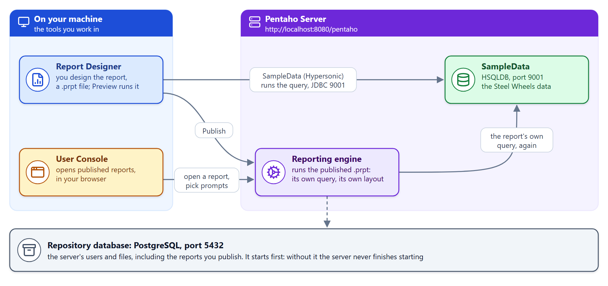

# Before You Start

> **Note:**
>
> #### Get Ready — Before You Start
>
> Before the first workshop, check that the Pentaho Server and its sample
> data are up, that Report Designer starts and can reach that data, and
> that the workshop folder is in place. Every report in the course reads
> the Steel Wheels sample data the server supplies, and **none of the lab
> time should go on setup**: this page does it in advance.
>
> **What you'll do:**
>
> * Learn how the guide works: progress, copy buttons, the assistant.
> * See how Report Designer, the Pentaho Server and the sample data fit together.
> * Confirm the server, the sample data, Report Designer and the reporting plugin all answer.
> * Check the workshop folder: *C:\Workshop-RD-Practitioner*
>
> **Prerequisites:** A basic understanding of relational tables and SQL.
>
> **Estimated time:** 5 minutes on a lab VM; about 15 minutes the first
> time on your own machine.

## Meet your lab guide

This panel stays beside your tools for the whole workshop:

- **Float or dock** — drag the title bar to move the window anywhere
  (any monitor), or use the dock button to pin it to the right edge of
  the screen so maximized apps make room for it.
- **The sidebar** lists every section and lab. A <span data-icon="video"></span> badge means the lab
  includes a video; the `~15 min` tag is a time estimate.
- Use the **font-size** and **reading-mode** controls in the toolbar if
  you're on a small VM screen.

## Track your progress

Each workshop's steps sit in a numbered row at the top of the lab, one
dot per step. Work through them in order: the button at the end of a
step names the next one, and moving on puts a check mark on the step
you leave. Your progress is saved on this machine and survives
restarts, so you can pick up exactly where you left off. (This page has
no steps: tracking starts in the first workshop.)

## Copy code from the guide

Every code block has a **copy button**: hover over the block and select
it, then paste into your tool. Try it:

```sql
SELECT 'hello from the lab guide' AS greeting;
```

## How the pieces fit

Three things run on your machine for this course, and every workshop
uses all three:

<div align="center">
<figure>

<figcaption>Report Designer, the Pentaho Server and the sample data</figcaption>
</figure>
</div>

* **Report Designer** is where you design a report, a `.prpt` file:
  its data source and query, its layout, groups, totals, charts and
  prompts. **Preview** runs the report on your machine.
* **The Pentaho Server** hosts the **SampleData** database (HSQLDB, on
  port 9001) and the **reporting engine**. When you publish a report,
  the engine runs the same file for anyone who opens it in the User
  Console.
* **PostgreSQL** is the server's own repository: its users and files,
  including the reports you publish. The server cannot finish starting
  without it, so it starts first.

> **Under the hood:**
>
> #### A report carries its own query
>
> A `.prpt` file is a zip of XML: the layout, the parameters, and the
> data source with its query. Report Designer's Preview and the
> server's reporting engine read the same file and run the same query,
> each through its own connection to SampleData.
>
> **Why it matters:** what you preview is what the published report
> shows, provided both sides can reach the database by the connection
> the report names.

## Set up your environment

Launch your main tool straight from the guide:

<button data-launch="prd">Start Pentaho Report Designer</button>

If it is already open from a previous session, the button focuses
the running window instead of starting a second copy.

### Do you need to set anything up?

:::: tabs

### I'm using a lab VM

Nothing to install. Everything is already on the machine, and the
Pentaho Server and its repository database start by themselves with it.

> **Note:** **Give the Pentaho Server time to load.** It starts its
> repository database first and then needs **3 to 5 minutes** to finish,
> so it will not answer the moment you sign in. **Check your
> environment**, directly below these tabs, shows **Starting up** while it
> loads and turns green by itself. **Please don't click anything or
> restart anything while it says so**: that only makes the server start
> again from the beginning.

If something looks wrong later, tell your instructor rather than
reinstalling anything.

### I'm installing on my own machine

Everything here is a **one-off setup** for your own laptop. Work through
the tabs in order — the panel underneath checks your machine as you go,
so you can always see what is left. The last tab is a reference card of
every port and login, for when you come back to it later.

> **Note:** This course needs no containers and no MySQL. Report
> Designer is the tool you work in; the Pentaho Server supplies the
> sample data behind every report, and receives the reports you publish
> in Module 9. The Report Bursting workshop also uses Mailpit, a small
> test mail server: a lab VM has it in `C:\Mailpit`, and on your own
> machine that workshop says where to download it.

::: tabs

### 1. Start the Pentaho Server

The server ships with Pentaho, so there is nothing to install: you
start it. Do this first, even though the course is about Report
Designer: it hosts the **Steel Wheels sample data** that every report
queries, not only the reports you publish.

1. Start the server's repository database, PostgreSQL, if it is not
   already running. An installer-based install runs it as the
   **Pentaho Solution Repository** service. In PowerShell, run:

   ```powershell
   Start-Service "Pentaho Solution Repository"
   ```

   On an install with no such service, start it with PostgreSQL's own
   tool instead:

   ```powershell
   & "C:\Pentaho\postgresql\bin\pg_ctl.exe" start -D "C:\Pentaho\postgresql\data" -l "$env:TEMP\postgresql.log"
   ```

2. Start the server. In PowerShell, run:

   ```powershell
   C:\Pentaho\server\pentaho-server\start-pentaho.bat
   ```

3. Wait for it to finish loading: 3 to 5 minutes. Leave the **Tomcat**
   window open, because closing it stops the server.

4. Browse to **http://localhost:8080/pentaho**.

   > **Success:** Checkpoint: the User Console's sign-in page opens.

To shut it down later, run `stop-pentaho.bat` from the same folder.

<details>
<summary>Troubleshooting</summary>

**"No data" or an empty preview in Report Designer.** The sample data
lives in the server's bundled HSQLDB on port 9001 and starts *with* the
server: if the server is not running, the SampleData connection has
nothing to talk to. Start it and preview again.

**The server never finishes starting.** Its repository database is
down. The **Pentaho repository database** row in the panel below is
red: start PostgreSQL (step 1), then stop and start the server again.

**"Port 8080 already in use".** Something else has the port, often a
second Pentaho Server or another Tomcat. Stop it, or change the port in
`tomcat\conf\server.xml`.

**The window closes immediately.** The server could not find a usable
Java. It checks `PENTAHO_JAVA_HOME` first, then the bundled
`C:\Pentaho\java`, and only then `JAVA_HOME` (a JDK newer than 21 stops
the server). Check them with `echo $env:PENTAHO_JAVA_HOME, $env:JAVA_HOME`,
and see `set-pentaho-env.bat` in the same folder for what the server
expects.

</details>

### 2. Start Report Designer

1. Install the Pentaho design tools to `C:\Pentaho`, so Report Designer
   is at `C:\Pentaho\design-tools\report-designer\report-designer.bat`.

2. Start it with the **Start Pentaho Report Designer** button at the top
   of this page, and let it finish loading. It is a Java application;
   the first start is the slowest.

3. Check that it has the HSQLDB driver its **SampleData (Hypersonic)**
   connection uses: `hsqldb-2.3.2.jar` in
   `C:\Pentaho\design-tools\report-designer\lib\jdbc`. Report Designer
   ships it there; the **HSQLDB driver (Report Designer)** row in the
   panel below checks it for you.

<details>
<summary>Troubleshooting</summary>

**The Start button does nothing.** The button runs
`C:\Pentaho\design-tools\report-designer\report-designer.bat`. Install
Report Designer there, or ask your instructor to point the launcher at
your install.

**Report Designer opens but the SampleData connection fails.** That is
the server, not Report Designer: see the previous tab.

</details>

### 3. Check it worked

The **Check your environment** panel below these tabs already ran this
for you, but you can run it yourself at any time. From the
**`provisioning`** folder of your install, in PowerShell, run:

```powershell
.\check-environment.ps1 -Mode server -Course RD
```

It walks the prerequisites in dependency order and prints the exact
command that fixes anything missing. A red line early on usually makes
the later ones meaningless, so fix from the top down.

<details>
<summary>What it checks</summary>

| Check | Why the course needs it |
| --- | --- |
| Java (for the Pentaho Server) | The server runs on Java 21: Pentaho's bundled `C:\Pentaho\java`, or `PENTAHO_JAVA_HOME` |
| Report Designer | The tool the whole course teaches, at `C:\Pentaho\design-tools\report-designer` |
| HSQLDB driver (Report Designer) | Without it the SampleData (Hypersonic) connection cannot open |
| Reporting (server plugin) | Runs the reports you publish in Module 9 |
| Mailpit (Report Bursting) | The test mail server the bursting schedules send to; amber when it isn't answering, since only that workshop needs it |
| Pentaho repository database | PostgreSQL; the server cannot start without it |
| Pentaho Server and its URL | Hosts the sample data; green once the sign-in page answers |
| HSQLDB (Steel Wheels sample data) | The data every report reads; green once it answers a query |
| Ollama | Optional: powers the in-app chat assistant |

</details>

### 4. Lab files on disk

The installer has already laid this course's lab files out under
**`C:\Workshop-RD-Practitioner`**, one folder per module, so you can
open a report in Report Designer directly instead of downloading it
from the guide first. Every lab's **Lab Files** section names the files.

<details>
<summary>The folder isn't there</summary>

It is an optional component, so a **Minimal (app only)** install, or a
cleared **Workshop lab files** box, skips it. Lay it down at any time
from the same `provisioning` folder:

```powershell
.\install-workshop.ps1
```

Safe to run whenever you want the shipped lab files back as they
shipped: it only ever adds and refreshes, and never deletes your work.

</details>

### 5. Ports and logins

Everything this course uses, in one place. All of it is local to your
machine.

> **Warning:** These are the stock Pentaho workshop credentials, and
> they are widely known. Change them on any server that is reachable
> beyond your own machine.

| Service | Address | Username | Password |
| --- | --- | --- | --- |
| Pentaho User Console | http://localhost:8080/pentaho | `admin` | `password` |
| Publishing a report (**File > Publish**) | http://localhost:8080/pentaho | `admin` | `password` |
| Steel Wheels sample data | `localhost:9001`, database `sampledata` | `pentaho_user` | `password` |
| PostgreSQL, the server's repository | `localhost:5432` | *the server's own* | *not needed in the labs* |
| Ollama — the Chat tab | `127.0.0.1:11434` | *none* | *none* |

You will not normally type the sample-data details: Report Designer
ships a **SampleData (Hypersonic)** connection you pick from a list, and
it already carries them.

:::

When the last tab is done, **Check your environment** below these tabs
should be all green.

::::

## Check your environment

This panel probes the machine live: the Pentaho Server and the
repository database behind it, the Steel Wheels sample data, Report
Designer and its driver, and the reporting plugin, whichever tab above
you chose. Each row reports one of four states:

* **<span class="pcm-c-ok">Green</span>** — the check passed; that piece is present and answering.
* **<span class="pcm-c-warn">Amber</span>** — usable, but worth tidying before the session.
* **<span class="pcm-c-danger">Red</span>** — it will block a lab, and the row tells you the exact fix.
* **<span class="pcm-c-muted">Grey</span>** — skipped, because this course doesn't use it.

The rows that matter most are **HSQLDB (Steel Wheels sample data)**,
which every report reads, and **Report Designer** with its **HSQLDB
driver**.

A row with a turning circle and **Starting up** is not broken: the
Pentaho Server is still loading (3 to 5 minutes), and the list checks
again by itself every few seconds. Wait for it. Only when a row is
**red** is something wrong, and then **Get my lab ready** runs the same
steps the sign-in runs and checks again.

<div data-env-check="server"></div>

> **Success:** Checkpoint: every row is green, or grey for a check this course skips. An amber row is usable, but worth tidying.

## Check the working folders

Two folders matter in this course:

* **`C:\Workshop-RD-Practitioner`**, laid down by the installer: one
  folder per module, in the order the sidebar reads, holding each lab's
  shipped reports. A lab's `solution` folder holds its finished report,
  to compare with your own; a report at the lab's top level is a starter
  or an extra example.
* **`Documents\RD-Workshop`**, your **reports folder**: create it when
  [Connect to a JDBC Data Source](../05-mod3-connect-jdbc/guide.md) asks
  you to save your first report. You build one report and carry it from
  workshop to workshop, saving a new copy in this folder at each step.

```text
C:\Workshop-RD-Practitioner
├── 02-navigating-report-designer\03-mod2-navigating-report-designer
├── 03-data-sources-queries\05-mod3-connect-jdbc\solution
├── 04-report-elements-groups\07-mod4-adding-elements-groups\solution
├── 05-calculations\10-mod5-conditional-formatting\solution, 11-mod5-totals\solution
├── 06-formatting-the-report\14-mod6-headers-footers\solution
├── 07-report-parameters\18-mod7-parameters\solution
├── 08-charts-sub-reports\21-, 22-, 23-...\solution    plus example reports
├── 09-publishing-reports\27-mod9-hyperlinks           starters, and the solution
├── 09-publishing-reports\39-mod9-report-bursting\solution   the report with its territory prompt
├── 11-reference                                       templates and every course file
└── capstone                                           your report, its exported run and the emailed copies: checked for your accreditation
```

The capstone folder ships nothing, because the capstone is yours to build. Its
`solution\` and `out\` folders are where the accreditation checks look, and
upgrading the course never touches them.

**Confirm the files are there**, not only the folder: open
`03-data-sources-queries\05-mod3-connect-jdbc\solution` and check you can
see `Training Demo Report 3 jdbc sql query.prpt`. An empty folder is the
one thing worth catching now rather than in the middle of a lab.

## Ask the AI assistant

The **Chat** tab in the bottom panel answers questions about Pentaho —
ask it anything from "what is a sub-report?" to "why is my total blank?".
A model on this machine writes the answers, and it grounds them in a
live search of the official Pentaho documentation. Without an internet
connection that search is unavailable, so only the local model answers,
without the documentation behind it.

## How this course is organized

Each section starts with an **overview page** (<span data-icon="page"></span> — background reading,
no check boxes) followed by **hands-on workshops** (<span data-icon="workshop"></span> — tracked steps).
Select a heading to open that section's page, or the chevron beside it to
expand the workshops underneath. The **Reference** pages at the end are
there to look things up; they are not part of the course time.

## The exam and your course accreditation

When you have worked through the sections, the **Practitioner Exam** in
the sidebar draws 40 questions from a pool of 50. It is open-book: take
your time, browse any module to refresh your memory, or ask the
assistant. Your answers are saved as you go, so leaving the page to look
something up is fine, and the explanations show afterwards so you can
learn from anything you missed. The pass mark is **80%**.

You are asked for your name, email and organization before you begin
(and your Partner ID, if you are taking it as part of the Pentaho Partner
Program); those are what your accreditation is made out to. Complete the
capstone project and pass the exam, and your **Pentaho Report Designer -
Practitioner Level** course accreditation appears on the results screen
to download. It is valid for two years, and you can come back for it
later from the same screen.

Head to the first section whenever you're ready.

---

> **Tip:** You can revisit this page any time from the sidebar.
