# Navigating Report Designer

> **Warning:**
>
> #### Workshop - Navigating Report Designer
>
> Start Report Designer and find your way round its workspace with the **Inventory List** sample report: the toolbars, the report bands, and the four panes you use in every later workshop.
>
> **What you'll do**
>
> * Start Report Designer and read its **Welcome** tab
> * Open the **Inventory List** sample and preview it
> * Identify each report band and what it prints
> * Explore the **Structure**, **Data**, **Style** and **Attributes** panes
> * Look inside three more samples: a chart, a buyer report and an invoice
>
> **Prerequisites:** Report Designer and the Pentaho Server running (see [Before You Start](../01-mod1-getting-started/guide.md)): the samples query the server's Steel Wheels sample data
>
> **Estimated time:** 60 minutes

:::: tabs

### 1. Start Report Designer

> **Note:**
>
> #### The Welcome tab
>
> Report Designer opens on its **Welcome** tab: two ways to start a report on the left, and the bundled sample reports on the right. The samples read the Steel Wheels sample data, so they only open with data while the Pentaho Server is running.

1. Start Report Designer with the **Start Pentaho Report Designer** button below, or from a terminal:

::: tabs

### Windows (PowerShell)

```powershell
Set-Location C:\Pentaho\design-tools\report-designer
.\report-designer.bat
```

### macOS / Linux

```bash
cd ~/Pentaho/design-tools/report-designer
./report-designer.sh
```

:::

<button data-launch="prd" data-path="">Start Pentaho Report Designer</button>

On a lab VM you can also double-click the Report Designer icon on the desktop.

<div align="center">
<figure>
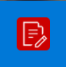
<figcaption>The Report Designer desktop icon</figcaption>
</figure>
</div>

2. Wait for Report Designer to open. It is a Java application, so the first start takes longer than later ones.

<div align="center">
<figure>
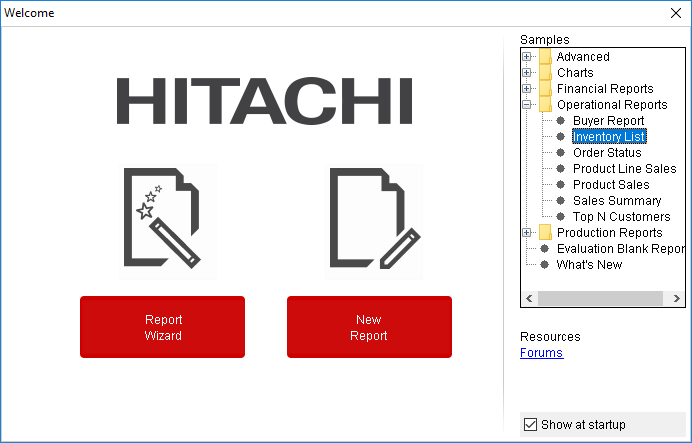
<figcaption>The Welcome tab, with the Samples tree on the right</figcaption>
</figure>
</div>

> **Success:** Checkpoint: the **Welcome** tab shows **Report Wizard** and **New Report** on the left, and the **Samples** tree on the right, with folders such as **Charts**, **Operational Reports** and **Production Reports**.

The parts of the **Welcome** tab:

| Part | What it does |
| --- | --- |
| **Report Wizard** | Builds a new report in four steps: a look and feel, a data source and query, a layout, and formatting |
| **New Report** | Opens an empty report that you design yourself, as every workshop in this course does |
| **Samples** | The sample reports that ship with Report Designer; double-click one to open it |
| **Resources** | A link to the community **Forums** |
| **Show at startup** | Clear it to start Report Designer without the **Welcome** tab |

To bring the **Welcome** tab back after you close it, select **Help > Welcome**.

### 2. The Inventory List

> **Note:**
>
> #### Open a sample and read the toolbars
>
> **Inventory List** is a grouped product report with conditional colors, a table of contents and parameters. It is the report you take apart in the rest of this workshop.

1. In the **Samples** tree, open the **Operational Reports** folder and double-click **Inventory List**. The report opens in a tab of its own, named **Inventory List**.

<div align="center">
<figure>
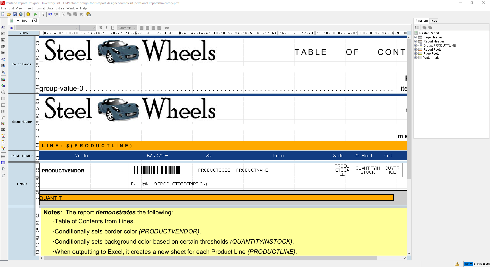
<figcaption>The Inventory List sample in design mode</figcaption>
</figure>
</div>

> **Success:** Checkpoint: the canvas shows the **Report Header**, **Group Header**, **Details Header** and **Details** bands down its left edge, and the **Structure** tab on the right lists **Master Report** with its bands.

2. Hover over each icon of the main toolbar, below the menu bar, to read its tooltip. Every icon is a shortcut to a menu item: **New**, **Open**, **Save**, **Publish**, **Add DataSources**, **Run**, **Select Objects**, **Undo**, **Redo**, **Cut**, **Copy**, **Paste**, **Delete** and **Field Selector**.

<div align="center">
<figure>
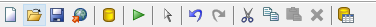
<figcaption>The main toolbar</figcaption>
</figure>
</div>

3. Look at the row of tabs above the canvas. Each report and each sub-report opens in its own tab; the open report's tab is highlighted. To close a report, select the **X** on its tab, or right-click the tab for more close options.
4. Look at the formatting toolbar below the tabs. The eye icon on its left switches to preview; the rest are font, size, bold, italic, underline, color and alignment controls for the selected element.

<div align="center">
<figure>
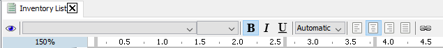
<figcaption>The formatting toolbar, with the preview eye on the left</figcaption>
</figure>
</div>

5. Select **Edit > Preferences**. The **Settings** dialog holds the date and time formats, the look and feel, the network settings, external tools and storage locations. One option worth knowing is **Display the index columns in the Report-Designer's field selectors**, which lets you refer to a data field by its column position as well as its name.
6. Select **Cancel** to close **Settings** without changing anything.

### 3. Preview the report

> **Note:**
>
> #### Preview
>
> Preview runs the report on real data inside Report Designer. **Inventory List** asks for its parameters first.

1. On the formatting toolbar, select the eye icon (**Preview**).

<div align="center">
<figure>
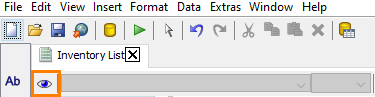
<figcaption>The Preview button</figcaption>
</figure>
</div>

> **Success:** Checkpoint: the report appears in preview, below its prompts: a product line list (several lines are selected by default), whether to show the bar section, and whether to show the notes.

2. On the preview toolbar, select the next-page arrow to move to the next page. The arrows page through the report; the magnifying glasses and the percentage box zoom.

<div align="center">
<figure>
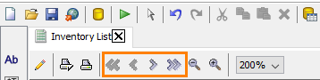
<figcaption>The page navigation buttons</figcaption>
</figure>
</div>

3. Page through the report and find each of these features. You build a report with the same features later in this course:

| Feature | Where it is |
| --- | --- |
| A graphic image and the date | The top of each product line |
| One section per product line | The **PRODUCTLINE** group |
| A background color on **On Hand** that follows the quantity: green, yellow or red | The `QUANTITYINSTOCK` field in the **Details** band |
| A bar under each product that shows the units in stock | The bar section in the **Details** band |
| The page number and the number of pages | The **Page Footer** |

4. On the preview toolbar, select the pencil icon (**Design**) to go back to design mode.

<div align="center">
<figure>
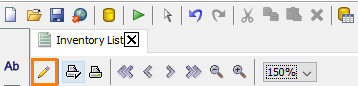
<figcaption>The Design button</figcaption>
</figure>
</div>

> **Under the hood:**
>
> #### Preview ran the report through the engine, twice
>
> Preview isn't a mock-up of the design. Report Designer handed the
> report to the Pentaho Reporting engine, the same code the server
> runs, which executed the query, then processed the rows in two
> passes. The first, the *pagination* pass, lays everything out to
> discover where pages break and what the group and report totals will
> be; the second prints the pages you paged through. That is how the
> footer can say "page 1 of 12" on page one: the total was known before
> anything was drawn.
>
> The prompts you saw first are the report's parameter definitions,
> rendered by the same parameter framework the User Console uses.
>
> **Why it matters:** what you preview is what publishes. There is no
> separate rendering path on the server to surprise you later, only
> a different output format.

### 4. Report bands

> **Note:**
>
> #### The bands
>
> The canvas is divided into *bands*, each printing at a different moment: once per report, once per page, once per group, or once per row. The band names run down the left edge of the canvas, and the selected band's name is highlighted.

<div align="center">
<figure>
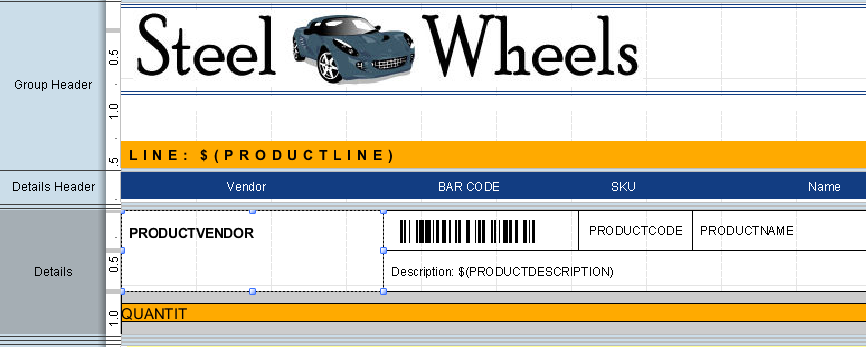
<figcaption>Band names run down the left edge of the canvas</figcaption>
</figure>
</div>

1. Select each band name on the left edge of the canvas in turn, and compare it with this table:

| Band | When it prints | In Inventory List |
| --- | --- | --- |
| **Page Header** | At the top of every page; on the first page, above the report header | Empty, with a height of 0 |
| **Report Header** | Once, at the start of the report | A table of contents, built by a report function |
| **Group Header** | At the start of each group | The logo, the title, and `LINE: $(PRODUCTLINE)` on a gold band |
| **Details Header** | Above the details of each group | The column labels: Vendor, Bar Code, SKU, Name, Scale, On Hand, Cost, MSRP |
| **Details** | Once for every row of data | The data fields, a description and the bar section |
| **Report Footer** | Once, at the end of the report | The notes and an index |
| **Page Footer** | At the bottom of every page | The page number and the number of pages |

<div align="center">
<figure>
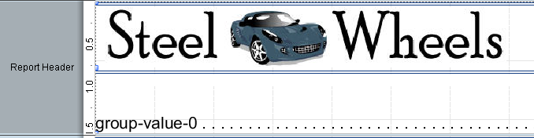
<figcaption>Report Header: the table of contents</figcaption>
</figure>
</div>

<div align="center">
<figure>
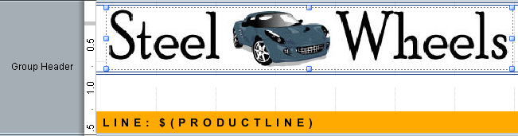
<figcaption>Group Header: one per product line</figcaption>
</figure>
</div>

<div align="center">
<figure>
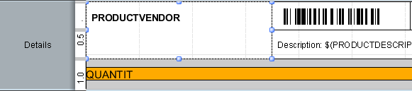
<figcaption>Details: printed once for each product</figcaption>
</figure>
</div>

<div align="center">
<figure>
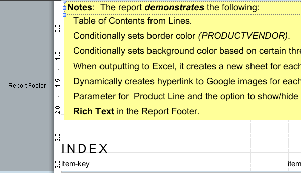
<figcaption>Report Footer: the notes and the index</figcaption>
</figure>
</div>

<div align="center">
<figure>
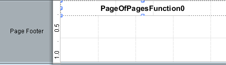
<figcaption>Page Footer: the page count function</figcaption>
</figure>
</div>

To resize a band, drag the divider line at its bottom edge. An element can't be dragged from one band to another: cut it (`Ctrl+X`) in the first band and paste it (`Ctrl+V`) in the second.

2. Drag the zoom percentage in the top left corner of the canvas toward the bottom right corner to zoom in, and toward the top left to zoom out. Zooming changes only your view, not the published report.
3. Double-click the zoom percentage to reset it to 100%.

<div align="center">
<figure>
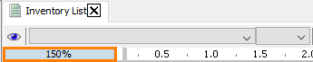
<figcaption>The zoom percentage: drag to zoom, double-click to reset</figcaption>
</figure>
</div>

### 5. Structure and Data

> **Note:**
>
> #### The Structure and Data panes
>
> The top right of the window has two tabs. **Structure** shows every element of the report as a tree; **Data** shows where the data comes from: the data sets, the functions, the environment fields and the parameters.

1. Open the **Structure** tab and expand **Master Report**.

<div align="center">
<figure>
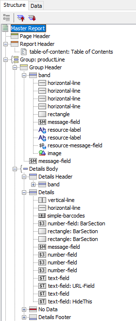
<figcaption>The Structure tab: every element, by band</figcaption>
</figure>
</div>

> **Success:** Checkpoint: under **Master Report** the tree lists **Page Header**, **Report Header**, **Group: productLine**, **Report Footer**, **Page Footer** and **Watermark**. Inside the group are its **Group Header** and the **Details Body**, which holds **Details Header**, **Details**, **No Data** and **Details Footer**.

What each part of the tree holds:

| Node | What it holds |
| --- | --- |
| **Master Report** | The top level; every band is listed under it |
| **Page Header**, **Report Header**, **Report Footer**, **Page Footer** | The elements of that band |
| **Group** | Each group you define, with its **Group Header** and **Group Footer**; the details are part of the innermost group |
| **Details Body** | **Details Header**, **Details**, **No Data** and **Details Footer** |
| **No Data** | What the report prints when the query returns no rows |
| **Watermark** | Content printed behind every page |

A band that is hidden on the canvas, such as **No Data** or **Watermark**, appears when you select it in the **Structure** tab and set its **hide-on-canvas** attribute to `false` on the **Attributes** tab. To add an element from the tree, right-click a band and select **Add Element**. To delete one, select it and press `Delete`, or right-click it and select **Delete**.

2. Open the **Data** tab and expand **Data Sets**, **Functions**, **Environment** and **Parameters**.

<div align="center">
<figure>
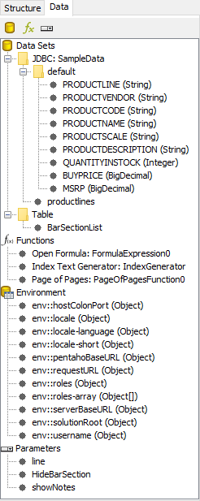
<figcaption>The Data tab: data sets, functions, environment and parameters</figcaption>
</figure>
</div>

> **Success:** Checkpoint: **Data Sets** holds **JDBC: SampleData**, whose query lists fields such as `PRODUCTLINE` and `QUANTITYINSTOCK`; **Parameters** holds `line`, `HideBarSection` and `showNotes`.

The three icons at the top of the **Data** tab add a data source, a function and a parameter, in that order. What each section holds:

| Section | What it holds |
| --- | --- |
| **Data Sets** | Every data source and its queries. To add a query to a data source, right-click it and select **Edit Datasource** |
| **Functions** | The calculations the report adds to its data: totals, page numbers, formulas |
| **Environment** | Values the Pentaho Server supplies when the report runs there, such as `env::username` and `env::roles` |
| **Parameters** | The prompts the reader answers before the report runs |

To delete a data source, a function or a parameter, select it and press `Delete`, or right-click it and select **Delete**.

### 6. Style and Attributes

> **Note:**
>
> #### The Style and Attributes panes
>
> The bottom right of the window shows the properties of the element selected in the **Structure** tab. **Style** holds how it looks: size and position, font, text, borders, page behavior. **Attributes** holds what it is and does: its field, its format, its links.

1. Open the **Structure** tab. Under **Details**, select the `number-field` whose field is `QUANTITYINSTOCK`. Its properties appear on the **Style** tab.

<div align="center">
<figure>
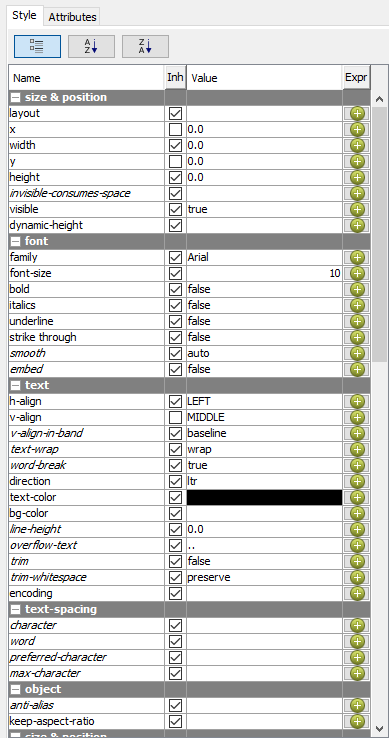
<figcaption>The Style tab, grouped by category</figcaption>
</figure>
</div>

The style groups are **size & position**, **font**, **text**, **text-spacing**, **object**, **padding**, **border**, **page-behavior**, **links**, **rotation** and **excel**. Some style properties, such as the font family and size, are also on the formatting toolbar.

2. At the top of the **Style** tab, select the **A-Z** sort button to list the properties alphabetically.
3. Find **bg-color (text)**. Its **Expr** column shows a pencil instead of a green plus: a formula sets the value. Select the pencil to open the formula.

<div align="center">
<figure>
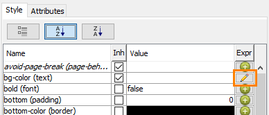
<figcaption>A pencil means a formula sets the property</figcaption>
</figure>
</div>

> **Success:** Checkpoint: the formula sets the background color from `QUANTITYINSTOCK`: green above 1,000, yellow above 500, and red above 0.

4. Select **Cancel** to close the formula without changing it.

> **Under the hood:**
>
> #### A style expression is evaluated per element, per row
>
> The pencil icon means the style key has a *formula* attached instead
> of a fixed value. Every time the engine lays out this element for a
> row of data it evaluates the expression (`[QUANTITYINSTOCK]` reads
> the current row) and uses the result as that instance's background
> color. The formula is OpenFormula, evaluated by Pentaho's LibFormula
> library.
>
> Any style key can carry one: color, font, visibility, height. The
> Structure pane shows *what* the report contains; the Style pane
> shows how each piece decides to look.
>
> **Why it matters:** conditional formatting is not a special feature
> bolted on. Every visual property is a value or a formula, so
> anything you can compute from the row, you can style by.

5. Open the **Attributes** tab. It lists the low-level properties of the selected element, grouped the same way and sortable the same way. Not every attribute applies to every element.

<div align="center">
<figure>
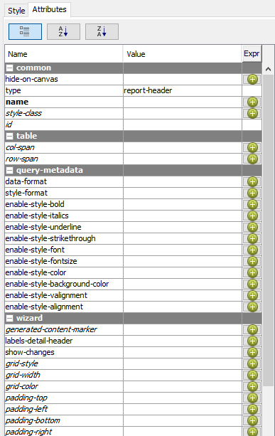
<figcaption>The Attributes tab; hide-on-canvas is in the common group</figcaption>
</figure>
</div>

You can't edit the **Style** or **Attributes** of a selected element while the **Data** tab has the focus. Open the **Structure** tab to see them again.

### 7. More samples

> **Note:**
>
> #### Three more samples
>
> Three samples show features you build later in this course: a chart, nested groups with a sparkline, and an invoice with a sub-report. Each opens from **Help > Sample Reports**.

**A bar chart**

1. Select **Help > Sample Reports > Charts > Bar**. The report holds one bar chart, **Product Line Sales Trend**: the sales of each product line for 2003, 2004 and 2005.
2. On the formatting toolbar, select the eye icon (**Preview**).

<div align="center">
<figure>
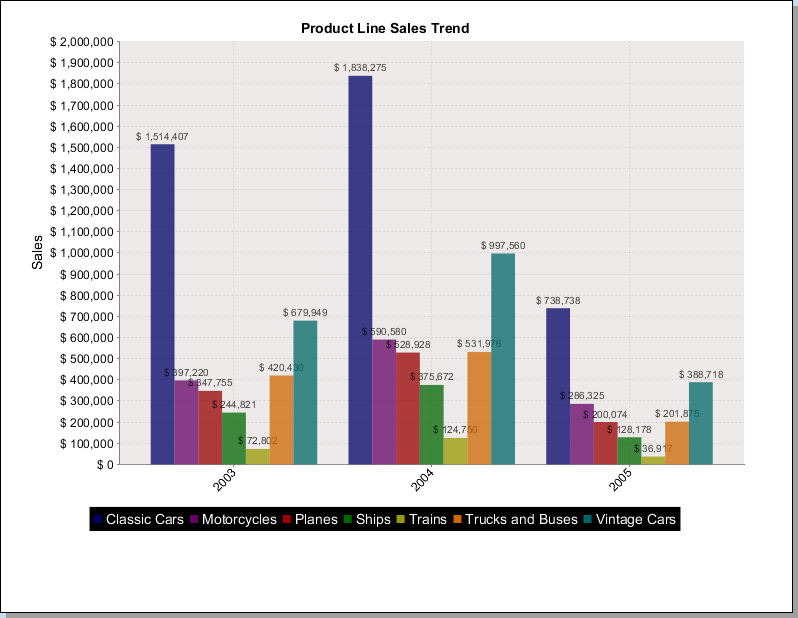
<figcaption>The Bar sample in preview</figcaption>
</figure>
</div>

> **Success:** Checkpoint: a chart titled **Product Line Sales Trend**, with a bar for each of the seven product lines in each of the three years, a value on each bar, and a legend.

3. Select the pencil icon (**Design**). On the **Data** tab, expand **Data Sets** and the **JDBC: SampleData** data source, and double-click **Query 1**.

The query reads the `PRODUCTS` and `ORDERFACT` tables, joined on `PRODUCTCODE`. It sums `TOTALPRICE` and `QUANTITYORDERED` and renames them `SALES` and `VOLUME`, and its `GROUP BY` returns one row per product line and year:

```sql
SELECT
     PRODUCTS.PRODUCTLINE,
     ORDERFACT.YEAR_ID,
     sum(ORDERFACT.TOTALPRICE) AS SALES,
     sum(ORDERFACT.QUANTITYORDERED) AS VOLUME
FROM
     PRODUCTS INNER JOIN ORDERFACT ON PRODUCTS.PRODUCTCODE = ORDERFACT.PRODUCTCODE
GROUP BY
     PRODUCTS.PRODUCTLINE,
     ORDERFACT.YEAR_ID
ORDER BY
     PRODUCTS.PRODUCTLINE ASC,
     ORDERFACT.YEAR_ID ASC
```

4. Select **Cancel** to close the data source without changing it.

> **Under the hood:**
>
> #### The chart in the header saw every row before the first page printed
>
> A chart element is a *chart expression* fed by a data-collector
> function. During the pagination pass the collector walks every row
> the query returned and builds a JFreeChart dataset from the columns
> you nominate: category, value, series. Only when the band that holds
> the chart is printed does the chart expression draw that dataset.
> That is why a chart can sit at the top of a report and still
> summarize data the engine hasn't "reached" yet: by the time the
> header prints, it has.
>
> The `SUM` and `GROUP BY` in the query mean the database did the
> aggregation and the chart received one row per product line and
> year: 21 rows instead of 2,996 order lines.
>
> **Why it matters:** aggregate in SQL when you can, and trust the
> two-pass engine to put summaries wherever the layout needs them:
> header, footer or group band.

**The Buyer Report**

5. Select **Help > Sample Reports > Operational Reports > Buyer Report**. It shows product facts grouped by product line and then by vendor.
6. Select the eye icon (**Preview**).

<div align="center">
<figure>
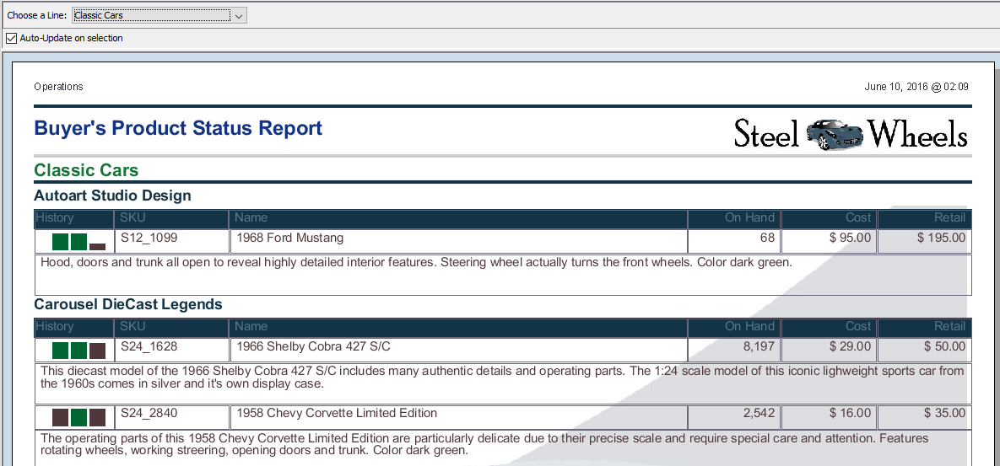
<figcaption>The Buyer Report: grouped by line, then by vendor</figcaption>
</figure>
</div>

> **Success:** Checkpoint: the **Buyer's Product Status Report**, with a **Choose a Line** prompt above it. Notice:
>
> * The page header holds a label and the date; the report header, a title and an image.
> * The details are grouped by product line, then by vendor.
> * The **History** column is a sparkline chart.
> * A watermark image sits behind the page.
> * The page footer holds the author's name and the page number.

7. Select the pencil icon (**Design**). Select elements in the **Structure** tab and read their settings on the **Style** and **Attributes** tabs. The sparkline is in the **Details** band.

<div align="center">
<figure>
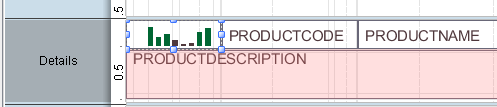
<figcaption>The sparkline in the Details band</figcaption>
</figure>
</div>

**The invoice**

8. Select **Help > Sample Reports > Production Reports > Invoice**. It prints one invoice per page, and the reader picks the customer.
9. Select the eye icon (**Preview**).

<div align="center">
<figure>
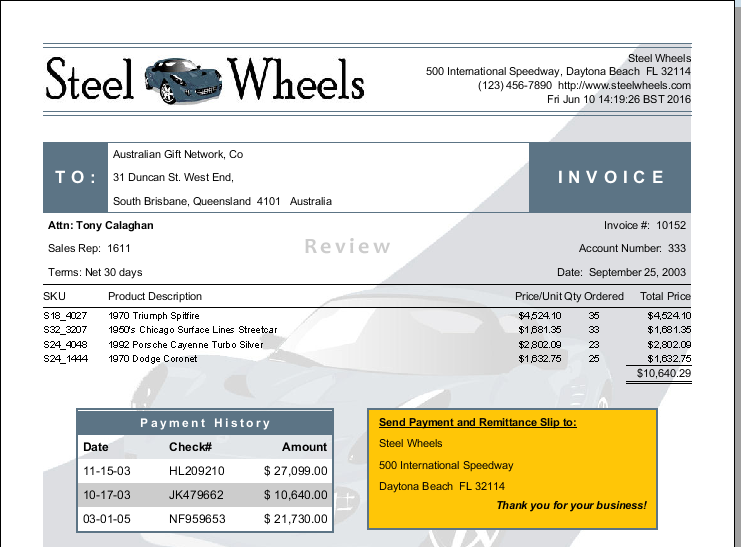
<figcaption>The Invoice sample: one invoice per page</figcaption>
</figure>
</div>

> **Success:** Checkpoint: each page is one invoice, with the order lines and their total, a **Payment History** table, and a remittance box.

10. Select the pencil icon (**Design**). The **Payment History** table is a sub-report: a report with its own query, placed inside this one. In the **Details** band, double-click the sub-report element to open it in a tab of its own.
11. Close the sample reports without saving them: right-click a report's tab and select **Close all tabs**.

::::

## Lab Files

Click a file to download. For `.prpt` files, **Open in Pentaho Report Designer** starts Report Designer with the report loaded.

This workshop tours the **Inventory List** sample from the **Welcome** tab. `Inventory List.prpt` below is not that sample: it is a Steel Wheels product report grouped by product line, of the kind you build in Modules 3 to 6.

[Inventory List.prpt](./files/Inventory%20List.prpt) <button data-launch="prd" data-path="files/Inventory List.prpt">Open in Pentaho Report Designer</button>
