# Connect to a JDBC Data Source

> **Warning:**
>
> #### Workshop - Connect to a JDBC Data Source
>
> Connect a new report to the Steel Wheels sample database and build, with the SQL Query Designer, the query that every report in Modules 4 to 7 uses: products, their order lines and their customers.
>
> **What you'll do**
>
> * Add a JDBC data source that uses the **SampleData (Hypersonic)** connection
> * Join three tables in the **SQL Query Designer**
> * Choose the columns and the sort order
> * Preview the rows and save the report
>
> **Prerequisites:** [Navigating Report Designer](../03-mod2-navigating-report-designer/guide.md); the Pentaho Server running, for its sample data
>
> **Estimated time:** 15 minutes

:::: tabs

### 1. Connect to SampleData

> **Note:**
>
> #### A JDBC data source
>
> A report reads its data through a *data source*: a connection plus one or more named queries. Report Designer ships ready-made connections to the Steel Wheels sample database, so there is nothing to type.

1. Start Report Designer with the **Start Pentaho Report Designer** button below, or from a terminal:

::: tabs

### Windows (PowerShell)

```powershell
Set-Location C:\Pentaho\design-tools\report-designer
.\report-designer.bat
```

### macOS / Linux

```bash
cd ~/Pentaho/design-tools/report-designer
./report-designer.sh
```

:::

<button data-launch="prd" data-path="">Start Pentaho Report Designer</button>

2. Select **File > New** (`Ctrl+N`). An empty report opens in a new tab.
3. Select **Data > Add Datasource > JDBC**.

<div align="center">
<figure>
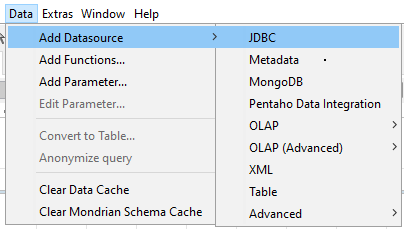
<figcaption>Data > Add Datasource > JDBC</figcaption>
</figure>
</div>

The **Add DataSources** icon on the main toolbar, a yellow cylinder, opens the same list.

<div align="center">
<figure>
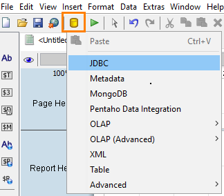
<figcaption>The same list from the toolbar</figcaption>
</figure>
</div>

4. In the **JDBC Data Source** dialog, under **Connections**, select **SampleData (Hypersonic)**.

<div align="center">
<figure>
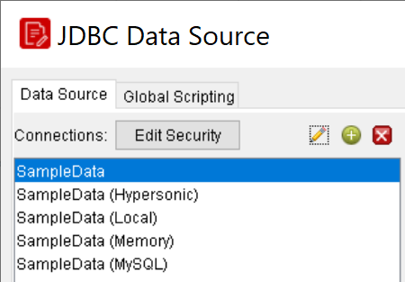
<figcaption>The ready-made connections; the screenshot has the first one selected</figcaption>
</figure>
</div>

> **Under the hood:**
>
> #### SampleData is a connection definition that travels inside the report
>
> What you picked is a saved connection: a JDBC driver class, a URL
> and credentials. When you save the report those go into the bundle
> as `datasources/sql-ds.xml`, alongside every query you write against
> them. At run time the engine's SQL data factory loads the driver,
> opens the connection, runs the named query and closes it again, in
> Report Designer's preview and on the server alike.
>
> The alternative access type, JNDI, stores only a *name*. Report
> Designer resolves it locally from `simple-jndi/default.properties`;
> the server resolves the same name against its own configured data
> sources, so one report can point at the test database on your
> laptop and production on the server without editing.
>
> **Why it matters:** the report is self-describing about where its
> data comes from. Prefer JNDI for anything you will publish, so the
> credentials live on the server, not in a file that gets emailed
> around.

### 2. Build the query

> **Note:**
>
> #### The SQL Query Designer
>
> The **SQL Query Designer** writes the `SELECT` statement for you as you pick tables and columns. You join three tables: `PRODUCTS`, `ORDERFACT` (one row per order line) and `CUSTOMER_W_TER` (customers with their sales territory).

1. To the right of **Available Queries**, select the green plus (**Add Query**). Report Designer adds a query named `Query 1`.
2. Keep `Query 1` in **Query Name**: the later workshops refer to the query by that name.
3. Above the right-hand corner of the **Query** box, select the pencil icon. The **SQL Query Designer** opens.

<div align="center">
<figure>
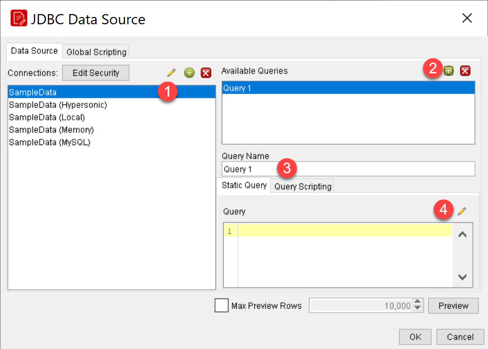
<figcaption>The connection, Add Query, the query name and the pencil that opens the designer</figcaption>
</figure>
</div>

4. Check that the schema list at the lower left shows `PUBLIC`, and double-click `PRODUCTS` in the table list. The table appears in the workspace on the right, with all its columns selected.

<div align="center">
<figure>
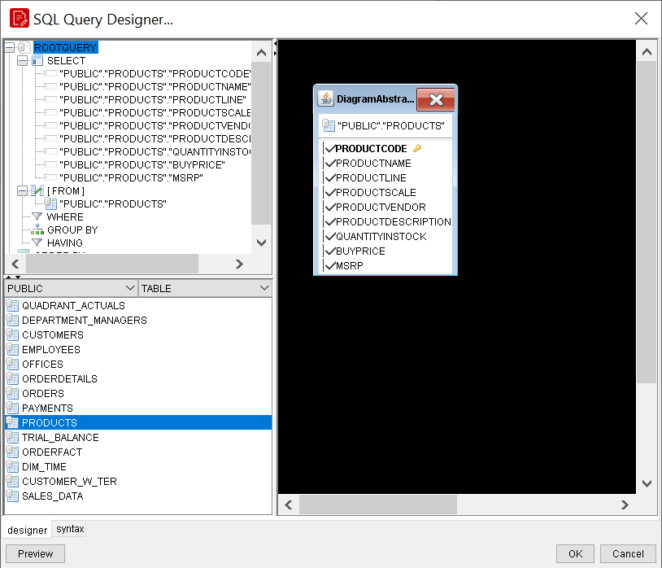
<figcaption>PRODUCTS in the workspace, every column selected</figcaption>
</figure>
</div>

5. Double-click `ORDERFACT`. The designer joins it to `PRODUCTS` on `PRODUCTCODE`: a line between the tables with a red square on it.

<div align="center">
<figure>
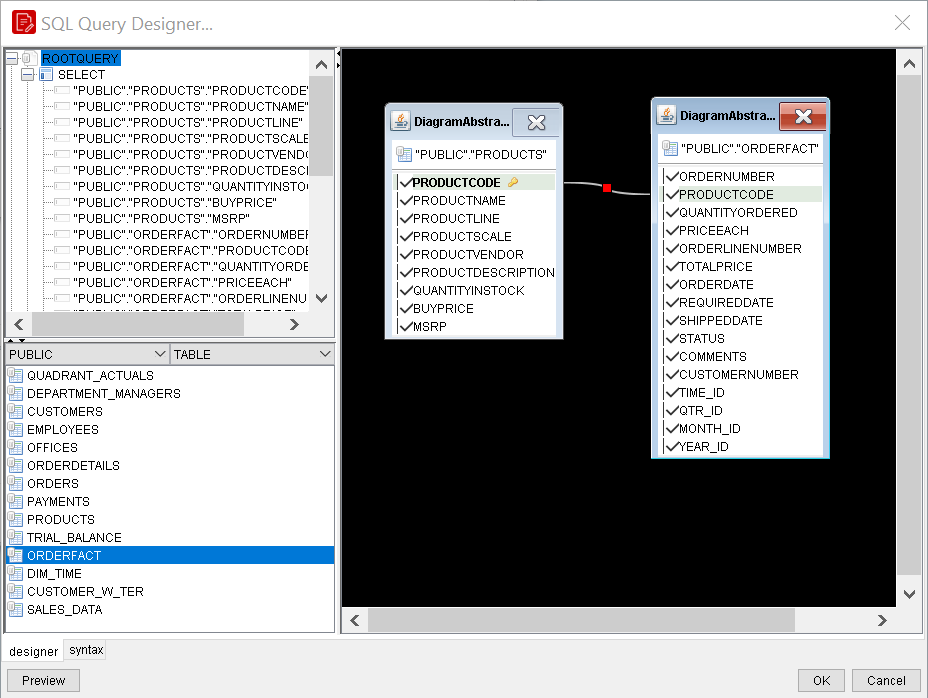
<figcaption>The designer joins PRODUCTS and ORDERFACT on PRODUCTCODE</figcaption>
</figure>
</div>

6. Double-click the red square on the join line. The **join.edit** dialog shows the condition `"PUBLIC"."PRODUCTS"."PRODUCTCODE" = "PUBLIC"."ORDERFACT"."PRODUCTCODE"`, with neither **all rows from** option selected: an inner join.

<div align="center">
<figure>
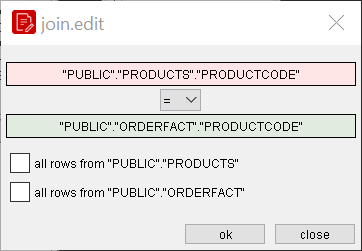
<figcaption>The join condition; both check boxes cleared means an inner join</figcaption>
</figure>
</div>

7. Select **close**.
8. Double-click `CUSTOMER_W_TER`. It appears in the workspace without a join.

<div align="center">
<figure>
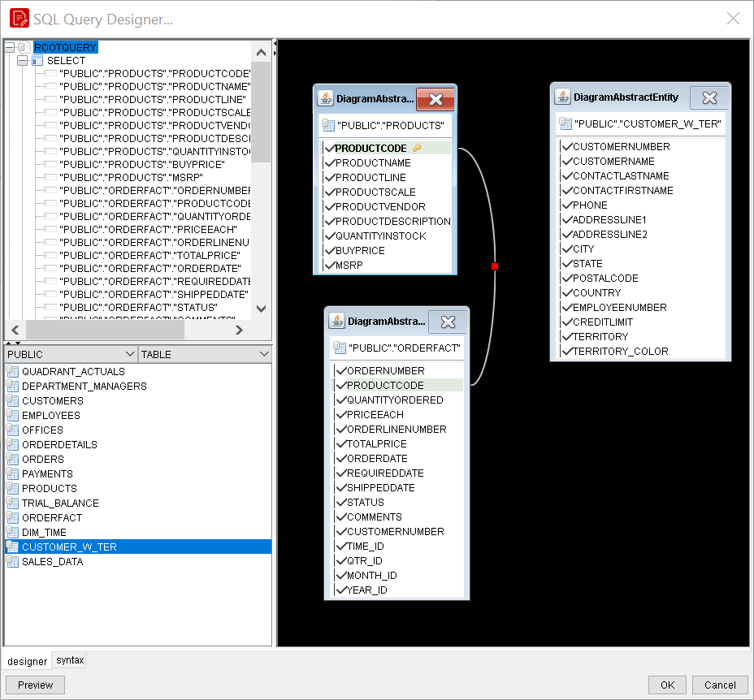
<figcaption>CUSTOMER_W_TER added, not joined yet</figcaption>
</figure>
</div>

9. Drag `CUSTOMERNUMBER` in `CUSTOMER_W_TER` onto `CUSTOMERNUMBER` in `ORDERFACT`. A second join line appears. You can join any two tables this way: drag the column of one onto the matching column of the other.

<div align="center">
<figure>
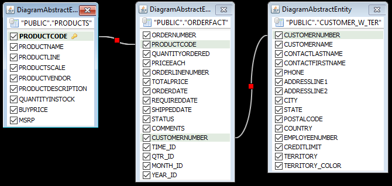
<figcaption>ORDERFACT joined to CUSTOMER_W_TER on CUSTOMERNUMBER</figcaption>
</figure>
</div>

10. In `PRODUCTS`, clear `PRODUCTDESCRIPTION`.

<div align="center">
<figure>
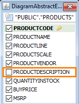
<figcaption>PRODUCTDESCRIPTION cleared</figcaption>
</figure>
</div>

11. Select the `"PUBLIC"."ORDERFACT"` heading of the `ORDERFACT` table and, in the menu that opens, select **deselect all**.

<div align="center">
<figure>
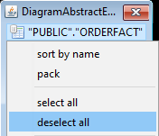
<figcaption>deselect all clears every column of the table</figcaption>
</figure>
</div>

12. In `ORDERFACT`, select `ORDERNUMBER`, `QUANTITYORDERED` and `PRICEEACH`.

<div align="center">
<figure>
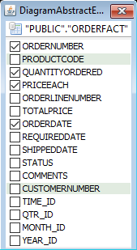
<figcaption>The ORDERFACT columns; leave ORDERDATE cleared, unlike the screenshot</figcaption>
</figure>
</div>

13. In `CUSTOMER_W_TER`, select **deselect all** the same way, then select `CUSTOMERNAME` and `TERRITORY`.

> **Success:** Checkpoint: **SELECT**, in the top left pane, lists 13 columns: eight from `PRODUCTS` (`PRODUCTCODE`, `PRODUCTNAME`, `PRODUCTLINE`, `PRODUCTSCALE`, `PRODUCTVENDOR`, `QUANTITYINSTOCK`, `BUYPRICE`, `MSRP`), three from `ORDERFACT` (`ORDERNUMBER`, `QUANTITYORDERED`, `PRICEEACH`) and two from `CUSTOMER_W_TER` (`CUSTOMERNAME`, `TERRITORY`).

14. Open the **syntax** tab at the bottom of the designer to read the statement it has written, then open the **designer** tab again.

> **Under the hood:**
>
> #### The Query Designer is a SQL text generator, nothing more
>
> Every click has been rewriting the statement in the top-left pane.
> The join path appeared because the designer asked the database's
> JDBC metadata for foreign keys between PRODUCTS and ORDERFACT; the
> join you drew by hand became the same kind of condition. Identifiers
> come out schema-qualified and quoted (`"PUBLIC"."PRODUCTS"."PRODUCTLINE"`)
> so they survive case-sensitive databases.
>
> Only the text is saved. The engine never sees the diagram, and you
> can edit the SQL directly at any point: the designer is a
> convenience, not a layer.
>
> **Why it matters:** anything your database can express (window
> functions, CTEs, vendor syntax) works here, because the query goes
> to the driver exactly as written.

### 3. Sort, preview and save

> **Note:**
>
> #### The sort order
>
> Sort the rows by product line first: the next workshop groups the report by product line, and a group needs its rows sorted by the group's field.

1. In the top left pane, under **SELECT**, right-click `"PUBLIC"."PRODUCTS"."PRODUCTLINE"` and select **add to order-by**.

<div align="center">
<figure>
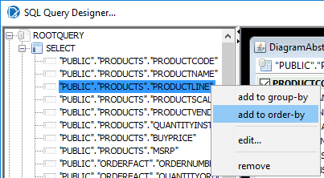
<figcaption>add to order-by</figcaption>
</figure>
</div>

2. Under **ORDER BY**, double-click the new entry. The **order.edit** dialog shows its direction: keep `ASC` and select **OK**.

<div align="center">
<figure>
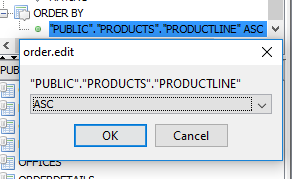
<figcaption>The direction of each sort column: ASC or DESC</figcaption>
</figure>
</div>

3. Add `"PUBLIC"."CUSTOMER_W_TER"."CUSTOMERNAME"` and then `"PUBLIC"."CUSTOMER_W_TER"."TERRITORY"` to the order the same way.

<div align="center">
<figure>
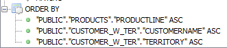
<figcaption>The finished sort order</figcaption>
</figure>
</div>

> **Success:** Checkpoint: **ORDER BY** lists `PRODUCTLINE`, `CUSTOMERNAME` and `TERRITORY`, in that order, each `ASC`.

4. Select **OK** to close the **SQL Query Designer**. The **Query** box now holds the statement:

```sql
SELECT
     "PUBLIC"."PRODUCTS"."PRODUCTCODE",
     "PUBLIC"."PRODUCTS"."PRODUCTNAME",
     "PUBLIC"."PRODUCTS"."PRODUCTLINE",
     "PUBLIC"."PRODUCTS"."PRODUCTSCALE",
     "PUBLIC"."PRODUCTS"."PRODUCTVENDOR",
     "PUBLIC"."PRODUCTS"."QUANTITYINSTOCK",
     "PUBLIC"."PRODUCTS"."BUYPRICE",
     "PUBLIC"."PRODUCTS"."MSRP",
     "PUBLIC"."ORDERFACT"."ORDERNUMBER",
     "PUBLIC"."ORDERFACT"."QUANTITYORDERED",
     "PUBLIC"."ORDERFACT"."PRICEEACH",
     "PUBLIC"."CUSTOMER_W_TER"."CUSTOMERNAME",
     "PUBLIC"."CUSTOMER_W_TER"."TERRITORY"
FROM
     "PUBLIC"."PRODUCTS" INNER JOIN "PUBLIC"."ORDERFACT" ON "PUBLIC"."PRODUCTS"."PRODUCTCODE" = "PUBLIC"."ORDERFACT"."PRODUCTCODE"
     INNER JOIN "PUBLIC"."CUSTOMER_W_TER" ON "PUBLIC"."ORDERFACT"."CUSTOMERNUMBER" = "PUBLIC"."CUSTOMER_W_TER"."CUSTOMERNUMBER"
ORDER BY
     "PUBLIC"."PRODUCTS"."PRODUCTLINE" ASC,
     "PUBLIC"."CUSTOMER_W_TER"."CUSTOMERNAME" ASC,
     "PUBLIC"."CUSTOMER_W_TER"."TERRITORY" ASC
```

If the join between `PRODUCTS` and `ORDERFACT` appears twice, joined with `AND`, the result is the same.

5. Below the **Query** box, select **Preview**.

> **Success:** Checkpoint: the preview lists the rows, product line `Classic Cars` first, with the 13 columns of the query. The query returns one row for each of the 2,996 order lines in `ORDERFACT`.

6. Close the preview window.
7. Select **OK** to close the **JDBC Data Source** dialog. On the **Data** tab, **Data Sets** now holds the data source, with `Query 1` and its fields.
8. Select **File > Save As** and save the report as `Demo - jdbc sql query.prpt` in a folder of your own. This course uses `Documents\RD-Workshop` for every report you build.

> **Under the hood:**
>
> #### Preview pulled the whole result into memory, in the order the database returned it
>
> Preview ran the query and read the result set into an in-memory
> table model, which is what the engine iterates (twice, as you'll
> see) when the report runs. Nothing is re-sorted afterwards. The
> `ORDER BY` you built is therefore not cosmetic: the groups you
> will add in the next module are detected by watching a field's value
> change from one row to the next, and that only works on sorted rows.
>
> The query name matters too. The report references its data by that
> name, and a sub-report or parameter list can pick any query in the
> data source by it.
>
> **Why it matters:** sort in the query, outermost group first, and
> the layout will follow. Get the order wrong and the report won't
> error; it will show the same group header several times.

To connect to other kinds of data source, see the [Data Sources Reference](../29-ref-data-sources/guide.md).

::::

## Lab Files

Click a file to download. For `.prpt` files, **Open in Pentaho Report Designer** starts Report Designer with the report loaded.

### Solution <!-- no-step -->

The finished report for this lab: the **SampleData (Hypersonic)** data source and `Query 1`, with no layout yet. Open it alongside your own to compare.

[Training Demo Report 3 jdbc sql query.prpt](./files/Training%20Demo%20Report%203%20jdbc%20sql%20query.prpt) <button data-launch="prd" data-path="files/Training Demo Report 3 jdbc sql query.prpt">Open in Pentaho Report Designer</button>

The same query, with the `PRODUCTS` to `ORDERFACT` join written once:

[Training Demo Report 3 sql query.prpt](./files/Training%20Demo%20Report%203%20sql%20query.prpt) <button data-launch="prd" data-path="files/Training Demo Report 3 sql query.prpt">Open in Pentaho Report Designer</button>

A query on a Metadata data source instead of SQL: the products of the `BV_INVENTORY` model in the sample `metadata.xmi`. The [Data Sources Reference](../29-ref-data-sources/guide.md) shows how to connect one:

[Training Demo Report 3-1 metadata sql query.prpt](./files/Training%20Demo%20Report%203-1%20metadata%20sql%20query.prpt) <button data-launch="prd" data-path="files/Training Demo Report 3-1 metadata sql query.prpt">Open in Pentaho Report Designer</button>
