# Adding Data Elements and Report Groups

> **Warning:**
>
> #### Workshop - Adding Data Elements and Report Groups
>
> Turn the query from the last workshop into a report: four columns of product data with labels above them, grouped by product line.
>
> **What you'll do**
>
> * Place data fields in the **Details** band
> * Line the elements up with guides and the alignment tools
> * Add column labels in the **Details Header** band
> * Group the report by product line, with a heading for each group
>
> **Prerequisites:** [Connect to a JDBC Data Source](../05-mod3-connect-jdbc/guide.md) and its report, `Demo - jdbc sql query.prpt`
>
> **Estimated time:** 20 minutes

:::: tabs

### 1. Data elements

> **Note:**
>
> #### Data elements
>
> Drag a field from the **Data** tab onto the **Details** band and it becomes an element that prints once for every row: a text field for text, a number field for numbers. You add four: `PRODUCTCODE`, `PRODUCTNAME`, `QUANTITYINSTOCK` and `BUYPRICE`.

1. Start Report Designer with the **Start Pentaho Report Designer** button below, or from a terminal:

::: tabs

### Windows (PowerShell)

```powershell
Set-Location C:\Pentaho\design-tools\report-designer
.\report-designer.bat
```

### macOS / Linux

```bash
cd ~/Pentaho/design-tools/report-designer
./report-designer.sh
```

:::

<button data-launch="prd" data-path="">Start Pentaho Report Designer</button>

2. Select **File > Open** (`Ctrl+O`) and open `Demo - jdbc sql query.prpt` from your workshop folder, `Documents\RD-Workshop`.
3. Select **File > Save As** and save it as `Demo - data elements.prpt` in the same folder, so the report from the last workshop stays as it was.
4. Open the **Data** tab and expand **Data Sets**, the data source and `Query 1`.
5. Drag `PRODUCTCODE` onto the top left corner of the **Details** band. Its exact place doesn't matter yet: you align the elements in the next part.

<div align="center">
<figure>
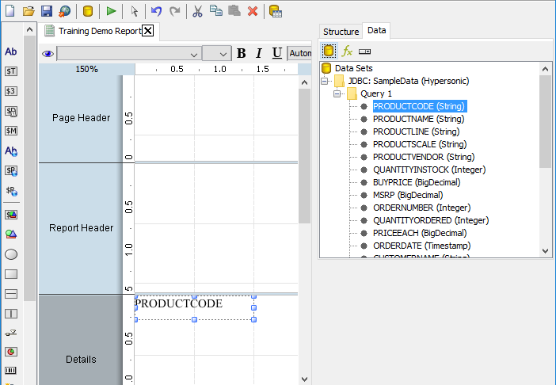
<figcaption>PRODUCTCODE dragged from the Data tab to the Details band</figcaption>
</figure>
</div>

6. Drag `PRODUCTNAME` onto the **Details** band, to the right of `PRODUCTCODE`.
7. On the main toolbar, select **Field Selector**, the last icon. The **Fields ..** palette opens: the same fields, in a window you can keep next to the canvas.

<div align="center">
<figure>
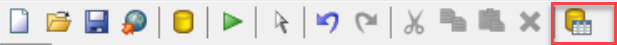
<figcaption>The Field Selector icon</figcaption>
</figure>
</div>

8. From the **Fields ..** palette, drag `QUANTITYINSTOCK` onto the **Details** band, to the right of `PRODUCTNAME`.

<div align="center">
<figure>
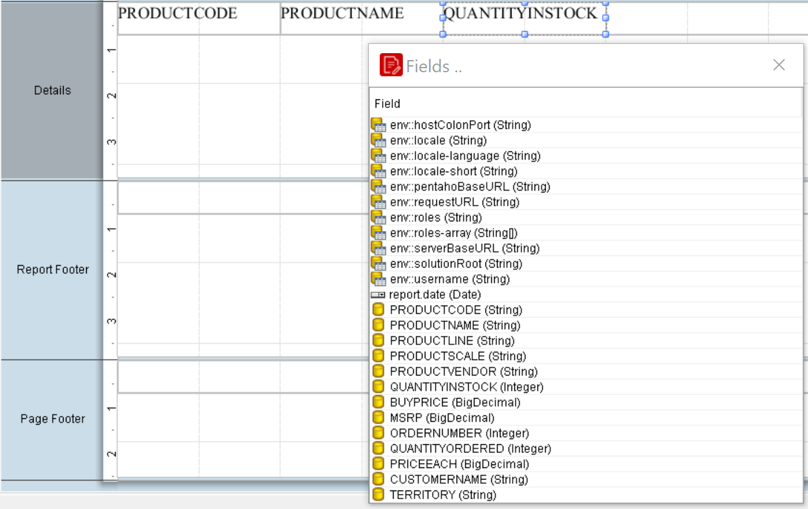
<figcaption>The Fields palette also lists the environment fields and report.date</figcaption>
</figure>
</div>

9. Drag `BUYPRICE` onto the **Details** band, to the right of `QUANTITYINSTOCK`.
10. Close the **Fields ..** palette.

> **Success:** Checkpoint: the **Details** band holds four elements in a row: `PRODUCTCODE`, `PRODUCTNAME`, `QUANTITYINSTOCK` and `BUYPRICE`. In the **Structure** tab, under **Details**, the first two are `text-field` elements and the last two `number-field` elements.

### 2. Align the elements

> **Note:**
>
> #### Guides and alignment
>
> Elements in a band don't flow: each sits exactly where you put it. Guides, the grid and alignment hints help you line them up. The column edges in this report are at 1.25, 3.75 and 5.25 inches.

1. Open the **View** menu and check that **Grids > Show**, **Grids > Snap**, **Guides > Show Guides** and **Element Alignment Hints** are selected. Select any that are not.

<div align="center">
<figure>
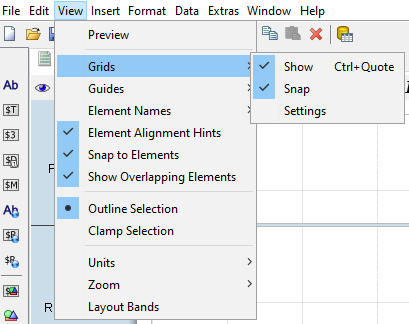
<figcaption>Grids, snap and alignment hints on</figcaption>
</figure>
</div>

2. Drag the zoom percentage in the top left corner of the canvas toward the bottom right until it shows 175%.

<div align="center">
<figure>
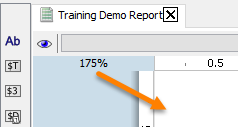
<figcaption>Drag the zoom percentage to zoom in</figcaption>
</figure>
</div>

3. Click the top ruler at 1.25 inches (3 cm). A vertical guide appears there.

<div align="center">
<figure>
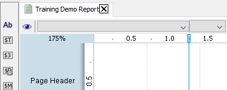
<figcaption>A guide at 1.25 inches</figcaption>
</figure>
</div>

4. Add guides at 3.75 inches (9.5 cm) and 5.25 inches (13.5 cm) the same way.
5. Drag `PRODUCTNAME` to the top of the **Details** band, with its left edge on the 1.25-inch guide. The guide holds the element as you drop it.

<div align="center">
<figure>
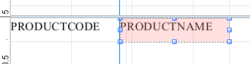
<figcaption>PRODUCTNAME on the first guide</figcaption>
</figure>
</div>

6. Drag the handles of each element so that it fills the space between its guides, as in this table. Each element is 20 points (about 0.28 inch) high.

| Element | Left edge | Right edge |
| --- | --- | --- |
| `PRODUCTCODE` | 0 | 1.25 in |
| `PRODUCTNAME` | 1.25 in | 3.75 in |
| `QUANTITYINSTOCK` | 3.75 in | 5.25 in |
| `BUYPRICE` | 5.25 in | 6.5 in, the right edge of the band |

7. On the main toolbar, select **Select Objects**, the arrow.

<div align="center">
<figure>
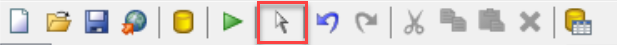
<figcaption>Select Objects</figcaption>
</figure>
</div>

8. On the canvas, drag from a point left of `PRODUCTCODE` to the right until all four elements of the **Details** band are selected.
9. Right-click one of the selected elements and select **Alignment > Top**. The four elements move to the same top edge.

<div align="center">
<figure>
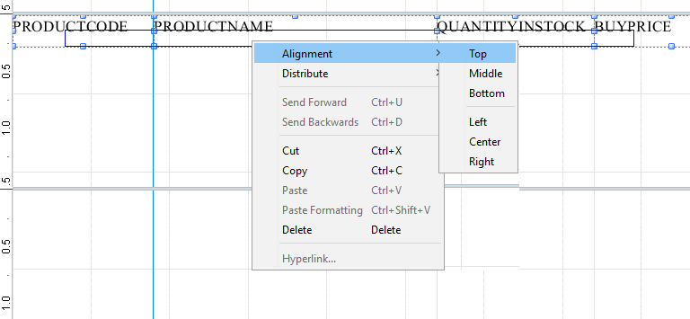
<figcaption>Alignment > Top on the selected elements</figcaption>
</figure>
</div>

10. On the formatting toolbar, select the eye icon (**Preview**).

<div align="center">
<figure>
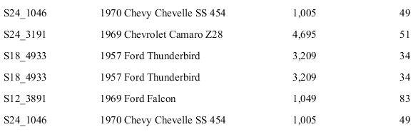
<figcaption>Four aligned columns; a product repeats once for each order line</figcaption>
</figure>
</div>

> **Success:** Checkpoint: four aligned columns of data, Classic Cars products first. The same product appears on several rows: the query returns one row for each order line, not one for each product.

11. Select the pencil icon (**Design**).

> **Under the hood:**
>
> #### A band is a canvas of absolutely positioned elements
>
> Each field you dropped became an element with an x, y, width and
> height in points (1/72 of an inch), saved in the bundle's
> `layout.xml`. The Details band is printed once per row: the engine
> stamps the band at the current vertical position, fills every element
> from that row, advances by the band's height and repeats. Elements
> don't flow around each other, which is why alignment is your job,
> and why the guides, grid and snap exist. They are design-time aids;
> nothing about them is saved into the output.
>
> **Why it matters:** pixel-exact layout is what makes PDF and print
> output predictable. Set the band height and element positions once
> and every row, on every page, lands in the same place.

### 3. Column labels

> **Note:**
>
> #### The Details Header band
>
> The **Details Header** band prints above the details of each group: the place for column labels. A new report hides it on the canvas until you show it.

1. In the **Structure** tab, expand **Group** and **Details Body**, and select **Details Header**.
2. On the **Attributes** tab, in the **common** group, set **hide-on-canvas** to `False`. The **Details Header** band appears on the canvas, 1 inch high.

<div align="center">
<figure>
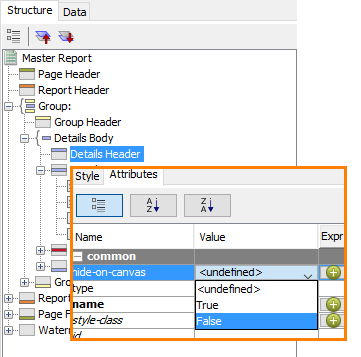
<figcaption>hide-on-canvas set to False shows the band</figcaption>
</figure>
</div>

3. Drag the divider line at the bottom of the **Details Header** band up until the band is about 0.5 inch high.

<div align="center">
<figure>
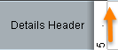
<figcaption>Drag the divider to make the band shorter</figcaption>
</figure>
</div>

4. From the palette on the left of the canvas, drag a **label** onto the **Details Header** band, directly above `PRODUCTCODE`.

<div align="center">
<figure>
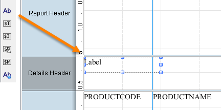
<figcaption>The label icon, Ab, at the top of the palette</figcaption>
</figure>
</div>

5. Resize the label to the width of `PRODUCTCODE`, from the left edge to the 1.25-inch guide.

<div align="center">
<figure>
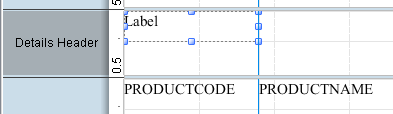
<figcaption>The label as wide as the field below it</figcaption>
</figure>
</div>

6. With the label selected, open the **Attributes** tab and select the **...** button in the **value** row. In the **Edit Property** dialog, enter `Product Code` and select **OK**.

<div align="center">
<figure>
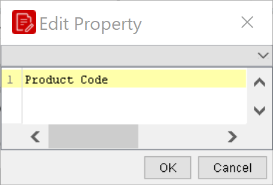
<figcaption>The label's text</figcaption>
</figure>
</div>

7. Add three more labels the same way, each above its field and as wide as it: `Product Name`, `Quantity in Stock` and `Buy Price`.
8. Select **Preview**.

<div align="center">
<figure>
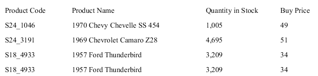
<figcaption>Column labels above the data</figcaption>
</figure>
</div>

> **Success:** Checkpoint: the labels **Product Code**, **Product Name**, **Quantity in Stock** and **Buy Price** print above their columns.

9. Select **Design**, and save the report (`Ctrl+S`).

### 4. Group by product line

> **Note:**
>
> #### Groups
>
> A group splits the report into sections by the value of a field, with a **Group Header** and a **Group Footer** band for each section. You group by `PRODUCTLINE` and print the product line at the top of each section.

1. In the **Structure** tab, right-click **Group** and select **Add Group**.

<div align="center">
<figure>
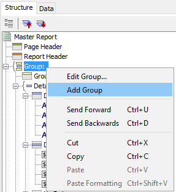
<figcaption>Add Group</figcaption>
</figure>
</div>

2. In the **Edit Group** dialog, set **Name** to `Product Line`.
3. In **Available Fields**, select `PRODUCTLINE`, then select the right arrow to move it to **Selected Fields**.

<div align="center">
<figure>
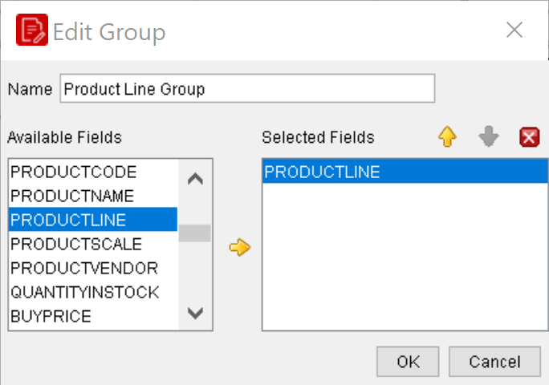
<figcaption>PRODUCTLINE in Selected Fields; name the group Product Line, not as shown</figcaption>
</figure>
</div>

4. Select **OK**.

> **Success:** Checkpoint: a **Group Header** and a **Group Footer** band appear on the canvas, around the **Details Header** and **Details** bands. In the **Structure** tab, the new group sits inside the first **Group**.

5. From the palette, drag a **message** element onto the top left corner of the **Group Header** band.

<div align="center">
<figure>
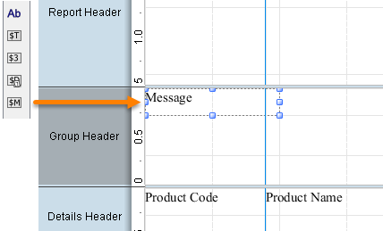
<figcaption>The message element, $M on the palette</figcaption>
</figure>
</div>

> **Under the hood:**
>
> #### A group is a value change in sorted rows
>
> The engine doesn't gather rows by product line. It reads rows in
> the order the query returned them and compares `PRODUCTLINE` on each
> row with the one before; when the value changes it prints the Group
> Footer for the old value, then the Group Header for the new one, and
> carries on. The bundle records nothing more than
> `group-fields="PRODUCTLINE"`.
>
> That is why the query sorts by `PRODUCTLINE` first: unsorted rows
> produce a "group" every time the value flips back, and the engine
> cannot tell the difference.
>
> **Why it matters:** grouping costs nothing at any volume (no
> buffering, no second query) provided the ORDER BY matches the group
> order. Nested groups work the same way, outermost sort key first.

6. With the message selected, open the **Attributes** tab and select the **...** button in the **value** row. In the **Edit Property** dialog, enter `Product Line: $(PRODUCTLINE)` and select **OK**.

<div align="center">
<figure>
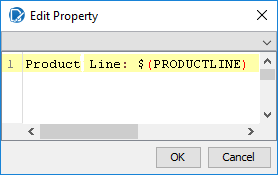
<figcaption>The message text, with the field in $( )</figcaption>
</figure>
</div>

7. Resize the message element to about 3 inches wide, keeping it at the top left of the band.
8. Drag the bottom of the **Group Header** band up until the band is about 0.5 inch high.

<div align="center">
<figure>
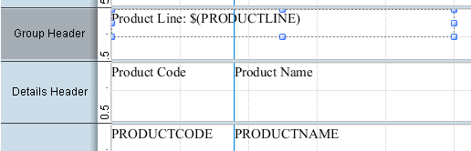
<figcaption>The message in the Group Header band</figcaption>
</figure>
</div>

9. With the message selected, on the formatting toolbar, select **Bold** and set the font size to `12`.
10. Select **Preview**.

> **Success:** Checkpoint: each product line starts with a bold heading, the first one `Product Line: Classic Cars`, and the column labels repeat under each heading.

11. Select **Design**, and save the report (`Ctrl+S`).

> **Under the hood:**
>
> #### A message field is a template, filled in each time its band prints
>
> `Product Line: $(PRODUCTLINE)` is a pattern. Whenever the Group
> Header band is laid out, the engine resolves each `$( )` reference
> against the current row and substitutes the value, so the header
> for Classic Cars says Classic Cars, and the next one says Motorcycles,
> from one element. The syntax also takes a type and a format:
> `$(ORDERDATE, date, dd MMM yyyy)` or `$(TOTAL, number, #,##0.00)`,
> and a message can mix several references with literal text.
>
> **Why it matters:** labels that carry data are one element, not a
> label plus a field plus alignment work, and they reformat with the
> pattern, so a date column never shows a raw timestamp by accident.

### 5. A page per group

> **Note:**
>
> #### Page breaks
>
> A group's **pagebreak-after** style ends the page after each of its groups, so each product line starts on a new page. Try it, then set it back: the solution and the later workshops keep the product lines on continuous pages.

1. In the **Structure** tab, expand the first **Group** and its **Group Body**, and select the **Product Line** group inside it.

<div align="center">
<figure>
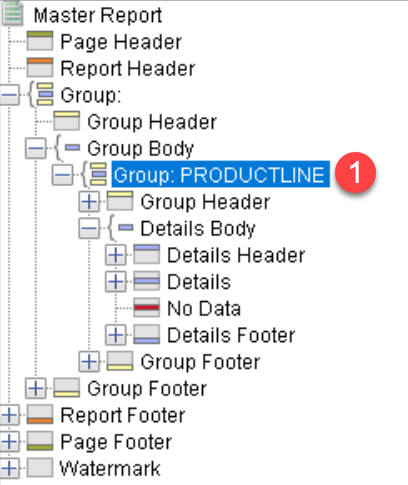
<figcaption>The product line group, inside the first Group</figcaption>
</figure>
</div>

2. On the **Style** tab, in the **page-behavior** group, set **pagebreak-after** to `True`.

<div align="center">
<figure>
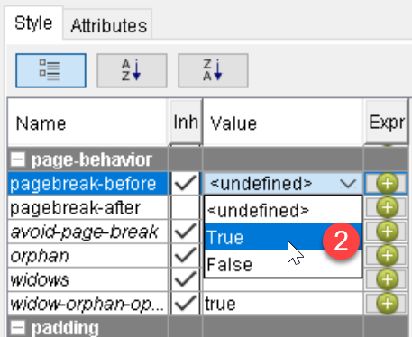
<figcaption>The page-behavior group; the screenshot sets pagebreak-before, the row above pagebreak-after</figcaption>
</figure>
</div>

3. Select **Preview**, and page through the report.

> **Success:** Checkpoint: each product line starts on a new page.

4. Select **Design**.

> **Under the hood:**
>
> #### pagebreak-after is a layout instruction; each exporter interprets it
>
> Setting `pagebreak-after` on the group tells the pagination pass to
> end the page once that group's footer has printed. Pageable outputs
> (PDF, print, the preview) honor it literally. The Excel exporter has
> no pages, so it maps each page break to a new worksheet: one sheet
> per product line. HTML in single-page mode ignores page breaks
> altogether.
>
> This is the general rule for every output format: the engine
> produces one laid-out result, and each *output processor* (PDF,
> Excel, HTML, CSV) renders it the way that format can.
>
> **Why it matters:** design once for the page and you get sensible
> Excel and HTML for free; but preview in the format the user will
> actually receive before you promise how it looks.

5. Set **pagebreak-after** back to `<undefined>`.
6. Save the report (`Ctrl+S`).

::::

## Troubleshooting <!-- no-step -->

<details>
<summary>The same product line has several group headers</summary>

The rows aren't sorted by `PRODUCTLINE`. Double-click the data source on the **Data** tab, select `Query 1`, and check that its `ORDER BY` starts with `PRODUCTLINE`, as in [Connect to a JDBC Data Source](../05-mod3-connect-jdbc/guide.md).

</details>

## Lab Files

Click a file to download. For `.prpt` files, **Open in Pentaho Report Designer** starts Report Designer with the report loaded.

### Solution <!-- no-step -->

The finished report for this lab. Open it alongside your own to compare, or preview it to see the expected result.

[Training Demo Report 4 data elements.prpt](./files/Training%20Demo%20Report%204%20data%20elements.prpt) <button data-launch="prd" data-path="files/Training Demo Report 4 data elements.prpt">Open in Pentaho Report Designer</button>
