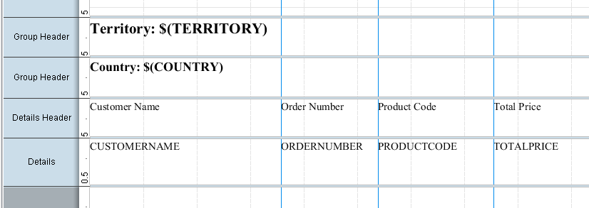

# Practice: Data Elements and Report Groups

> **Warning:**
>
> #### Workshop - Practice: Data Elements and Report Groups
>
> Build a grouped report on your own: customer orders, grouped by territory and then by country. The exercise repeats the steps of the guided workshops with less help.
>
> **What you'll do**
>
> * Create a report with its own JDBC query
> * Add and align four data elements, with labels above them
> * Group the report by territory, then by country, each with a heading
> * Check your result against the target layout
>
> **Prerequisites:** [Connect to a JDBC Data Source](../05-mod3-connect-jdbc/guide.md) and [Adding Data Elements and Report Groups](../07-mod4-adding-elements-groups/guide.md)
>
> **Estimated time:** 20 minutes

:::: tabs

### 1. The exercise report

> **Note:**
>
> #### A query for the exercise
>
> The exercise reads customers and their order lines: one row for each order line, sorted by territory, country and customer, the order of the groups you add.

1. Start Report Designer with the **Start Pentaho Report Designer** button below, or from a terminal:

::: tabs

### Windows (PowerShell)

```powershell
Set-Location C:\Pentaho\design-tools\report-designer
.\report-designer.bat
```

### macOS / Linux

```bash
cd ~/Pentaho/design-tools/report-designer
./report-designer.sh
```

:::

<button data-launch="prd" data-path="">Start Pentaho Report Designer</button>

2. Select **File > New** (`Ctrl+N`).
3. Select **Data > Add Datasource > JDBC**, and under **Connections** select **SampleData (Hypersonic)**.
4. To the right of **Available Queries**, select the green plus (**Add Query**), and keep the name `Query 1`.
5. Enter this statement in the **Query** box. You can also build it in the **SQL Query Designer**, as in [Connect to a JDBC Data Source](../05-mod3-connect-jdbc/guide.md):

```sql
SELECT
     CUSTOMER_W_TER.TERRITORY,
     CUSTOMER_W_TER.COUNTRY,
     CUSTOMER_W_TER.CUSTOMERNAME,
     ORDERFACT.ORDERNUMBER,
     ORDERFACT.PRODUCTCODE,
     ORDERFACT.TOTALPRICE
FROM
     ORDERFACT INNER JOIN CUSTOMER_W_TER ON ORDERFACT.CUSTOMERNUMBER = CUSTOMER_W_TER.CUSTOMERNUMBER
ORDER BY
     CUSTOMER_W_TER.TERRITORY ASC,
     CUSTOMER_W_TER.COUNTRY ASC,
     CUSTOMER_W_TER.CUSTOMERNAME ASC
```

6. Select **Preview**.

> **Success:** Checkpoint: one row for each of the 2,996 order lines, starting with territory `APAC` and country `Australia`.

7. Close the preview window, and select **OK**.
8. Select **File > Save As** and save the report as `Exercise - sql query.prpt` in your workshop folder, `Documents\RD-Workshop`.

### 2. Data elements

> **Note:**
>
> #### Four columns
>
> Add four fields to the **Details** band and line them up on guides.

1. Select **File > Save As** and save the report as `Exercise - data elements.prpt`.
2. From the **Data** tab, drag `CUSTOMERNAME`, `ORDERNUMBER`, `PRODUCTCODE` and `TOTALPRICE` onto the **Details** band, from left to right.
3. Zoom the canvas to 150%.
4. Click the top ruler to add vertical guides at 2.5 inches (6 cm), 3.75 inches (9.5 cm) and 5.25 inches (13.5 cm).
5. Resize the elements to fit between the guides:

| Element | Left edge | Right edge |
| --- | --- | --- |
| `CUSTOMERNAME` | 0 | 2.5 in |
| `ORDERNUMBER` | 2.5 in | 3.75 in |
| `PRODUCTCODE` | 3.75 in | 5.25 in |
| `TOTALPRICE` | 5.25 in | 6.5 in |

6. Select the four elements with **Select Objects**, then select **Format > Alignment > Top**.
7. Select **Preview**.

> **Success:** Checkpoint: four aligned columns: customer name, order number, product code and total price.

8. Select **Design**.

### 3. Column labels

> **Note:**
>
> #### Labels
>
> Show the **Details Header** band and put a label above each column.

1. In the **Structure** tab, select **Details Header**, and on the **Attributes** tab set **hide-on-canvas** to `False`.
2. Resize the **Details Header** band to about 0.5 inch high.
3. Add a **label** above each element, as wide as the element below it, with the text `Customer Name`, `Order Number`, `Product Code` and `Total Price`.
4. Select the four labels and select **Format > Alignment > Top**.
5. Select **Preview**.

> **Success:** Checkpoint: the four labels print above their columns.

6. Select **Design**, and save the report (`Ctrl+S`).

### 4. Groups

> **Note:**
>
> #### Two groups
>
> Group the orders by territory and, inside each territory, by country. Each group gets a message element as its heading.

1. In the **Structure** tab, right-click **Group** and select **Add Group**. Set **Name** to `Territory`, move `TERRITORY` to **Selected Fields**, and select **OK**.
2. In the **Structure** tab, right-click the new `Territory` group and select **Add Group**: the new group goes inside it. Set **Name** to `Country`, move `COUNTRY` to **Selected Fields**, and select **OK**.
3. Drag a **message** element onto the top left corner of the territory group's **Group Header** band, the upper of the two. Set its **value** to `Territory: $(TERRITORY)` and resize it to the second guide, at 3.75 inches.
4. Drag a **message** element onto the top left corner of the country group's **Group Header** band. Set its **value** to `Country: $(COUNTRY)` and resize it to the first guide, at 2.5 inches.
5. Select both messages and select **Bold**.

<div align="center">
<figure>

<figcaption>The target layout: the territory group outside, the country group inside</figcaption>
</figure>
</div>

6. Select **Preview**.

> **Success:** Checkpoint: the report opens with `Territory: APAC`, then `Country: Australia`, then the Australian customers' order lines. The four territories are APAC, EMEA, Japan and NA.

7. Select **Design**, and save the report (`Ctrl+S`).

> **Under the hood:**
>
> #### Nested groups are nested value changes
>
> The country group sits inside the territory group's body. When
> `COUNTRY` changes on the next row, the engine closes and opens the
> country group only; when `TERRITORY` changes, it closes the country
> group, then the territory group, and opens both again for the new
> values. That only works because the query sorts by `TERRITORY` first
> and `COUNTRY` second, the same order as the groups.
>
> **Why it matters:** the `ORDER BY` and the group nesting are one
> design decision. Change one and change the other, or a country
> heading will repeat inside the wrong territory.

::::

## Lab Files

_No bundled files for this lab._
