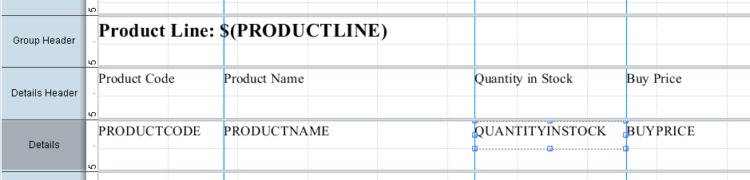
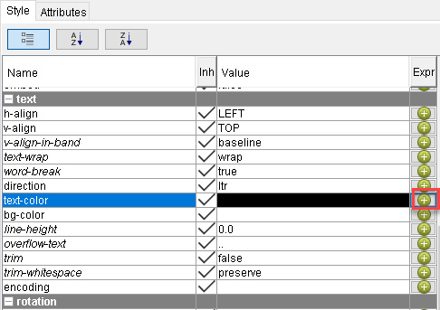
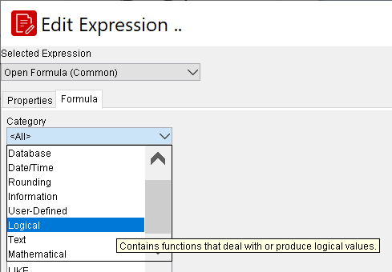
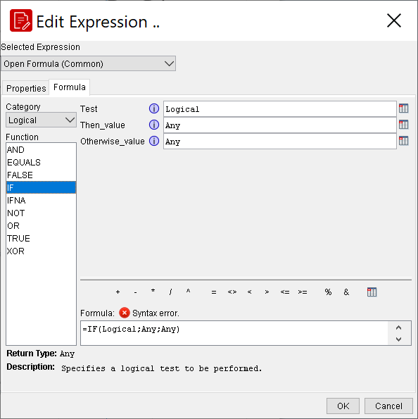
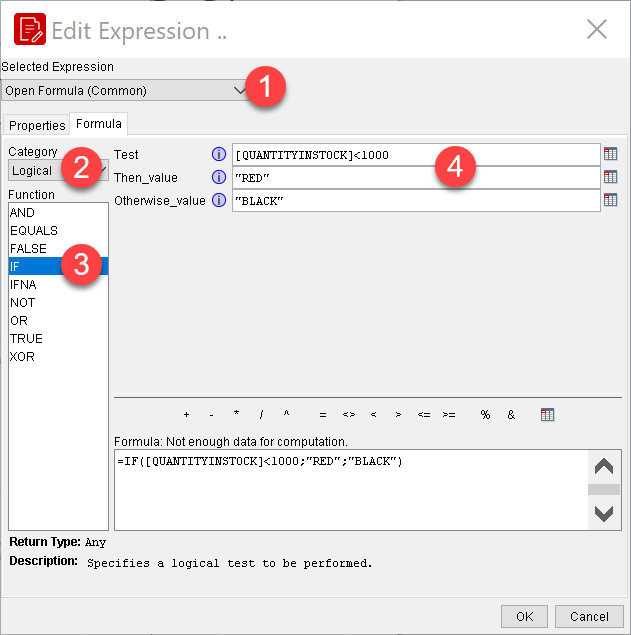
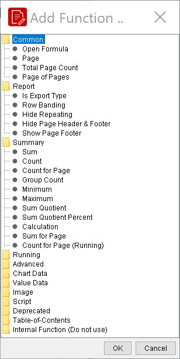

# Conditional Formatting

> **Warning:**
>
> #### Workshop - Conditional Formatting
>
> Color the quantity in stock by its value: red when stock is low, green when it is high, blue in between. A formula on the element's text color does it, row by row.
>
> **What you'll do**
>
> * Open the **Edit Expression** dialog for a style property
> * Build an `IF` formula with the function list
> * Nest a second `IF` for a third color
> * Preview the colors change with the data
>
> **Prerequisites:** [Adding Data Elements and Report Groups](../07-mod4-adding-elements-groups/guide.md) and its report, `Demo - data elements.prpt`
>
> **Estimated time:** 15 minutes

:::: tabs

### 1. A formula for the text color

> **Note:**
>
> #### Style expressions
>
> Every property on the **Style** tab can take a formula instead of a fixed value. The formula runs for every row, so the property can follow the data.

1. Start Report Designer with the **Start Pentaho Report Designer** button below, or from a terminal:

::: tabs

### Windows (PowerShell)

```powershell
Set-Location C:\Pentaho\design-tools\report-designer
.\report-designer.bat
```

### macOS / Linux

```bash
cd ~/Pentaho/design-tools/report-designer
./report-designer.sh
```

:::

<button data-launch="prd" data-path="">Start Pentaho Report Designer</button>

2. Select **File > Open** (`Ctrl+O`) and open `Demo - data elements.prpt` from your workshop folder, `Documents\RD-Workshop`.
3. Select **File > Save As** and save it as `Demo - conditional formatting.prpt` in the same folder.
4. On the canvas, in the **Details** band, select `QUANTITYINSTOCK`.

<div align="center">
<figure>

<figcaption>QUANTITYINSTOCK selected</figcaption>
</figure>
</div>

5. On the **Style** tab, in the **text** group, select the green plus in the **Expr** column of **text-color**. The **Edit Expression** dialog opens, with **Open Formula (Common)** as the **Selected Expression**.

<div align="center">
<figure>

<figcaption>The Expr column of text-color</figcaption>
</figure>
</div>

6. On the **Formula** tab, set **Category** to `Logical`. The **Function** list now holds only the logical functions.

<div align="center">
<figure>

<figcaption>The Logical category</figcaption>
</figure>
</div>

7. In **Function**, double-click `IF`. The fields **Test**, **Then_value** and **Otherwise_value** appear, and the **Formula** box shows `=IF(Logical;Any;Any)`.

<div align="center">
<figure>

<figcaption>IF and its three arguments</figcaption>
</figure>
</div>

8. Select the field icon to the right of **Test**. In the **Select Field** dialog, select `QUANTITYINSTOCK` and select **OK**. **Test** now holds `[QUANTITYINSTOCK]`.
9. Click in **Test** after `[QUANTITYINSTOCK]` and enter `<1000`.
10. Set **Then_value** to `"RED"` and **Otherwise_value** to `"BLACK"`, with the quotation marks.

<div align="center">
<figure>

<figcaption>The formula, built from the three fields</figcaption>
</figure>
</div>

> **Success:** Checkpoint: the **Formula** box shows `=IF([QUANTITYINSTOCK]<1000;"RED";"BLACK")`, and the line above it says **Not enough data for computation.**: the formula is valid, but its result depends on a field the dialog has no value for.

11. Replace the text in the **Formula** box with a second `IF` in place of `"BLACK"`, so that quantities above 5,000 show green and the rest blue:

```text
=IF([QUANTITYINSTOCK]<1000;"RED";IF([QUANTITYINSTOCK]>5000;"GREEN";"BLUE"))
```

12. Select **OK**. The **Expr** column of **text-color** now shows a pencil.

> **Under the hood:**
>
> #### The formula is attached to a style key and evaluated for every row
>
> What you saved is a *style expression*: the bundle stores it as
> `style-key="paint"` (the engine's name for text color) with your
> `=IF(...)` as the formula. During layout, each time the Details band
> prints a row, LibFormula evaluates the expression with
> `[QUANTITYINSTOCK]` bound to that row and hands back `"RED"`,
> `"GREEN"` or `"BLUE"`; the engine converts the string to a color and
> paints the element. The dialog can't show a result because it has no
> row to evaluate against.
>
> Expressions like this are *stateless*: each evaluation sees one row.
> The functions you'll add next are the stateful kind: they remember
> what they saw on earlier rows.
>
> **Why it matters:** anything computable from the row can drive any
> visual property, with no code and no second pass over the data.

13. Select **Preview**.

> **Success:** Checkpoint: each quantity in stock is red below 1,000, green above 5,000 and blue in between. The other columns stay black.

14. Select **Design**, and save the report (`Ctrl+S`).

The next workshop adds *functions*. Unlike the formula you wrote, a function keeps its state while the report runs, so it can total, count or number rows. Functions are added from the **Add Function** dialog:

<div align="center">
<figure>

<figcaption>The Add Function dialog, used in the next workshop</figcaption>
</figure>
</div>

::::

## Lab Files

Click a file to download. For `.prpt` files, **Open in Pentaho Report Designer** starts Report Designer with the report loaded.

### Solution <!-- no-step -->

The finished report for this lab. Open it alongside your own to compare, or preview it to see the expected result.

[Training Demo Report 5 conditional formatting.prpt](./files/Training%20Demo%20Report%205%20conditional%20formatting.prpt) <button data-launch="prd" data-path="files/Training Demo Report 5 conditional formatting.prpt">Open in Pentaho Report Designer</button>
