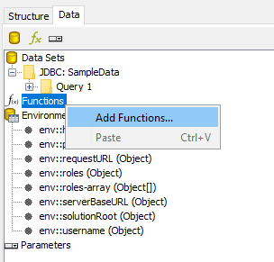
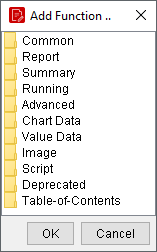
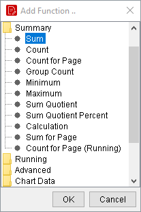
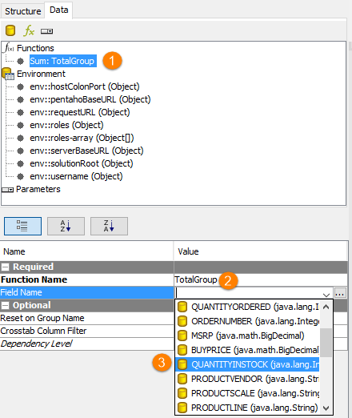
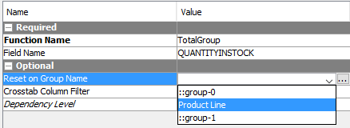
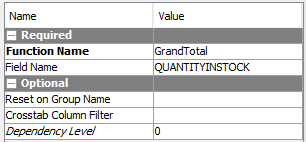
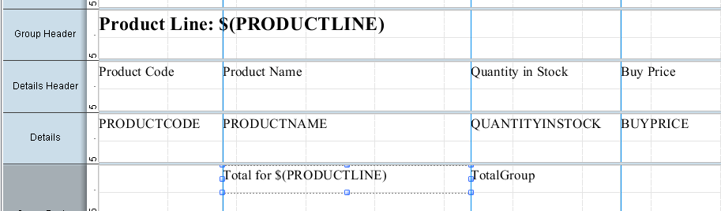
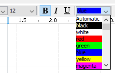
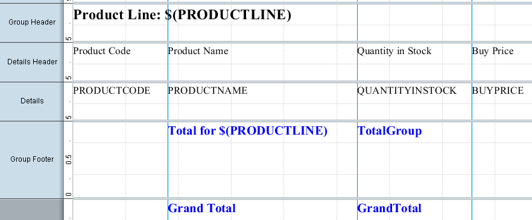

# Totals

> **Warning:**
>
> #### Workshop - Totals
>
> Add a total of the quantity in stock to each product line, and a grand total at the end of the report, with two **Sum** functions.
>
> **What you'll do**
>
> * Add two **Sum** functions from the **Add Function** dialog
> * Reset one at each product line and let the other run for the whole report
> * Place the totals in the **Group Footer** and **Report Footer** bands, with labels
> * Preview and check the numbers
>
> **Prerequisites:** [Conditional Formatting](../10-mod5-conditional-formatting/guide.md) and its report, `Demo - conditional formatting.prpt`
>
> **Estimated time:** 10 minutes

:::: tabs

### 1. Two Sum functions

> **Note:**
>
> #### Functions
>
> A *function* calculates a value as the report runs: a total, an average, a count, a page number. It can use the fields of the query or the result of another function, and it appears on the **Data** tab like a field, ready to drag onto a band.

1. Start Report Designer with the **Start Pentaho Report Designer** button below, or from a terminal:

::: tabs

### Windows (PowerShell)

```powershell
Set-Location C:\Pentaho\design-tools\report-designer
.\report-designer.bat
```

### macOS / Linux

```bash
cd ~/Pentaho/design-tools/report-designer
./report-designer.sh
```

:::

<button data-launch="prd" data-path="">Start Pentaho Report Designer</button>

2. Select **File > Open** (`Ctrl+O`) and open `Demo - conditional formatting.prpt` from your workshop folder, `Documents\RD-Workshop`.
3. Select **File > Save As** and save it as `Demo - totals.prpt` in the same folder.
4. On the **Data** tab, right-click **Functions** and select **Add Functions**.

<div align="center">
<figure>

<figcaption>Add Functions</figcaption>
</figure>
</div>

5. In the **Add Function** dialog, double-click the **Summary** folder.

<div align="center">
<figure>

<figcaption>The function folders</figcaption>
</figure>
</div>

6. Select **Sum**, then select **OK**.

<div align="center">
<figure>

<figcaption>Summary > Sum</figcaption>
</figure>
</div>

7. On the **Data** tab, under **Functions**, select the new **Sum** function. Its properties appear in the lower part of the tab.
8. Set **Function Name** to `TotalGroup`, **Field Name** to `QUANTITYINSTOCK`, and **Reset on Group Name** to `Product Line`.

<div align="center">
<figure>

<figcaption>The field to add up</figcaption>
</figure>
</div>

<div align="center">
<figure>

<figcaption>Reset at each product line</figcaption>
</figure>
</div>

> **Success:** Checkpoint: **Functions** on the **Data** tab lists **Sum: TotalGroup**.

9. Add a second **Sum** function the same way, and set it as in the second row of this table. Leave its **Reset on Group Name** empty, so it adds up the whole report.

| Function Name | Field Name | Reset on Group Name |
| --- | --- | --- |
| `TotalGroup` | `QUANTITYINSTOCK` | `Product Line` |
| `TotalReport` | `QUANTITYINSTOCK` | (empty) |

<div align="center">
<figure>

<figcaption>The report total; name it TotalReport, not as shown</figcaption>
</figure>
</div>

> **Under the hood:**
>
> #### TotalGroupSumFunction knows the group's total before the group starts
>
> The engine runs the report in two passes, and the **Sum** function,
> `TotalGroupSumFunction`, is declared to depend on the first one.
> During the pagination pass it adds up `QUANTITYINSTOCK` for every row,
> resetting each time the Product Line group changes, and remembers
> the result for each group. In the print pass it can therefore report
> the *complete* group total from the group's first row onward, which
> is why it works in a Group Header as well as in a footer.
>
> The running family, such as `ItemSumFunction`, is correct only at
> the moment the last row of the group has passed, so it belongs in
> footers alone. **Reset on Group Name** is what scopes either kind;
> leave it blank and the function accumulates across the whole report.
>
> **Why it matters:** totals in headers, percentages of a group total
> on every detail row, "3 of 12" counters: all possible because the
> engine reads the data twice so you don't have to write a second
> query.

### 2. Group totals

> **Note:**
>
> #### The Group Footer band
>
> The **Group Footer** band prints after the last row of each group: the place for the group's total.

1. Drag **Sum: TotalGroup** from the **Data** tab onto the **Group Footer** band, directly below `QUANTITYINSTOCK`, between the 3.75-inch and 5.25-inch guides.
2. Drag a **message** element onto the **Group Footer** band, directly below `PRODUCTNAME`, and resize it to fill the space between the 1.25-inch and 3.75-inch guides.
3. With the message selected, open the **Attributes** tab and select the **...** button in the **value** row. In the **Edit Property** dialog, enter `Total for Product Line: $(PRODUCTLINE)` and select **OK**.

<div align="center">
<figure>

<figcaption>The group total and its label; the solution's text is Total for Product Line: $(PRODUCTLINE)</figcaption>
</figure>
</div>

> **Under the hood:**
>
> #### Dragging a function onto a band creates a field bound to its name
>
> The number field that appeared in the Group Footer has its `field`
> attribute set to `TotalGroup`. From the layout's point of view a
> function is another column of the data row, one the engine computes
> rather than the database, so it is placed, formatted and aligned
> exactly like `QUANTITYINSTOCK`. The message field beside it resolves
> `$(PRODUCTLINE)` from the same row, and because a Group Footer prints
> after the group's last row but *before* the value changes, it shows
> the group that ended.
>
> **Why it matters:** functions, query columns and parameters all
> live in one namespace. A formula can reference `[TotalGroup]` the
> same way as `[QUANTITYINSTOCK]`, which is how you get a "% of group"
> column with one more expression.

4. Select the message, hold `Shift` and select the **TotalGroup** field, so that both are selected.
5. On the formatting toolbar, select **Bold**, and set the font color list to `blue`.

<div align="center">
<figure>

<figcaption>Bold and blue</figcaption>
</figure>
</div>

6. Select **Preview**.

> **Success:** Checkpoint: after the rows of each product line, a bold blue line: `Total for Product Line: Classic Cars`, with 5,844,033 under **Quantity in Stock**. The total is large because the query has one row for each order line, so a product's stock is added once for every line that ordered it.

7. Select **Design**.

### 3. Grand total

> **Note:**
>
> #### The Report Footer band
>
> The **Report Footer** band prints once, after the last group: the place for the grand total.

1. Drag **Sum: TotalReport** from the **Data** tab onto the **Report Footer** band, directly below the **TotalGroup** field.
2. Drag a **label** onto the **Report Footer** band, below the group total's message, starting at the 1.25-inch guide and about 1.4 inches wide.
3. Set the label's **value** to `Grand Total`.
4. Select the label and the **TotalReport** field, select **Bold**, and set the font color to `blue`.

<div align="center">
<figure>

<figcaption>The group total and the grand total; the screenshot names the function GrandTotal</figcaption>
</figure>
</div>

5. Select **Preview**, and on the preview toolbar select the last-page arrow.

> **Success:** Checkpoint: the last page ends with **Grand Total** and 15,130,027, the sum of the seven product line totals.

6. Select **Design**, and save the report (`Ctrl+S`).

::::

## Lab Files

Click a file to download. For `.prpt` files, **Open in Pentaho Report Designer** starts Report Designer with the report loaded.

### Solution <!-- no-step -->

The finished report for this lab. Open it alongside your own to compare, or preview it to see the expected result. It already has the report header you build in [Formatting Report Headers & Footers](../14-mod6-headers-footers/guide.md).

[Training Demo Report 5-1 totals.prpt](./files/Training%20Demo%20Report%205-1%20totals.prpt) <button data-launch="prd" data-path="files/Training Demo Report 5-1 totals.prpt">Open in Pentaho Report Designer</button>
