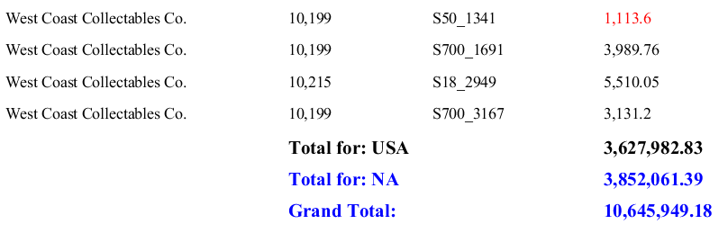

# Practice: Calculations

> **Warning:**
>
> #### Workshop - Practice: Calculations
>
> Two exercises on the report from the last practice: color the total price by its value, then add totals for each country, each territory and the whole report.
>
> **What you'll do**
>
> * Write a nested `IF` formula for a text color
> * Add three **Sum** functions, each reset at a different group
> * Place the totals in the group footers and the report footer
> * Compare your result with the expected totals
>
> **Prerequisites:** [Practice: Data Elements and Report Groups](../08-mod4-practice/guide.md) and its report, `Exercise - data elements.prpt`; [Conditional Formatting](../10-mod5-conditional-formatting/guide.md) and [Totals](../11-mod5-totals/guide.md)
>
> **Estimated time:** 20 minutes

:::: tabs

### 1. Conditional formatting

> **Note:**
>
> #### Color the total price
>
> Show `TOTALPRICE` in red below 3,000, in green above 6,000, and in black otherwise.

1. Start Report Designer with the **Start Pentaho Report Designer** button below, or from a terminal:

::: tabs

### Windows (PowerShell)

```powershell
Set-Location C:\Pentaho\design-tools\report-designer
.\report-designer.bat
```

### macOS / Linux

```bash
cd ~/Pentaho/design-tools/report-designer
./report-designer.sh
```

:::

<button data-launch="prd" data-path="">Start Pentaho Report Designer</button>

2. Select **File > Open** (`Ctrl+O`) and open `Exercise - data elements.prpt` from your workshop folder, `Documents\RD-Workshop`.
3. Select **File > Save As** and save it as `Exercise - conditional formatting.prpt`.
4. In the **Details** band, select `TOTALPRICE`.
5. On the **Style** tab, select the green plus in the **Expr** column of **text-color**.
6. On the **Formula** tab, set **Category** to `Logical` and double-click `IF`, or enter the formula in the **Formula** box directly:

```text
=IF([TOTALPRICE]<3000;"RED";IF([TOTALPRICE]>6000;"GREEN";"BLACK"))
```

7. Select **OK**, then select **Preview**.

> **Success:** Checkpoint: each total price is red below 3,000, green above 6,000, and black in between.

8. Select **Design**, and save the report (`Ctrl+S`).

### 2. Three totals

> **Note:**
>
> #### Sum functions
>
> One **Sum** function for each level: country, territory and the whole report. **Reset on Group Name** decides the level.

1. Select **File > Save As** and save the report as `Exercise - totals.prpt`.
2. On the **Data** tab, right-click **Functions**, select **Add Functions**, and add three **Sum** functions from the **Summary** folder. Set them as in this table:

| Function Name | Field Name | Reset on Group Name |
| --- | --- | --- |
| `TotalforCountry` | `TOTALPRICE` | `Country` |
| `TotalforTerritory` | `TOTALPRICE` | `Territory` |
| `TotalforReport` | `TOTALPRICE` | (empty) |

> **Success:** Checkpoint: **Functions** lists **Sum: TotalforCountry**, **Sum: TotalforTerritory** and **Sum: TotalforReport**.

3. Select `TotalforCountry` on the **Data** tab and check its **Reset on Group Name** once more: it names the group, `Country`, not the field `COUNTRY`.

> **Under the hood:**
>
> #### A function resets on a group, not on a field
>
> **Reset on Group Name** takes the name you gave a group in
> **Edit Group**. Each time that group starts, the function sets its
> sum back to zero; a group nested inside it resets more often, a
> group outside it less often. With no group named, the sum is never
> reset, which makes it the report's grand total.
>
> **Why it matters:** one function type gives you every level of total
> the report needs. The level is a property, so moving a total from
> country to territory is a change of one value.

### 3. Place the totals

> **Note:**
>
> #### Footers
>
> The country group is inside the territory group, so its **Group Footer** band is the upper of the two.

1. Drag **Sum: TotalforCountry** onto the country group's **Group Footer** band, directly below `TOTALPRICE`.
2. Drag a **message** element onto the same band, below `ORDERNUMBER`, and set its **value** to `Total for: $(COUNTRY)`.
3. Select the message and the total, select **Bold**, and set the font size to `12`.
4. Drag **Sum: TotalforTerritory** onto the territory group's **Group Footer** band, below the country total.
5. Drag a **message** element onto the same band, below the country message, and set its **value** to `Total for: $(TERRITORY)`.
6. Select the message and the total, select **Bold**, set the font size to `12` and the font color to `blue`.
7. Drag **Sum: TotalforReport** onto the **Report Footer** band, below the territory total.
8. Drag a **label** onto the **Report Footer** band, below the territory message, and set its **value** to `Grand Total:`.
9. Select the label and the total, select **Bold**, set the font size to `12` and the font color to `blue`.
10. Select **Preview**, and select the last-page arrow.

<div align="center">
<figure>

<figcaption>The end of the report: the last country, territory and grand totals</figcaption>
</figure>
</div>

> **Success:** Checkpoint: the last page ends with **Total for: USA** 3,627,982.83, **Total for: NA** 3,852,061.39 and **Grand Total:** 10,645,949.18.

11. Select **Design**, and save the report (`Ctrl+S`).

::::

## Lab Files

_No bundled files for this lab._
