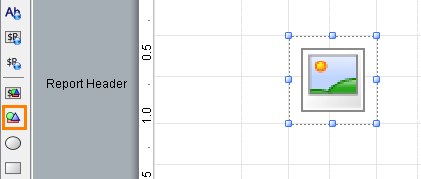
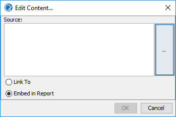
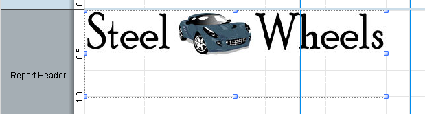
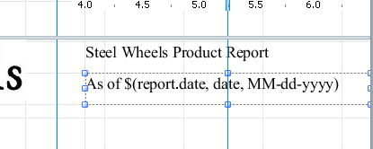
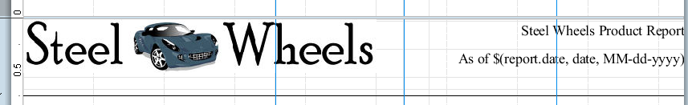
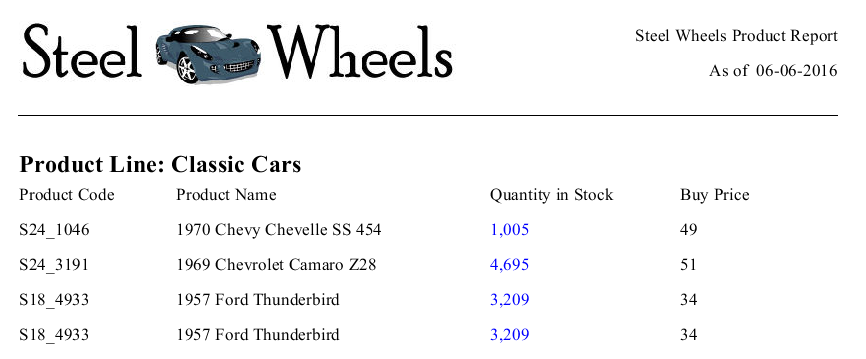
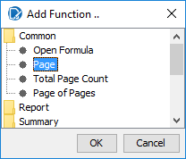
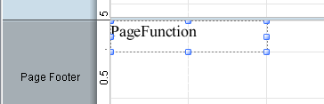

# Formatting Report Headers & Footers

> **Warning:**
>
> #### Workshop - Formatting Report Headers & Footers
>
> Give the report a header, printed once at the top of the first page: the Steel Wheels logo, a title, the date it was run and a rule under them. Then number the pages in the page footer.
>
> **What you'll do**
>
> * Embed an image in the **Report Header** band
> * Add a title and a run date, aligned right
> * Draw a horizontal line under the header
> * Number the pages with a **Page** function in the **Page Footer** band
>
> **Prerequisites:** [Totals](../11-mod5-totals/guide.md) and its report, `Demo - totals.prpt`; the Pentaho Server installed in `C:\Pentaho`, for the logo image
>
> **Estimated time:** 15 minutes

:::: tabs

### 1. The logo

> **Note:**
>
> #### An image element
>
> An **image** element shows a picture, either linked from a file or embedded in the report. The Steel Wheels logo ships with the Pentaho Server, in its `sw-style` web application.

1. Start Report Designer with the **Start Pentaho Report Designer** button below, or from a terminal:

::: tabs

### Windows (PowerShell)

```powershell
Set-Location C:\Pentaho\design-tools\report-designer
.\report-designer.bat
```

### macOS / Linux

```bash
cd ~/Pentaho/design-tools/report-designer
./report-designer.sh
```

:::

<button data-launch="prd" data-path="">Start Pentaho Report Designer</button>

2. Select **File > Open** (`Ctrl+O`) and open `Demo - totals.prpt` from your workshop folder, `Documents\RD-Workshop`.
3. Select **File > Save As** and save it as `Demo - header.prpt` in the same folder.
4. From the palette, drag an **image** element onto the **Report Header** band. You resize and place it later.

<div align="center">
<figure>

<figcaption>An image element in the Report Header band</figcaption>
</figure>
</div>

5. Double-click the image element. The **Edit Content** dialog opens.

<div align="center">
<figure>

<figcaption>Link to the image, or embed it in the report</figcaption>
</figure>
</div>

6. Select the browse button to the right of **Source**, open `C:\Pentaho\server\pentaho-server\tomcat\webapps\sw-style\active\sw_logo.jpg`, and select **Open**.
7. Select **Embed in Report**, then select **OK**.

> **Under the hood:**
>
> #### Embed put the JPEG inside the bundle
>
> A `.prpt` is a zip. Choosing Embed copied `sw_logo.jpg` into it as
> `resources/image.jpeg` and pointed the image element at that entry,
> so the report carries its logo wherever it goes: preview, the
> server, an email attachment. Link keeps only the path: the engine's
> resource loader fetches it at run time, relative to the report's
> location, which on the server means a repository path.
>
> **Why it matters:** embed anything the report cannot function
> without; link only what changes independently of the report and is
> guaranteed to exist where the report runs.

8. Select the image, drag its top left handle to the top left corner of the **Report Header** band, and drag its bottom right handle to about 3.5 inches across and 1 inch down.

<div align="center">
<figure>

<figcaption>The logo, about 3.5 by 1 inch</figcaption>
</figure>
</div>

> **Success:** Checkpoint: the Steel Wheels logo sits in the top left corner of the **Report Header** band.

### 2. Title, date and line

> **Note:**
>
> #### Title and date
>
> The title is a fixed **label**; the date is a **message** element that reads `report.date`, the date and time the report runs.

1. Drag a **label** onto the upper right corner of the **Report Header** band. Set its **value** to `Steel Wheels Product Report`, and drag its left handle to about 4 inches on the top ruler, so that it spans from 4 inches to the right edge of the band.
2. Drag a **message** element directly below the label, with the same width. Set its **value** to `As of $(report.date, date, MM-dd-yyyy)`.

<div align="center">
<figure>

<figcaption>The title and the run date</figcaption>
</figure>
</div>

> **Under the hood:**
>
> #### `report.date` is a field the engine injects, not one from your query
>
> When processing starts the engine adds a set of environment fields
> to every row alongside your query columns (`report.date` is the run
> timestamp), and a message field reads them like any other field. The
> three-part syntax `$(report.date, date, MM-dd-yyyy)` names the
> field, tells the formatter to treat it as a date, and supplies the
> pattern. On the server the same mechanism exposes the user name,
> roles and locale as `env::` fields (see the
> [Environment Variables Reference](../31-ref-environment-variables/guide.md)).
>
> **Why it matters:** "As of" dates, user stamps and locale-aware
> formatting come from the engine, so a report can say who ran it and
> when without a single change to the SQL.

3. Select the label, hold `Shift` and select the message. On the formatting toolbar, select **Align Right**.
4. From the palette, drag a **horizontal-line** onto the **Report Header** band, below the logo.
5. Select the line. Drag its left handle to the left edge of the band and its right handle to the right edge, then drag its middle handle to about 0.75 inch on the left ruler.

<div align="center">
<figure>

<figcaption>The Report Header in design mode</figcaption>
</figure>
</div>

6. Select **Preview**.

<div align="center">
<figure>

<figcaption>The header on the first page; the date is the day the report runs</figcaption>
</figure>
</div>

> **Success:** Checkpoint: the first page opens with the logo on the left, **Steel Wheels Product Report** and **As of** with today's date on the right, and a line across the page, above `Product Line: Classic Cars`.

7. Select **Design**, and save the report (`Ctrl+S`).

### 3. Page numbers

> **Note:**
>
> #### The Page Footer band
>
> The **Page Footer** band prints at the bottom of every page. A **Page** function counts the pages as the report runs.

1. On the **Data** tab, right-click **Functions** and select **Add Functions**.
2. In the **Add Function** dialog, open the **Common** folder, select **Page**, and select **OK**.

<div align="center">
<figure>

<figcaption>Common > Page</figcaption>
</figure>
</div>

3. Drag the new **Page** function, `PageFunction`, from the **Data** tab onto the top left corner of the **Page Footer** band.

<div align="center">
<figure>

<figcaption>The page number field</figcaption>
</figure>
</div>

4. Select **Preview**, and page through the report.

> **Success:** Checkpoint: the bottom of each page shows its page number: 1 on the first page, 2 on the second, and so on.

5. Select **Design**, and save the report (`Ctrl+S`).

> **Under the hood:**
>
> #### Page numbers come from the pagination pass
>
> `PageFunction` counts pages as the pageable output processor breaks
> them, and the `PageOfPagesFunction` used by the sample reports adds
> the total, a number only known once the pagination pass has laid
> out the entire report. That is why page functions only make sense in
> the Page Header and Page Footer bands, and why they show nothing
> useful in HTML single-page output, which has no pages at all.
>
> **Why it matters:** the same footer prints "Page 3 of 12" in PDF and
> in print, and the count stays right when a parameter changes the
> length of the report, because it is measured, not guessed.

::::

## Lab Files

Click a file to download. For `.prpt` files, **Open in Pentaho Report Designer** starts Report Designer with the report loaded.

### Solution <!-- no-step -->

The finished report for this lab. Open it alongside your own to compare, or preview it to see the expected result. It also has the formatting of the next workshop, [Formatting the Report](../15-mod6-formatting-report/guide.md), and its title reads `Steel Wheels Sales Report`.

[Training Demo Report 6-1 header.prpt](./files/Training%20Demo%20Report%206-1%20header.prpt) <button data-launch="prd" data-path="files/Training Demo Report 6-1 header.prpt">Open in Pentaho Report Designer</button>
