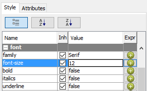
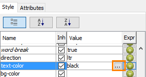
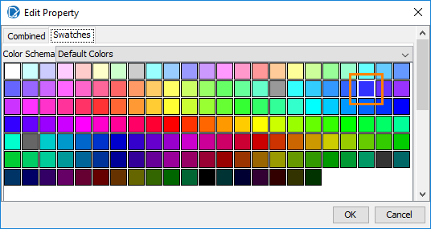
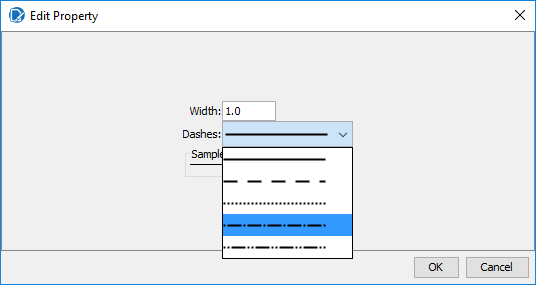
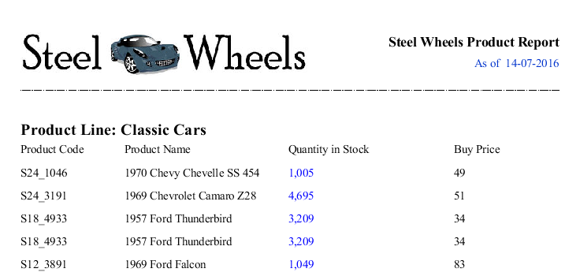
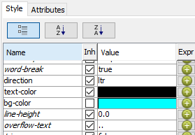
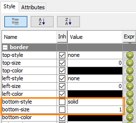
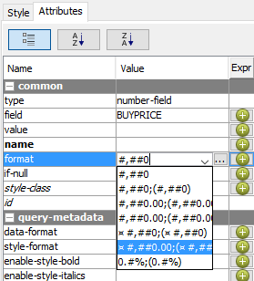
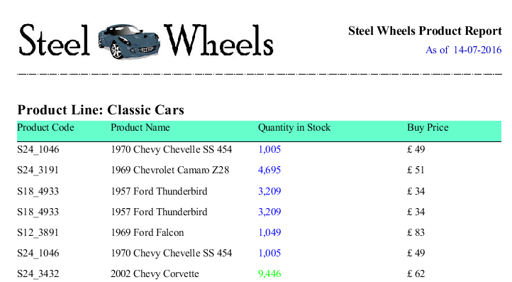
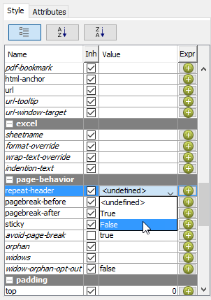

# Formatting the Report

> **Warning:**
>
> #### Workshop - Formatting the Report
>
> Format the report with the **Style** and **Attributes** tabs: a larger, bold title, a blue run date, a dashed rule, shaded column labels, a currency format, and column labels that repeat on every page.
>
> **What you'll do**
>
> * Change font size, weight and color on the **Style** tab
> * Change a line's stroke
> * Shade and underline the column labels
> * Format a number as currency on the **Attributes** tab
> * Repeat the column labels when a group continues onto a new page
>
> **Prerequisites:** [Formatting Report Headers & Footers](../14-mod6-headers-footers/guide.md) and its report, `Demo - header.prpt`
>
> **Estimated time:** 15 minutes

:::: tabs

### 1. Title, date and line

> **Note:**
>
> #### The Style tab
>
> The **Style** tab lists every visual property of the selected element, by group: **font**, **text**, **border**, **object** and more. The formatting toolbar sets some of the same properties.

1. Start Report Designer with the **Start Pentaho Report Designer** button below, or from a terminal:

::: tabs

### Windows (PowerShell)

```powershell
Set-Location C:\Pentaho\design-tools\report-designer
.\report-designer.bat
```

### macOS / Linux

```bash
cd ~/Pentaho/design-tools/report-designer
./report-designer.sh
```

:::

<button data-launch="prd" data-path="">Start Pentaho Report Designer</button>

2. Select **File > Open** (`Ctrl+O`) and open `Demo - header.prpt` from your workshop folder, `Documents\RD-Workshop`.
3. Select **File > Save As** and save it as `Demo - formatting.prpt` in the same folder.
4. In the **Report Header** band, select the **Steel Wheels Product Report** label.
5. On the **Style** tab, in the **font** group, double-click the **Value** of **font-size**, enter `12`, and press `Enter`.

<div align="center">
<figure>

<figcaption>font-size 12</figcaption>
</figure>
</div>

6. Set **bold** to `true`.
7. Select the message `As of $(report.date, date, MM-dd-yyyy)`.
8. On the **Style** tab, in the **text** group, select the **...** button in the **Value** column of **text-color**. The **Edit Property** dialog opens.

<div align="center">
<figure>

<figcaption>The browse button opens the color picker</figcaption>
</figure>
</div>

9. Open the **Swatches** tab, select the bright blue swatch, and select **OK**.

<div align="center">
<figure>

<figcaption>Bright blue on the Swatches tab</figcaption>
</figure>
</div>

10. Select the horizontal line under the logo.
11. On the **Style** tab, in the **object** group, select the **...** button of **stroke**. In the **Edit Property** dialog, set **Width** to `1.0` and **Dashes** to the dot-dash line, the fourth in the list, and select **OK**.

<div align="center">
<figure>

<figcaption>A dot-dash stroke, 1 point wide</figcaption>
</figure>
</div>

12. Select **Preview**.

<div align="center">
<figure>

<figcaption>The formatted header</figcaption>
</figure>
</div>

> **Success:** Checkpoint: the title is bold and larger, the **As of** date is blue, and the line under the header is dot-dash.

13. Select **Design**.

> **Under the hood:**
>
> #### The Style pane edits a style sheet that cascades
>
> Every visual property is a style key (`font-size`, `bold`, `paint`
> for the text color, `stroke` for the line) stored per element in
> the bundle. A key you haven't set is not blank: it is inherited from
> the band the element sits in, then from the report's default style,
> much like CSS. The **Inh** column on the **Style** tab shows which
> values are inherited. The formatting toolbar writes the same keys the
> Style pane shows; it is a shortcut, not a second system.
>
> **Why it matters:** set a font on a band and every element in it
> follows; set it on the master report and the whole report follows.
> Format at the highest level that is true, and override only where
> something must differ.

### 2. Labels and currency

> **Note:**
>
> #### Shading and number formats
>
> Shade the column labels and draw a line under them on the **Style** tab. A number's format is an attribute, on the **Attributes** tab.

1. In the **Details Header** band, select the four labels: select the first, then hold `Shift` and select the others.
2. On the **Style** tab, in the **text** group, select the **...** button of **bg-color**. On the **Swatches** tab, select an aqua swatch, and select **OK**. The solution's color is `#33ccff`.

<div align="center">
<figure>

<figcaption>bg-color set to aqua</figcaption>
</figure>
</div>

3. In the **border** group, double-click the **Value** of **bottom-size**, enter `1`, and press `Enter`. Set **bottom-style** to `solid`.

<div align="center">
<figure>

<figcaption>A solid bottom border, 1 point</figcaption>
</figure>
</div>

4. In the **Details** band, select `BUYPRICE`.
5. On the **Attributes** tab, in the **common** group, open the list in the **Value** column of **format**, select `¤ #,##0.00;(¤ #,##0.00)`, and press `Enter`.

<div align="center">
<figure>

<figcaption>The currency formats start with ¤</figcaption>
</figure>
</div>

The `¤` in the pattern stands for the currency symbol of the locale the report runs in. Some systems show it as an empty box.

6. Select **Preview**.

<div align="center">
<figure>

<figcaption>Shaded labels and currency; the screenshot shows a pound sign and no decimals</figcaption>
</figure>
</div>

> **Success:** Checkpoint: the column labels sit on an aqua background with a line under them, and **Buy Price** shows your locale's currency symbol and two decimal places.

7. Select **Design**.

> **Under the hood:**
>
> #### The ¤ is Java's currency sign
>
> The `format` attribute is a `java.text.DecimalFormat` pattern. The
> character that renders as a box in some lists is `¤` (U+00A4),
> which DecimalFormat replaces at run time with the currency symbol of
> the locale the report runs in: `$` on a US machine, `€` for a German
> user on the server. The `;` splits the pattern into positive and
> negative halves, which is where the parentheses for negatives come
> from.
>
> **Why it matters:** one pattern serves every locale, and the same
> rule applies to dates: `MMM` will read "Jan" or "janv." depending on
> who runs the report, with no change to the design.

### 3. Repeat the labels

> **Note:**
>
> #### Page behavior
>
> A product line can run over several pages. The **Details Header** band's **repeat-header** style prints the column labels again at the top of each page that continues a group.

1. In the **Structure** tab, select **Details Header**.
2. On the **Style** tab, in the **page-behavior** group, set **repeat-header** to `True`.

<div align="center">
<figure>

<figcaption>repeat-header; select True, not False as in the screenshot</figcaption>
</figure>
</div>

3. Select **Preview**, and go to the second page.

> **Success:** Checkpoint: the second page continues **Classic Cars**, and the column labels print again at its top.

4. Select **Design**, and save the report (`Ctrl+S`).

::::

## Lab Files

_No bundled files for this lab._ The solution of [Formatting Report Headers & Footers](../14-mod6-headers-footers/guide.md) already carries most of this formatting.
