# Report Parameters

> **Warning:**
>
> #### Workshop - Report Parameters
>
> Let the reader choose what the report shows: a drop-down of product lines, filled by a query, that filters the report's main query. Then add a second prompt, for the country.
>
> **What you'll do**
>
> * Add a query that lists the valid choices
> * Add a parameter that prompts with that list
> * Use the parameter in the main query's `WHERE` clause
> * Add a second parameter and preview with different values
>
> **Prerequisites:** [Formatting the Report](../15-mod6-formatting-report/guide.md) and its report, `Demo - formatting.prpt`
>
> **Estimated time:** 15 minutes

:::: tabs

### 1. A list of product lines

> **Note:**
>
> #### A query for the choices
>
> A drop-down prompt takes its choices from a query. Add one to the report's data source that returns each product line once.

1. Start Report Designer with the **Start Pentaho Report Designer** button below, or from a terminal:

::: tabs

### Windows (PowerShell)

```powershell
Set-Location C:\Pentaho\design-tools\report-designer
.\report-designer.bat
```

### macOS / Linux

```bash
cd ~/Pentaho/design-tools/report-designer
./report-designer.sh
```

:::

<button data-launch="prd" data-path="">Start Pentaho Report Designer</button>

2. Select **File > Open** (`Ctrl+O`) and open `Demo - formatting.prpt` from your workshop folder, `Documents\RD-Workshop`.
3. Select **File > Save As** and save it as `Demo - parameters.prpt` in the same folder.
4. On the **Data** tab, under **Data Sets**, double-click **JDBC: SampleData (Hypersonic)**. The **JDBC Data Source** dialog opens.

<div align="center">
<figure>
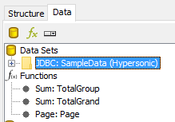
<figcaption>Double-click the data source to edit it</figcaption>
</figure>
</div>

5. To the right of **Available Queries**, select the green plus (**Add Query**), and set **Query Name** to `prod_list`. The parameter refers to the query by this name.

<div align="center">
<figure>
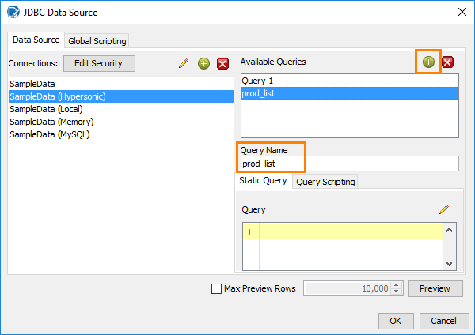
<figcaption>A second query, prod_list</figcaption>
</figure>
</div>

6. In the **Query** box, enter:

```sql
select distinct productline from products
```

7. Select **Preview**.

<div align="center">
<figure>
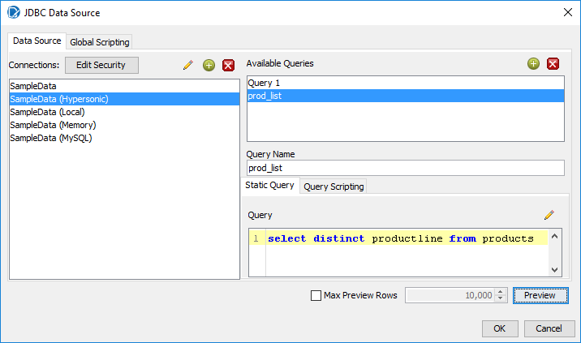
<figcaption>The prod_list query</figcaption>
</figure>
</div>

> **Success:** Checkpoint: 7 rows, one for each product line, from `Classic Cars` to `Vintage Cars`.

8. Close the preview window, and select **OK**.

### 2. The parameter

> **Note:**
>
> #### Add Parameter
>
> A *parameter* is a named value the reader supplies before the report runs. Its prompt can be a drop-down, a list, buttons, a text box or a date picker.

1. On the **Data** tab, right-click **Parameters** and select **Add Parameter**.

<div align="center">
<figure>
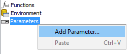
<figcaption>Add Parameter</figcaption>
</figure>
</div>

2. In the **Add Parameter** dialog, under **DataSources**, select `prod_list`.
3. Set the fields as in this table, then select **OK**:

| Field | Value |
| --- | --- |
| **Name** | `product_var` |
| **Label** | `Select a Product Line:` |
| **Value Type** | `String` |
| **Default Value** | `Classic Cars` |
| **Mandatory** | Cleared |
| **Hidden** | Cleared |
| **Display Type** | `Drop Down` |
| **Query** | `prod_list` |
| **Value** | `PRODUCTLINE` |
| **Display Name** | `PRODUCTLINE` |
| **Validate Values** | Selected |
| **Reset to default value on invalid selections** | Selected |
| **Use first value if default value formula results in NA.** | Selected |

<div align="center">
<figure>
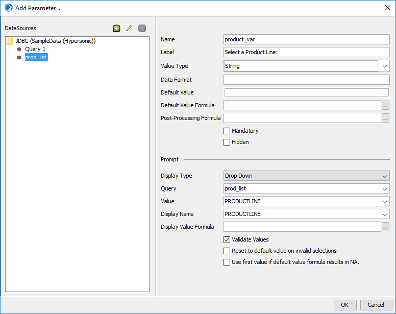
<figcaption>The parameter; set the default value and the last two options as the table says</figcaption>
</figure>
</div>

> **Success:** Checkpoint: **Parameters** on the **Data** tab lists `product_var`.

4. Select `product_var` on the **Data** tab and select **Data > Edit Parameter**. Check the values against the table, then select **OK**.

> **Under the hood:**
>
> #### A parameter is a query-backed definition, validated before the report runs
>
> The dialog wrote a `list-parameter` into the bundle's
> `datadefinition.xml`: its name, type, the query that supplies the
> choices (`prod_list`), which column is the key and which the label,
> a default, and `strict-values` (**Validate Values**). Before the
> engine runs the main query it evaluates that definition: runs
> `prod_list`, builds the prompt, and with strict values on, rejects
> any value that isn't in the list. Report Designer's preview and the
> server's viewer both render the prompt from the same definition.
>
> **Why it matters:** the prompt is part of the report, not of the
> tool showing it. Publish, schedule or link to the report and the
> same validated choices appear everywhere.

### 3. Filter the main query

> **Note:**
>
> #### Use the parameter
>
> A parameter does nothing until a query uses it. Reference it in `Query 1` as `${product_var}`.

1. On the **Data** tab, double-click the data source, and under **Available Queries** select `Query 1`.
2. In the **Query** box, click at the start of the `ORDER BY` line, press `Enter`, and enter this line above `ORDER BY`:

```sql
WHERE productline IN (${product_var})
```

<div align="center">
<figure>
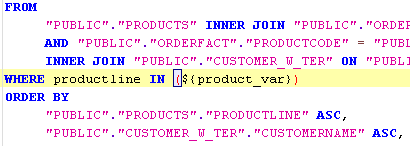
<figcaption>The WHERE clause, above ORDER BY</figcaption>
</figure>
</div>

3. Select **OK**.
4. Select **Preview**.

<div align="center">
<figure>
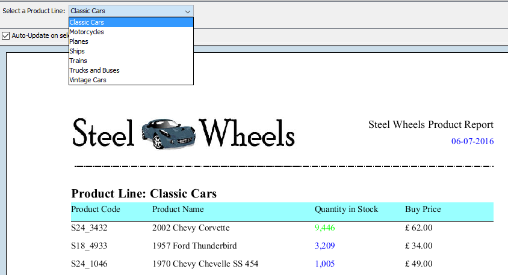
<figcaption>The prompt above the report</figcaption>
</figure>
</div>

> **Success:** Checkpoint: the prompt **Select a Product Line:** shows `Classic Cars`, and the report holds Classic Cars only: **Total for Product Line: Classic Cars** and **Grand Total** both read 5,844,033.

5. In the prompt, select `Ships`. **Auto-Update on selection** is selected, so the report runs again with Ships only.
6. Select **Design**, and save the report (`Ctrl+S`).

> **Under the hood:**
>
> #### `${product_var}` became a bind marker, not spliced text
>
> The SQL data factory parses the query for `${name}` references before
> it runs, replaces each with a JDBC `?` placeholder and binds the
> parameter's value through a prepared statement. That is why the
> value needs no quotes and why a product line called `O'Brien's`
> can't break the query or inject anything. For a multi-select
> parameter the value is an array, and the parser expands it to
> `?, ?, ?` so `IN (...)` works with any number of choices.
>
> **Why it matters:** parameters are type-safe and injection-proof by
> construction, and the database can cache the prepared statement
> across runs, because only the values change.

### 4. A second prompt

> **Note:**
>
> #### Country
>
> Add a country prompt the same way: a query for the choices, a parameter, and a second condition in `Query 1`.

1. Select **File > Save As** and save the report as `Demo - parameters prod & country.prpt`.
2. On the **Data** tab, double-click **JDBC: SampleData (Hypersonic)**.

<div align="center">
<figure>

<figcaption>The same data source holds every query</figcaption>
</figure>
</div>

3. Select the green plus (**Add Query**), set **Query Name** to `country_list`, and enter:

```sql
select distinct country from customer_w_ter
```

<div align="center">
<figure>
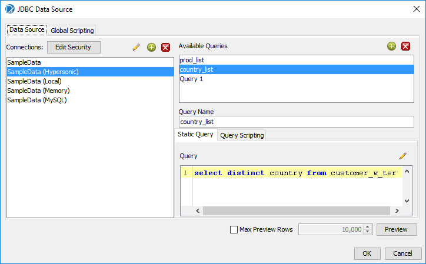
<figcaption>The country_list query</figcaption>
</figure>
</div>

4. Select **Preview**.

> **Success:** Checkpoint: 27 rows, one for each country in `CUSTOMER_W_TER`.

5. Close the preview window, and select **OK**.
6. On the **Data** tab, right-click **Parameters** and select **Add Parameter**. Under **DataSources**, select `country_list`, set the fields as in this table, and select **OK**:

| Field | Value |
| --- | --- |
| **Name** | `country_var` |
| **Label** | `Select a Country:` |
| **Value Type** | `String` |
| **Default Value** | `Australia` |
| **Mandatory** | Cleared |
| **Hidden** | Cleared |
| **Display Type** | `Drop Down` |
| **Query** | `country_list` |
| **Value** | `COUNTRY` |
| **Display Name** | `COUNTRY` |
| **Validate Values** | Selected |
| **Reset to default value on invalid selections** | Cleared |
| **Use first value if default value formula results in NA.** | Cleared |

<div align="center">
<figure>
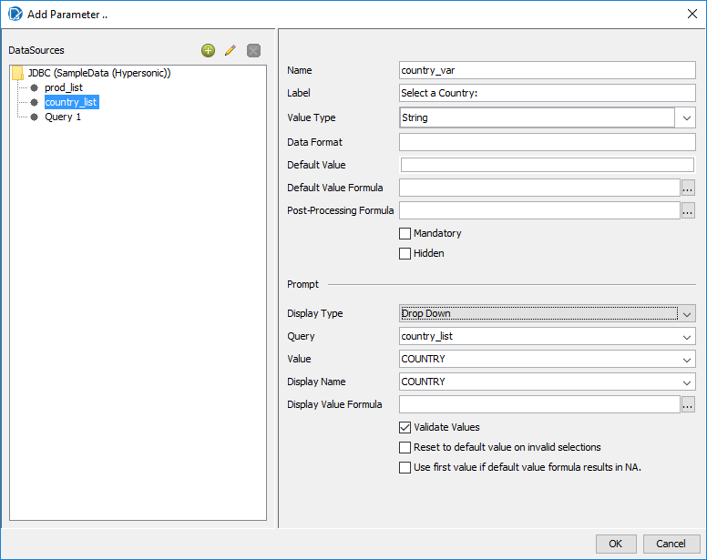
<figcaption>The country parameter; set the default value as the table says</figcaption>
</figure>
</div>

7. Double-click the data source, select `Query 1`, and change the `WHERE` line to:

```sql
WHERE productline IN (${product_var}) AND country IN (${country_var})
```

<div align="center">
<figure>
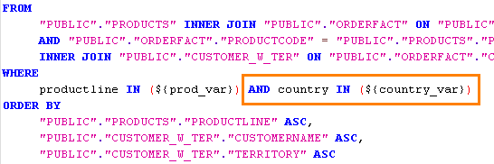
<figcaption>The second condition; the screenshot's first parameter is named prod_var, yours product_var</figcaption>
</figure>
</div>

8. Select **OK**, then select **Preview**. You may need to widen the prompt panel to see both prompts.

> **Success:** Checkpoint: with the defaults, Classic Cars and Australia, the report has 53 rows and a total of 310,536.

9. Select `Ships` in the first prompt and `Finland` in the second.

<div align="center">
<figure>
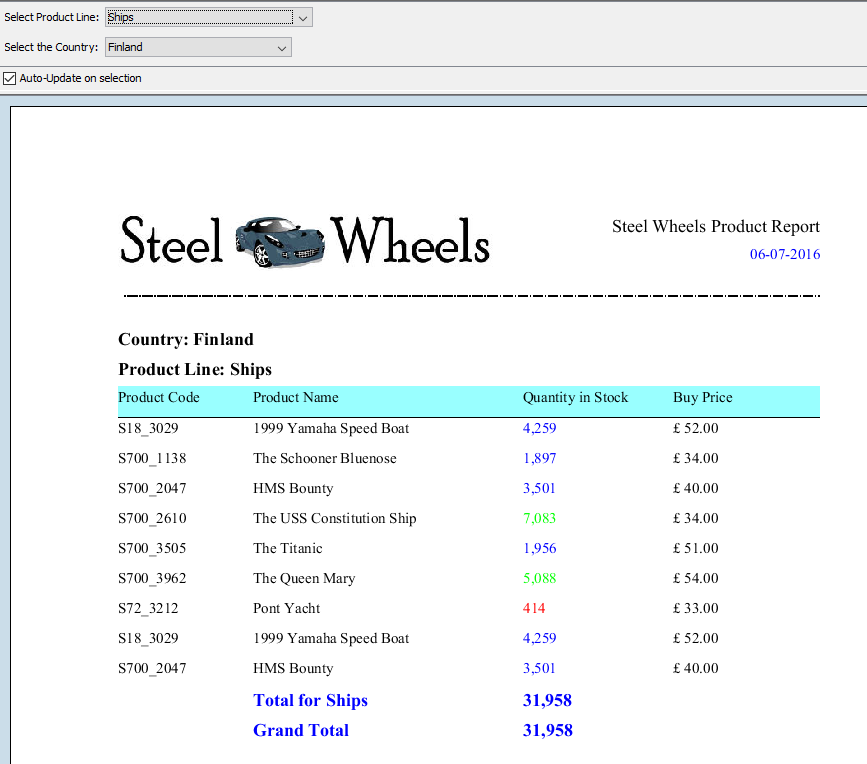
<figcaption>Ships in Finland; the screenshot's report also groups by country</figcaption>
</figure>
</div>

> **Success:** Checkpoint: 9 rows, and **Total for Product Line: Ships** and **Grand Total** both read 31,958.

10. Select **Design**, and save the report (`Ctrl+S`).

> **Under the hood:**
>
> #### Each prompt is a query, and a query can depend on another parameter
>
> Each list parameter has its own query. Here the two are independent:
> `country_list` returns all 27 countries whatever the product line.
> If `country_list` mentioned `${product_var}` (countries with orders
> in the chosen line, say), the parameter framework would record the
> dependency: whenever the product line changed it would re-run the
> country query, rebuild that prompt, and drop a selection that is no
> longer valid. That is a *cascading* prompt.
>
> **Why it matters:** cascading filters are ordinary SQL plus a
> naming convention. There is no wiring diagram to maintain, only the
> parameter names the queries mention.

11. Optional: group the report by `COUNTRY`, outside the product line group, with a `Country: $(COUNTRY)` message in its header, as in the screenshot above.

::::

## Lab Files

Click a file to download. For `.prpt` files, **Open in Pentaho Report Designer** starts Report Designer with the report loaded.

### Solution <!-- no-step -->

The finished reports for this lab: the product line prompt, then both prompts. Open them alongside your own to compare, or preview them to see the expected result.

[Training Demo Report 7 parameters.prpt](./files/Training%20Demo%20Report%207%20parameters.prpt) <button data-launch="prd" data-path="files/Training Demo Report 7 parameters.prpt">Open in Pentaho Report Designer</button>

[Training Demo Report 7 parameters prod & country.prpt](./files/Training%20Demo%20Report%207%20parameters%20prod%20%26%20country.prpt) <button data-launch="prd" data-path="files/Training Demo Report 7 parameters prod & country.prpt">Open in Pentaho Report Designer</button>
