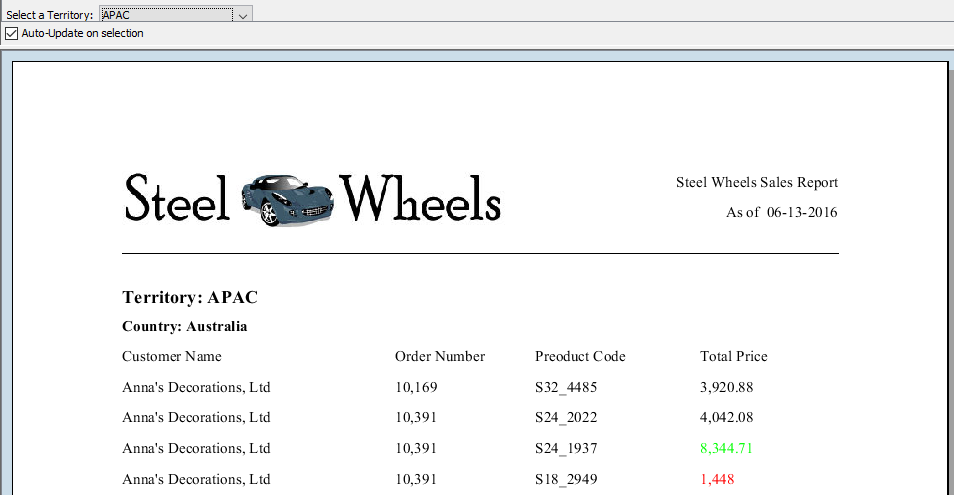

# Practice: Parameters

> **Warning:**
>
> #### Workshop - Practice: Parameters
>
> Add a territory prompt to the exercise report, on your own: a query for the choices, a parameter, and a condition in the main query.
>
> **What you'll do**
>
> * Add a `territory_list` query to the data source
> * Add a `territory_var` drop-down parameter
> * Filter `Query 1` with it
> * Confirm the prompt filters the data
>
> **Prerequisites:** [Practice: Formatting](../16-mod6-practice/guide.md) and its report, `Exercise - formatting.prpt`; [Report Parameters](../18-mod7-parameters/guide.md)
>
> **Estimated time:** 20 minutes

:::: tabs

### 1. The territory prompt

> **Note:**
>
> #### A query, a parameter, a condition
>
> The same three pieces as in the guided workshop, for the territory.

1. Start Report Designer with the **Start Pentaho Report Designer** button below, or from a terminal:

::: tabs

### Windows (PowerShell)

```powershell
Set-Location C:\Pentaho\design-tools\report-designer
.\report-designer.bat
```

### macOS / Linux

```bash
cd ~/Pentaho/design-tools/report-designer
./report-designer.sh
```

:::

<button data-launch="prd" data-path="">Start Pentaho Report Designer</button>

2. Select **File > Open** (`Ctrl+O`) and open `Exercise - formatting.prpt` from your workshop folder, `Documents\RD-Workshop`.
3. Select **File > Save As** and save it as `Exercise - parameters.prpt`.
4. On the **Data** tab, double-click **JDBC: SampleData (Hypersonic)**, select the green plus (**Add Query**), set **Query Name** to `territory_list`, and enter:

```sql
select distinct territory from customer_w_ter
```

5. Select **Preview**.

> **Success:** Checkpoint: 5 rows: the four territories `APAC`, `EMEA`, `Japan` and `NA`, and one row with no value, for the 22 customers that have no territory.

6. Close the preview window, and select **OK**.
7. On the **Data** tab, right-click **Parameters** and select **Add Parameter**. Under **DataSources**, select `territory_list`, set the fields as in this table, and select **OK**:

| Field | Value |
| --- | --- |
| **Name** | `territory_var` |
| **Label** | `Select a Territory:` |
| **Value Type** | `String` |
| **Default Value** | `APAC` |
| **Display Type** | `Drop Down` |
| **Query** | `territory_list` |
| **Value** | `TERRITORY` |
| **Display Name** | `TERRITORY` |
| **Validate Values** | Selected |

8. Double-click the data source, select `Query 1`, and add this line above `ORDER BY`:

```sql
WHERE territory IN (${territory_var})
```

9. Select **OK**, then select **Preview**.

<div align="center">
<figure>

<figcaption>The exercise report filtered to APAC</figcaption>
</figure>
</div>

> **Success:** Checkpoint: the prompt **Select a Territory:** shows `APAC`, and the report opens with `Territory: APAC` and `Country: Australia`.

10. In the prompt, select `EMEA`.

> **Success:** Checkpoint: the report starts with `Territory: EMEA` and `Country: Austria`, and its last page ends with **Total for: EMEA** and **Grand Total:** both 5,008,224.32.

11. Select **Design**, and save the report (`Ctrl+S`).

> **Under the hood:**
>
> #### A filtered query makes the totals follow the prompt
>
> The territory filter is in the SQL, so the database returns only
> the chosen territory's rows. Every function in the report works on
> what the query returned, which is why the grand total now equals the
> EMEA total: the other territories never reached the engine.
>
> **Why it matters:** filter in the query, not in the layout. Hiding
> rows in the report would leave them in every total, and would still
> fetch them from the database.

::::

## Lab Files

_No bundled files for this lab._
