# Charts & Sub Reports

> **Warning:**
>
> #### Workshop - Charts & Sub Reports
>
> Build a landscape report whose header holds a radar chart of list prices by vendor and product line and, beside it, a sub-report that lists the same figures as a table.
>
> **What you'll do**
>
> * Set up a report on a summary query, in landscape
> * Add a chart and make it a radar chart
> * Feed the chart a category, a value and a series
> * Add an inline sub-report beside the chart, with its own layout
>
> **Prerequisites:** [Connect to a JDBC Data Source](../05-mod3-connect-jdbc/guide.md) and [Adding Data Elements and Report Groups](../07-mod4-adding-elements-groups/guide.md)
>
> **Estimated time:** 15 minutes

:::: tabs

### 1. The report and its query

> **Note:**
>
> #### A summary query
>
> The chart and the sub-report read one query: the total list price (`MSRP`) of each vendor's products in each product line. `Sub Chart Demo Report.prpt` on the [Course Files](../33-ref-course-files/guide.md) page already holds it; these steps build the same report.

1. Start Report Designer with the **Start Pentaho Report Designer** button below, or from a terminal:

::: tabs

### Windows (PowerShell)

```powershell
Set-Location C:\Pentaho\design-tools\report-designer
.\report-designer.bat
```

### macOS / Linux

```bash
cd ~/Pentaho/design-tools/report-designer
./report-designer.sh
```

:::

<button data-launch="prd" data-path="">Start Pentaho Report Designer</button>

2. Select **File > New** (`Ctrl+N`).
3. Select **Data > Add Datasource > JDBC**, select **SampleData (Hypersonic)**, select the green plus (**Add Query**), keep the name `Query 1`, and enter in the **Query** box:

```sql
SELECT
     "PRODUCTS"."PRODUCTLINE",
     "PRODUCTS"."PRODUCTVENDOR",
     sum("PRODUCTS"."MSRP") AS MSRP
FROM
     "PRODUCTS"
GROUP BY
     "PRODUCTS"."PRODUCTVENDOR",
     "PRODUCTS"."PRODUCTLINE"
ORDER BY
     "PRODUCTS"."PRODUCTVENDOR" ASC,
     "PRODUCTS"."PRODUCTLINE" ASC
```

4. Select **Preview**.

> **Success:** Checkpoint: 65 rows, one for each vendor and product line; the first is `Autoart Studio Design`, `Classic Cars`, `195`.

5. Close the preview window, and select **OK**.
6. Select **File > Save As** and save the report as `Demo - charts.prpt` in your workshop folder, `Documents\RD-Workshop`.
7. On the **Data** tab, expand the data source and `Query 1`. It has three fields: `PRODUCTLINE`, `PRODUCTVENDOR` and `MSRP`.

<div align="center">
<figure>
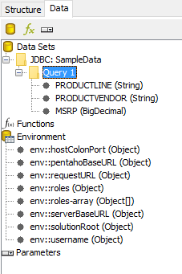
<figcaption>The three fields of the query</figcaption>
</figure>
</div>

8. Select **File > Page Setup**. Under **Orientation**, select **Landscape**, and select **OK**.
9. In the **Resize Report Elements** dialog, select **Do not change the layout**, and select **OK**.

<div align="center">
<figure>
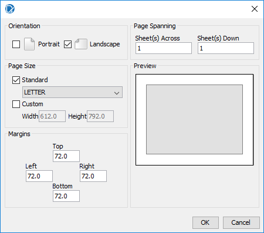
<figcaption>Landscape orientation</figcaption>
</figure>
</div>

### 2. A radar chart

> **Note:**
>
> #### The chart element
>
> A **chart** starts as a bar chart with sample data. The **Edit Chart** dialog sets its type and, on the **Primary DataSource** tab, the fields it reads: the category, the values and the series.

1. From the palette, drag a **chart** onto the **Report Header** band.

<div align="center">
<figure>
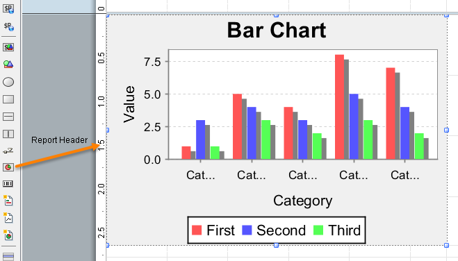
<figcaption>A new chart is a bar chart with sample data</figcaption>
</figure>
</div>

2. Double-click the chart. The **Edit Chart** dialog opens: the chart types across the top, the chart's own properties on the left, and the data it reads on the right.

<div align="center">
<figure>
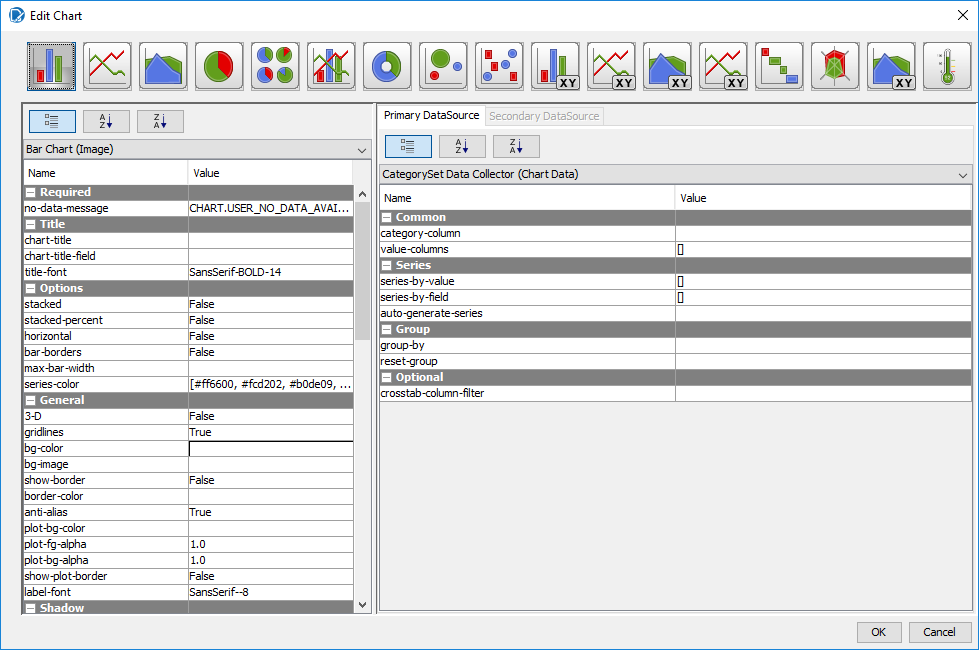
<figcaption>The Edit Chart dialog</figcaption>
</figure>
</div>

3. Select the **Radar Chart** button.

<div align="center">
<figure>
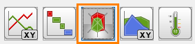
<figcaption>The Radar Chart button</figcaption>
</figure>
</div>

4. On the **Primary DataSource** tab, set **category-column** to `PRODUCTVENDOR`.

<div align="center">
<figure>
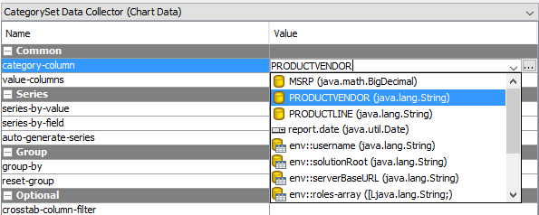
<figcaption>The category: one spoke per vendor</figcaption>
</figure>
</div>

5. Select the **...** button of **value-columns**. In the **Edit Array** dialog, select `MSRP` under **Available Items**, select the right arrow to move it to **Selected Items**, and select **OK**.

<div align="center">
<figure>
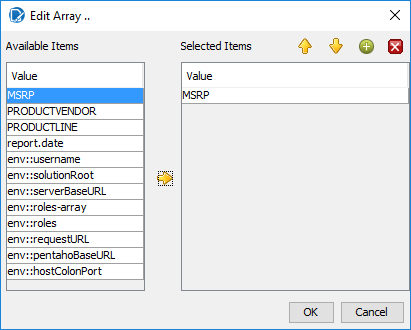
<figcaption>The value: MSRP</figcaption>
</figure>
</div>

6. Set **series-by-field** to `PRODUCTLINE` the same way.

<div align="center">
<figure>
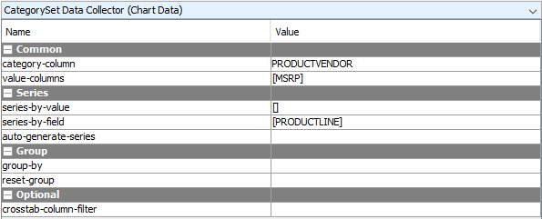
<figcaption>Category, value and series set</figcaption>
</figure>
</div>

7. Select **OK**. The chart on the canvas is now a radar chart, still with sample data.

<div align="center">
<figure>
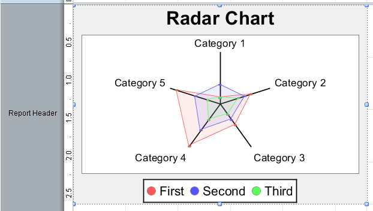
<figcaption>The canvas shows sample data; preview shows yours</figcaption>
</figure>
</div>

8. Drag the chart's handles so that it sits in the top left of the band, about 4.25 inches wide and 2.5 inches high.
9. Select **Preview**.

<div align="center">
<figure>
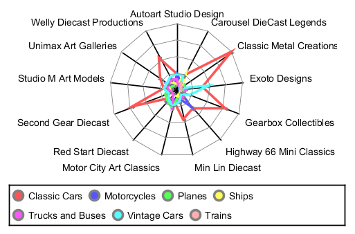
<figcaption>The radar chart on real data</figcaption>
</figure>
</div>

> **Success:** Checkpoint: a radar chart with 13 spokes, one for each vendor, and a colored line for each of the seven product lines, named in the legend.

10. Select **Design**, and save the report (`Ctrl+S`).

> **Under the hood:**
>
> #### The chart is an expression fed by a collector, and both ran before the header printed
>
> The bundle now holds a `RadarChartExpression` paired with a
> `CategorySetDataCollector`. The collector is a function: during the
> pagination pass it visits every row of Query 1 and accumulates a
> JFreeChart dataset keyed by your category column (`PRODUCTVENDOR`),
> value column (`MSRP`) and series field (`PRODUCTLINE`). When the
> Report Header band is printed, the chart expression draws that
> completed dataset. Change the chart type and only the expression
> changes; the collected data is the same.
>
> **Why it matters:** a chart summarizing the whole report can sit
> above the detail it summarizes, with no extra query, because the
> engine had already read every row by the time it drew the header.

### 3. A sub-report

> **Note:**
>
> #### Sub-reports
>
> A **sub-report** is a report inside a report, with its own bands and its own query. Placed in the **Report Header**, it runs once.

1. From the palette, drag a **sub-report** onto the right side of the **Report Header** band. In the **Insert Subreport** dialog, select **Inline**.

<div align="center">
<figure>
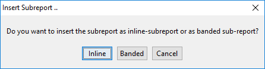
<figcaption>Inline or banded</figcaption>
</figure>
</div>

2. In the **Select Data Source** dialog, select `Query 1`, and select **OK**. The sub-report opens in a tab of its own.

<div align="center">
<figure>
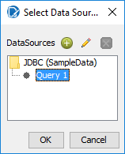
<figcaption>The sub-report reuses Query 1</figcaption>
</figure>
</div>

3. Select the master report's tab, `Demo - charts`. Drag the sub-report element's handles so that it starts at 4.5 inches on the top ruler, reaches the right edge of the band, and is as high as the chart.

<div align="center">
<figure>
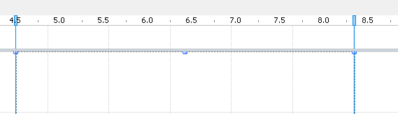
<figcaption>The sub-report from 4.5 inches to the right edge</figcaption>
</figure>
</div>

4. Select the sub-report's tab. From the **Data** tab, drag `PRODUCTVENDOR`, `PRODUCTLINE` and `MSRP` onto its **Details** band, side by side.

<div align="center">
<figure>
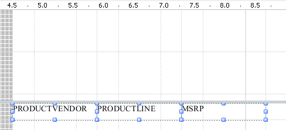
<figcaption>The sub-report's fields</figcaption>
</figure>
</div>

5. In the sub-report's **Structure** tab, select **Details Header**, and on the **Attributes** tab set **hide-on-canvas** to `False`.
6. Drag three **label** elements onto the **Details Header** band, one above each field, with the text `Product Vendor`, `Product Line` and `MSRP`. Drag a **horizontal-line** under them.

<div align="center">
<figure>
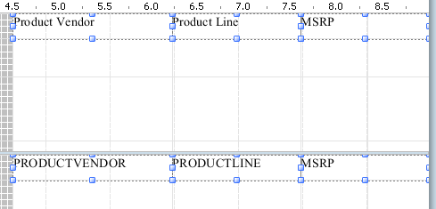
<figcaption>The sub-report's column labels</figcaption>
</figure>
</div>

7. Drag the dividers of the sub-report's bands up, so that each band is only as high as its elements.
8. Select the master report's tab, and select **Preview**.

<div align="center">
<figure>
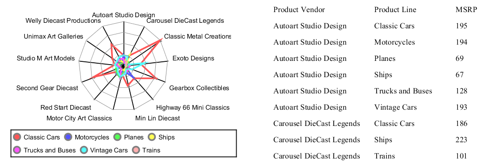
<figcaption>The chart and the sub-report side by side</figcaption>
</figure>
</div>

> **Success:** Checkpoint: the radar chart on the left and, to its right, the sub-report's table under **Product Vendor**, **Product Line** and **MSRP**, starting with `Autoart Studio Design`, `Classic Cars`, `195`.

9. Select **Design**, and save the report (`Ctrl+S`).

> **Under the hood:**
>
> #### A sub-report is a whole report inside the bundle, run when its band prints
>
> The zip gained a `subreport/` folder with its own `layout.xml` and
> data definition, referenced from the master as `<sub-report
> href="/subreport/content.xml">`. It has its own bands, functions and
> (here, by reuse) the parent's data source and Query 1. The engine
> executes it each time the containing band is processed: once for a
> Report Header, but once *per group* if you put it in a Group Header,
> and once per row in the Details band.
>
> **Why it matters:** anything that needs a second query, a different
> grouping or a different orientation can be composed in rather than
> forced into one query, and the "runs once per band instance" rule
> is what turns a sub-report in a group header into a master-detail
> report.

**Inline or banded**

Every report prints its bands relative to its own position on the page. A master report starts at the top left corner of the first page, so all its bands print from the left edge.

* A **banded** sub-report prints at the left edge of its parent, like another band.
* An **inline** sub-report prints where its element sits in the parent band, at the element's x and y position, so it can sit beside other elements, as this one sits beside the chart. A sub-report inside it is offset by both positions.

The dark gray area at the left of an inline sub-report's canvas is the space to the left of its element in the parent. You can't place elements there; move the sub-report element in the parent instead.

::::

## Lab Files

Click a file to download. For `.prpt` files, **Open in Pentaho Report Designer** starts Report Designer with the report loaded.

### Solution <!-- no-step -->

The finished report for this lab. Open it alongside your own to compare, or preview it to see the expected result. It puts the column labels in the master report's **Page Header** band instead of the sub-report.

[Training Demo Report 8 charts.prpt](./files/Training%20Demo%20Report%208%20charts.prpt) <button data-launch="prd" data-path="files/Training Demo Report 8 charts.prpt">Open in Pentaho Report Designer</button>

### More examples <!-- no-step -->

A chart report from the course's samples:

[chart report.prpt](./files/chart%20report.prpt) <button data-launch="prd" data-path="files/chart report.prpt">Open in Pentaho Report Designer</button>

A report with a sub-report that lists the lines of each order:

[Order Details - sub report.prpt](./files/Order%20Details%20-%20sub%20report.prpt) <button data-launch="prd" data-path="files/Order Details - sub report.prpt">Open in Pentaho Report Designer</button>
