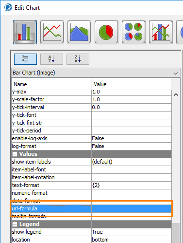
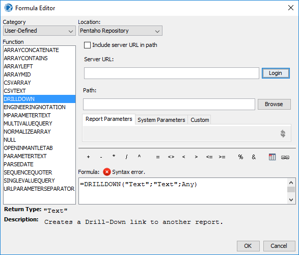
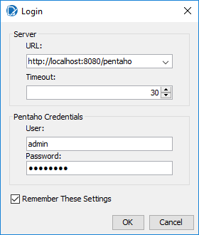
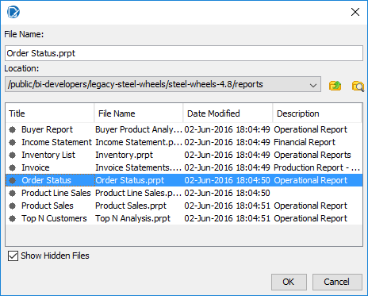
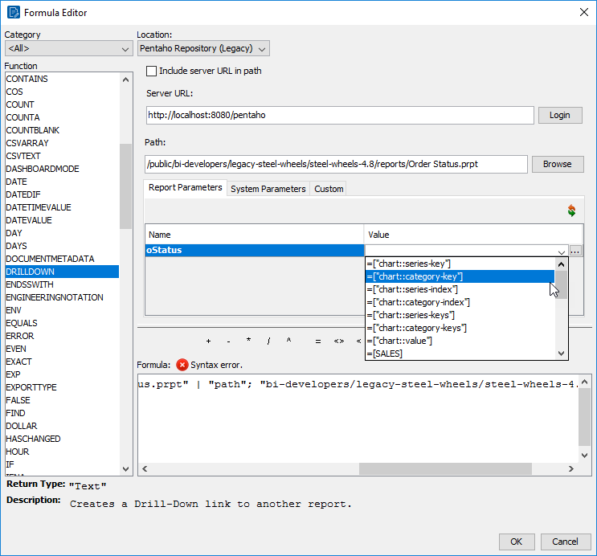

# Drilldown Charts

> **Warning:**
>
> #### Workshop - Drilldown Charts
>
> Build a bar chart of orders by status whose bars are links: select a bar in the HTML output and the **Order Status** report on the Pentaho Server opens for that status.
>
> **What you'll do**
>
> * Build a bar chart on a summary query
> * Give the chart a title and axis titles
> * Build a `DRILLDOWN` formula that opens a report on the server
> * Pass the selected bar to that report's parameter
> * Test the links in HTML output
>
> **Prerequisites:** [Charts & Sub Reports](../21-mod8-charts-sub-reports/guide.md); the Pentaho Server running, and its administrator sign-in from [Before You Start](../01-mod1-getting-started/guide.md)
>
> **Estimated time:** 15 minutes

:::: tabs

### 1. The chart

> **Note:**
>
> #### Orders by status
>
> The chart reads one row per order status, leaving out `Shipped`. `Order Status Chart.prpt` on the [Course Files](../33-ref-course-files/guide.md) page already holds the query and a taller **Report Header**; these steps build the same report.

1. Start Report Designer with the **Start Pentaho Report Designer** button below, or from a terminal:

::: tabs

### Windows (PowerShell)

```powershell
Set-Location C:\Pentaho\design-tools\report-designer
.\report-designer.bat
```

### macOS / Linux

```bash
cd ~/Pentaho/design-tools/report-designer
./report-designer.sh
```

:::

<button data-launch="prd" data-path="">Start Pentaho Report Designer</button>

2. Select **File > New** (`Ctrl+N`).
3. Select **Data > Add Datasource > JDBC**, select **SampleData (Hypersonic)**, select the green plus (**Add Query**), keep the name `Query 1`, and enter in the **Query** box:

```sql
SELECT
	"ORDERFACT"."STATUS",
	sum("CUSTOMER_W_TER"."CREDITLIMIT") AS Sales
FROM
	"ORDERFACT" INNER JOIN "CUSTOMER_W_TER" ON "ORDERFACT"."CUSTOMERNUMBER" = "CUSTOMER_W_TER"."CUSTOMERNUMBER"
WHERE
	"ORDERFACT"."STATUS" NOT LIKE 'Shipped'
GROUP BY
	"ORDERFACT"."STATUS"
ORDER BY
	"ORDERFACT"."STATUS" ASC
```

4. Select **Preview**.

> **Success:** Checkpoint: 5 rows, one for each status other than `Shipped`: `Cancelled`, `Disputed`, `In Process`, `On Hold` and `Resolved`.

5. Close the preview window, and select **OK**.
6. Select **File > Save As** and save the report as `Demo - drilldown chart.prpt` in your workshop folder, `Documents\RD-Workshop`.
7. Drag the divider at the bottom of the **Report Header** band down to about 4 inches.
8. From the palette, drag a **chart** onto the **Report Header** band, and drag its handles so that it fills the band: 6.5 inches wide and 4 inches high.
9. Double-click the chart. In the **Edit Chart** dialog, keep the bar chart, and on the **Primary DataSource** tab set **category-column** to `STATUS` and **value-columns** to `SALES`: select the **...** button, move `SALES` to **Selected Items** in the **Edit Array** dialog, and select **OK**.
10. In the chart's properties on the left, set:

| Property | Value |
| --- | --- |
| **chart-title** | `Sales by Order Status` |
| **x-axis-title** | `Status` |
| **y-axis-title** | `Sales` |
| **show-legend** | `False` |

11. Select **OK**, then select **Preview**.

> **Success:** Checkpoint: a bar chart titled **Sales by Order Status**, with five bars from `Cancelled` to `Resolved`.

12. Select **Design**, and save the report (`Ctrl+S`).

### 2. The drill link

> **Note:**
>
> #### url-formula
>
> A chart's **url-formula** gives every bar a link. The `DRILLDOWN` function builds a link to a report on the Pentaho Server and passes it values from the bar, such as its category.

1. Double-click the chart. In the chart's properties, in the **Values** group, select the **...** button of **url-formula**. The **Formula Editor** opens.

<div align="center">
<figure>

<figcaption>url-formula and tooltip-formula, in the Values group</figcaption>
</figure>
</div>

2. Set **Category** to `User-Defined`, and double-click `DRILLDOWN` in **Function**. The editor shows the drill-down settings: **Location**, **Server URL**, **Path** and the parameter tabs.

<div align="center">
<figure>

<figcaption>DRILLDOWN in the Formula Editor</figcaption>
</figure>
</div>

3. Set **Location** to `Pentaho Repository (Legacy)`.
4. Select **Login**. In the **Login** dialog, check that **URL** is `http://localhost:8080/pentaho`, enter the administrator user and password from [Before You Start](../01-mod1-getting-started/guide.md), and select **OK**.

<div align="center">
<figure>

<figcaption>Sign in to the server to browse its reports</figcaption>
</figure>
</div>

> **Warning:** The link opens `/public/bi-developers/legacy-steel-wheels/steel-wheels-4.8/reports/Order Status.prpt`, a report with an `oStatus` parameter. The Pentaho 11 sample content has no `reports` folder there. If your server lacks it, publish `Order+Status.prpt` from the [Course Files](../33-ref-course-files/guide.md) page to that folder as `Order Status.prpt` first, as in [Publishing Reports](../26-mod9-publishing/guide.md).

5. Select **Browse**. Select **Show Hidden Files**, open `/public/bi-developers/legacy-steel-wheels/steel-wheels-4.8/reports`, select **Order Status**, and select **OK**. **Path** now holds the report's path.

<div align="center">
<figure>

<figcaption>The target report on the server</figcaption>
</figure>
</div>

6. On the **Report Parameters** tab, open the **Value** list of `oStatus` and select `=["chart::category-key"]`: the status of the bar the reader selects.

<div align="center">
<figure>

<figcaption>oStatus takes the selected bar's category</figcaption>
</figure>
</div>

> **Success:** Checkpoint: the **Formula** box holds:
>
> ```text
> =DRILLDOWN("local-sugar"; NA(); {"oStatus"; ["chart::category-key"] | "::pentaho-path"; "/public/bi-developers/legacy-steel-wheels/steel-wheels-4.8/reports/Order Status.prpt"})
> ```

7. Select **OK**.
8. In the **Values** group, set **tooltip-formula** to `=["chart::category-key"]`, so that each bar shows its status when the pointer rests on it.
9. Select **OK** to close **Edit Chart**, and save the report (`Ctrl+S`).

> **Under the hood:**
>
> #### DRILLDOWN builds a viewer URL from a profile
>
> `url-formula` is evaluated once per chart item, with the item's
> context exposed as fields: `["chart::category-key"]` is the
> category the bar belongs to. `DRILLDOWN` takes a profile name, a
> server (`NA()` means the one the report is running on) and a list of
> parameters, and assembles the target URL from the profile's
> template: `local-sugar` knows the Pentaho Server's viewer URL pattern
> and encodes `::pentaho-path` and `oStatus` into it. The HTML output
> processor then writes each bar as an image-map area with that href.
>
> Only HTML has clickable regions, which is why you test the links in
> HTML; PDF gets the picture without the links.
>
> **Why it matters:** a drillable chart is a formula, not JavaScript.
> Change the target report or add a parameter and the URLs regenerate
> for every bar, every run.

10. Select **File > Preview > HTML**. The report opens in your web browser.

> **Success:** Checkpoint: resting the pointer on a bar shows its status. Selecting a bar opens the **Order Status** report for that status, after you sign in to the server.

::::

## Lab Files

Click a file to download. For `.prpt` files, **Open in Pentaho Report Designer** starts Report Designer with the report loaded.

### Solution <!-- no-step -->

The finished report for this lab. Open it alongside your own to compare.

[Training Demo Report 8-1 drilldown charts.prpt](./files/Training%20Demo%20Report%208-1%20drilldown%20charts.prpt) <button data-launch="prd" data-path="files/Training Demo Report 8-1 drilldown charts.prpt">Open in Pentaho Report Designer</button>

### More examples <!-- no-step -->

A drillable sales chart from the course's samples:

[chart drillable.prpt](./files/chart%20drillable.prpt) <button data-launch="prd" data-path="files/chart drillable.prpt">Open in Pentaho Report Designer</button>
