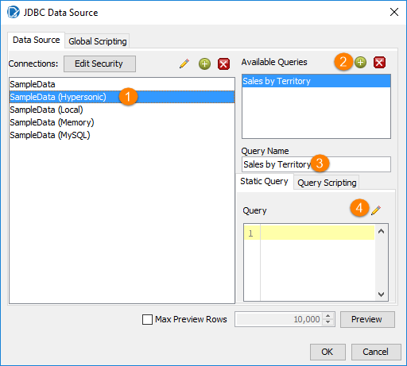
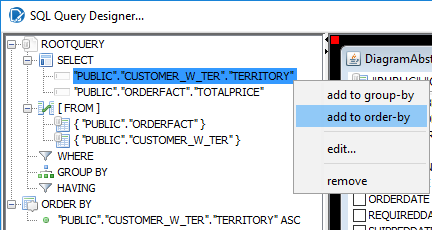
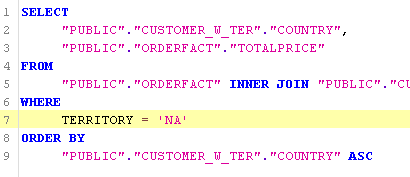
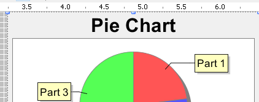
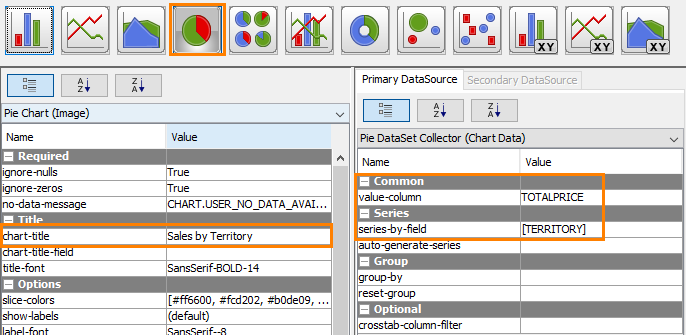
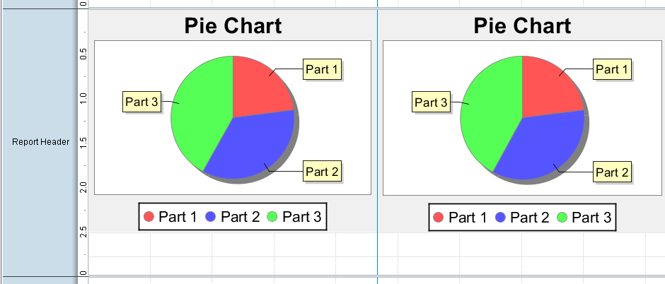
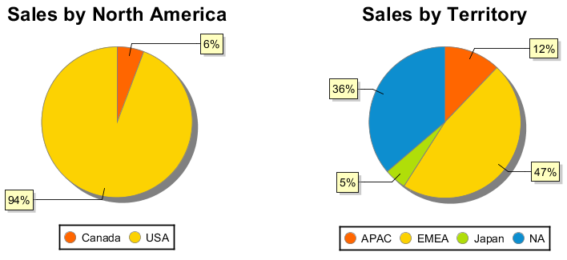

# Multiple Sub Reports

> **Warning:**
>
> #### Workshop - Multiple Sub Reports
>
> Put two pie charts side by side, each in its own sub-report with its own query: sales by territory, and sales in North America by country.
>
> **What you'll do**
>
> * Add two named queries to one data source
> * Filter one of them with a `WHERE` clause
> * Add two inline sub-reports to the **Report Header** band, one per query
> * Put a pie chart in each sub-report
>
> **Prerequisites:** [Charts & Sub Reports](../21-mod8-charts-sub-reports/guide.md)
>
> **Estimated time:** 15 minutes

:::: tabs

### 1. Two queries

> **Note:**
>
> #### One query per chart
>
> Each chart reads its own query: territory and total price for every order line, and country and total price for the order lines of the `NA` territory. The pie chart adds up the prices itself, so neither query needs a `SUM`.

1. Start Report Designer with the **Start Pentaho Report Designer** button below, or from a terminal:

::: tabs

### Windows (PowerShell)

```powershell
Set-Location C:\Pentaho\design-tools\report-designer
.\report-designer.bat
```

### macOS / Linux

```bash
cd ~/Pentaho/design-tools/report-designer
./report-designer.sh
```

:::

<button data-launch="prd" data-path="">Start Pentaho Report Designer</button>

2. Select **File > New** (`Ctrl+N`).
3. Select **Data > Add Datasource > JDBC**, and select **SampleData (Hypersonic)**.
4. Select the green plus (**Add Query**), set **Query Name** to `Sales by Territory`, and select the pencil above the **Query** box to open the **SQL Query Designer**.

<div align="center">
<figure>

<figcaption>The Sales by Territory query</figcaption>
</figure>
</div>

5. Double-click `CUSTOMER_W_TER`, then `ORDERFACT`.
6. Drag `CUSTOMERNUMBER` in `CUSTOMER_W_TER` onto `CUSTOMERNUMBER` in `ORDERFACT` to join them.
7. Select the `CUSTOMER_W_TER` heading, select **deselect all**, and select `TERRITORY`.
8. Select the `ORDERFACT` heading, select **deselect all**, and select `TOTALPRICE`.
9. Under **SELECT**, right-click `"PUBLIC"."CUSTOMER_W_TER"."TERRITORY"` and select **add to order-by**.

<div align="center">
<figure>

<figcaption>Territory and total price, sorted by territory</figcaption>
</figure>
</div>

10. Select **OK**. The **Query** box holds:

```sql
SELECT
     "PUBLIC"."CUSTOMER_W_TER"."TERRITORY",
     "PUBLIC"."ORDERFACT"."TOTALPRICE"
FROM
     "PUBLIC"."ORDERFACT" INNER JOIN "PUBLIC"."CUSTOMER_W_TER" ON "PUBLIC"."ORDERFACT"."CUSTOMERNUMBER" = "PUBLIC"."CUSTOMER_W_TER"."CUSTOMERNUMBER"
ORDER BY
     "PUBLIC"."CUSTOMER_W_TER"."TERRITORY" ASC
```

11. Add a second query the same way, named `Sales by Country`, with `COUNTRY` and `TOTALPRICE`, sorted by `COUNTRY`.
12. In its **Query** box, click at the start of the `ORDER BY` line, press `Enter`, and enter above it:

```sql
WHERE
     TERRITORY = 'NA'
```

<div align="center">
<figure>

<figcaption>The filter for North America</figcaption>
</figure>
</div>

13. Select **Preview**.

> **Success:** Checkpoint: the order lines of the `NA` territory only, `Canada` first and then `USA`.

14. Close the preview window, and select **OK**.
15. Select **File > Save As** and save the report as `Demo - multiple sub reports.prpt` in your workshop folder, `Documents\RD-Workshop`.

### 2. Two sub-reports

> **Note:**
>
> #### A pie chart in each sub-report
>
> Each sub-report takes one query and holds one pie chart. The North America chart goes on the left, the territory chart on the right.

1. Drag the divider at the bottom of the **Report Header** band down to about 3 inches.
2. From the palette, drag a **sub-report** onto the right side of the **Report Header** band. Select **Inline**, then select `Sales by Territory` in the **Select Data Source** dialog, and select **OK**.
3. On the master report's tab, drag the sub-report element's handles so that it spans from about 3.4 inches to the right edge of the band, and is about 2.65 inches high.
4. Select the sub-report's tab. Drag the bottom of its **Report Header** band down to about 3 inches.
5. Drag a **chart** onto the sub-report's **Report Header** band, at the top left, and resize it to about 3.1 inches wide and 2.8 inches high.

<div align="center">
<figure>

<figcaption>A chart element in the sub-report</figcaption>
</figure>
</div>

6. Double-click the chart. In the **Edit Chart** dialog, select the **Pie Chart** button, and set:

| Where | Property | Value |
| --- | --- | --- |
| Chart properties, **Title** | **chart-title** | `Sales by Territory` |
| **Primary DataSource**, **Common** | **value-column** | `TOTALPRICE` |
| **Primary DataSource**, **Series** | **series-by-field** | `TERRITORY` |

<div align="center">
<figure>

<figcaption>The pie chart's title, value and series</figcaption>
</figure>
</div>

7. Select **OK**.
8. Select the master report's tab. Add a second inline **sub-report** on the left side of the **Report Header** band, with the `Sales by Country` query, spanning from the left edge to about 3.4 inches.
9. In the second sub-report, add a pie chart the same way, with **chart-title** `Sales by North America`, **value-column** `TOTALPRICE` and **series-by-field** `COUNTRY`.

<div align="center">
<figure>

<figcaption>Two sub-reports, each with a pie chart; the canvas shows sample data</figcaption>
</figure>
</div>

10. Select the master report's tab, and select **Preview**.

<div align="center">
<figure>

<figcaption>Two charts, two queries</figcaption>
</figure>
</div>

> **Success:** Checkpoint: **Sales by North America** on the left, with `Canada` at 6% and `USA` at 94%; **Sales by Territory** on the right, with `APAC` 12%, `EMEA` 47%, `Japan` 5% and `NA` 36%.

11. Select **Design**, and save the report (`Ctrl+S`).

> **Under the hood:**
>
> #### Two sub-reports, two queries, one page
>
> Each inline sub-report was bound to a different named query, Sales
> by Territory and Sales by Country, so when the master's Report
> Header band printed, the engine ran the first sub-report (its query,
> its collector, its pie chart), then the second, and placed each in
> its rectangle. The master's own data wasn't involved in either chart.
> The `WHERE TERRITORY = 'NA'` ran in the database; the pie's collector
> then added up `TOTALPRICE` for each country.
>
> **Why it matters:** side-by-side views of different questions are
> different queries composed on one page, each as simple as it can be:
> no unions, no pivoting a single result set to serve two charts.

::::

## Lab Files

Click a file to download. For `.prpt` files, **Open in Pentaho Report Designer** starts Report Designer with the report loaded.

### Solution <!-- no-step -->

The finished report for this lab. Open it alongside your own to compare, or preview it to see the expected result.

[Training Guided Demo Report 8-2 multiple sub.prpt](./files/Training%20Guided%20Demo%20Report%208-2%20multiple%20sub.prpt) <button data-launch="prd" data-path="files/Training Guided Demo Report 8-2 multiple sub.prpt">Open in Pentaho Report Designer</button>

The same report with a third sub-report in the **Details** band, which lists the North American order lines with their country and total price:

[Training Guided Demo Report 8-2a multiple sub.prpt](./files/Training%20Guided%20Demo%20Report%208-2a%20multiple%20sub.prpt) <button data-launch="prd" data-path="files/Training Guided Demo Report 8-2a multiple sub.prpt">Open in Pentaho Report Designer</button>

### More examples <!-- no-step -->

A report on sales and volume by product line and year:

[Sub Report Activity.prpt](./files/Sub%20Report%20Activity.prpt) <button data-launch="prd" data-path="files/Sub Report Activity.prpt">Open in Pentaho Report Designer</button>

The starting report of [Charts & Sub Reports](../21-mod8-charts-sub-reports/guide.md), with its summary query and no layout:

[Sub Chart Demo Report.prpt](./files/Sub%20Chart%20Demo%20Report.prpt) <button data-launch="prd" data-path="files/Sub Chart Demo Report.prpt">Open in Pentaho Report Designer</button>
