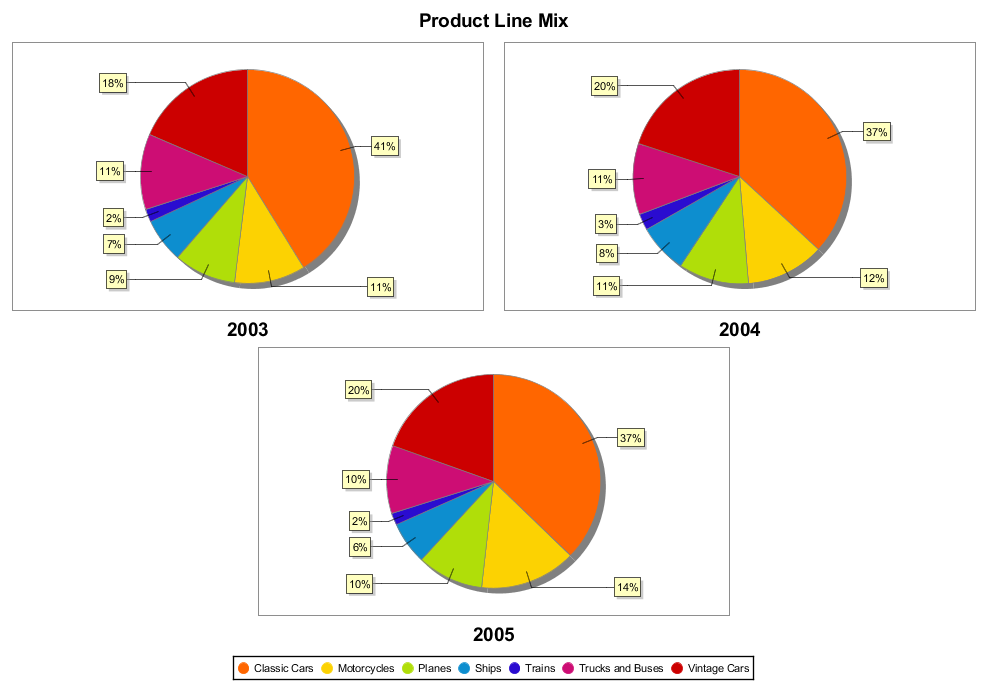
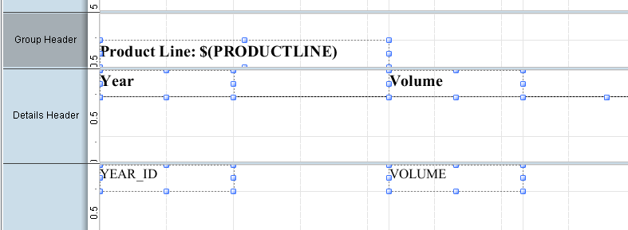
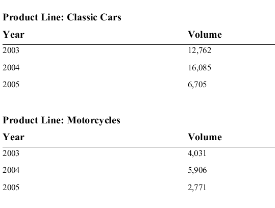
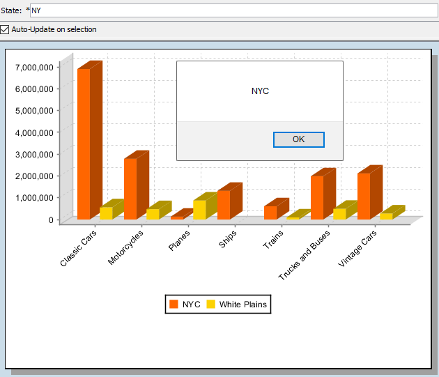

# Practice: Charts & Sub Reports

> **Warning:**
>
> #### Workshop - Practice: Charts & Sub Reports
>
> Four exercises on your own: a multi-pie chart, a grouped sub-report, two summary sub-reports, and a 3-D chart with a parameter and a drill link.
>
> **What you'll do**
>
> * Add a multi-pie chart to a landscape report
> * Add a grouped sub-report in the **Report Footer** band
> * Add two summary sub-reports to the multiple sub-reports report
> * Make a chart 3-D, filter it with a parameter, and add a JavaScript drill link
>
> **Prerequisites:** [Charts & Sub Reports](../21-mod8-charts-sub-reports/guide.md), [Drilldown Charts](../22-mod8-drilldown-charts/guide.md) and [Multiple Sub Reports](../23-mod8-multiple-sub-reports/guide.md), with its report `Demo - multiple sub reports.prpt`
>
> **Estimated time:** 30 minutes

:::: tabs

### 1. Multi-pie chart

> **Note:**
>
> #### Product line mix by year
>
> A multi-pie chart draws one pie per series value. Here each year gets a pie of sales by product line. The starting report, `Sub Report Activity.prpt`, is in the **Lab Files** of [Multiple Sub Reports](../23-mod8-multiple-sub-reports/guide.md): download it into your workshop folder first.

1. Start Report Designer with the **Start Pentaho Report Designer** button below, or from a terminal:

::: tabs

### Windows (PowerShell)

```powershell
Set-Location C:\Pentaho\design-tools\report-designer
.\report-designer.bat
```

### macOS / Linux

```bash
cd ~/Pentaho/design-tools/report-designer
./report-designer.sh
```

:::

<button data-launch="prd" data-path="">Start Pentaho Report Designer</button>

2. Select **File > Open** (`Ctrl+O`) and open `Sub Report Activity.prpt` from your workshop folder, `Documents\RD-Workshop`.
3. Select **File > Save As** and save it as `Exercise - charts.prpt`.
4. On the **Data** tab, double-click `Query 1` to read the query: `SALES` and `VOLUME` by product line and year. Select **OK**.
5. Select **File > Page Setup**, select **Landscape**, and set the four margins to `18`. Select **OK**, then select **Do not change the layout** and **OK**.
6. Drag the bottom of the **Report Header** band down to about 7 inches, drag a **chart** onto it, and resize the chart to fill the band.
7. Double-click the chart, select the **Multi Pie Chart** button, and set:

| Property | Value |
| --- | --- |
| **chart-title** | `Product Line Mix` |
| **category-column** | `PRODUCTLINE` |
| **value-columns** | `SALES` |
| **series-by-field** | `YEAR_ID` |

8. Select **OK**, then select **Preview**.

<div align="center">
<figure>

<figcaption>One pie per year</figcaption>
</figure>
</div>

> **Success:** Checkpoint: **Product Line Mix** shows three pies, labeled `2003`, `2004` and `2005`, each split into the seven product lines, with Classic Cars the largest slice in each.

9. Select **Design**, and save the report (`Ctrl+S`).

### 2. A grouped sub-report

> **Note:**
>
> #### Volume by year, for each product line
>
> A sub-report in the **Report Footer** band, grouped by product line, lists the volume of each year.

1. From the palette, drag a **sub-report** onto the **Report Footer** band. Select **Inline**, select `Query 1` in **Select Data Source**, and select **OK**.
2. On the master report's tab, drag the bottom of the **Report Footer** band down to about 3 inches, and resize the sub-report element to fill the band.
3. On the sub-report's tab, drag `YEAR_ID` and `VOLUME` onto the **Details** band.
4. Show the **Details Header** band (**hide-on-canvas** `False`), and add the labels `Year` and `Volume` and a **horizontal-line** under them.
5. Add a group on `PRODUCTLINE` (**Add Group**), and a **message** element `Product Line: $(PRODUCTLINE)` in its **Group Header** band.
6. Select `YEAR_ID` in the **Details** band and select **Format > Morph > text-field**, so that the year prints without a thousands separator.

<div align="center">
<figure>

<figcaption>The grouped sub-report</figcaption>
</figure>
</div>

7. Select the master report's tab, and select **Preview**. Go to the last page.

<div align="center">
<figure>

<figcaption>Volume by year, grouped by product line</figcaption>
</figure>
</div>

> **Success:** Checkpoint: after the chart, the sub-report starts with **Product Line: Classic Cars**: 12,762 in 2003, 16,085 in 2004 and 6,705 in 2005. Motorcycles follows with 4,031, 5,906 and 2,771.

8. Select **Design**, and save the report (`Ctrl+S`).

### 3. Summary sub-reports

> **Note:**
>
> #### Totals beside the charts
>
> Add two small tables under the pie charts of `Demo - multiple sub reports.prpt`: the total sales of each territory, and of each North American country. Each table is a sub-report with a summary query.

1. Select **File > Open** (`Ctrl+O`), open `Demo - multiple sub reports.prpt`, and save it as `Exercise - multiple sub reports.prpt`.
2. Double-click the data source on the **Data** tab and add two queries:

`By Territory`:

```sql
SELECT
     "CUSTOMER_W_TER"."TERRITORY",
     sum("ORDERFACT"."TOTALPRICE") AS TOTAL
FROM
     "ORDERFACT" INNER JOIN "CUSTOMER_W_TER" ON "ORDERFACT"."CUSTOMERNUMBER" = "CUSTOMER_W_TER"."CUSTOMERNUMBER"
GROUP BY
     "CUSTOMER_W_TER"."TERRITORY"
ORDER BY
     "CUSTOMER_W_TER"."TERRITORY" ASC
```

`By Country`:

```sql
SELECT
     "CUSTOMER_W_TER"."COUNTRY",
     sum("ORDERFACT"."TOTALPRICE") AS TOTAL
FROM
     "ORDERFACT" INNER JOIN "CUSTOMER_W_TER" ON "ORDERFACT"."CUSTOMERNUMBER" = "CUSTOMER_W_TER"."CUSTOMERNUMBER"
WHERE
     "CUSTOMER_W_TER"."TERRITORY" = 'NA'
GROUP BY
     "CUSTOMER_W_TER"."COUNTRY"
ORDER BY
     "CUSTOMER_W_TER"."COUNTRY" ASC
```

3. Drag the bottom of the **Report Header** band down to about 4 inches.
4. Drag a **sub-report** onto the band below the territory chart. Select **Inline** and the `By Territory` query.
5. On the sub-report's tab, drag `TERRITORY` and `TOTAL` onto the **Details** band, and add the labels `Territory` and `Total` above them, in the sub-report's **Report Header** band.
6. On the master report's tab, add a second sub-report below the North America chart, with the `By Country` query, `COUNTRY` and `TOTAL`, and the labels `Country` and `Total`.
7. Select **Preview**.

> **Success:** Checkpoint: under the territory pie, `APAC` 1,281,705.89, `EMEA` 5,008,224.32, `Japan` 503,957.58 and `NA` 3,852,061.39; under the North America pie, `Canada` 224,078.56 and `USA` 3,627,982.83.

8. Select **Design**, and save the report (`Ctrl+S`).

### 4. A drillable 3-D chart

> **Note:**
>
> #### Quantity by product line and city
>
> The last exercise starts from `chart drillable.prpt`, in the **Lab Files** of [Drilldown Charts](../22-mod8-drilldown-charts/guide.md): its query reads the quantity ordered by product line and city for the state of New York, and its **Report Header** band is already tall. Download it into your workshop folder first.

1. Select **File > Open** (`Ctrl+O`), open `chart drillable.prpt`, and save it as `Exercise - drillable chart.prpt`.
2. Drag a **chart** onto the **Report Header** band and resize it to fill the band.
3. Double-click the chart, keep the bar chart, and set **category-column** to `PRODUCTLINE`, **value-columns** to `QUANTITY` and **series-by-field** to `CITY`.
4. Set **3-D** (in **General**) to `True`, and **x-axis-label-rotation** (in **X-Axis**) to `45`. Select **OK**.
5. Select **Preview**.

> **Success:** Checkpoint: a 3-D bar chart with the product lines along the x-axis at an angle, and one bar per New York city in each: `NYC` and `White Plains`.

6. Select **Design**. On the **Data** tab, right-click **Parameters** and select **Add Parameter**. Set the fields as in this table, and select **OK**:

| Field | Value |
| --- | --- |
| **Name** | `State` |
| **Label** | `State:` |
| **Value Type** | `String` |
| **Default Value** | `NY` |
| **Mandatory** | Selected |
| **Display Type** | `Text Box` |

7. Double-click the data source, select `Query 1`, and in its `WHERE` clause change `'NY'` to `${State}`, without the quotation marks:

```sql
	 AND CUSTOMER_W_TER.STATE = ${State}
```

8. Select **OK**, then select **Preview**. Enter `CA`, then `NJ`, in **State:**.

> **Success:** Checkpoint: the chart changes with the state: ten cities in the legend for `CA`, and one, `Newark`, for `NJ`.

9. Select **Design**, and double-click the chart. Select the **...** button of **url-formula** (in **Values**), and enter this formula on one line:

```text
="javascript:alert('" & ["chart::series-key"] & "')"
```

10. Select **OK**, then select **OK** to close **Edit Chart**.
11. Select **File > Preview > HTML**. In the browser, keep `NY` for the state, and select a bar.

<div align="center">
<figure>

<figcaption>A bar's alert shows its city</figcaption>
</figure>
</div>

> **Success:** Checkpoint: selecting a bar opens an alert box with the name of the bar's city. Select **OK** to close it.

12. Close the browser tab, and save the report (`Ctrl+S`).

> **Under the hood:**
>
> #### url-formula can return any URL, including JavaScript
>
> The HTML output writes each bar as an image-map area whose link is
> the result of **url-formula**, evaluated for that bar with the
> `chart::` fields bound to it. `["chart::series-key"]` is the bar's
> series, here the city. A `javascript:` URL runs in the browser
> instead of opening a page, which makes it a quick way to see what a
> drill link would pass before you point it at a real report.
>
> **Why it matters:** test the values first, then swap the `alert`
> for a `DRILLDOWN` to a report, with the same `chart::` field as its
> parameter.

::::

## Lab Files

_No bundled files for this lab._ The starting reports are in the **Lab Files** of [Drilldown Charts](../22-mod8-drilldown-charts/guide.md) and [Multiple Sub Reports](../23-mod8-multiple-sub-reports/guide.md).
