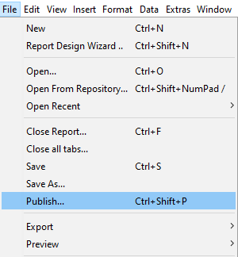
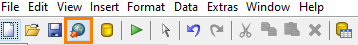
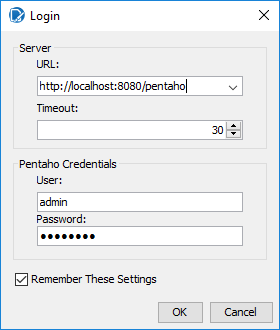
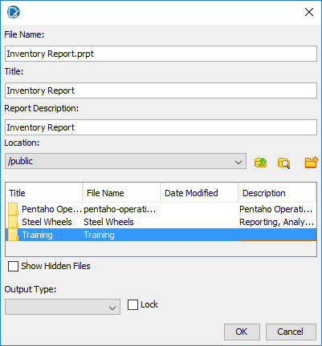
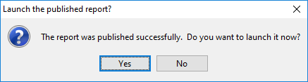
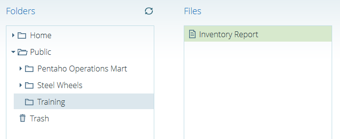
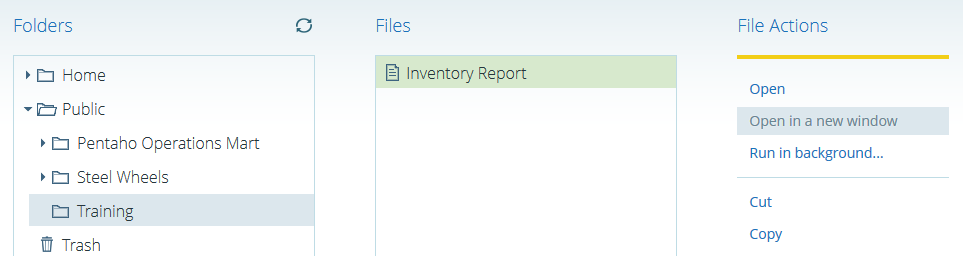

# Publishing Reports

> **Warning:**
>
> #### Workshop - Publishing Reports
>
> Publish a finished report from Report Designer to the Pentaho Server, run it in the Pentaho User Console (PUC), and find the URL that opens it on its own.
>
> **What you'll do**
>
> * Publish a report to the server's repository
> * Create a folder for it on the way
> * Open the published report in the User Console
> * Open it in a window of its own and read its URL
>
> **Prerequisites:** [Formatting the Report](../15-mod6-formatting-report/guide.md) and its report, `Demo - formatting.prpt`; the Pentaho Server running, and its administrator sign-in from [Before You Start](../01-mod1-getting-started/guide.md)
>
> **Estimated time:** 20 minutes

:::: tabs

### 1. Publish

> **Note:**
>
> #### File > Publish
>
> **Publish** uploads the report to the server's repository, where anyone with access to the folder can run it from the User Console.

1. Start Report Designer with the **Start Pentaho Report Designer** button below, or from a terminal:

::: tabs

### Windows (PowerShell)

```powershell
Set-Location C:\Pentaho\design-tools\report-designer
.\report-designer.bat
```

### macOS / Linux

```bash
cd ~/Pentaho/design-tools/report-designer
./report-designer.sh
```

:::

<button data-launch="prd" data-path="">Start Pentaho Report Designer</button>

2. Select **File > Open** (`Ctrl+O`) and open `Demo - formatting.prpt` from your workshop folder, `Documents\RD-Workshop`.
3. Select **File > Publish** (`Ctrl+Shift+P`).

<div align="center">
<figure>

<figcaption>File > Publish</figcaption>
</figure>
</div>

The **Publish** icon on the main toolbar does the same.

<div align="center">
<figure>

<figcaption>The Publish icon</figcaption>
</figure>
</div>

4. In the **Login** dialog, check that **URL** is `http://localhost:8080/pentaho`, enter the administrator user and password from [Before You Start](../01-mod1-getting-started/guide.md), and select **OK**.

<div align="center">
<figure>

<figcaption>Sign in to the server</figcaption>
</figure>
</div>

5. In the **Publish To Server** dialog, set **File Name** to `Inventory Report.prpt`, **Title** to `Inventory Report` and **Report Description** to `Inventory Report`.
6. Under **Location**, open `/public`. If it has no `Training` folder, select the new-folder icon, the rightmost, and create one named `Training`.
7. Double-click `Training`, so that **Location** reads `/public/Training`, and select **OK**.

<div align="center">
<figure>

<figcaption>The name, title and folder on the server</figcaption>
</figure>
</div>

> **Success:** Checkpoint: the **Launch the published report?** dialog says the report was published successfully.

8. Select **No**.

<div align="center">
<figure>

<figcaption>Published</figcaption>
</figure>
</div>

> **Under the hood:**
>
> #### Publish uploaded the bundle; the server runs the same engine
>
> Publish posted the `.prpt` over HTTP to the server's repository,
> where it became a file under `/public/Training` with that folder's
> permissions. When someone opens it, the server's reporting plugin
> unpacks the bundle, builds the prompt panel from
> `datadefinition.xml`, and runs the report with the reporting engine,
> the same library as Report Designer, using the connection stored in
> `datasources/sql-ds.xml`. For a driver-based connection that means
> the JDBC driver must be on the server too; a JNDI connection would
> resolve the name against the server's own data sources instead.
>
> **Why it matters:** publishing is a file upload, not a deployment.
> Republish and the next viewer gets the new version; nothing is
> compiled or installed.

### 2. Run it in the User Console

> **Note:**
>
> #### Browse Files
>
> The published report is a file in the repository: open it from **Browse Files** in the User Console.

1. Open `http://localhost:8080/pentaho` in your web browser and sign in with the same user.
2. Select **Browse Files**, and in **Folders** open **Public > Training**.
3. In **Files**, double-click **Inventory Report**.

<div align="center">
<figure>

<figcaption>The report in Public > Training</figcaption>
</figure>
</div>

> **Success:** Checkpoint: the report opens in a tab of the User Console, with the same header, groups and totals as in Report Designer's preview.

### 3. A URL for the report

> **Note:**
>
> #### Open in a new window
>
> A published report has a URL of its own, which opens it without the rest of the User Console: a link you can send to its readers.

1. In **Browse Files**, select **Inventory Report**, and under **File Actions** select **Open in a new window**.

<div align="center">
<figure>

<figcaption>Open in a new window</figcaption>
</figure>
</div>

> **Success:** Checkpoint: a new browser window shows the report alone, at this URL:
>
> ```text
> http://localhost:8080/pentaho/api/repos/%3Apublic%3ATraining%3AInventory%20Report.prpt/viewer
> ```

2. Copy the URL from the address bar: it is the link to send to the report's readers.

> **Under the hood:**
>
> #### The viewer URL is the repository path with colons for slashes
>
> `%3Apublic%3ATraining%3AInventory%20Report.prpt` is
> `/public/Training/Inventory Report.prpt` with each `/` written as
> `:` (URL-encoded as `%3A`) so the path fits in one URL segment. The
> `/viewer` suffix asks the reporting plugin for the page with the
> prompt panel; parameter values can be appended as ordinary query
> string arguments, and an `output-target` such as `pageable/pdf`
> selects the exporter. This is the URL shape the `DRILLDOWN`
> formula generates.
>
> **Why it matters:** every published report is an addressable URL
> with parameters. Email it, embed it in a dashboard, bookmark a
> specific parameter set: no portal navigation required.

**Next: hyperlinks**

A hyperlink has two parts: the *link*, the element the reader selects, and the *target*, what it opens: a web page, a file, another report, or a place in the same report. Report Designer can send values to the target report's parameters, which turns a link into a drill-down, and can put links on parts of a chart, as in [Drilldown Charts](../22-mod8-drilldown-charts/guide.md). Its link types:

| Link type | What it targets |
| --- | --- |
| **Self** | The current report, with new values for its parameters |
| **URL** | An external resource, such as a web site, an image or a file |
| **Pentaho Repository** | A report or another file in the Pentaho Server's repository; the server must be running, as it renders the target |
| **Manual Linking** | A link you write yourself, for example to an HTML anchor in the same report |

The next workshop, [Hyperlinks](../27-mod9-hyperlinks/guide.md), builds them.

::::

## Lab Files

_No bundled files for this lab._
