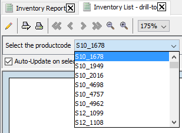
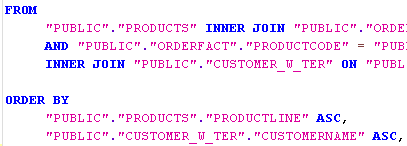
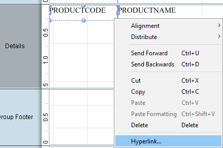
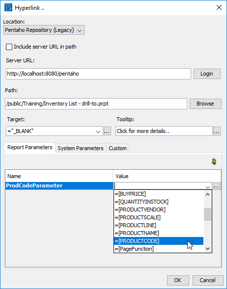
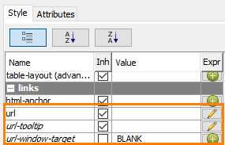
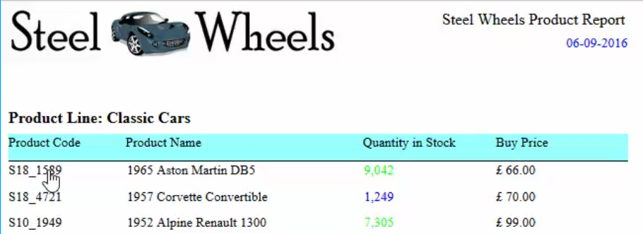

# Hyperlinks

> **Warning:**
>
> #### Workshop - Hyperlinks
>
> Make each product code in the report a link: selecting it opens a detail report on the Pentaho Server for that product, in a new window.
>
> **What you'll do**
>
> * Preview and publish the detail report, `Inventory List - drill-to`
> * Add a hyperlink to the `PRODUCTCODE` field
> * Pass the row's product code to the detail report's parameter
> * Test the links in HTML preview
>
> **Prerequisites:** [Publishing Reports](../26-mod9-publishing/guide.md), with a `Training` folder in `/public` on the server; `Demo - formatting.prpt` from [Formatting the Report](../15-mod6-formatting-report/guide.md)
>
> **Estimated time:** 15 minutes

:::: tabs

### 1. The detail report

> **Note:**
>
> #### The drill target
>
> `Inventory List - drill-to.prpt`, in **Lab Files** below, shows the product code, name, line, vendor and scale of the products you choose in its `ProdCodeParameter` prompt. Publish it, so the link has a target on the server.

1. Start Report Designer with the **Start Pentaho Report Designer** button below, or from a terminal:

::: tabs

### Windows (PowerShell)

```powershell
Set-Location C:\Pentaho\design-tools\report-designer
.\report-designer.bat
```

### macOS / Linux

```bash
cd ~/Pentaho/design-tools/report-designer
./report-designer.sh
```

:::

<button data-launch="prd" data-path="">Start Pentaho Report Designer</button>

2. Open `Inventory List - drill-to.prpt` with its **Open in Pentaho Report Designer** button in **Lab Files** below.
3. Select **Preview**, and in the **Select the productcode** prompt select `S10_1678`.

<div align="center">
<figure>

<figcaption>The detail report's product code prompt</figcaption>
</figure>
</div>

> **Success:** Checkpoint: the report shows one product, `S10_1678`, the `1969 Harley Davidson Ultimate Chopper`, a `Motorcycles` product by `Min Lin Diecast` at scale `1:10`.

4. Select **Design**, then select **File > Publish** (`Ctrl+Shift+P`) and sign in.
5. In the **Publish To Server** dialog, set **File Name** to `Inventory List - drill-to.prpt` and **Title** to `Inventory List - drill-to`, open `/public/Training` under **Location**, and select **OK**.
6. In the **Launch the published report?** dialog, select **No**.

<div align="center">
<figure>

<figcaption>Published</figcaption>
</figure>
</div>

### 2. The hyperlink

> **Note:**
>
> #### Hyperlink on a field
>
> A hyperlink on the `PRODUCTCODE` field opens the detail report and passes it the code of the row the reader selects.

1. Select **File > Open** (`Ctrl+O`) and open `Demo - formatting.prpt` from your workshop folder, `Documents\RD-Workshop`.
2. Select **File > Save As** and save it as `Demo - hyperlinks.prpt`.
3. On the **Data** tab, double-click the data source and select `Query 1`. Check that it has no `WHERE` clause: the hyperlink report shows every product line. Select **OK**.

<div align="center">
<figure>

<figcaption>Query 1 without a WHERE clause</figcaption>
</figure>
</div>

4. In the **Details** band, right-click `PRODUCTCODE` and select **Hyperlink**.

<div align="center">
<figure>

<figcaption>Right-click > Hyperlink</figcaption>
</figure>
</div>

5. In the **Hyperlink** dialog, set **Location** to `Pentaho Repository (Legacy)`, and check that **Server URL** is `http://localhost:8080/pentaho`.
6. Select **Browse**, sign in if asked, open `/public/Training`, select **Inventory List - drill-to**, and select **OK**. **Path** now reads `/public/Training/Inventory List - drill-to.prpt`.
7. Set **Target** to `_BLANK`, so the detail opens in a new window, and **Tooltip** to `Click for more details...`.
8. On the **Report Parameters** tab, open the **Value** list of `ProdCodeParameter` and select `=[PRODUCTCODE]`.

<div align="center">
<figure>

<figcaption>The target report, the window, the tooltip and the parameter</figcaption>
</figure>
</div>

9. Select **OK**, and save the report (`Ctrl+S`).

> **Success:** Checkpoint: with `PRODUCTCODE` selected, the **links** group of the **Style** tab shows a pencil in the **Expr** column of **url** and **url-tooltip**, and **url-window-target** reads `_BLANK`.

<div align="center">
<figure>

<figcaption>The hyperlink is stored as styles</figcaption>
</figure>
</div>

10. Select **File > Preview > HTML**. The report opens in your web browser.

<div align="center">
<figure>

<figcaption>Each product code is a link</figcaption>
</figure>
</div>

11. Rest the pointer on a product code, and select it.

> **Success:** Checkpoint: the pointer becomes a hand and shows **Click for more details...**; selecting the code opens the `Inventory List - drill-to` report in a new window, after you sign in to the server, showing that product only.

12. Close the browser windows.

> **Under the hood:**
>
> #### A hyperlink is a style expression on href-target
>
> The dialog saved a formula, not a link: `href-target` (shown as
> `url` on the **Style** tab) now carries:
>
> ```text
> =DRILLDOWN("local-sugar"; NA(); {"::pentaho-path"; "/public/Training/Inventory List - drill-to.prpt" | "ProdCodeParameter"; [PRODUCTCODE]})
> ```
>
> and `href-title` (**url-tooltip**) holds the tooltip. Because it is a
> style expression it is evaluated for every row, so each product code
> links to a URL carrying its own value as the target report's
> parameter. The HTML exporter writes it as `<a href>`, the PDF
> exporter as a link annotation, and Excel as a cell hyperlink.
>
> **Why it matters:** report-to-report navigation is a formula on a
> field. Change the target, add a parameter or make the link
> conditional, and it applies to every row without touching the data.

::::

## Lab Files

Click a file to download. For `.prpt` files, **Open in Pentaho Report Designer** starts Report Designer with the report loaded.

The detail report the hyperlinks open:

[Inventory List - drill-to.prpt](./files/Inventory%20List%20-%20drill-to.prpt) <button data-launch="prd" data-path="files/Inventory List - drill-to.prpt">Open in Pentaho Report Designer</button>

If you don't have `Demo - formatting.prpt`, start from this report instead: the same Steel Wheels report, with no hyperlink yet:

[Inventory List HyperLink Report.prpt](./files/Inventory%20List%20HyperLink%20Report.prpt) <button data-launch="prd" data-path="files/Inventory List HyperLink Report.prpt">Open in Pentaho Report Designer</button>

### Solution <!-- no-step -->

The finished report for this lab. Open it alongside your own to compare.

[Training Guided Demo Report 9-1 hyperlinks.prpt](./files/Training%20Guided%20Demo%20Report%209-1%20hyperlinks.prpt) <button data-launch="prd" data-path="files/Training Guided Demo Report 9-1 hyperlinks.prpt">Open in Pentaho Report Designer</button>
