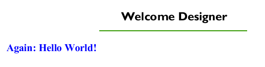
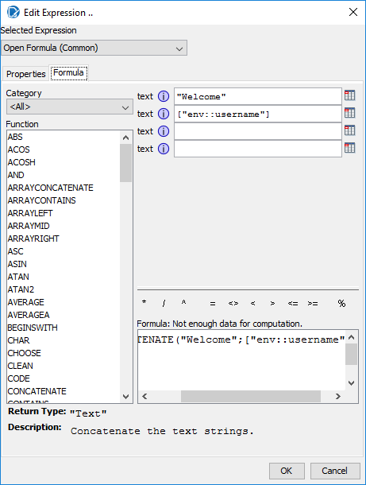
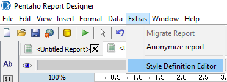
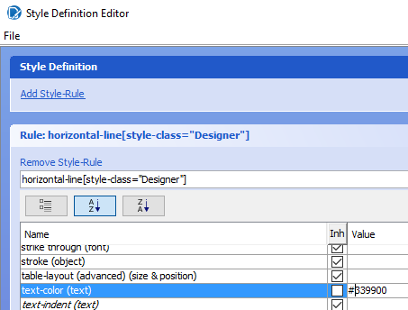
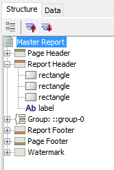
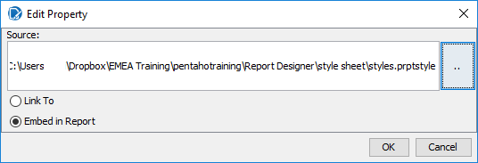
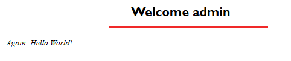

# Environment Variables Reference

> **Note:**
>
> Reference material from the course manual (Appendix C).

## Appendix B – Charts

## Environmental Variables

Environment variables are basically variables whose values depend on the environment in which they are being used. For example, an environment variable can return to the application using it as a description of the current operating system or the complete path where the application is being executed.

In Pentaho Report Designer (PRD) there exists a series of predefined environment variables that will help us interact with the Pentaho Server that is running them. Making use of these variables, we can modify the behavior and content of our reports.

<figure>

<figcaption>The finished report as Report Designer previews it, for the user Designer</figcaption>
</figure>

* Create a new report.
* In the Page Header section, add a Label.
* Configure the Label:
Attributes.value =      =CONCATENATE("Welcome "; ["env::username"])

## Attributes.style-class =      =["env::username"]

## Style.family (font) = 16

## Style.bold = true

<figure>

<figcaption>CONCATENATE joins Welcome and the env::username variable</figcaption>
</figure>

* In the Page Header, add a Horizontal Rule
* Configure the Horizontal Rule:
## Attributes.style-class =    =["env::username"]

## Style.stroke = solid, 2.0

* In the Report Header section, add a Label.
* Configure the Label:
Attributes.value = Again: Hello World!

## Attributes.style-class =    =["env::username"]

## Style sheet

PRD uses CSS3 to implement stylesheets, which allows, among other things, correct integration with the most popular web browsers.

The stylesheets' code in PRD is stored in an XML file with the extension .prptstyle. This file can be created, exported, and modified from the PRD UI using the Style Definition Editor. Also, this file can be embedded in our report or linked to it.

Using stylesheets in PRD will make the design of the final presentation of our reports easier and will save us a lot of manual configuration time, in addition to separating the presentation logic from the report logic. That is, we can create our stylesheets once and then apply them to all of our reports. If, for example, our company changes its logo, colors, font face, and so on, we don't have to modify each and every report. We modify only the CSS assigned to the reports.

* To create a stylesheet, select **Extras > Style Definition Editor**.

<figure>

<figcaption>The Style Definition Editor is on the Extras menu</figcaption>
</figure>

* Select **Add Style-Rule** and configure a Rule:
## Rule =   horizontal-line[style-class="Designer"]

## Style.text-color= #339900

<figure>

<figcaption>The Designer rule gives horizontal lines the green text-color #339900</figcaption>
</figure>

The CSS rule says that it will apply the style (green color) to all the horizontal lines that have the value Designer in their Attributes.style-class.

Note: Designer is the default user used when previewing reports in PRD.

* Select **Add Style-Rule** and configure another Rule:
## Rule= horizontal-line[style-class="admin"]

## Style.text-color= #f02929

The CSS rule says that it will apply the style (red color) to all the horizontal lines that have the value Admin in their Attributes.style-class.

Note: Remember that Admin is the name of a Pentaho Server user.

* Select **Add Style-Rule** and configure another Rule:
## Rule= report-header label[style-class="Designer"]

## Style.font-size= 18

## Style.bold= true

The CSS Rule says that it will apply the style (large and bold font) to all the labels in the Report Header section that have the value Designer in their Attributes.style-class.

* Select **Add Style-Rule** and configure another Rule:
## Rule= report-header label[style-class="admin"]

## Style.italics= true

The CSS Rule says that it will apply the style (italic) to all the labels in the Report Header section that have the value Admin in their Attributes.style-class.

* Save the file. To do so, select **File > Save As...** and name it `styles.prptstyle`.
## Report

* On our report, open the **Structure** tab and select **Master Report**.

<figure>

<figcaption>Master Report holds the attributes that apply to the whole report</figcaption>
</figure>

* Configure the following:
## Attributes.style-sheet-reference

<figure>

<figcaption>The ellipsis button that opens the property editor</figcaption>
</figure>

Select the **...** button in the style-sheet-reference value.

Search for your styles.prptstyle file and embed.

<figure>

<figcaption>Embed in Report stores the stylesheet inside the report file</figcaption>
</figure>

To try out the style sheets you created, run them in Report Designer, whose default user is Designer, and on the Pentaho Server, signed in as Admin.

Then, on one hand, preview the report in PRD.

On the other hand, publish the report (PDF) to the Pentaho Server, in the same folder where we published previous reports. When asked if you want to execute the report now, select **Yes**.

<figure>

<figcaption>Previewed in Report Designer as Designer: green rule, large bold label</figcaption>
</figure>

<figure>

<figcaption>Run on the server as admin: red rule, italic label</figcaption>
</figure>

## Configuration directories

On first launch, Report Designer creates a `.pentaho` directory in the
user's home directory with these subdirectories:

| Directory | Purpose |
| --- | --- |
| `caches` | Cached fonts — speeds up report rendering. |
| `classic-engine` | Low-level options saved by the Pentaho Reporting engine. |
| `report-designer` | Pentaho-supplied samples and content, plus user preferences for the interface. |
| `report-design-wizard` | Default Report Design Wizard templates. |
| `simple-jndi` | A properties file with JNDI connection details — by default, the HSQLDB sample database. |

## Configuration files

Global options live under `/pentaho/design-tools/report-designer/resources/`.
Don't change these without guidance from Pentaho documentation or support:

| File | Purpose |
| --- | --- |
| `report-designer.properties` | Options for the Report Designer client tool (not report options). |
| `classic-engine.properties` | Global report rendering options for reports generated locally; some can be overridden per report. |
