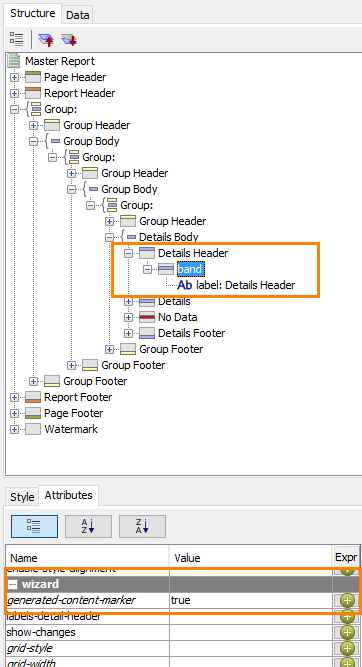
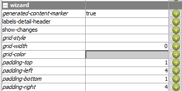
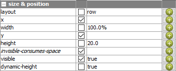
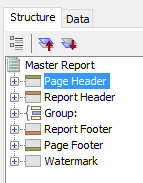
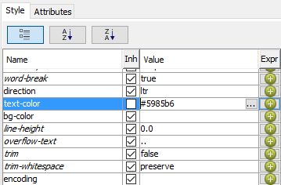
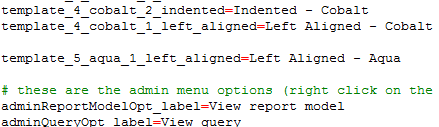

# Report Templates Reference

> **Note:**
>
> Reference material from the course manual (Appendix D).

## Appendix D – Report Templates

## Report Templates

Open the report ..\template\original_5_aqua_1_left_aligned.prpt

To view the generated-content-marker for the Details Header:

Click within the Details Header band.

On the **Structure** tab, select the band element under the Details Header.

On the **Attributes** tab, scroll to view the wizard > generated-content-marker attribute.

<div align="center">
<figure>

<figcaption>The Details Header band carries generated-content-marker set to true</figcaption>
</figure>
</div>

Notice the band element. Any formatting applied to a band will also apply to the elements used within it.

To view the Group Header band, on the Structure tab, expand the inner-most Group Header (directly above the Details Body).

Notice the band element, and also notice the generated-content-marker attribute on the Attributes tab.

To view the attributes for the Details band, on the canvas, in the Details band, select the ID element, and then on the **Structure** tab, select the **Details** band.

<div align="center">
<figure>

<figcaption>The wizard group holds the band's padding and grid settings</figcaption>
</figure>
</div>

Notice the settings on the Attributes tab under query-metadata, and notice the padding and grid settings under wizard.

To view the style properties for the Details band, on the Style tab, scroll to view the size & position properties.

<div align="center">
<figure>

<figcaption>The Details band lays out its elements in a row across the full width</figcaption>
</figure>
</div>

Notice the layout and width settings.

To select the Page Header band, on the **Structure** tab, select the **Page Header** band.

<div align="center">
<figure>

<figcaption>Page Header selected on the Structure tab</figcaption>
</figure>
</div>

To change the text-color property to aqua, on the **Style** tab, click in the Value for text-color and replace the value with #009999.

<div align="center">
<figure>

<figcaption>The template's cobalt text-color, #5985b6, before you replace it</figcaption>
</figure>
</div>

Note that by changing the text-color for the Page Header band, elements within the band inherit the text-color.

To facilitate changing all bands and elements in the template from cobalt to aqua, copy the text-color value to the clipboard.

To change the text-color for the Report Header band, on the **Structure** tab, select the **Report Header** band, and then on the **Style** tab, replace the value for text-color with #009999.

To continue changing all the cobalt bands and elements to aqua, navigate down the bands and elements on the Structure tab and change any cobalt value for text-color and bg-color to #009999.

Important: Change only the cobalt values. Do not change any of the other color values.

Notice in some cases, the formatting is applied at the element level instead of the band level.

**Review and Save** `5_aqua_1_left_aligned.prpt`

## Deploying the Template

To stop the Pentaho Server, from the Windows task bar, select **Start > All Programs > Pentaho Enterprise Edition > Server Management > Stop BA Server**.

Copy:

**File:** `5_aqua_1_left_aligned.png`

**File:** `5_aqua_1_left_aligned.prpt`

..\pentahotraining\BA2000\templates to either:

..\pentaho\server\biserver-ee\pentaho-solutions\system\pentaho-interactive-reporting\ resources\templates (pre version 7)

..\pentaho\server\pentaho-server\pentaho-solutions\system\pentaho-interactive-reporting\resources\templates

## Open Notepad ++

To open the messages.properties file:

Select **File > Open**.

Navigate to:

..\pentaho\server\biserver-ee\pentaho-solutions\system\pentaho-interactive-reporting\resources\messages. (pre version 7)

Open the messages.properties file.

To edit the messages.properties file:

Find the template labels, the lines that start `template_`, and place the cursor at the end of the last one. Where the new line goes does not matter in a `.properties` file; beside the others it is easy to find.

Press `Enter`.

Type:

```text
template_5_aqua_1_left_aligned=Left Aligned - Aqua
```

Press `Enter`.

Save the changes.

Close the text editor.

<div align="center">
<figure>

<figcaption>The new template's label added to messages.properties</figcaption>
</figure>
</div>

To start the BA Server, from the Windows task bar, select **Start > All Programs > Pentaho Enterprise Edition > Server Management > Start BA Server**.

Launch the User Console and log in as admin.

From the User Console Home Perspective page, select **Create New > Interactive Report**.

In the **Select Data Source** window, select **Orders**, and then select **OK**.

To select a report template, in the **Selection** pane, select the **General** tab, and then select **Select**.

Select the right arrow to scroll through the available templates, and then select **Left Aligned - Aqua**.

For this demonstration it is not necessary to create an actual report.

Preview the template.

## Lab files

<button data-launch="prd" data-path="files/5_aqua_1_left_aligned.prpt">Open: Template: 5 aqua, left aligned</button>

<button data-launch="prd" data-path="files/original_5_aqua_1_left_aligned.prpt">Open: Template: original 5 aqua</button>

