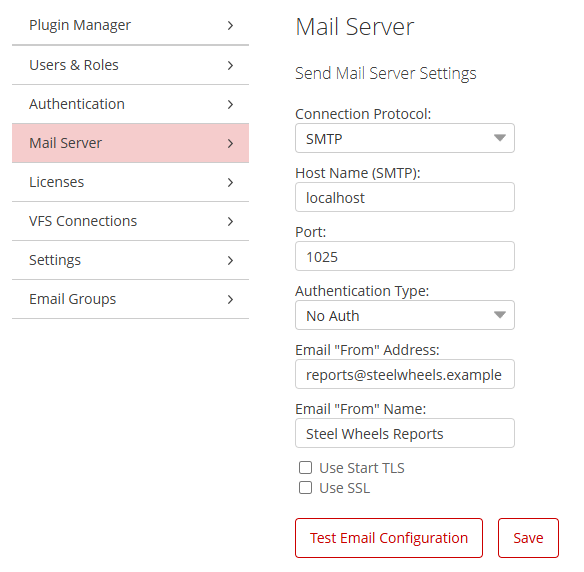
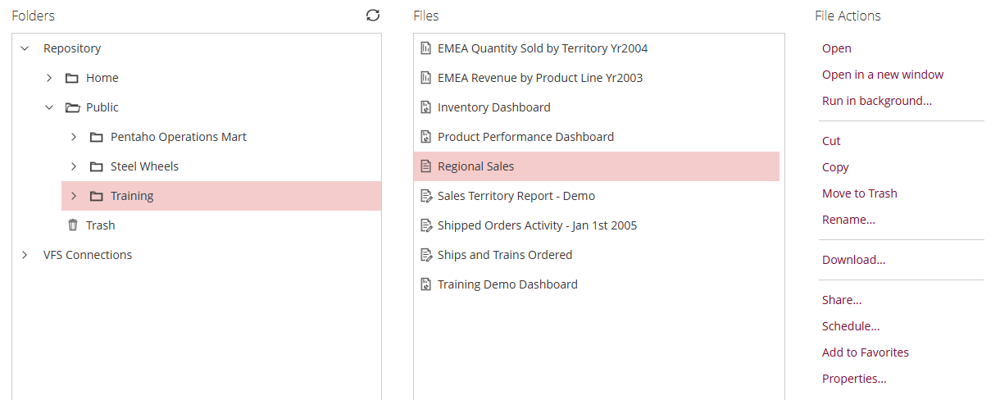
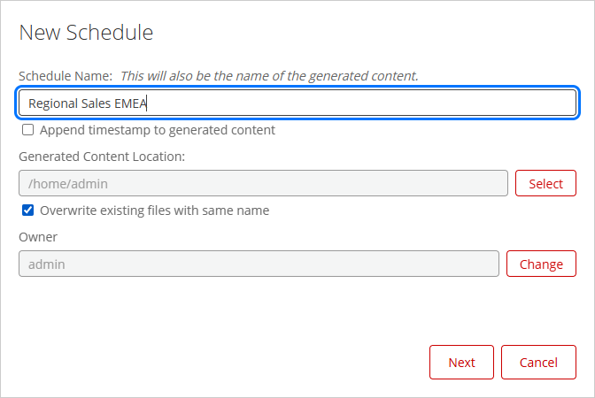
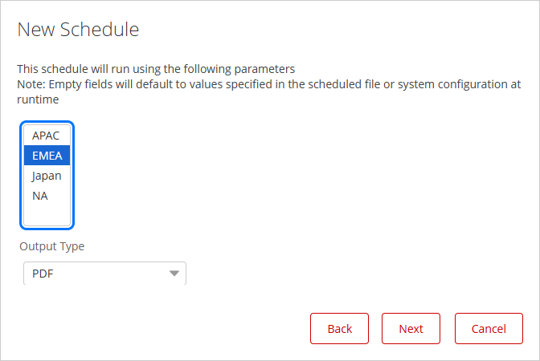
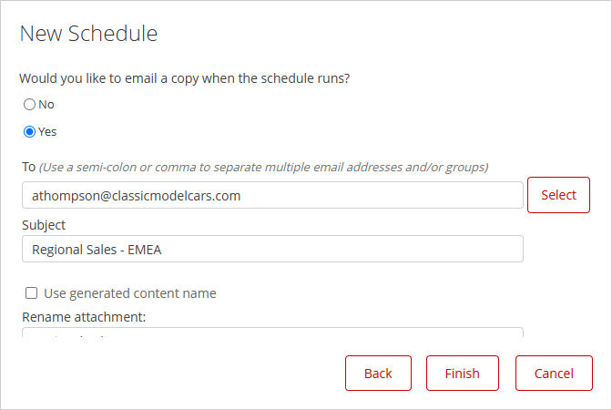
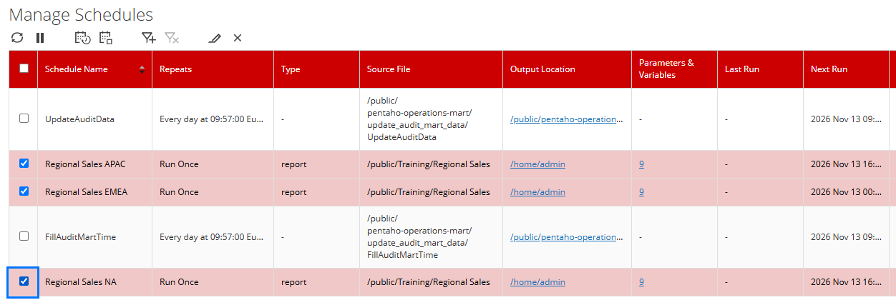
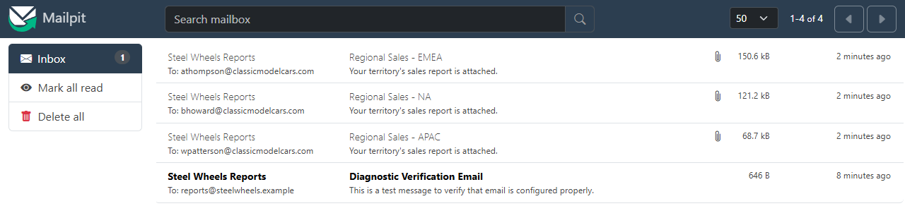

# Report Bursting

> **Warning:**
>
> #### Workshop - Report Bursting
>
> One report, many readers: each regional manager wants the sales report for their own territory, in their inbox, without opening the User Console and picking from a prompt. **Bursting** runs one parameterized report once per value and sends each reader their own copy. The Pentaho Server does it with schedules: each schedule runs the report with its own prompt value and emails the result to its own address.
>
> **What you'll do**
>
> * Turn your report's product line prompt into a territory prompt, in Report Designer
> * Publish it, and point the Pentaho Server's mail settings at a test mail server
> * Schedule the report once per territory, each emailing its PDF to that territory's manager
> * Run the schedules and check each manager's email holds their territory only
>
> **Prerequisites:**
>
> * [Report Parameters](../18-mod7-parameters/guide.md): your `Demo - parameters.prpt`, whose `product_var` prompt picks a product line
> * [Publishing Reports](../26-mod9-publishing/guide.md), and the Pentaho Server running, with its administrator sign-in from [Before You Start](../01-mod1-getting-started/guide.md)
> * Mailpit, the test mail server: on a lab VM in `C:\Mailpit`; on your own machine, see step 1 of tab 3
>
> **Estimated time:** 40 minutes

<figure>

<figcaption class="pcm-video-caption">Walkthrough: coming soon</figcaption>

</figure>

:::: tabs

### 1. A Territory Prompt

> **Note:**
>
> #### One report, one value per reader
>
> Each manager reads one territory, so the report needs a territory prompt. Your Report Parameters report already filters on a prompt; here the prompt changes from product line to territory, and becomes a list, so one copy can hold more than one territory.

1. Start Report Designer with the **Start Pentaho Report Designer** button below, or from PowerShell:

```powershell
Set-Location C:\Pentaho\design-tools\report-designer
.\report-designer.bat
```

<button data-launch="prd" data-path="">Start Pentaho Report Designer</button>

2. Select **File > Open** (`Ctrl+O`) and open `Demo - parameters.prpt` from your reports folder, `Documents\RD-Workshop`.
3. Select **File > Save As** and save it as `Regional Sales.prpt` in the same folder.
4. On the **Data** tab, under **Data Sets**, double-click **JDBC: SampleData (Hypersonic)**. Under **Available Queries**, select `prod_list`, set **Query Name** to `territory_list`, and replace the **Query** with:

```sql
SELECT DISTINCT TERRITORY FROM CUSTOMER_W_TER
WHERE TERRITORY IS NOT NULL AND TERRITORY <> ''
ORDER BY TERRITORY
```

5. Select **Preview**.

> **Success:** Checkpoint: 4 rows: `APAC`, `EMEA`, `Japan`, `NA`. The `WHERE` leaves out the customers that have no territory.

6. Close the preview. Under **Available Queries**, select `Query 1`, and in its **Query** replace the line `WHERE productline IN (${product_var})` with:

```sql
WHERE "PUBLIC"."CUSTOMER_W_TER"."TERRITORY" IN (${TERRITORY})
```

7. Select **OK**.
8. On the **Data** tab, under **Parameters**, select `product_var`, select **Data > Edit Parameter**, and set:

| Field | Value |
| --- | --- |
| **Name** | `TERRITORY` |
| **Label** | `Select territories:` |
| **Value Type** | `String` |
| **Default Value** | `NA` |
| **Mandatory** | Selected |
| **Display Type** | `Multi Value List` |
| **Query** | `territory_list` |
| **Value** | `TERRITORY` |
| **Display Name** | `TERRITORY` |

9. Select **OK**, then **Preview**. In the prompt, select `EMEA` only.

> **Success:** Checkpoint: the report holds EMEA's orders only: **Total for Product Line: Classic Cars** reads 3,063,110, and **Total for Product Line: Vintage Cars**, the last, 1,471,391.

10. Select **Design**, and save the report (`Ctrl+S`).

> **Under the hood:**
>
> #### A list parameter sends an array, and `IN` takes it
>
> With **Multi Value List** the parameter's value is an array of
> strings, not one string. The SQL data factory expands
> `IN (${TERRITORY})` to one `?` per selected value and binds each one,
> so `EMEA` alone, or `APAC` and `Japan` together, both run as written.
> The report has no idea who will read it: it only knows the
> territories it was handed.
>
> **Why it matters:** the same report serves every reader. Whatever
> runs it, Preview, the User Console or a schedule, decides which
> territories go in, and a single copy can cover a manager who looks
> after two of them.

### 2. Publish and Connect the Mail

> **Note:**
>
> #### The server sends the mail
>
> Schedules run on the Pentaho Server, so the server sends the emails, through the mail server set in its **Administration**. Here that is Mailpit, a test mail server on this machine: it accepts every message and shows it on a web page, and nothing leaves the machine.

1. Select **File > Publish** (`Ctrl+Shift+P`), sign in as in [Publishing Reports](../26-mod9-publishing/guide.md), set **File Name** to `Regional Sales.prpt` and **Title** to `Regional Sales`, open `/public/Training`, and select **OK**. Select **No** when asked whether to view the report.
2. Start Mailpit. On a lab VM, from PowerShell:

```powershell
C:\Mailpit\start-mailpit.cmd
```

On your own machine, download `mailpit-windows-amd64.zip` from the [Mailpit releases](https://github.com/axllent/mailpit/releases), unzip it, and run `mailpit.exe --smtp 127.0.0.1:1025 --listen 127.0.0.1:8025` in that folder. Leave its window open.

3. Open Mailpit's inbox with the **Open Mailpit** button below, or at `http://localhost:8025` in your web browser.

<button data-launch="mailpit" data-path="">Open Mailpit</button>

4. In the User Console (`http://localhost:8080/pentaho`, signed in as the administrator), select **Home > Administration**, then **Mail Server**, and set:

| Field | Value |
| --- | --- |
| **Connection Protocol** | `SMTP` |
| **Host Name (SMTP)** | `localhost` |
| **Port** | `1025` |
| **Authentication Type** | `No Auth` |
| **Email "From" Address** | `reports@steelwheels.example` |
| **Email "From" Name** | `Steel Wheels Reports` |
| **Use Start TLS**, **Use SSL** | Cleared |

<div align="center">
<figure>

<figcaption>The server's mail settings, pointing at Mailpit</figcaption>
</figure>
</div>

5. Select **Save**, then **Test Email Configuration**.

> **Success:** Checkpoint: the User Console says the connection was successful, and Mailpit's inbox shows **Diagnostic Verification Email** to `reports@steelwheels.example`.

6. Select **Close**.

> **Under the hood:**
>
> #### One mail setting for the whole server
>
> **Save** writes `pentaho-solutions\system\smtp-email\email_config.xml`,
> the JavaMail settings every part of the server sends through:
> schedules, the test you just ran, failure notices. Mailpit listens
> for SMTP on port 1025 and keeps each message it receives, so the
> server behaves exactly as it would with a real mail server.
>
> **Why it matters:** in production the same page points at the
> company's mail server, and nothing in the report or its schedules
> changes.

### 3. Schedule per Territory

> **Note:**
>
> #### A schedule is a run with its own values
>
> Each schedule stores which report to run, the prompt values to run it with, the output type, and who to email the result to. Three schedules, three managers.

1. Select **Home > Browse Files**, open **Public > Training**, and select **Regional Sales**.

<div align="center">
<figure>

<figcaption>The published report, and Schedule... under File Actions</figcaption>
</figure>
</div>

2. Under **File Actions**, select **Schedule...**. Set **Schedule Name** to `Regional Sales EMEA`, select **Overwrite existing files with same name**, and select **Next**.

<div align="center">
<figure>

<figcaption>The schedule's name, also the name of its PDF</figcaption>
</figure>
</div>

3. Leave **Recurrence** at `Run Once` and select **Next**.
4. Under **Select territories:**, select `EMEA` only, set **Output Type** to `PDF`, and select **Next**.

<div align="center">
<figure>

<figcaption>The report's own prompt, inside the schedule</figcaption>
</figure>
</div>

5. Select **Yes** to email a copy, and set:

| Field | Value |
| --- | --- |
| **To** | `athompson@classicmodelcars.com` |
| **Subject** | `Regional Sales - EMEA` |
| **Use generated content name** | Cleared |
| **Rename attachment** | `Regional Sales EMEA` |
| **Message** | `Your territory's sales report is attached.` |

<div align="center">
<figure>

<figcaption>Who the EMEA copy goes to</figcaption>
</figure>
</div>

> **Tip:** **Finish** stays disabled until the **To** box has an address typed into it. If you pasted the address, type a space at its end and delete it.

6. Select **Finish**, then **No** when asked whether to view your schedules.
7. Repeat steps 2 to 6 for the other two managers. The addresses are the ones `EMPLOYEES` holds for each territory's sales manager in the sample data:

| Schedule Name | Territories | To | Subject |
| --- | --- | --- | --- |
| `Regional Sales APAC` | `APAC` and `Japan` (`Ctrl`+click) | `wpatterson@classicmodelcars.com` | `Regional Sales - APAC` |
| `Regional Sales NA` | `NA` | `bhoward@classicmodelcars.com` | `Regional Sales - NA` |

> **Note:** Japan has no sales manager of its own in the sample data; William Patterson's title is *Sales Manager (JAPAN, APAC)*, so his copy holds both.

### 4. Run and Check

> **Note:**
>
> #### Run them now
>
> A **Run Once** schedule waits for its start time. **Execute Now** in the **Schedules** perspective runs the selected schedules straight away.

1. Select **Home > Schedules**. Select the boxes of **Regional Sales APAC**, **Regional Sales EMEA** and **Regional Sales NA**, then select **Execute Now**, the third icon above the list.

<div align="center">
<figure>

<figcaption>The three schedules, ready to execute</figcaption>
</figure>
</div>

2. Select **OK**, wait a few seconds, and open Mailpit's inbox.

<div align="center">
<figure>

<figcaption>One email per manager, each with its own PDF</figcaption>
</figure>
</div>

> **Success:** Checkpoint: three emails from **Steel Wheels Reports**, each with a PDF attached. In **Regional Sales - EMEA**, open `Regional Sales EMEA.pdf`: **Total for Product Line: Classic Cars** 3,063,110, as in your preview. `Regional Sales APAC.pdf` reads 808,846 there, and `Regional Sales NA.pdf` 1,972,077.

3. In the User Console, open **Home > Browse Files > Home > admin**: each schedule also saved its PDF there, under its schedule name.

> **Under the hood:**
>
> #### The schedule replays the prompt, then mails the file
>
> A schedule stores the report's path and the prompt values you
> picked as its job parameters (`TERRITORY` = `EMEA`), plus
> `_SCH_EMAIL_TO`, `_SCH_EMAIL_SUBJECT` and the attachment name. When
> it fires, the server runs the report in the background exactly as
> the User Console would with those values, writes the PDF to the
> output location, and hands that file to the mail sender.
>
> **Why it matters:** the managers never open the User Console. Give
> the schedules a weekly recurrence and each Monday's report arrives
> on its own; change the report once, republish it, and every copy
> changes with it.

::::

## Lab Files

Click a file to download. For `.prpt` files, **Open in Pentaho Report Designer** starts Report Designer with the report loaded. Every file is also on disk in this workshop's folder, `C:\Workshop-RD-Practitioner\09-publishing-reports\39-mod9-report-bursting`.

### Solution <!-- no-step -->

The finished report: the [Report Parameters](../18-mod7-parameters/guide.md) solution with its product line prompt turned into the `TERRITORY` list. Open it in Report Designer to compare with your own.

Also on disk at `C:\Workshop-RD-Practitioner\09-publishing-reports\39-mod9-report-bursting\solution`.

[Regional Sales.prpt](./files/solution/Regional%20Sales.prpt) <button data-launch="prd" data-path="files/solution/Regional Sales.prpt">Open in Pentaho Report Designer</button>
