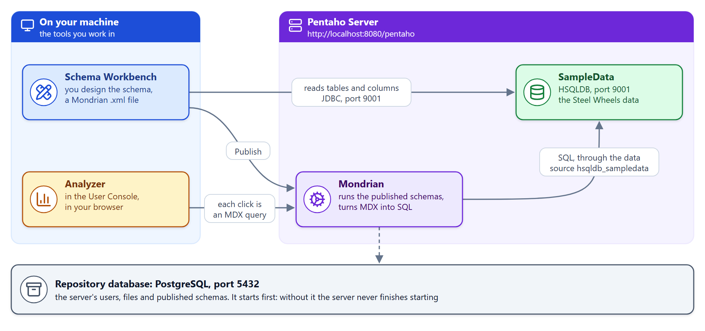

# Before You Start

> **Note:**
>
> #### Get Ready — Before You Start
>
> Before the first workshop, check that the Pentaho Server and its sample
> data are up, that Schema Workbench starts and can reach that data, and
> that the workshop folder is in place. The course builds Mondrian
> schemas against the Steel Wheels sample data and tests every one in
> Analyzer, and **none of the lab time should go on setup**: this page
> does it in advance.
>
> **What you'll do:**
>
> * Learn how the guide works: progress, copy buttons, the assistant.
> * See how Schema Workbench, the Pentaho Server and the sample data fit together.
> * Confirm the server, the sample data, Schema Workbench and Analyzer all answer.
> * Check the workshop folder: *C:\Workshop-SW-Practitioner*
>
> **Prerequisites:** A basic understanding of relational tables and SQL.
>
> **Estimated time:** 5 minutes on a lab VM; about 15 minutes the first
> time on your own machine.

## Meet your lab guide

This panel stays beside your tools for the whole workshop:

- **Float or dock** — drag the title bar to move the window anywhere
  (any monitor), or use the dock button to pin it to the right edge of
  the screen so maximized apps make room for it.
- **The sidebar** lists every section and lab. A <span data-icon="video"></span> badge means the lab
  includes a video; the `~15 min` tag is a time estimate.
- Use the **font-size** and **reading-mode** controls in the toolbar if
  you're on a small VM screen.

## Track your progress

Each workshop's steps sit in a numbered row at the top of the lab, one
dot per step. Work through them in order: the button at the end of a
step names the next one, and moving on puts a check mark on the step
you leave. Your progress is saved on this machine and survives
restarts, so you can pick up exactly where you left off. (This page has
no steps: tracking starts in the first workshop.)

## Copy code from the guide

Every code block has a **copy button**: hover over the block and select
it, then paste into your tool. Try it:

```sql
SELECT 'hello from the lab guide' AS greeting;
```

## How the pieces fit

Three things run on your machine for this course, and every workshop
uses all three:

<div align="center">
<figure>

<figcaption>Schema Workbench, the Pentaho Server and the sample data</figcaption>
</figure>
</div>

* **Schema Workbench** is where you design a schema, a Mondrian `.xml`
  file. Its own connection to the sample data lets it list the tables
  and columns you build from, and run MDX in its query window.
* **The Pentaho Server** hosts the **SampleData** database (HSQLDB, on
  port 9001) and the **Mondrian** engine. When you publish a schema,
  Mondrian loads it, and **Analyzer** in the User Console turns each
  click into an MDX query that Mondrian answers with SQL against
  SampleData.
* **PostgreSQL** is the server's own repository: its users, files and
  published schemas. The server cannot finish starting without it, so
  it starts first.

Read the diagram from the two tools on the left. Schema Workbench reaches SampleData directly, over JDBC on port 9001, to list tables and columns while you design, and hands the finished schema to Mondrian when you publish. Analyzer never touches the database: each click reaches Mondrian as an MDX query, and Mondrian sends the SQL through the `hsqldb_sampledata` data source. The dashed arrow down to the repository bar is where the server keeps what you publish.

> **Under the hood:**
>
> #### The schema holds the model, never the connection
>
> A Mondrian schema names tables and columns, but no database URL, user
> or driver. On the server, Mondrian finds the data through a data
> source that you name when you publish (`hsqldb_sampledata` in this
> course), and Schema Workbench uses a connection of its own while you
> design.
>
> **Why it matters:** the same schema file publishes against test data
> today and production tomorrow, by naming a different data source.

## Set up your environment

Launch your main tool straight from the guide:

<button data-launch="schema-workbench">Start Pentaho Schema Workbench</button>

If it is already open from a previous session, the button focuses
the running window instead of starting a second copy.

### Do you need to set anything up?

:::: tabs

### I'm using a lab VM

Nothing to install. Everything is already on the machine, and the
Pentaho Server and its repository database start by themselves with it.

> **Note:** **Give the Pentaho Server time to load.** It starts its
> repository database first and then needs **3 to 5 minutes** to finish,
> so it will not answer the moment you sign in. **Check your
> environment**, directly below these tabs, shows **Starting up** while it
> loads and turns green by itself. **Please don't click anything or
> restart anything while it says so**: that only makes the server start
> again from the beginning.

If something looks wrong later, tell your instructor rather than
reinstalling anything.

### I'm installing on my own machine

Everything here is a **one-off setup** for your own laptop. Work through
the tabs in order — the panel underneath checks your machine as you go,
so you can always see what is left. The last tab is a reference card of
every port and login, for when you come back to it later.

> **Note:** This course needs no containers and no extra databases. Your
> schemas model the Steel Wheels sample data that the Pentaho Server's
> bundled HSQLDB serves, and they publish back to the same server for
> Analyzer.

::: tabs

### 1. Start the Pentaho Server

The server ships with Pentaho, so there is nothing to install: you
start it. It brings up the User Console, Analyzer, the sample data and
the target you publish your schemas to.

1. Start the server's repository database, PostgreSQL, if it is not
   already running. An installer-based install runs it as the
   **Pentaho Solution Repository** service. In PowerShell, run:

   ```powershell
   Start-Service "Pentaho Solution Repository"
   ```

   On an install with no such service, start it with PostgreSQL's own
   tool instead:

   ```powershell
   & "C:\Pentaho\postgresql\bin\pg_ctl.exe" start -D "C:\Pentaho\postgresql\data" -l "$env:TEMP\postgresql.log"
   ```

2. Start the server. In PowerShell, run:

   ```powershell
   C:\Pentaho\server\pentaho-server\start-pentaho.bat
   ```

3. Wait for it to finish loading: 3 to 5 minutes. Leave the **Tomcat**
   window open, because closing it stops the server.

4. Browse to **http://localhost:8080/pentaho**.

   > **Success:** Checkpoint: the User Console's sign-in page opens.

To shut it down later, run `stop-pentaho.bat` from the same folder.

<details>
<summary>Troubleshooting</summary>

**The server never finishes starting.** Its repository database is
down. The **Pentaho repository database** row in the panel below is
red: start PostgreSQL (step 1), then stop and start the server again.
A server started before its database does not recover by itself.

**The browser cannot reach localhost:8080.** The server is still
starting, or it stopped. Watch the **Tomcat** window for
`Server startup in ... ms`, then retry.

**"Port 8080 already in use".** Something else has the port, often a
second Pentaho Server or another Tomcat. Stop it, or change the port in
`tomcat\conf\server.xml`.

**The window closes immediately.** The server could not find a usable
Java. It checks `PENTAHO_JAVA_HOME` first, then the bundled
`C:\Pentaho\java`, and only then `JAVA_HOME` (a JDK newer than 21 stops
the server). Check them with `echo $env:PENTAHO_JAVA_HOME, $env:JAVA_HOME`,
and see `set-pentaho-env.bat` in the same folder for what the server
expects.

</details>

### 2. Start Schema Workbench

1. Install the Pentaho design tools to `C:\Pentaho`, so Schema Workbench
   is at `C:\Pentaho\design-tools\schema-workbench\workbench.bat`.

2. Start it with the **Start Pentaho Schema Workbench** button at the
   top of this page, and let it finish loading.

3. Check that it has the HSQLDB driver it connects to SampleData with:
   `hsqldb-2.3.2.jar` in `C:\Pentaho\design-tools\schema-workbench\drivers`.
   Schema Workbench ships it there; the **HSQLDB driver (Schema
   Workbench)** row in the panel below checks it for you.

You make the connection itself in the first workshop,
[SteelWheels](../04-schemas-steelwheels/guide.md): **Options >
Connection** opens the **Database Connection** dialog, with the values
in **Check the database** below.

<details>
<summary>Troubleshooting</summary>

**The Start button does nothing.** The button runs
`C:\Pentaho\design-tools\schema-workbench\workbench.bat`. Install
Schema Workbench there, or ask your instructor to point the launcher at
your install.

**The connection test fails.** SampleData is an HSQLDB database that
starts *with the Pentaho Server*, on port 9001. Start the server first
(tab 1), wait for the sign-in page, then test the connection again.

**"Driver class org.hsqldb.jdbcDriver could not be found".** The driver
is missing from `schema-workbench\drivers`. Copy
`C:\Pentaho\server\pentaho-server\tomcat\lib\hsqldb-2.3.2.jar` there and
restart Schema Workbench.

</details>

### 3. Check it worked

The **Check your environment** panel below these tabs already ran this
for you, but you can run it yourself at any time. From the
**`provisioning`** folder of your install, in PowerShell, run:

```powershell
.\check-environment.ps1 -Mode server -Course SW
```

It walks the prerequisites in dependency order and prints the exact
command that fixes anything missing. A red line early on usually makes
the later ones meaningless, so fix from the top down.

When everything is green you are ready to start Module 1.

<details>
<summary>What it checks</summary>

| Check | Why the course needs it |
| --- | --- |
| Java (for the Pentaho Server) | The server runs on Java 21: Pentaho's bundled `C:\Pentaho\java`, or `PENTAHO_JAVA_HOME` |
| Schema Workbench | The tool the whole course teaches, at `C:\Pentaho\design-tools\schema-workbench` |
| HSQLDB driver (Schema Workbench) | Without it Schema Workbench cannot reach SampleData |
| Analyzer (server plugin) | Every workshop tests its published schema in an Analyzer report |
| Pentaho repository database | PostgreSQL; the server cannot start without it |
| Pentaho Server and its URL | Hosts the sample data and Mondrian; green once the sign-in page answers |
| HSQLDB (Steel Wheels sample data) | The data every schema models; green once it answers a query |
| Ollama | Optional: powers the in-app chat assistant |

</details>

### 4. Lab files on disk

The installer has already laid this course's lab files out under
**`C:\Workshop-SW-Practitioner`**, one folder per module, so you can
open a schema in Schema Workbench directly instead of downloading it
from the guide first. Every lab's **Lab Files** section names the files.

<details>
<summary>The folder isn't there</summary>

It is an optional component, so a **Minimal (app only)** install, or a
cleared **Workshop lab files** box, skips it. Lay it down at any time
from the same `provisioning` folder:

```powershell
.\install-workshop.ps1
```

Safe to run whenever you want the shipped lab files back as they
shipped: it only ever adds and refreshes, and never deletes your work.

</details>

### 5. Ports and logins

Everything this course uses, in one place. All of it is local to your
machine.

> **Warning:** These are the stock Pentaho workshop credentials, and
> they are widely known. Change them on any server that is reachable
> beyond your own machine.

| Service | Address | Username | Password |
| --- | --- | --- | --- |
| Pentaho User Console and Analyzer | http://localhost:8080/pentaho | `admin` | `password` |
| Publishing a schema | http://localhost:8080/pentaho | `admin` | `password` |
| HSQLDB `sampledata` | `localhost:9001`, database `sampledata` | `pentaho_admin` | `password` |
| PostgreSQL, the server's repository | `localhost:5432` | *the server's own* | *not needed in the labs* |
| Ollama — the Chat tab | `127.0.0.1:11434` | *none* | *none* |

:::

When the last tab is done, **Check your environment** below these tabs
should be all green.

::::

## Check your environment

This panel probes the machine live: the Pentaho Server and the
repository database behind it, the Steel Wheels sample data, Schema
Workbench and its driver, and Analyzer, whichever tab above you chose.
Each row reports one of four states:

* **<span class="pcm-c-ok">Green</span>** — the check passed; that piece is present and answering.
* **<span class="pcm-c-warn">Amber</span>** — usable, but worth tidying before the session.
* **<span class="pcm-c-danger">Red</span>** — it will block a lab, and the row tells you the exact fix.
* **<span class="pcm-c-muted">Grey</span>** — skipped, because this course doesn't use it.

The rows that matter most are **HSQLDB (Steel Wheels sample data)**,
which every schema models, and **Schema Workbench** with its **HSQLDB
driver**. The sample-data row is green only once SampleData answers a
real query.

A row with a turning circle and **Starting up** is not broken: the
Pentaho Server is still loading (3 to 5 minutes), and the list checks
again by itself every few seconds. Wait for it. Only when a row is
**red** is something wrong, and then **Get my lab ready** runs the same
steps the sign-in runs and checks again.

<div data-env-check="server"></div>

> **Success:** Checkpoint: every row is green, or grey for a check this course skips. An amber row is usable, but worth tidying.

## Check the working folders

The installer lays every lab's files out under
**`C:\Workshop-SW-Practitioner`**, one folder per module, in the order
the sidebar reads. The first two sections, Getting Started and Key
Concepts, have no lab files, so the numbering starts at `03`.

```text
C:\Workshop-SW-Practitioner
├── 03-schemas
│   ├── 04-schemas-steelwheels
│   │   ├── steelwheels.xml                   the SteelWheels schema you explore
│   │   └── steelwheels-original.xml          an earlier version, to compare
│   ├── 05-schemas-basic-model
│   └── 06-schemas-standard-model
├── 04-extend-model
│   ├── 08-extend-model-extended-model
│   └── 09-extend-model-calculations
├── 05-mdx-query
│   └── 12-mdx-query-named-sets
├── 06-data-security
│   └── 14-data-security-mondrian-security
├── 07-localization
│   └── 16-localization-fr-localization        English and French message files
├── 08-performance
│   └── 17-performance-aggregate-tables
│       ├── agg_tables.sql                    builds the two aggregate tables
│       ├── miniaturemodels-agg.xml           the schema you start from
│       └── solution
│           └── miniaturemodels-agg-complete.xml   the finished schema
└── capstone
    ├── solution                              your schema, checked for your accreditation
    └── out                                   your exported published schema, checked too
```

The capstone is the one folder with a shape of its own: it ships
nothing, because the capstone's schema is yours to build. Its
`solution\` and `out\` folders are where the accreditation checks look,
and upgrading the course never touches them.

**Confirm the files are there**, not only the folder: open
`03-schemas\04-schemas-steelwheels` and check you can see
`steelwheels.xml`. An empty folder is the one thing worth catching now
rather than in the middle of a lab.

## Check the database

Every schema in this course models the Steel Wheels sample data in the
SampleData database. The environment panel shows **HSQLDB (Steel Wheels
sample data)** green when it answers. The first workshop builds this
connection in Schema Workbench, and every later workshop reuses it:

| Field | Value |
| --- | --- |
| Connection name | `hsqldb_sampledata` |
| Connection type | Hypersonic |
| Access | Native (JDBC) |
| Host Name | `localhost` |
| Database Name | `sampledata` |
| Port Number | `9001` |
| Username | `pentaho_admin` |
| Password | `password` |

The server needs a connection of its own for the schemas you publish.
[Basic Model](../05-schemas-basic-model/guide.md) creates it in the User
Console's **Manage Data Sources** with the same name,
`hsqldb_sampledata`, and you name it again each time you publish.

## Ask the AI assistant

The **Chat** tab in the bottom panel answers questions about Pentaho —
ask it anything from "what is a degenerate dimension?" to "why does my
cube not load?". A model on this machine writes the answers, and it
grounds them in a live search of the official Pentaho documentation.
Without an internet connection that search is unavailable, so only the
local model answers, without the documentation behind it.

## How this course is organized

Each section starts with an **overview page** (<span data-icon="page"></span> — background reading,
no check boxes) followed by **hands-on workshops** (<span data-icon="workshop"></span> — tracked steps).
Select a heading to open that section's page, or the chevron beside it to
expand the workshops underneath.

## The exam and your course accreditation

When you have worked through the sections, the **Practitioner Exam** in
the sidebar draws 40 questions from a pool of 50. It is open-book: take
your time, browse any module to refresh your memory, or ask the
assistant. Your answers are saved as you go, so leaving the page to look
something up is fine, and the explanations show afterwards so you can
learn from anything you missed. The pass mark is **80%**.

You are asked for your name, email and organization before you begin
(and your Partner ID, if you are taking it as part of the Pentaho Partner
Program); those are what your accreditation is made out to. Complete the
capstone project and pass the exam, and your **Pentaho Schema Workbench - Practitioner Level** course
accreditation appears on the results screen to download. It is valid
for two years, and you can come back for it later from the same screen.

Head to the first section whenever you're ready.

---

> **Tip:** You can revisit this page any time from the sidebar.
