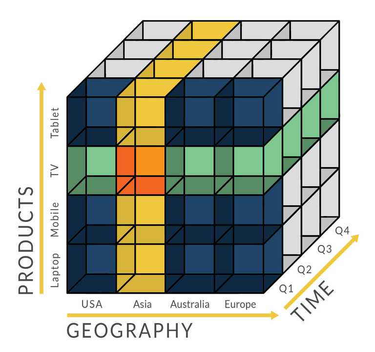
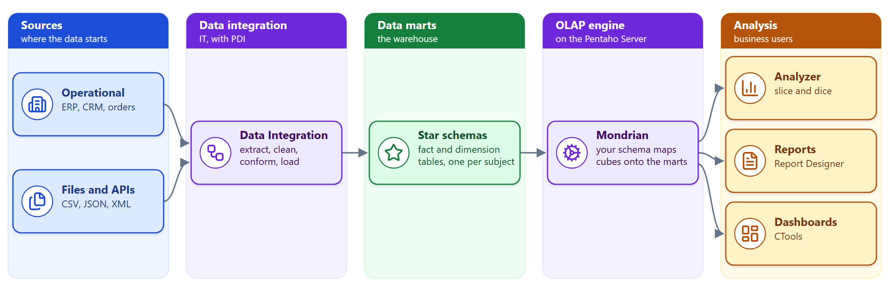
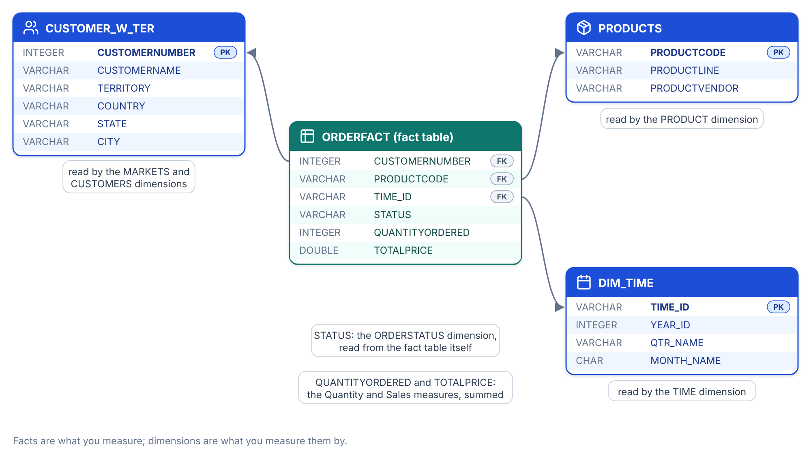
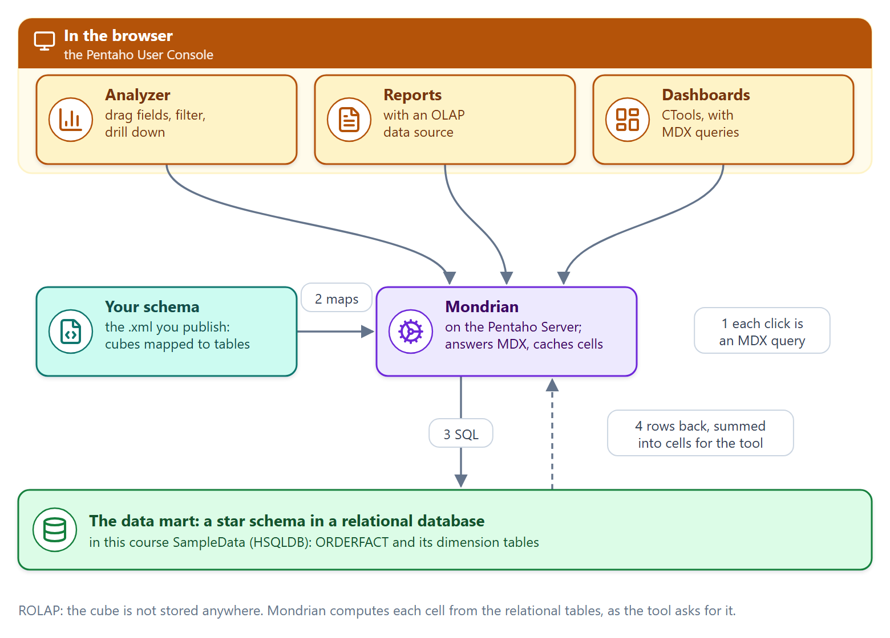

# Key Concepts & Terminology

> **Note:**
>
> #### Online Analytical Processing
>
> **What is OLAP?** Online Analytical Processing (OLAP) systems are specialized databases designed for analyzing large volumes of data quickly and efficiently. Unlike OLTP (Online Transaction Processing) systems that handle day-to-day transactions like order processing or inventory updates, OLAP systems focus exclusively on **reading and analyzing** data. This read-only approach, combined with pre-aggregated data and multidimensional structures, allows OLAP to provide consistently fast query performance for business intelligence and decision-making.

<div align="center">
<figure>

<figcaption>OLAP Cube</figcaption>
</figure>
</div>

> **Note:**
>
> #### Key distinguishing features
>
> OLAP systems differ from traditional relational databases in four fundamental ways:
>
> 1. They use **multidimensional data structures** (often called "cubes") that organize data across business dimensions like time, geography, products, and customers.
> 2. They ensure consistently **fast data access** through pre-aggregation and optimized architectures.
> 3. They provide **intuitive interfaces** that let both technical analysts and business users explore data without IT assistance.
> 4. They support complex **cross-dimensional calculations**, such as current sales as a percentage of total sales across different time periods and regions.

## Core ideas

:::: tabs

### Multidimensional

> **Note:**
>
> #### Multidimensional
>
> Business users naturally think and communicate using business terms like "sales by region," "quarterly costs," and "customer segments." They don't think in terms of database tables, foreign keys, or SQL joins. Traditional relational databases force users to understand complex table relationships and translate their business questions into technical queries, creating a significant barrier to data access.
>
> OLAP removes this friction by aligning data structures with business language. Users select "Products" and "Revenue," filter by "Region = Northeast" and "Time = Q3 2024," and get instant answers. The underlying complexity is completely hidden — business users explore data independently without waiting days for IT to write SQL.
>
> The traditional approach creates bottlenecks: a sales director asks a simple question, submits a request to IT, waits 2–3 days, receives a static report, realizes they need more, and starts over. By the time they get answers, the opportunity has passed. OLAP turns this into a self-service process.

<div align="center">
<figure>

<figcaption>Data cube operations on the SteelWheels cube: what each one does to the grid Analyzer shows</figcaption>
</figure>
</div>

Start top left, with the grid of Sales by Territory and Year. Each of the other five panels does one thing to that view: a **slice** pins one dimension to a single member, a **dice** keeps a few members on several dimensions, a **drill down** opens a member into the level below it, a **roll up** folds a level back into its parent, and a **pivot** swaps rows and columns without changing a cell. Every figure is the SteelWheels cube you open in Analyzer later in this course, so you can check them for yourself.

### Data Pipeline

> **Note:**
>
> #### Data Pipeline
>
> The data pipeline begins with **ETL processes** that extract operational data from source systems, transform it into dimensional structures, and load it into the data warehouse. Tools like **Pentaho Data Integration** orchestrate this flow — connecting to disparate sources (ERP, CRM, transactional databases), applying business rules and data-quality transformations, managing slowly changing dimensions, and conforming dimension attributes across sources.
>
> ETL typically employs **staging areas** as intermediate storage where raw extracted data lands before transformation, enabling delta-load processing that identifies only changed records since the last load rather than full reloads.
>
> **Data marts** serve as the foundational physical layer in ROLAP architecture — subject-specific dimensional models (star or snowflake schemas) optimized for a business domain like Sales, Finance, or Inventory. Each data mart contains fact tables with measures and foreign keys, surrounded by denormalized dimension tables.

<div align="center">
<figure>

<figcaption>From source systems to analysis: the cube sits at the end of the pipeline</figcaption>
</figure>
</div>

Read the diagram from left to right. Operational systems, files and APIs are where the data starts; Pentaho Data Integration extracts, cleans, conforms and loads it into star-schema data marts, one per subject. Mondrian comes next, with your schema mapping cubes onto the marts, and the analysis tools on the right, Analyzer, reports from Report Designer and CTools dashboards, all ask Mondrian rather than the marts.

> **Note:**
> **Mondrian** sits on top of this data-mart foundation as the **ROLAP engine**, with XML schemas that map each data mart's physical tables to logical business concepts — Cubes, Dimensions, Hierarchies, and Measures. When users query through OLAP client tools, Mondrian translates **MDX into SQL** that executes directly against the data mart's relational tables.

### Normalized v Star

> **Note:**
>
> #### Normalized vs. Star Schemas
>
> A normalized database, designed for OLTP, stores each fact once, so a simple question such as "What were total sales by product line and territory?" has to walk a chain of joins to find its answer. SampleData holds a normalized order system next to the SteelWheels star, so you can see both designs answer the same question.

<div align="center">
<figure>

<figcaption>The same question on SampleData's order system and on its SteelWheels star</figcaption>
</figure>
</div>

On the left, a customer has no territory of its own: the order system finds it through the customer's sales rep and the office that rep works in, four joins away from the order line, and works out each line's sales from quantity and price. On the right, the data mart has copied the territory onto the customer row (`CUSTOMER_W_TER`) and stored each line's `TOTALPRICE`, so the same question takes two joins.

> **Note:**
> A **star schema** simplifies this structure. It organizes data into a central **fact table** surrounded by **dimension tables**, resembling a star. The fact table holds the numeric measures and a foreign key to each dimension. Each dimension table is **denormalized**: all of a customer's or a product's attributes sit in one table.
>
> The same question that needed five joins in the normalized schema needs one join per dimension in a star schema: faster queries, a clearer structure, and a model non-technical users can follow. Star schemas also make pre-aggregated summary tables simpler to maintain, so the OLAP engine can read the level of detail a query needs.

This course models a real star schema, SteelWheels, in the SampleData database. Its fact table, `ORDERFACT`, holds one row per order line:

<div align="center">
<figure>

<figcaption>The SteelWheels star schema, with the columns its cube uses</figcaption>
</figure>
</div>

Read the diagram from the fact table in the middle. Each of its three FK columns points to the key of one dimension table, and the note under each table names the schema's dimensions that read it: CUSTOMER_W_TER is read twice, by MARKETS and CUSTOMERS. STATUS has no table to join to, so the ORDERSTATUS dimension reads it from the fact table itself. QUANTITYORDERED and TOTALPRICE are the columns the two measures sum.

### ROLAP Mondrian

> **Note:**
>
> #### ROLAP Mondrian
>
> [Mondrian](https://github.com/pentaho/mondrian) is an open-source **ROLAP** (Relational Online Analytical Processing) engine that provides access to data in a way that's intuitive to users. As an engine, Mondrian can run in a web container such as Tomcat or WildFly, or be embedded in an application. It requires only an optional configuration, a **schema** defining the logical structure of the data, and a database populated with data. Mondrian works with most databases that support JDBC.

<div align="center">
<figure>

<figcaption>From a click in Analyzer to SQL and back</figcaption>
</figure>
</div>

Read the diagram by its numbered labels. In step 1, each tool in the browser sends Mondrian an MDX query. In step 2, your published schema tells Mondrian which tables hold each cube's dimensions and measures. In step 3, Mondrian sends SQL to the data mart, SampleData in this course, and in step 4 the rows that come back are summed into the cells the tool shows. The cube itself is stored nowhere: that is what ROLAP means.

> **Note:**
> The **schema file** is Mondrian's most critical component — it defines the logical business structure of your data. Written in XML, the schema maps relational tables to multidimensional concepts users understand. This is where you define dimensions, hierarchies, measures, and calculated metrics. It teaches Mondrian how to translate business language into database queries.

Here is part of the SteelWheels schema you open in the first workshop, trimmed to one dimension and the two measures:

```xml
<Cube name="Sales_2003_2005">
  <Table name="ORDERFACT"/>
  <Dimension name="PRODUCT" foreignKey="PRODUCTCODE">
    <Hierarchy name="Products" hasAll="true" allMemberName="All Products" primaryKey="PRODUCTCODE">
      <Table name="PRODUCTS"/>
      <Level name="Line" column="PRODUCTLINE" uniqueMembers="false"/>
      <Level name="Vendor" column="PRODUCTVENDOR" uniqueMembers="false"/>
    </Hierarchy>
  </Dimension>
  <Measure name="Quantity" column="QUANTITYORDERED" aggregator="sum" formatString="#,###"/>
  <Measure name="Sales" column="TOTALPRICE" aggregator="sum" formatString="#,###"/>
</Cube>
```

> **Note:** The cube reads its rows from the `ORDERFACT` fact table. The PRODUCT dimension joins each row's `PRODUCTCODE` to the `PRODUCTS` table, and its hierarchy runs from product line down to vendor. The two measures sum `QUANTITYORDERED` and `TOTALPRICE`. When a user asks for "Sales by product line," Mondrian knows which tables to join and how to aggregate.

::::

## The vocabulary you'll use

| Term | Meaning |
| --- | --- |
| **Cube** | The analytical space for a business process — a collection of dimensions and measures. |
| **Dimension** | A descriptive axis you analyze by (Time, Markets, Products, Customers). |
| **Hierarchy** | An ordered set of levels within a dimension (Territory → Country → State → City). |
| **Level** | One tier of a hierarchy, mapped to a database column. |
| **Measure** | A numeric value being analyzed (Sales, Quantity), with an aggregator (sum, count…). |
| **Fact table** | The central table holding measures and foreign keys to dimensions. |
| **MDX** | Multidimensional Expressions — the query language Mondrian uses; it generates SQL from MDX. |
| **ROLAP** | Relational OLAP — the cube is queried by translating MDX into SQL against relational tables. |

Keep this page handy — every lab that follows uses these terms. Next: the **Schemas** module, where you'll see how these elements appear in a real Mondrian schema.
