# SteelWheels

> **Warning:**
>
> #### Workshop - SteelWheels
>
> OLAP (Online Analytical Processing) organizes data into cubes with dimensions, hierarchies and measures, so sales can be analyzed by product, region and time at once. A Mondrian schema maps the tables of a relational database onto those cubes.
>
> In this workshop you connect Schema Workbench to the SampleData database, browse its tables in JDBC Explorer, and then walk through the SteelWheels schema: one cube, five dimensions and two measures built on the `ORDERFACT` fact table.
>
> **What you'll do**
>
> * Connect Schema Workbench to the SampleData database
> * Browse the physical tables and columns in JDBC Explorer
> * Open the SteelWheels schema and explore the `Sales_2003_2005` cube and its `ORDERFACT` fact table
> * Examine a geographic hierarchy with annotations, a level with member properties and a time dimension
> * See how a degenerate dimension and the measures are defined
>
> **Prerequisites:** Schema Workbench installed and the Pentaho Server running, which hosts the SampleData database (see [Before You Start](../00-before-you-start/guide.md)); a basic understanding of relational tables
>
> **Estimated time:** 45 minutes

<div align="center">
<figure>
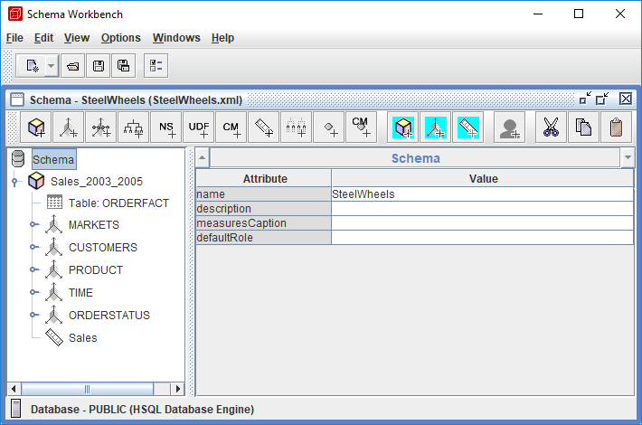
<figcaption>The SteelWheels schema in Schema Workbench</figcaption>
</figure>
</div>

:::: tabs

### 1. JDBC Connection

> **Note:**
>
> #### JDBC Connection
>
> Schema Workbench reads tables and columns through its own JDBC connection, set under **Options > Connection**: a connection name, a connection type such as Hypersonic, MySQL, Oracle or PostgreSQL, the access method, and the host, database, port and credentials.
>
> The SampleData database is HSQLDB (Hypersonic), and Schema Workbench ships its driver in `schema-workbench\drivers`, so this connection needs nothing extra. For another database, copy its JDBC driver into that `drivers` folder and restart Schema Workbench.

<div class="pcm-embed-card" data-href="https://www.loom.com/share/5d8aeb46632048b491c3a26eeaeb936f?hideEmbedTopBar=true&amp;hide_owner=true&amp;hide_share=true&amp;hide_title=true" data-title="Connecting to the Steel Wheels Sample Database in Schema Workbench" data-description="In this video, I demonstrate how to connect to the Steel Wheels sample database using Schema Workbench. I walk through the steps to set up the database connection, including specifying the connection name, type, hostname, database name, port, username, and password. I also emphasize the importance of testing the connection to ensure everything is set up correctly, which I successfully did. Now that the connection is established, I am ready to build the schema in the next demonstration. Please follow along as I create the schema in the upcoming video." data-thumb="../_assets/embeds/2631a0493553.png"></div>

1. Start Schema Workbench with the **Start Schema Workbench** button below, or from a terminal:

::: tabs

### Windows (PowerShell)

```powershell
Set-Location C:\Pentaho\design-tools\schema-workbench
.\workbench.bat
```

### macOS / Linux

```bash
cd ~/Pentaho/design-tools/schema-workbench
./workbench.sh
```

:::

<button data-launch="schema-workbench">Start Schema Workbench</button>

2. Make sure the Pentaho Server is running: it hosts the SampleData database on port `9001`. On a lab VM it starts with the machine. On your own machine, start it and wait until **http://localhost:8080/pentaho** shows the sign-in page:

::: tabs

### Windows (PowerShell)

```powershell
C:\Pentaho\server\pentaho-server\start-pentaho.bat
```

### macOS / Linux

```bash
cd ~/Pentaho/server/pentaho-server
./start-pentaho.sh
```

:::

3. Select **Options > Connection**.

<div align="center">
<figure>

<figcaption>Options > Connection</figcaption>
</figure>
</div>

4. In the **Database Connection** dialog, set these fields. The connection name can't contain reserved characters.

| Field | Value |
| --- | --- |
| **Connection name** | `hsqldb_sampledata` |
| **Connection type** | Hypersonic |
| **Access** | Native (JDBC) |
| **Host Name** | `localhost` |
| **Database Name** | `sampledata` |
| **Port Number** | `9001` |
| **Username** | `pentaho_admin` |
| **Password** | `password` |

5. Select **Test**.

<div align="center">
<figure>

<figcaption>The test succeeds</figcaption>
</figure>
</div>

> **Success:** Checkpoint: a **Message Box** reports that the connection to `hsqldb_sampledata` was successful, with the host name `localhost`, port `9001` and database name `sampledata`.

6. Select **OK** to close the message, then select **OK** to close **Database Connection**.

> **Under the hood:**
>
> #### The schema never sees this connection
>
> Open `steelwheels.xml` in a text editor and you won't find a URL, a
> user name or a driver in it. The connection you just made belongs to
> Schema Workbench: it is what lets the workbench check the tables and
> columns a schema names, and what runs your MDX in the query window.
>
> It points at the SampleData database the Pentaho Server hosts. Port
> 9001 is HSQLDB's network listener, and the database's own script
> creates `pentaho_admin` with administrator rights and `pentaho_user`
> with read-only access to the sample tables.
>
> **Why it matters:** because the schema carries no connection, the same
> file can be published against test data today and production tomorrow
> without an edit. Workshop 05 shows where the binding happens on the
> server.

### 2. JDBC Explorer

> **Note:**
>
> #### JDBC Explorer
>
> JDBC Explorer lists the schemas, tables and columns the connection can see: the same names the schema editor offers in its drop-down lists.

1. Select **File > New > JDBC Explorer**.

<div align="center">
<figure>
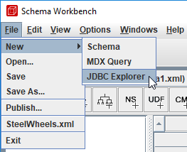
<figcaption>File > New > JDBC Explorer</figcaption>
</figure>
</div>

2. Expand **PUBLIC**.

<div align="center">
<figure>
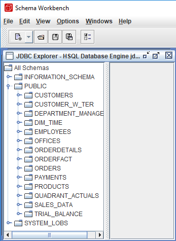
<figcaption>JDBC Explorer: the SampleData tables</figcaption>
</figure>
</div>

> **Success:** Checkpoint: **PUBLIC** lists 14 tables, from `CUSTOMERS` to `TRIAL_BALANCE`. The schemas in this course use four of them: `ORDERFACT`, `CUSTOMER_W_TER`, `PRODUCTS` and `DIM_TIME`.

3. Expand **CUSTOMER_W_TER**.

> **Success:** Checkpoint: 15 columns, among them `CUSTOMERNUMBER`, `CUSTOMERNAME`, `TERRITORY`, `COUNTRY`, `STATE` and `CITY`: the columns the Markets and Customers dimensions read.

4. Close JDBC Explorer: select the **X** in the top-right corner of its window.

### 3. SteelWheels Schema

> **Note:**
>
> #### SteelWheels Schema
>
> The SteelWheels schema is built on the SampleData database. Its one cube, `Sales_2003_2005`, reads the `ORDERFACT` fact table, which holds the order lines of three years, and has five dimensions:
>
> * **MARKETS**: a four-level geographic hierarchy, Territory, Country, State Province and City
> * **CUSTOMERS**: one level, Customer, with six member properties
> * **PRODUCT**: product line and vendor
> * **TIME**: years, quarters and months
> * **ORDERSTATUS**: a degenerate dimension, which lives in the fact table and has no table of its own
>
> Its two measures, **Quantity** and **Sales**, each have an aggregator and a format string.

1. Select **File > Open** and open `steelwheels.xml`, which you downloaded from **Lab Files** below.

<div align="center">
<figure>
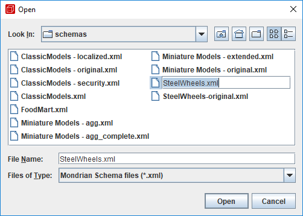
<figcaption>Open the SteelWheels schema</figcaption>
</figure>
</div>

2. In the left pane, expand **Sales_2003_2005**.

> **Success:** Checkpoint: the cube holds **Table: ORDERFACT**, the dimensions **MARKETS**, **CUSTOMERS**, **PRODUCT**, **TIME** and **ORDERSTATUS**, and the measures **Quantity** and **Sales**.

3. Select **Table: ORDERFACT**.

<div align="center">
<figure>
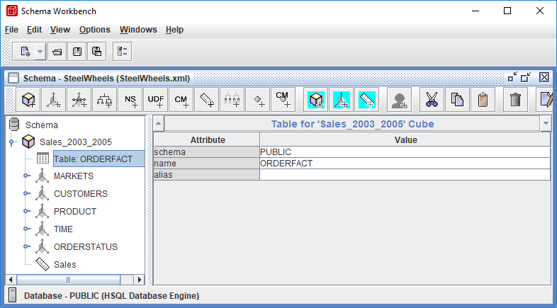
<figcaption>The cube's fact table</figcaption>
</figure>
</div>

> **Success:** Checkpoint: the property grid shows **schema** `PUBLIC` and **name** `ORDERFACT`. Every measure in the cube is computed from this table.

4. Select **MARKETS** and expand it, then expand its **Markets** hierarchy.

<div align="center">
<figure>
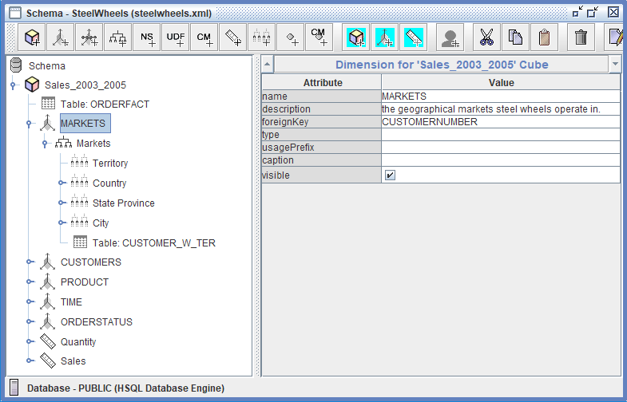
<figcaption>The MARKETS dimension</figcaption>
</figure>
</div>

> **Success:** Checkpoint: **MARKETS** joins the fact table on **foreignKey** `CUSTOMERNUMBER`. Its **Markets** hierarchy has four levels, **Territory**, **Country**, **State Province** and **City**, over **Table: CUSTOMER_W_TER**.

5. Expand **Country**, expand its **Annotations**, and select **Data.Role**.

<div align="center">
<figure>
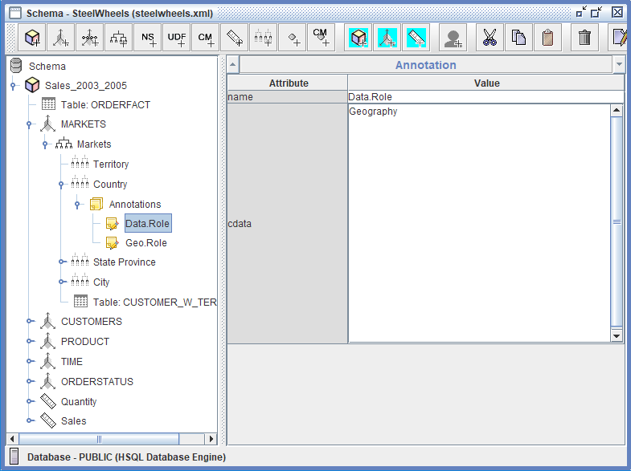
<figcaption>Annotations on the Country level</figcaption>
</figure>
</div>

> **Success:** Checkpoint: **name** `Data.Role`, **cdata** `Geography`. Country also has a **Geo.Role** annotation, `Country`; State Province and City add **Geo.RequiredParents**. Analyzer reads these to draw the levels on a map.

6. Expand **CUSTOMERS** and its **Customers** hierarchy, and select the **Customer** level.

<div align="center">
<figure>
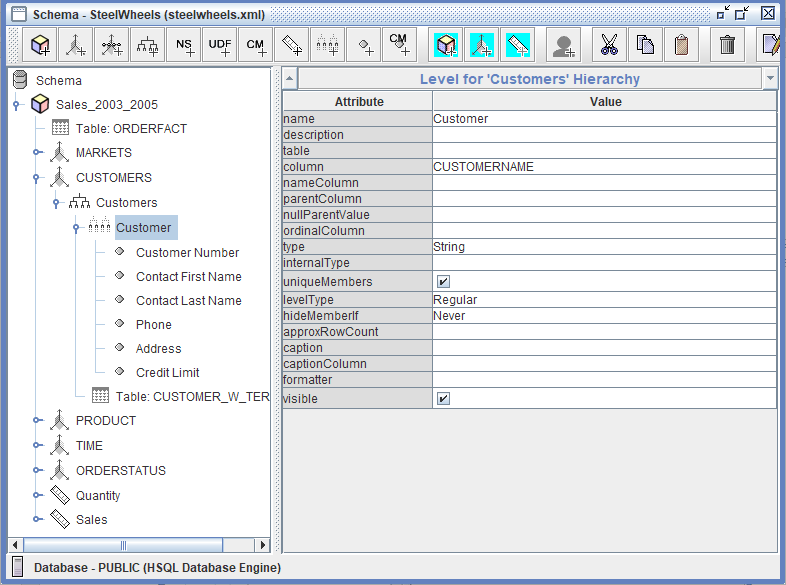
<figcaption>A level with member properties</figcaption>
</figure>
</div>

> **Success:** Checkpoint: **Customer** reads **column** `CUSTOMERNAME` and has six properties: **Customer Number**, **Contact First Name**, **Contact Last Name**, **Phone**, **Address** and **Credit Limit**.

7. Expand **PRODUCT** and its **Products** hierarchy.

> **Success:** Checkpoint: two levels, **Line** on `PRODUCTLINE` and **Vendor** on `PRODUCTVENDOR`, over **Table: PRODUCTS**.

8. Expand **TIME** and its **Time** hierarchy, and select **Years**.

<div align="center">
<figure>
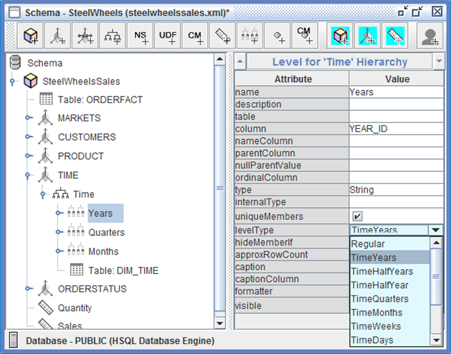
<figcaption>The levelType of a time level</figcaption>
</figure>
</div>

> **Success:** Checkpoint: **TIME** is a `TimeDimension` on **Table: DIM_TIME**. **Years** reads **column** `YEAR_ID` with **levelType** `TimeYears`. The **levelType** list also offers `TimeQuarters`, `TimeMonths`, `TimeWeeks` and `TimeDays`.

9. Select **Quarters**, then **Months**.

> **Under the hood:**
>
> #### levelType is what Ytd() looks for
>
> Mondrian's Ytd, Qtd and Mtd functions don't know what a year is. They
> look in the Time hierarchy for the level whose levelType is TimeYears,
> TimeQuarters or TimeMonths, and return the periods from the start of
> that member up to the current one. On this schema,
> `Aggregate(Ytd([TIME.Time].CurrentMember), [Measures].[Sales])` across
> 2004's quarters returns 877,419, then 1,725,133, 2,870,441 and
> 4,987,740: each quarter's sales plus every earlier quarter of the
> year.
>
> The type binds the other way too: give a level in a TimeDimension a
> non-time levelType and the schema won't load ("Level
> '[TIME.Time].[Months]' belongs to a time hierarchy, so its level-type
> must be 'Years', 'Quarters', 'Months', 'Weeks' or 'Days'").
>
> **Why it matters:** the level names (Years, Quarters, Months) are for
> people; the levelType is for the engine, and the time functions only
> work when it is set.

10. Expand **ORDERSTATUS** and select its **Status** hierarchy.

<div align="center">
<figure>
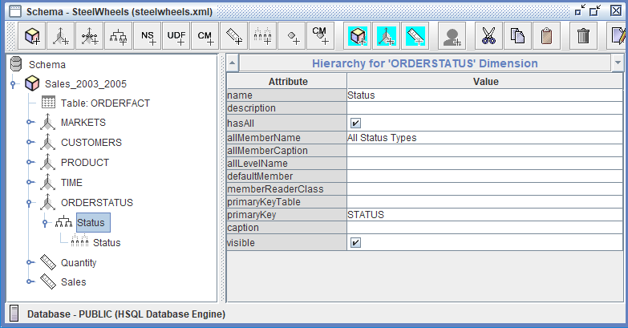
<figcaption>A degenerate dimension has no table</figcaption>
</figure>
</div>

> **Success:** Checkpoint: **allMemberName** `All Status Types` and **primaryKey** `STATUS`, and no **Table** node under the hierarchy: a star dimension has one dimension table and a snowflake two or more, but a degenerate dimension has none. Its one level, **Status**, reads `STATUS` from the fact table.

11. Select the **Status** level.

> **Under the hood:**
>
> #### Order Status costs no join
>
> Its hierarchy names no table, so Mondrian reads the level's column,
> STATUS, straight from the cube's fact table. Against SampleData the
> member query is a plain `select STATUS from ORDERFACT group by STATUS`
> (six values, from `Cancelled` to `Shipped`), and the cell query sums both
> measures from ORDERFACT in one statement with no other table in it.
>
> The cost moves to the member query: every lookup of this dimension's
> members scans the fact table, 2,996 rows here and many millions in a
> real warehouse.
>
> **Why it matters:** a degenerate dimension saves a table and a join for
> a column with a handful of values, but agree it with the data
> warehouse team, because it puts the member lookups on the largest
> table.

12. Select the **Quantity** measure.

<div align="center">
<figure>
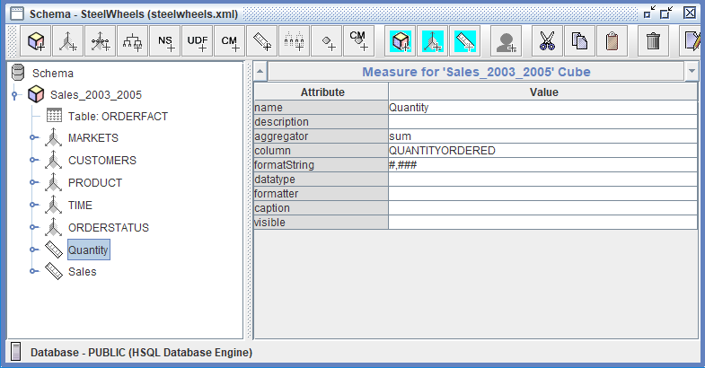
<figcaption>The Quantity measure</figcaption>
</figure>
</div>

> **Success:** Checkpoint: **aggregator** `sum`, **column** `QUANTITYORDERED`, **formatString** `#,###`.

13. Select the **Sales** measure.

> **Success:** Checkpoint: the same **aggregator** and **formatString**, on **column** `TOTALPRICE`.

14. Close the schema: select the **X** in the top-right corner of the schema window.

> **Under the hood:**
>
> #### The aggregator runs in the database; the format string never does
>
> `aggregator="sum"` on QUANTITYORDERED becomes
> `sum("ORDERFACT"."QUANTITYORDERED")` in the SQL Mondrian writes,
> grouped by whatever levels the query asks for, so the database does
> the adding. `formatString="#,###"` is applied by Mondrian to the
> number that comes back (49,417 units ordered in 2004).
>
> Every cube also gets one measure you didn't define: Fact Count, a
> `count(*)` of fact rows that Mondrian loads in the same statement.
> Workshop 11's first query shows it.
>
> **Why it matters:** changing a format never changes a query, while
> changing an aggregator changes the SQL and every number it returns.

::::

## Lab Files

Click a file to download. For `.ktr` and `.kjb` files, **Open in Pentaho Data Integration** launches Pentaho Data Integration with the file loaded. If Pentaho Data Integration is already running, the path is copied to your clipboard — switch to Pentaho Data Integration and press `Ctrl+O`, `Ctrl+V`, `Enter`.

The schema this workshop explores. Open it in Schema Workbench with **File > Open**:

[steelwheels.xml](./files/steelwheels.xml)

An earlier version of the same schema, with the cube named `SteelWheelsSales` and no annotations, for comparison:

[steelwheels-original.xml](./files/steelwheels-original.xml)
