# Basic Model

> **Warning:**
>
> #### Workshop - Basic Model
>
> Examining a schema teaches the concepts; building one teaches the craft. In this workshop you build the Classic Models schema and its `ClassicModelsOrders` cube in Schema Workbench, publish it to the Pentaho Server, and test it in an Analyzer report.
>
> **What you'll do**
>
> * Create a JDBC connection in Schema Workbench and a matching connection on the Pentaho Server
> * Create the Classic Models schema with the `ClassicModelsOrders` cube on the `ORDERFACT` fact table
> * Build the CUSTOMERS and PRODUCTS dimensions with their hierarchies and levels
> * Define the Sales measure and review the generated XML
> * Publish the schema and test it in an Analyzer report
>
> **Prerequisites:** Complete [SteelWheels](../04-schemas-steelwheels/guide.md); the Pentaho Server running, with access to the User Console as `admin`
>
> **Estimated time:** 90 minutes

<div align="center">
<figure>
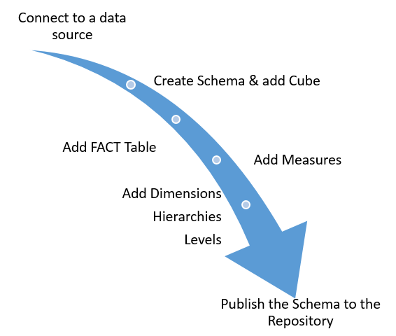
<figcaption>The workflow to define a schema</figcaption>
</figure>
</div>

:::: tabs

### 1. JDBC Connection

> **Note:**
>
> #### JDBC Connection
>
> A JDBC (Java Database Connectivity) connection links Schema Workbench to the source database, so it can list the physical tables and columns you build the schema from. Schema Workbench ships the HSQLDB driver the SampleData database needs in `schema-workbench\drivers`; for another database, copy its JDBC driver into that folder and restart Schema Workbench.

<div class="pcm-embed-card" data-href="https://www.loom.com/share/5d8aeb46632048b491c3a26eeaeb936f?hideEmbedTopBar=true&amp;hide_owner=true&amp;hide_share=true&amp;hide_title=true" data-title="Connecting to the Steel Wheels Sample Database in Schema Workbench" data-description="In this video, I demonstrate how to connect to the Steel Wheels sample database using Schema Workbench. I walk through the steps to set up the database connection, including specifying the connection name, type, hostname, database name, port, username, and password. I also emphasize the importance of testing the connection to ensure everything is set up correctly, which I successfully did. Now that the connection is established, I am ready to build the schema in the next demonstration. Please follow along as I create the schema in the upcoming video." data-thumb="../_assets/embeds/2631a0493553.png"></div>

1. Start Schema Workbench with the **Start Schema Workbench** button below, or from a terminal:

::: tabs

### Windows (PowerShell)

```powershell
Set-Location C:\Pentaho\design-tools\schema-workbench
.\workbench.bat
```

### macOS / Linux

```bash
cd ~/Pentaho/design-tools/schema-workbench
./workbench.sh
```

:::

<button data-launch="schema-workbench">Start Schema Workbench</button>

2. Make sure the Pentaho Server is running: it hosts the SampleData database on port `9001`. On a lab VM it starts with the machine. On your own machine, start it and wait until **http://localhost:8080/pentaho** shows the sign-in page:

::: tabs

### Windows (PowerShell)

```powershell
C:\Pentaho\server\pentaho-server\start-pentaho.bat
```

### macOS / Linux

```bash
cd ~/Pentaho/server/pentaho-server
./start-pentaho.sh
```

:::

3. Select **Options > Connection**.

<div align="center">
<figure>
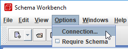
<figcaption>Options > Connection</figcaption>
</figure>
</div>

4. In the **Database Connection** dialog, set these fields:

| Field | Value |
| --- | --- |
| **Connection name** | `hsqldb_sampledata` |
| **Connection type** | Hypersonic |
| **Access** | Native (JDBC) |
| **Host Name** | `localhost` |
| **Database Name** | `sampledata` |
| **Port Number** | `9001` |
| **Username** | `pentaho_admin` |
| **Password** | `password` |

5. Select **Test**.

<div align="center">
<figure>
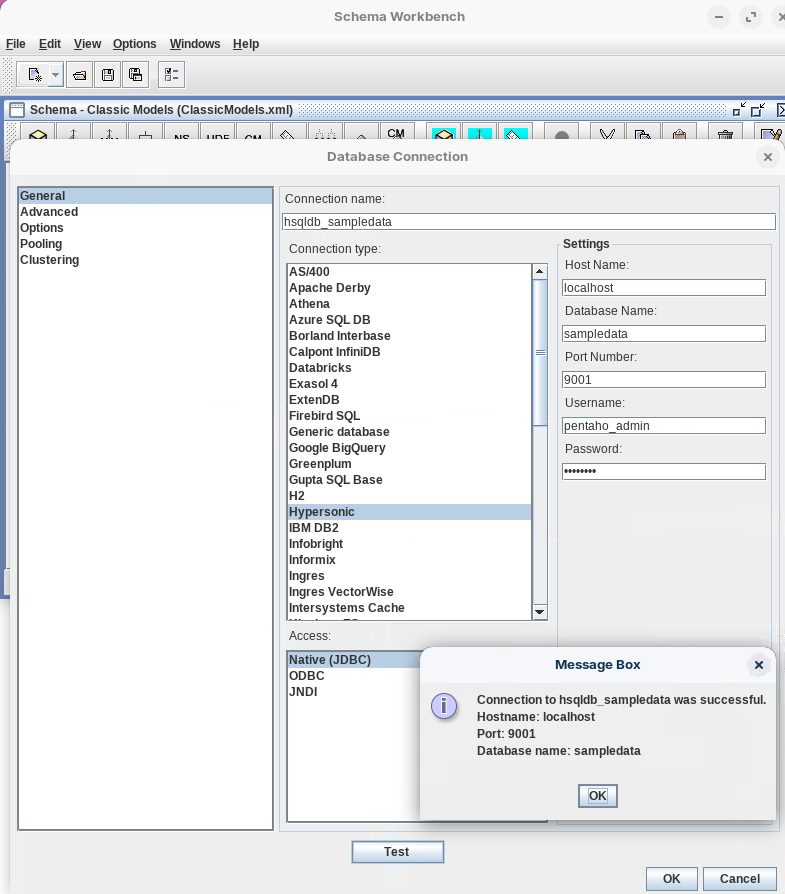
<figcaption>JDBC connection hsqldb_sampledata</figcaption>
</figure>
</div>

> **Success:** Checkpoint: a **Message Box** reports that the connection to `hsqldb_sampledata` was successful, with the host name `localhost`, port `9001` and database name `sampledata`.

6. Select **OK** to close the message, then select **OK** to close **Database Connection**.

### 2. Server Connection

> **Note:**
>
> #### Pentaho Server Connection
>
> The connection you just made belongs to Schema Workbench. The schema you publish runs on the Pentaho Server, which needs a connection of its own, set in **Manage Data Sources**. Give it the same name, `hsqldb_sampledata`: you type that name again when you publish.

<button data-launch="puc">Open Pentaho User Console</button>

1. Sign in to the Pentaho User Console as `admin`.
2. On the **Home** perspective, select **Manage Data Sources**.

<div align="center">
<figure>
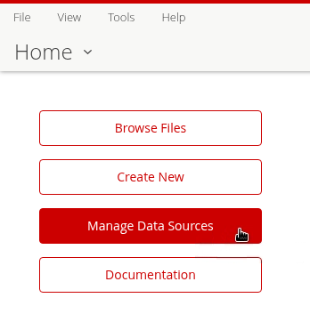
<figcaption>Manage Data Sources</figcaption>
</figure>
</div>

3. In **Manage Data Sources**, open the gear menu and select **New Connection**.

<div align="center">
<figure>
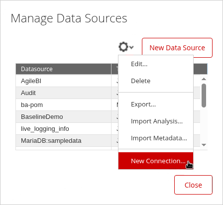
<figcaption>New Connection</figcaption>
</figure>
</div>

4. In the **Database Connection** dialog, set these fields:

| Field | Value |
| --- | --- |
| **Connection Name** | `hsqldb_sampledata` |
| **Database Type** | Hypersonic |
| **Access** | Native (JDBC) |
| **Host Name** | `localhost` |
| **Database Name** | `sampledata` |
| **Port Number** | `9001` |
| **User Name** | `pentaho_admin` |
| **Password** | `password` |

5. Select **Test**.

<div align="center">
<figure>
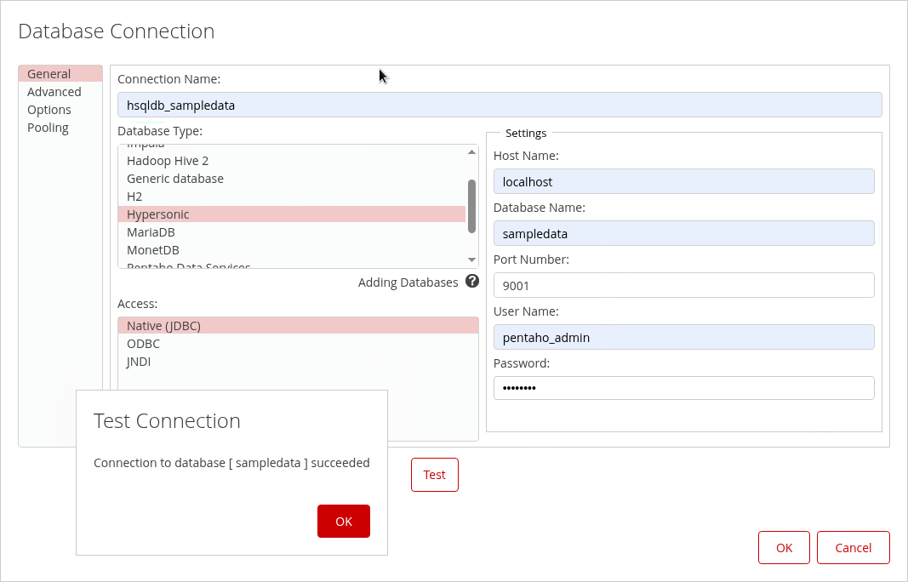
<figcaption>The server's connection - hsqldb_sampledata</figcaption>
</figure>
</div>

> **Success:** Checkpoint: **Test Connection** reports `Connection to database [ sampledata ] succeeded`.

6. Select **OK** to close the message, select **OK** to save the connection, and select **Close** to close **Manage Data Sources**.

> **Under the hood:**
>
> #### Two connections, joined only by a name
>
> The Pentaho Server never sees Schema Workbench's connection. When you
> publish (tab 8), the schema is stored on the server with the name you
> type under **Pentaho or JNDI Data Source**. There, Mondrian's
> connection names the schema as its Catalog and that name as its
> DataSource, and the server hands it the connection called
> `hsqldb_sampledata` from Manage Data Sources.
>
> The name is the only thing joining the two: publish against a name the
> server doesn't have and the schema has nowhere to send its SQL.
>
> **Why it matters:** moving from test to production is a server-side
> change, a connection with the same name pointing at the other
> database, with the schema file untouched.

### 3. Schema & Cube

> **Note:**
>
> #### Classic Models Schema and Cube
>
> The schema is the top-level container. The `ClassicModelsOrders` cube inside it covers one business process, order transactions: it joins the `ORDERFACT` fact table to the CUSTOMERS and PRODUCTS dimensions and the Sales measure. Once published, the cube is a data source in Analyzer, where users slice, drill and pivot sales by territory and product line.

<div class="pcm-embed-card" data-href="https://www.loom.com/share/edcdc7025caa49038a22df66e9e186e3?hideEmbedTopBar=true&amp;hide_owner=true&amp;hide_share=true&amp;hide_title=true" data-title="Creating a Schema in Schema Workbench 🛠️" data-description="In this video, I walk you through the process of creating a new schema file in Schema Workbench. I demonstrate how to name the schema &amp;#34;My Steel Wheels&amp;#34; and save it as an XML file on my file system. I also highlight the importance of using the right-click function to build your schema, cubes, measures, and dimensions effectively. As a next step, I will be adding a cube to this schema in the following demonstration. Please follow along and ensure you have your Schema Workbench ready for the next steps." data-thumb="../_assets/embeds/2631a0493553.png"></div>

1. Select **File > New > Schema**. (On the toolbar, **New** offers the same choice.)

<div align="center">
<figure>
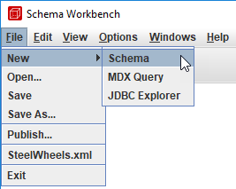
<figcaption>File > New > Schema</figcaption>
</figure>
</div>

2. In the left pane, select **Schema**.
3. Set **name** to `Classic Models` and press `Tab`. Press `Tab` after every value you enter in the property grid: Schema Workbench keeps a value only once you leave the cell.

<div align="center">
<figure>
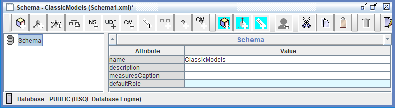
<figcaption>The schema's name</figcaption>
</figure>
</div>

<div class="pcm-embed-card" data-href="https://www.loom.com/share/aa2efbf60ee8490fbeef871e6192370f?hideEmbedTopBar=true&amp;hide_owner=true&amp;hide_share=true&amp;hide_title=true" data-title="Adding a Cube to the Schema: Steel Wheels Sales Training" data-description="In this video, I demonstrate how to add a cube called &amp;#34;Steel Wheels Sales Training&amp;#34; to the schema I previously created. I walk through the steps of right-clicking the schema in the navigation pane, selecting &amp;#34;Add Cube,&amp;#34; and entering the cube name. It's important to note that I need to set a fact name for the cube to be valid, as indicated by the red X's and messages at the bottom of the screen. In the next demonstration, I will begin building the cube by adding the fact table. Please make sure to follow along and ensure all necessary attributes are set for a valid schema." data-thumb="../_assets/embeds/2631a0493553.png"></div>

4. Right-click **Schema** and select **Add cube**.
5. Set **name** to `ClassicModelsOrders` and press `Tab`. Leave **cache**, **enabled** and **visible** selected.

<div align="center">
<figure>
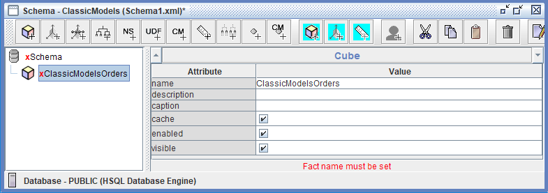
<figcaption>The ClassicModelsOrders cube, still without a fact table</figcaption>
</figure>
</div>

> **Success:** Checkpoint: the cube and the schema show a red cross, and the message under the property grid reads `Fact name must be set`: a cube needs a fact table, which you add next.

6. Select **File > Save As** and save the schema as `ClassicModels.xml` in a folder of your own.

### 4. Fact Table

> **Note:**
>
> #### Fact Table
>
> The fact table holds the columns the measures are calculated from, and the keys that join it to the dimension tables. `ORDERFACT` holds one row per order line; the Sales measure sums its `TOTALPRICE` column.

<div class="pcm-embed-card" data-href="https://www.loom.com/share/7d8012bd48594ff9aceec25256c9ef24?hideEmbedTopBar=true&amp;hide_owner=true&amp;hide_share=true&amp;hide_title=true" data-title="Building a Cube with Order Fact Table in Steel Wheel Sales Training" data-description="In this video, I demonstrate how to build a cube using a star schema, starting with the order fact table at the center. I guide you through the process of adding the order fact table to the Steel Wheel Sales Training Cube, showing you how to navigate the interface and select the appropriate table from our sample database. Once the fact table is added, we will be ready to incorporate measures in the next demonstration. Please pay attention to the steps I outline, as they are crucial for the next phase of our project." data-thumb="../_assets/embeds/2631a0493553.png"></div>

1. Right-click **ClassicModelsOrders** and select **Add Table**.

<div align="center">
<figure>
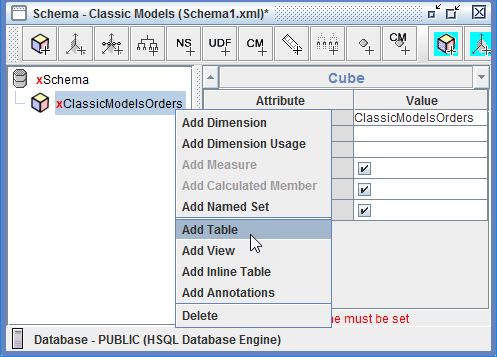
<figcaption>Add Table</figcaption>
</figure>
</div>

2. Set the table's attributes: click in each **Value** cell and select from the list.

| Attribute | Value |
| --- | --- |
| **schema** | `PUBLIC` |
| **name** | `ORDERFACT` |

<div align="center">
<figure>
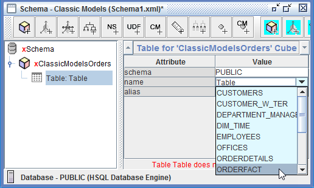
<figcaption>Set the ORDERFACT table</figcaption>
</figure>
</div>

3. Select **File > Save**.

> **Success:** Checkpoint: **Table: ORDERFACT** appears under the cube, and selecting the cube shows the next thing it lacks: `Cube must contain dimensions`.

### 5. CUSTOMERS Dimension

> **Note:**
>
> #### CUSTOMERS Dimension, Hierarchy and Levels
>
> The CUSTOMERS dimension joins the fact table on its `CUSTOMERNUMBER` foreign key. Its **Customers** hierarchy reads the `CUSTOMER_W_TER` table and has two levels, from general to specific: **Territory**, the sales region, and **Customer Name**. Users drill from a territory's total down to its customers.

<div class="pcm-embed-card" data-href="https://www.loom.com/share/3752f22898e6433e89cfc8c2872f5962?hideEmbedTopBar=true&amp;hide_owner=true&amp;hide_share=true&amp;hide_title=true" data-title="Adding Dimensions and Hierarchies in Schema Workbench" data-description="In this video, I demonstrate how to add a new dimension, specifically the Markets dimension, to our steel wheel sales training cube using Schema Workbench. I explain the process of selecting the foreign key, attaching the customer with territory table, and setting up the hierarchy within the dimension. I also highlight the importance of naming conventions and the all-member concept. As we move forward, I will be adding levels to this hierarchy in the next demonstration. Please pay attention to the steps outlined, as they are crucial for our logical star schema setup." data-thumb="../_assets/embeds/2631a0493553.png"></div>

1. Right-click **ClassicModelsOrders** and select **Add Dimension**.

<div align="center">
<figure>
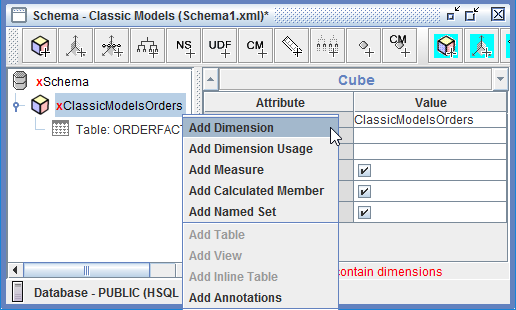
<figcaption>Add Dimension</figcaption>
</figure>
</div>

2. Set the dimension's attributes:

| Attribute | Value |
| --- | --- |
| **name** | `CUSTOMERS` |
| **foreignKey** | `CUSTOMERNUMBER` |
| **type** | StandardDimension |

<div align="center">
<figure>
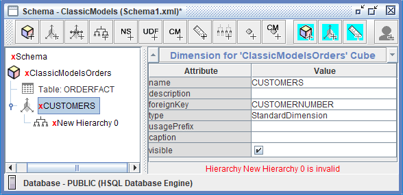
<figcaption>The CUSTOMERS dimension</figcaption>
</figure>
</div>

3. Expand **CUSTOMERS**, right-click **New Hierarchy 0** and select **Add Table**.

<div align="center">
<figure>
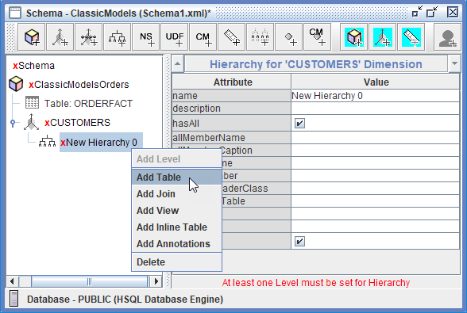
<figcaption>Add the dimension table</figcaption>
</figure>
</div>

4. Set the table's attributes:

| Attribute | Value |
| --- | --- |
| **schema** | `PUBLIC` |
| **name** | `CUSTOMER_W_TER` |

<div align="center">
<figure>
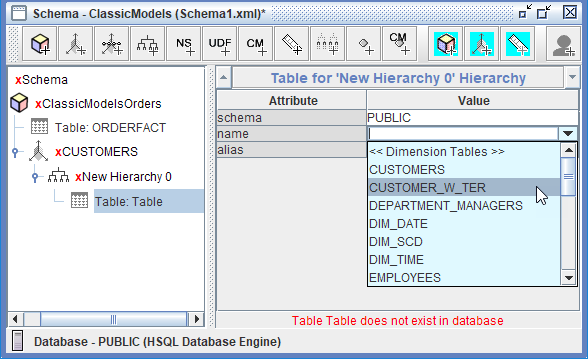
<figcaption>Select the dimension table</figcaption>
</figure>
</div>

5. Select **New Hierarchy 0** and set its attributes:

| Attribute | Value |
| --- | --- |
| **name** | `Customers` |
| **hasAll** | selected |
| **allMemberName** | `All Customers` |
| **primaryKey** | `CUSTOMERNUMBER` |
| **visible** | selected |

<div align="center">
<figure>
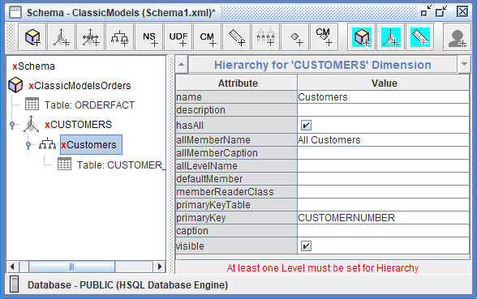
<figcaption>The Customers hierarchy</figcaption>
</figure>
</div>

> **Success:** Checkpoint: the hierarchy is now **Customers**, and its message reads `At least one Level must be set for Hierarchy`.

<div class="pcm-embed-card" data-href="https://www.loom.com/share/ce0e6919c4544c24adbb6cc2cc8f8f2e?hideEmbedTopBar=true&amp;hide_owner=true&amp;hide_share=true&amp;hide_title=true" data-title="BA3000 - M5L2S6b - Adding Levels to a Hierarchy" data-description="Use Loom to record quick videos of your screen and cam. Explain anything clearly and easily – and skip the meeting. An essential tool for hybrid workplaces." data-thumb="../_assets/embeds/2631a0493553.png"></div>

6. Right-click **Customers** and select **Add Level**.
7. Set the level's attributes:

| Attribute | Value |
| --- | --- |
| **name** | `Territory` |
| **column** | `TERRITORY` |
| **type** | String |
| **uniqueMembers** | selected |
| **levelType** | Regular |
| **hideMemberIf** | Never |

<div align="center">
<figure>
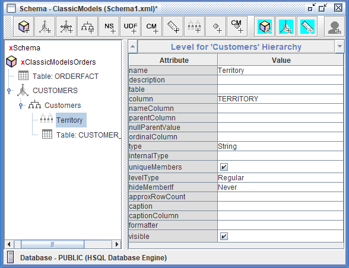
<figcaption>Level - Territory</figcaption>
</figure>
</div>

8. Right-click **Customers** and select **Add Level**.
9. Set the level's attributes. Leave **uniqueMembers** cleared unless you know every customer name is unique.

| Attribute | Value |
| --- | --- |
| **name** | `Customer Name` |
| **column** | `CUSTOMERNAME` |
| **type** | String |
| **uniqueMembers** | cleared |
| **levelType** | Regular |
| **hideMemberIf** | Never |

<div align="center">
<figure>
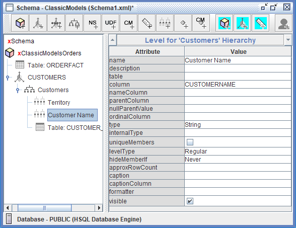
<figcaption>Level - Customer Name</figcaption>
</figure>
</div>

> **Under the hood:**
>
> #### uniqueMembers lets Mondrian leave the parent out of its SQL
>
> Ask for Japan's customers and, with uniqueMembers off, the cell SQL
> constrains and groups on TERRITORY and CUSTOMERNAME together. Switch
> it on for Customer Name and the same query constrains on CUSTOMERNAME
> alone: Mondrian now trusts a name to identify one member.
>
> That is only safe when it is true of the data, and below the top level
> it often isn't. In SampleData, Singapore has customers in both APAC
> and Japan, and France, Germany and Spain all have customers with no
> state. Mark Country unique and both Singapore rows show 288,488.41,
> their combined sales, instead of 115,498.73 and 172,989.68. Mark State
> unique and France, Germany and Spain each show 5,896,856.04 for their
> no-state row.
>
> **Why it matters:** a wrong `true` raises no error, only wrong numbers.
> The top level, Territory, is unique by definition; leave the levels
> below it off unless you know their values never repeat.

10. Select **File > Save**.

> **Success:** Checkpoint: **CUSTOMERS** and everything under it show no red cross: **Customers** holds **Territory**, **Customer Name** and **Table: CUSTOMER_W_TER**. The cube and the schema keep theirs until the cube has a measure.

### 6. PRODUCTS Dimension

> **Note:**
>
> #### PRODUCTS Dimension
>
> The PRODUCTS dimension joins the fact table on `PRODUCTCODE`. Its **Products** hierarchy reads the `PRODUCTS` table and has two levels: **Product Line**, the product family such as Classic Cars, Motorcycles or Planes, and **Vendor**, the manufacturer.

1. Right-click **ClassicModelsOrders** and select **Add Dimension**.
2. Set the dimension's attributes:

| Attribute | Value |
| --- | --- |
| **name** | `PRODUCTS` |
| **foreignKey** | `PRODUCTCODE` |
| **type** | StandardDimension |

3. Expand **PRODUCTS**, right-click **New Hierarchy 0** and select **Add Table**.
4. Set the table's attributes:

| Attribute | Value |
| --- | --- |
| **schema** | `PUBLIC` |
| **name** | `PRODUCTS` |

5. Select **New Hierarchy 0** and set its attributes:

| Attribute | Value |
| --- | --- |
| **name** | `Products` |
| **hasAll** | selected |
| **allMemberName** | `All Products` |
| **primaryKey** | `PRODUCTCODE` |
| **visible** | selected |

<div align="center">
<figure>
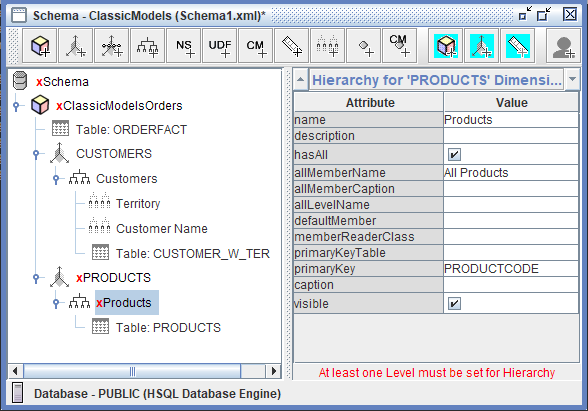
<figcaption>The Products hierarchy</figcaption>
</figure>
</div>

6. Right-click **Products**, select **Add Level**, and set the level's attributes:

| Attribute | Value |
| --- | --- |
| **name** | `Product Line` |
| **column** | `PRODUCTLINE` |
| **type** | String |
| **uniqueMembers** | selected |
| **levelType** | Regular |
| **hideMemberIf** | Never |

7. Right-click **Products**, select **Add Level**, and set the level's attributes:

| Attribute | Value |
| --- | --- |
| **name** | `Vendor` |
| **column** | `PRODUCTVENDOR` |
| **type** | String |
| **uniqueMembers** | cleared |
| **levelType** | Regular |
| **hideMemberIf** | Never |

<div align="center">
<figure>
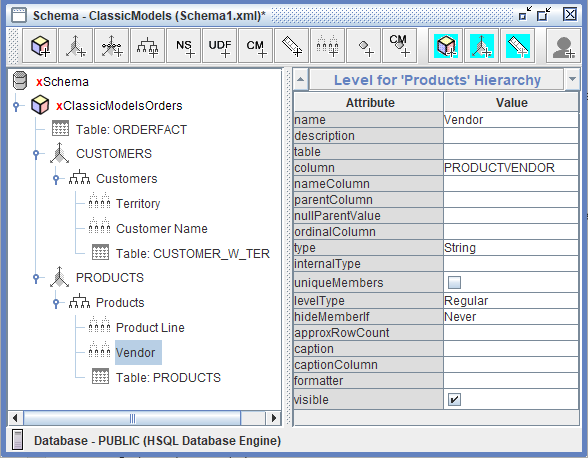
<figcaption>Level - Vendor</figcaption>
</figure>
</div>

8. Select **File > Save**.

> **Success:** Checkpoint: **PRODUCTS** shows no red cross, and its **Products** hierarchy holds **Product Line**, **Vendor** and **Table: PRODUCTS**.

### 7. Measures

> **Note:**
>
> #### Measures
>
> Measures are the numbers users aggregate across the dimensions. The **Sales** measure sums the `TOTALPRICE` column of `ORDERFACT`, so Sales by Territory, by Product Line or by both adds up the order lines underneath. Its format string shows the result as currency with two decimal places, and the **Numeric** data type tells client tools it is a number.

<div class="pcm-embed-card" data-href="https://www.loom.com/share/9a3b097c1ccc4819b8474147a67d7189?hideEmbedTopBar=true&amp;hide_owner=true&amp;hide_share=true&amp;hide_title=true" data-title="Adding Measures to Your Cube in Schema Workbench 📊" data-description="In this video, I walk you through the process of adding measures to our cube, specifically focusing on the sales measure derived from the total price column in the order fact table. I demonstrate how to assign a business-friendly name, select the aggregation method as &amp;#34;sum,&amp;#34; and format the measure as US currency with two decimal places. Additionally, I emphasize the importance of specifying the data type as numeric to ensure accurate reporting. I also show how to use the JDBC Explorer to verify the data type in the database. Please make sure to follow these steps as we prepare to add dimensions in the next demonstration." data-thumb="../_assets/embeds/2631a0493553.png"></div>

1. Right-click **ClassicModelsOrders** and select **Add Measure**.
2. Set the measure's attributes:

| Attribute | Value |
| --- | --- |
| **name** | `Sales` |
| **aggregator** | sum |
| **column** | `TOTALPRICE` |
| **formatString** | `$#,###.00` |
| **datatype** | Numeric |

<div align="center">
<figure>
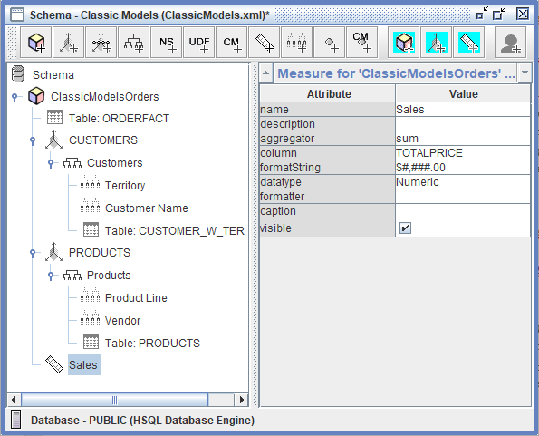
<figcaption>Measure - Sales</figcaption>
</figure>
</div>

3. Select **File > Save**.

> **Success:** Checkpoint: no red cross anywhere in the schema. That is the minimum a schema needs before it can be published: a cube with a fact table, a dimension with a table, a hierarchy, a level, and a measure.

4. Select **View > View XML**.

<div align="center">
<figure>
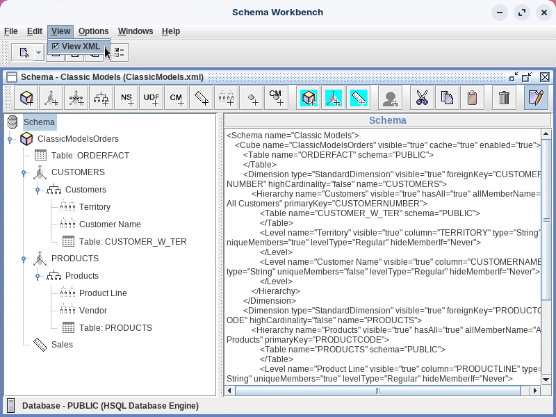
<figcaption>The schema's XML</figcaption>
</figure>
</div>

> **Success:** Checkpoint: the XML pane starts `<Schema name="Classic Models">` and `<Cube name="ClassicModelsOrders" ...>`, with the attributes you set. Keep a copy of the saved file in version control: the XML is the whole schema.

5. Select **View > View XML** again to hide the XML.

> **Under the hood:**
>
> #### One query for members, one for cells, then memory
>
> Run Sales by Territory and Mondrian sends two kinds of SQL. The first
> reads the members from the dimension table alone: `select TERRITORY
> from CUSTOMER_W_TER group by TERRITORY`. The second loads the cells:
> it joins ORDERFACT to CUSTOMER_W_TER on CUSTOMERNUMBER (the foreignKey
> and primaryKey you set) and returns `sum(TOTALPRICE)` for each
> territory.
>
> Mondrian keeps what it loaded: run the identical query again on the
> same connection and it sends no SQL at all. The extra row you'll see
> in MDX, #null, is the 22 customers with no territory; none of them has
> an order, so its cell is empty.
>
> **Why it matters:** every attribute you set in this lab ends up in that
> SQL, which is why designing a schema is designing queries.

### 8. Publish

> **Note:**
>
> #### Publish
>
> Publishing sends the schema from Schema Workbench to the Pentaho Server, where it becomes a data source for Analyzer reports and dashboards.

<div class="pcm-embed-card" data-href="https://www.loom.com/share/78f922d6f37d45dc81b56046eae090b0?hideEmbedTopBar=true&amp;hide_owner=true&amp;hide_share=true&amp;hide_title=true" data-title="Publishing a Schema to Pentaho BA Server" data-description="In this video, I walk you through the process of publishing a schema to the Pentaho server, which is essential for utilizing it as a data source in tools like Analyzer and Report Designer. I demonstrate how to access the publish feature, input the server URL, and enter your credentials—using &amp;#34;admin&amp;#34; and &amp;#34;password&amp;#34; as examples. It's important to ensure that the Pentaho data source is set to match your specific database connection, which I change to &amp;#34;sample data&amp;#34; in this instance. I also highlight the option to remember your settings for future publications. Please follow these steps to successfully publish your schema and make it available for use." data-thumb="../_assets/embeds/2631a0493553.png"></div>

1. Select **File > Publish**.
2. In the **Publish Schema** dialog, set these fields. **Pentaho or JNDI Data Source** is the name of the server connection from tab 2. **Register XMLA Data Source** also registers the schema for XML for Analysis (XMLA) clients.

| Field | Value |
| --- | --- |
| **Server URL** | `http://localhost:8080/pentaho/` |
| **User** | `admin` |
| **Password** | `password` |
| **Pentaho or JNDI Data Source** | `hsqldb_sampledata` |
| **Register XMLA Data Source** | selected |
| **Remember these Settings** | selected |

<div align="center">
<figure>
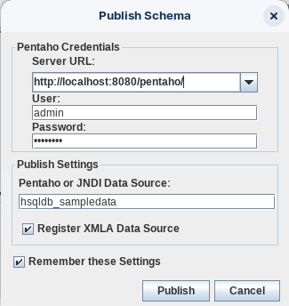
<figcaption>Publish Schema</figcaption>
</figure>
</div>

3. Select **Publish**.

> **Success:** Checkpoint: a **Publish** message reads `Publish Successful`.

4. Select **OK**.

### 9. Test in Analyzer

> **Note:**
>
> #### Test the Schema
>
> Build an Analyzer report on the new cube. If the report shows sales by territory and product line, the schema, its SQL and the server's connection all work.

<button data-launch="puc">Open Pentaho User Console</button>

1. In the User Console, signed in as `admin`, select **Tools > Refresh > Mondrian Schema Cache**, then **Tools > Refresh > Reporting Data Cache**.

<div align="center">
<figure>
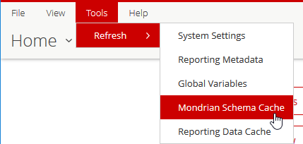
<figcaption>Refresh the caches</figcaption>
</figure>
</div>

2. On the **Home** perspective, select **Create New > Analysis Report**.
3. In the **Select Data Source** dialog, select **Classic Models: ClassicModelsOrders** and select **OK**.

<div align="center">
<figure>
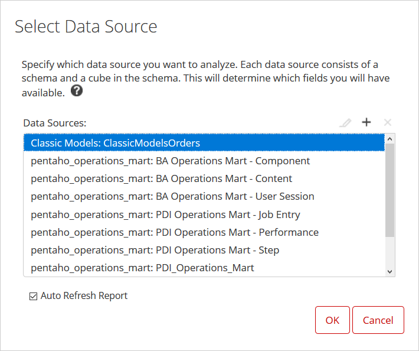
<figcaption>Select the Classic Models schema</figcaption>
</figure>
</div>

4. Drag **Sales** to the **Measures** drop zone.
5. Drag **Territory**, then **Product Line**, to the **Rows** drop zone.

<div align="center">
<figure>
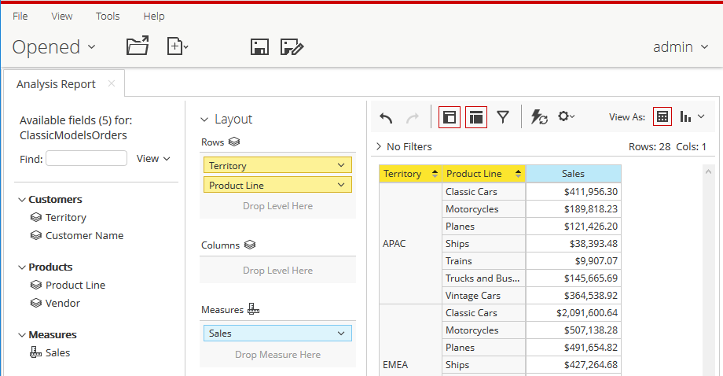
<figcaption>Sales by Territory and Product Line</figcaption>
</figure>
</div>

> **Success:** Checkpoint: 28 rows, the 7 product lines for each of the 4 territories. The first is APAC, Classic Cars, $411,956.30.

6. Optionally, set the field list's **View** to **Schema** to see the fields grouped as the schema defines them.
7. Close the report without saving it.

::::

## Lab Files

Click a file to download. For `.ktr` and `.kjb` files, **Open in Pentaho Data Integration** launches PDI with the file loaded. If PDI is already running, the path is copied to your clipboard — switch to PDI and press `Ctrl+O`, `Ctrl+V`, `Enter`.

### Solution <!-- no-step -->

The finished schema for this lab. Open it in Schema Workbench (**File > Open**) alongside your own to compare:

[classicmodels.xml](./files/classicmodels.xml)

An identical copy of the same schema:

[classicmodels-original.xml](./files/classicmodels-original.xml)
