# Standard Model

> **Warning:**
>
> #### Workshop - Standard Model
>
> Now build a schema on your own. The Miniature Models schema has a `Sales_FY2003_2005` cube whose two dimensions each have three levels, the drill paths users expect in production: from territory through country to customer, and from product line through vendor to product.
>
> **What you'll do**
>
> * Create the Miniature Models schema and the `Sales_FY2003_2005` cube on the `ORDERFACT` fact table
> * Build a three-level CUSTOMERS hierarchy: Territory, Country, Customer Name
> * Build a three-level PRODUCTS hierarchy: Line, Vendor, Name
> * Define a Sales measure and a distinct-count Quantity Ordered measure
> * Publish the schema and test it in an Analyzer report
>
> **Prerequisites:** Complete [Basic Model](../05-schemas-basic-model/guide.md), which also creates the server connection `hsqldb_sampledata`; the Pentaho Server running
>
> **Estimated time:** 45 minutes

<figure>

<figcaption class="pcm-video-caption">Walkthrough: coming soon</figcaption>

</figure>

<div align="center">
<figure>
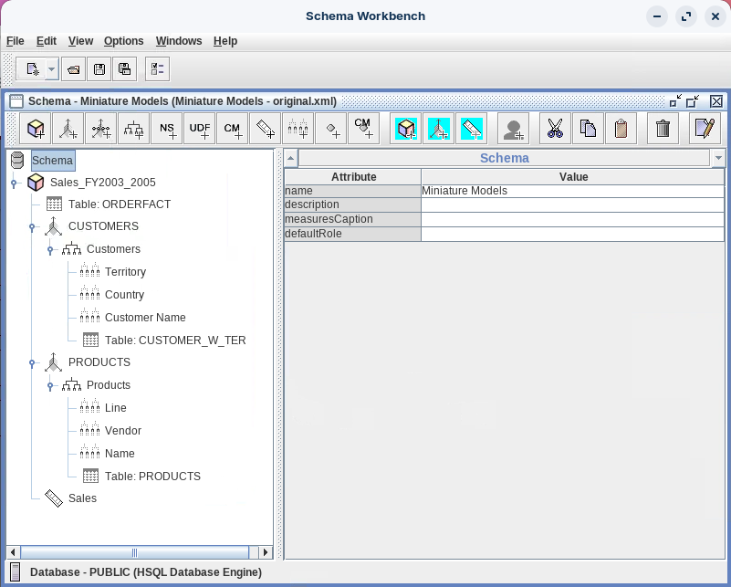
<figcaption>Schema - Miniature Models</figcaption>
</figure>
</div>

:::: tabs

### 1. JDBC Connection

> **Note:**
>
> #### Data Source
>
> Schema Workbench reads table and column metadata through its database connection. Check the `hsqldb_sampledata` connection first, so the schema editor can list the `ORDERFACT`, `CUSTOMER_W_TER` and `PRODUCTS` tables.

1. Start Schema Workbench with the **Start Pentaho Schema Workbench** button below, or from PowerShell:

```powershell
Set-Location C:\Pentaho\design-tools\schema-workbench
.\workbench.bat
```

<button data-launch="schema-workbench">Start Pentaho Schema Workbench</button>

2. Make sure the Pentaho Server is running: it hosts the SampleData database on port `9001`. On a lab VM it starts with the machine. On your own machine, start it as [Before You Start](../00-before-you-start/guide.md) describes (its repository database first), and wait until **http://localhost:8080/pentaho** shows the sign-in page:

```powershell
C:\Pentaho\server\pentaho-server\start-pentaho.bat
```

3. Select **Options > Connection**.
4. In the **Database Connection** dialog, make sure the fields hold these values:

| Field | Value |
| ----- | ----- |
| **Connection name** | `hsqldb_sampledata` |
| **Connection type** | Hypersonic |
| **Access** | Native (JDBC) |
| **Host Name** | `localhost` |
| **Database Name** | `sampledata` |
| **Port Number** | `9001` |
| **Username** | `pentaho_admin` |
| **Password** | `password` |

<div align="center">
<figure>
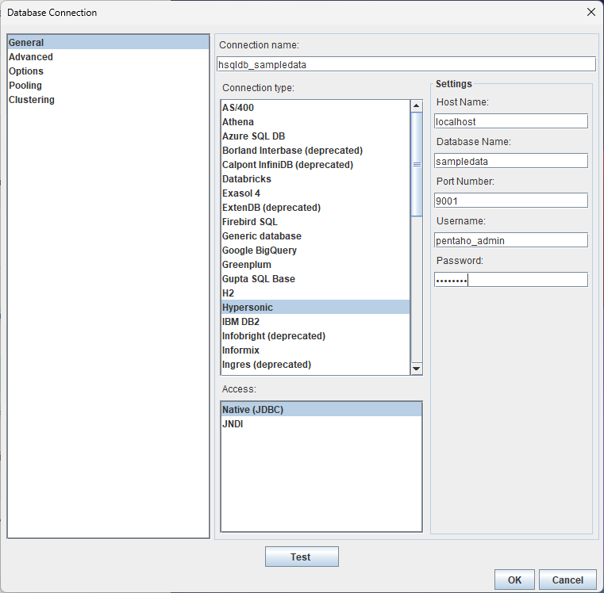
<figcaption>The Database Connection dialog, filled in</figcaption>
</figure>
</div>

5. Select **Test**.

> **Success:** Checkpoint: a **Message Box** reports that the connection to `hsqldb_sampledata` was successful.

6. Select **OK** to close the message, then select **OK** to close **Database Connection**.

### 2. Schema & Cube

> **Note:**
>
> #### Create the Schema and Add the Cube
>
> A schema is the top-level container; the cube binds a fact table to its measures and dimensions. Press `Tab` after entering each value, so Schema Workbench keeps it.

1. Select **File > New > Schema**.
2. In the left pane, select **Schema**, set **name** to `Miniature Models` and press `Tab`.
3. Right-click **Schema** and select **Add cube**.

<div align="center">
<figure>
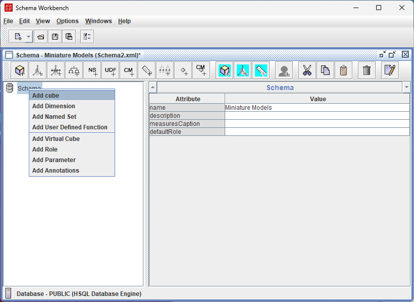
<figcaption>Add cube</figcaption>
</figure>
</div>

4. Set **name** to `Sales_FY2003_2005` and press `Tab`. Leave **cache**, **enabled** and **visible** selected.

<div align="center">
<figure>
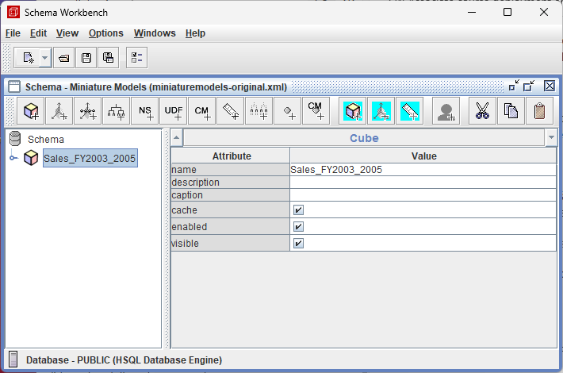
<figcaption>The Sales_FY2003_2005 cube</figcaption>
</figure>
</div>
5. Select **File > Save As** and save the schema as `MiniatureModels.xml` in `C:\Workshop-SW-Associate\03-schemas\06-schemas-standard-model`.

> **Success:** Checkpoint: the tree shows **Schema** and **Sales_FY2003_2005**, both with a red cross until the cube has a fact table, dimensions and a measure.

### 3. ORDERFACT

> **Note:**
>
> #### Add the ORDERFACT Table
>
> The fact table holds the transactional rows the cube aggregates. `ORDERFACT` lives in the `PUBLIC` schema of the SampleData database.

1. Right-click **Sales_FY2003_2005** and select **Add Table**.

<div align="center">
<figure>
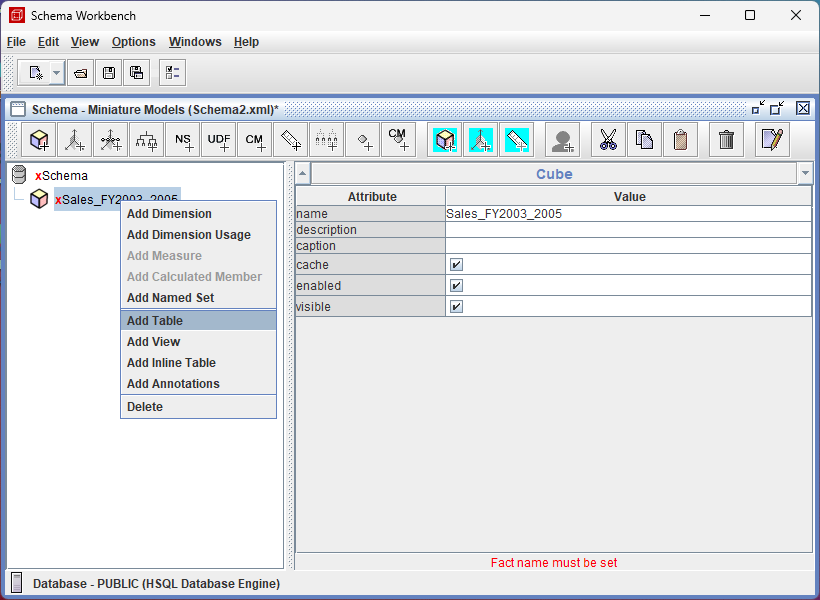
<figcaption>Add the fact table</figcaption>
</figure>
</div>

2. Set the table's attributes: click in each **Value** cell and select from the list.

| Attribute | Value |
| --------- | ----- |
| **schema** | `PUBLIC` |
| **name** | `ORDERFACT` |

<div align="center">
<figure>
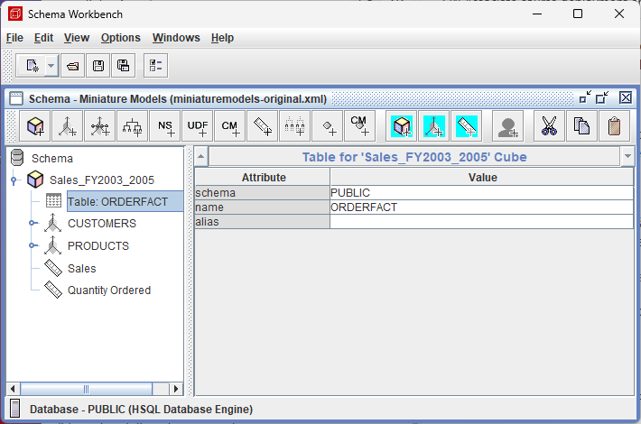
<figcaption>The fact table</figcaption>
</figure>
</div>

3. Select **File > Save**.

> **Success:** Checkpoint: **Table: ORDERFACT** appears under the cube.

### 4. CUSTOMERS Dimension

> **Note:**
>
> #### CUSTOMERS Dimension, Hierarchy and Levels
>
> A three-level hierarchy: Territory, Country, Customer Name. The dimension joins `ORDERFACT` on `CUSTOMERNUMBER`, and the hierarchy reads the `CUSTOMER_W_TER` table.

1. Right-click **Sales_FY2003_2005** and select **Add Dimension**.

<div align="center">
<figure>
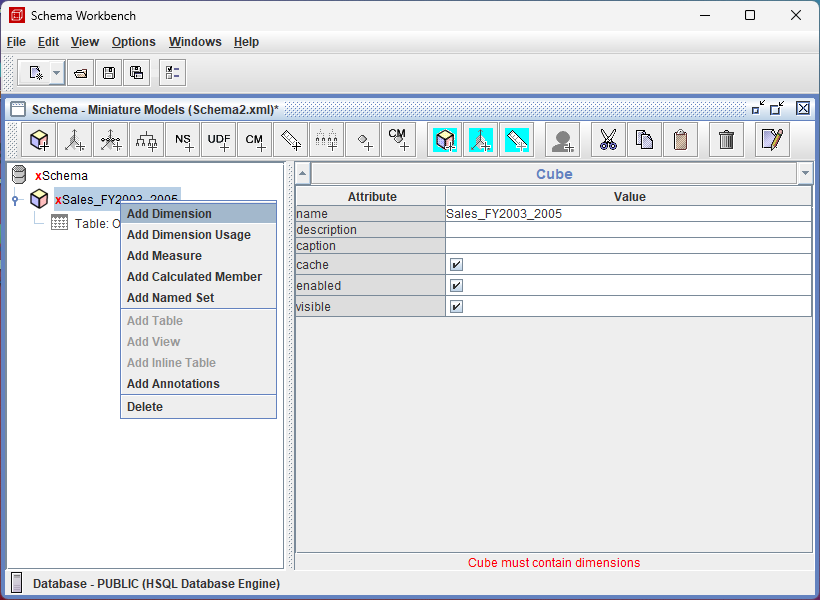
<figcaption>Add the CUSTOMERS dimension</figcaption>
</figure>
</div>

2. Set the dimension's attributes:

| Attribute | Value |
| --------- | ----- |
| **name** | `CUSTOMERS` |
| **foreignKey** | `CUSTOMERNUMBER` |
| **type** | StandardDimension |

<div align="center">
<figure>
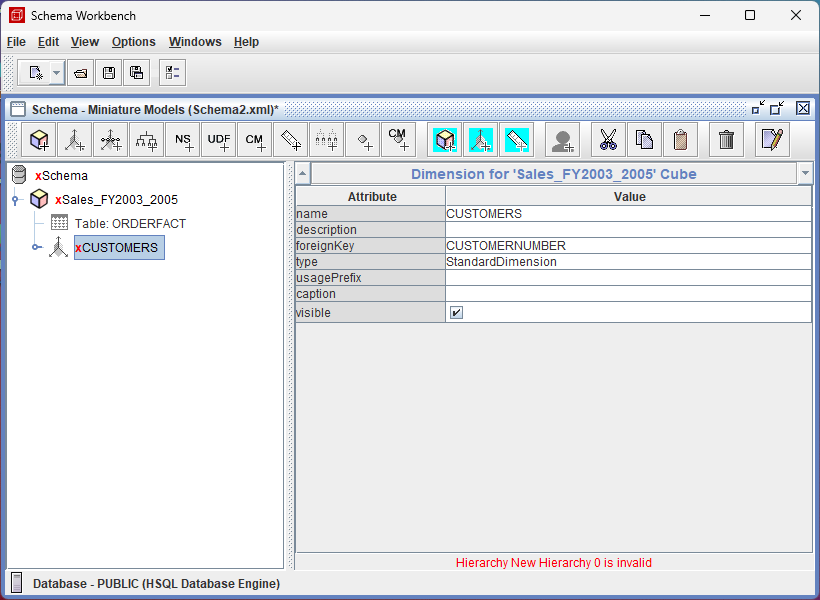
<figcaption>The dimension's attributes</figcaption>
</figure>
</div>

3. Expand **CUSTOMERS**, right-click **New Hierarchy 0** and select **Add Table**.

<div align="center">
<figure>
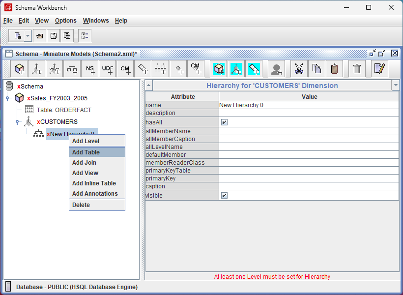
<figcaption>Add the dimension's table</figcaption>
</figure>
</div>

4. Set the table's attributes:

| Attribute | Value |
| --------- | ----- |
| **schema** | `PUBLIC` |
| **name** | `CUSTOMER_W_TER` |

<div align="center">
<figure>
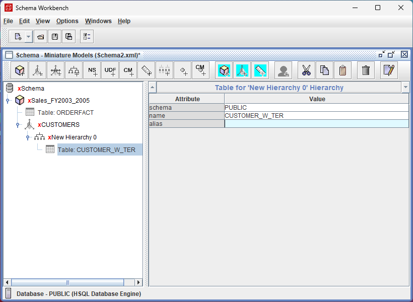
<figcaption>The dimension's table</figcaption>
</figure>
</div>

5. Select **New Hierarchy 0** and set its attributes:

| Attribute | Value |
| --------- | ----- |
| **name** | `Customers` |
| **hasAll** | selected |
| **allMemberName** | `All Customers` |
| **primaryKey** | `CUSTOMERNUMBER` |

<div align="center">
<figure>
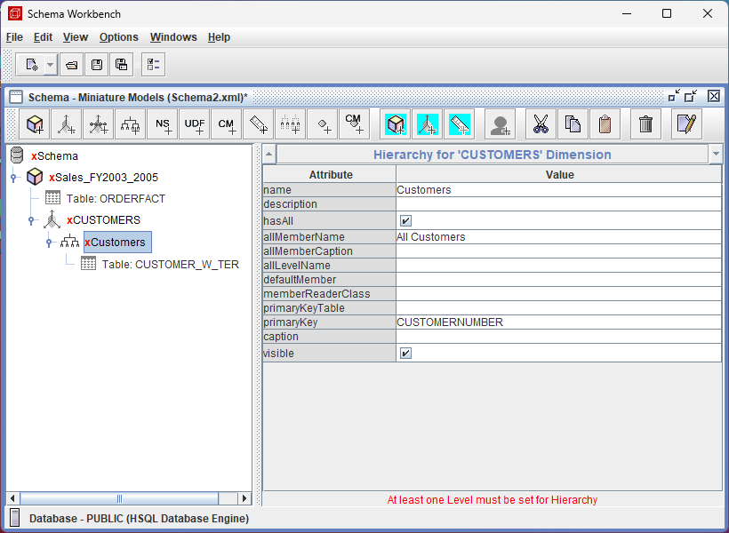
<figcaption>The Customers hierarchy</figcaption>
</figure>
</div>

6. Right-click **Customers**, select **Add Level**, and set the level's attributes:

| Attribute | Value |
| --------- | ----- |
| **name** | `Territory` |
| **column** | `TERRITORY` |
| **type** | String |
| **uniqueMembers** | selected |
| **levelType** | Regular |
| **hideMemberIf** | Never |

<div align="center">
<figure>
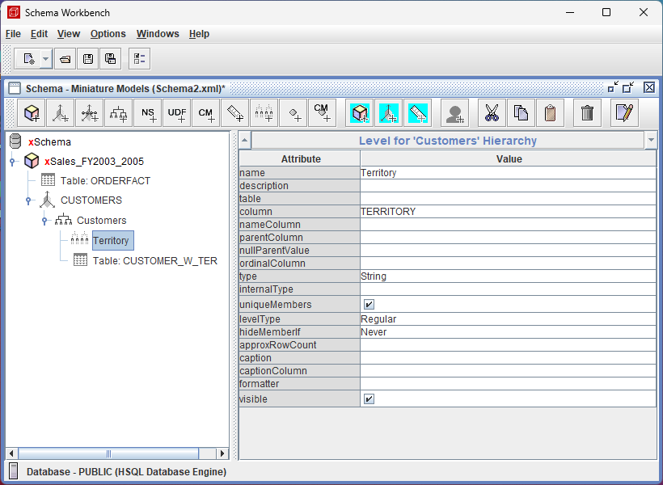
<figcaption>The Territory level</figcaption>
</figure>
</div>

7. Right-click **Customers**, select **Add Level**, and set the level's attributes:

| Attribute | Value |
| --------- | ----- |
| **name** | `Country` |
| **column** | `COUNTRY` |
| **type** | String |
| **uniqueMembers** | cleared |
| **levelType** | Regular |
| **hideMemberIf** | Never |

<div align="center">
<figure>
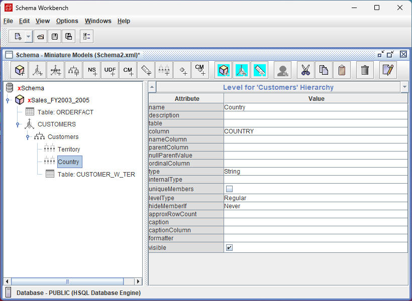
<figcaption>The Country level</figcaption>
</figure>
</div>

8. Right-click **Customers**, select **Add Level**, and set the level's attributes:

| Attribute | Value |
| --------- | ----- |
| **name** | `Customer Name` |
| **column** | `CUSTOMERNAME` |
| **type** | String |
| **uniqueMembers** | cleared |
| **levelType** | Regular |
| **hideMemberIf** | Never |

<div align="center">
<figure>
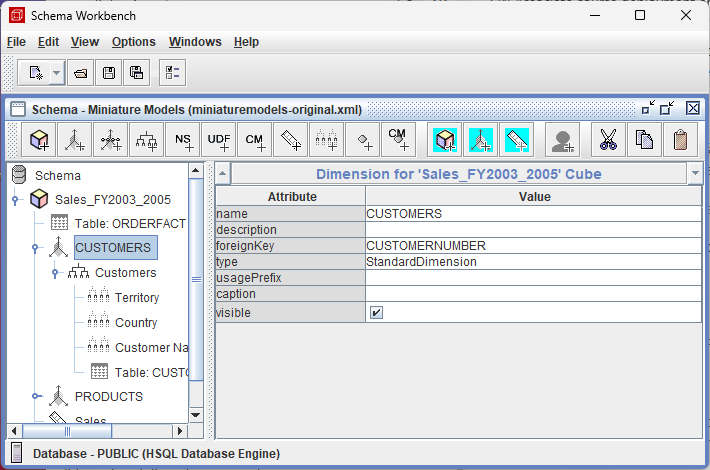
<figcaption>The finished CUSTOMERS dimension</figcaption>
</figure>
</div>

> **Under the hood:**
>
> #### A member's name carries its whole path
>
> Mondrian names every member by its hierarchy and all its ancestors:
> `[CUSTOMERS.Customers].[EMEA].[Germany]`,
> `[CUSTOMERS.Customers].[Japan].[Singapore]`. The hierarchy part reads
> `[CUSTOMERS.Customers]` because the hierarchy's name differs from its
> dimension's.
>
> That path keeps repeated values apart. Singapore has customers in both
> APAC and Japan, and the two Singapores are different members because
> their territories differ; with uniqueMembers left off for Country, as
> in this lab, each shows its own sales.
>
> **Why it matters:** this is also the name you write in MDX in workshop
> 12 and in security grants in workshop 14.

9. Select **File > Save**.

> **Success:** Checkpoint: **CUSTOMERS** shows no red cross, and **Customers** holds **Territory**, **Country**, **Customer Name** and **Table: CUSTOMER_W_TER**.

### 5. PRODUCTS Dimension

> **Note:**
>
> #### PRODUCTS Dimension, Hierarchy and Levels
>
> A second three-level hierarchy: Line, Vendor, Name. The dimension joins `ORDERFACT` on `PRODUCTCODE`, and the hierarchy reads the `PRODUCTS` table.

1. Right-click **Sales_FY2003_2005** and select **Add Dimension**.

<div align="center">
<figure>
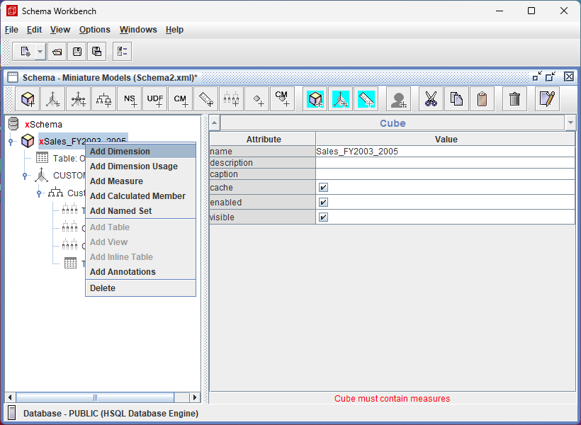
<figcaption>Add the PRODUCTS dimension</figcaption>
</figure>
</div>

2. Set the dimension's attributes:

| Attribute | Value |
| --------- | ----- |
| **name** | `PRODUCTS` |
| **foreignKey** | `PRODUCTCODE` |
| **type** | StandardDimension |

<div align="center">
<figure>
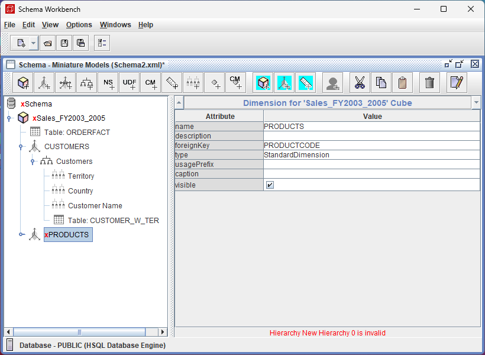
<figcaption>The dimension's attributes</figcaption>
</figure>
</div>

3. Expand **PRODUCTS**, right-click **New Hierarchy 0** and select **Add Table**.

<div align="center">
<figure>
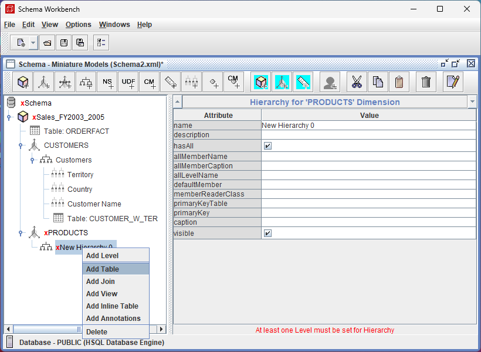
<figcaption>Add the dimension's table</figcaption>
</figure>
</div>

4. Set the table's attributes:

| Attribute | Value |
| --------- | ----- |
| **schema** | `PUBLIC` |
| **name** | `PRODUCTS` |

<div align="center">
<figure>
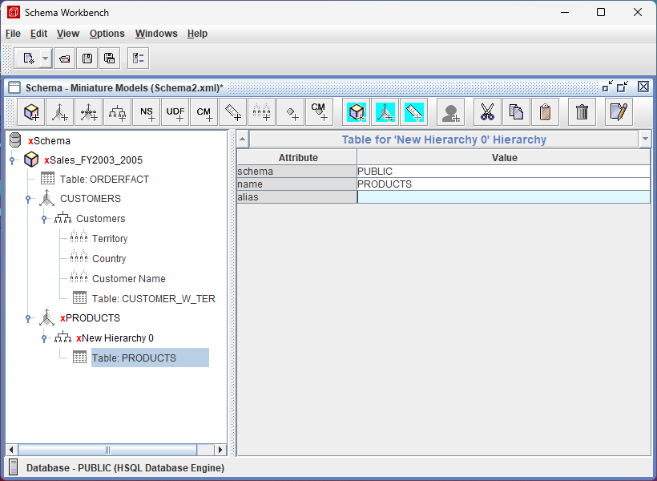
<figcaption>The dimension's table</figcaption>
</figure>
</div>

5. Select **New Hierarchy 0** and set its attributes:

| Attribute | Value |
| --------- | ----- |
| **name** | `Products` |
| **hasAll** | selected |
| **allMemberName** | `All Products` |
| **primaryKey** | `PRODUCTCODE` |

<div align="center">
<figure>
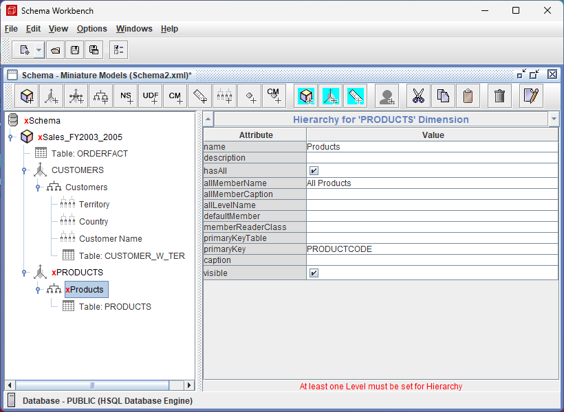
<figcaption>The Products hierarchy</figcaption>
</figure>
</div>

6. Right-click **Products**, select **Add Level**, and set the level's attributes:

| Attribute | Value |
| --------- | ----- |
| **name** | `Line` |
| **column** | `PRODUCTLINE` |
| **type** | String |
| **uniqueMembers** | selected |
| **levelType** | Regular |
| **hideMemberIf** | Never |

<div align="center">
<figure>
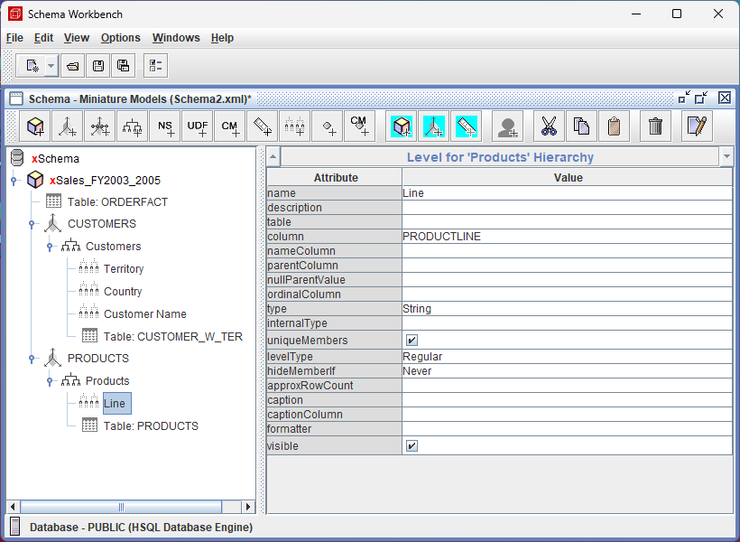
<figcaption>The Line level</figcaption>
</figure>
</div>

7. Right-click **Products**, select **Add Level**, and set the level's attributes:

| Attribute | Value |
| --------- | ----- |
| **name** | `Vendor` |
| **column** | `PRODUCTVENDOR` |
| **type** | String |
| **uniqueMembers** | cleared |
| **levelType** | Regular |
| **hideMemberIf** | Never |

<div align="center">
<figure>
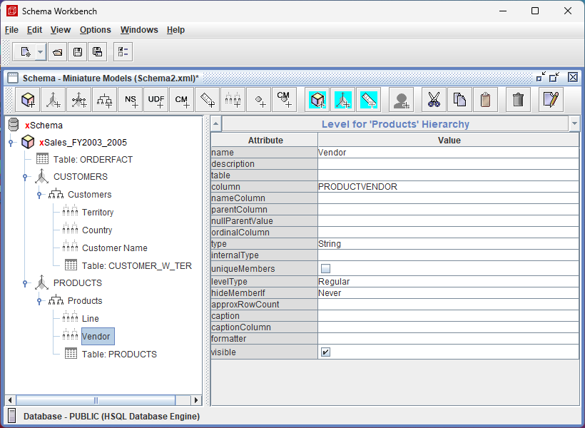
<figcaption>The Vendor level</figcaption>
</figure>
</div>

8. Right-click **Products**, select **Add Level**, and set the level's attributes. Later workshops refer to this level as **Name**.

| Attribute | Value |
| --------- | ----- |
| **name** | `Name` |
| **column** | `PRODUCTNAME` |
| **type** | String |
| **uniqueMembers** | cleared |
| **levelType** | Regular |
| **hideMemberIf** | Never |

<div align="center">
<figure>
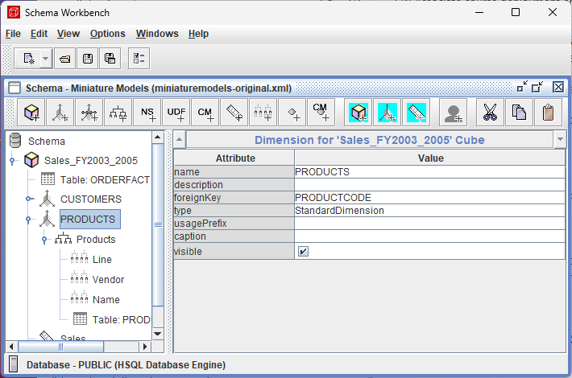
<figcaption>The finished PRODUCTS dimension</figcaption>
</figure>
</div>

9. Select **File > Save**.

> **Success:** Checkpoint: **PRODUCTS** shows no red cross, and **Products** holds **Line**, **Vendor**, **Name** and **Table: PRODUCTS**.

### 6. Measures

> **Note:**
>
> #### Add the Sales and Quantity Ordered Measures
>
> Measures are the aggregated numbers the cube exposes. Sales sums `TOTALPRICE` as currency; Quantity Ordered counts the distinct values of `QUANTITYORDERED`.

1. Right-click **Sales_FY2003_2005** and select **Add Measure**.

<div align="center">
<figure>
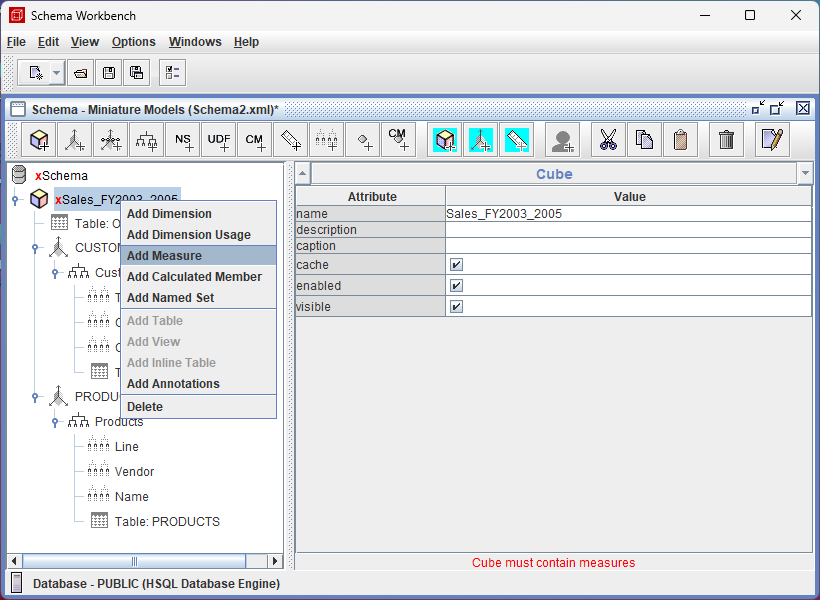
<figcaption>Add Measure</figcaption>
</figure>
</div>

2. Set the measure's attributes. The format string shows Sales in pounds, as the solution file and the later screenshots do.

| Attribute | Value |
| --------- | ----- |
| **name** | `Sales` |
| **aggregator** | sum |
| **column** | `TOTALPRICE` |
| **formatString** | `£#,###.00` |
| **datatype** | Numeric |

<div align="center">
<figure>
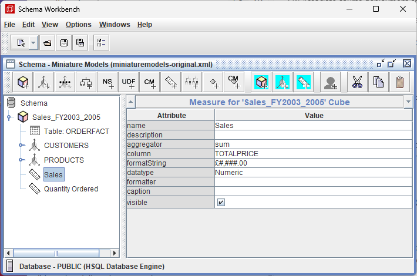
<figcaption>The Sales measure</figcaption>
</figure>
</div>

3. Right-click **Sales_FY2003_2005**, select **Add Measure**, and set the measure's attributes:

| Attribute | Value |
| --------- | ----- |
| **name** | `Quantity Ordered` |
| **aggregator** | distinct-count |
| **column** | `QUANTITYORDERED` |
| **formatString** | `#` |
| **datatype** | Integer |

<div align="center">
<figure>
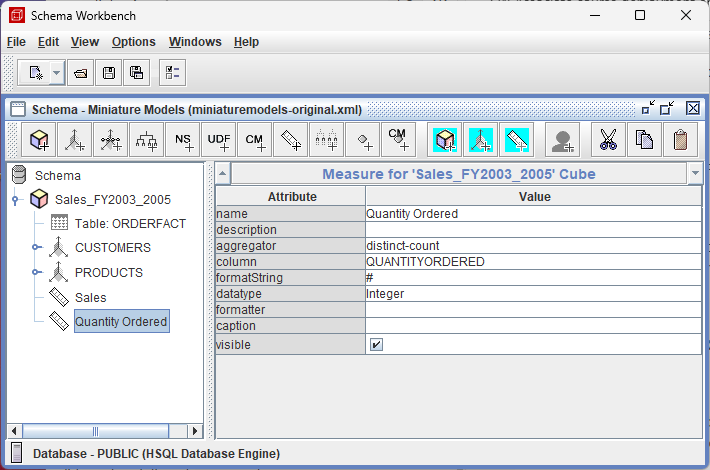
<figcaption>The Quantity Ordered measure</figcaption>
</figure>
</div>

> **Under the hood:**
>
> #### Quantity Ordered counts values, not units
>
> `distinct-count` becomes `count(distinct
> "ORDERFACT"."QUANTITYORDERED")`: the number of different quantities
> that appear on order lines. On SampleData that is 61 for all
> customers, while the units ordered add up to 105,331.
>
> It doesn't add up across members either. APAC shows 50, EMEA 48, Japan
> 33 and NA 48, which make 179, yet the total is 61, because the same
> quantities turn up in every territory. Mondrian can't derive a
> distinct count from figures it has already computed (its in-memory
> aggregator for distinct-count isn't implemented), so each level's
> figure comes from its own `count(distinct ...)` query.
>
> **Why it matters:** name a measure for what it computes. For units
> ordered you want `sum`, which is exactly the Quantity measure workshop
> 08 adds.

4. Select **File > Save**.

> **Success:** Checkpoint: no red cross anywhere in the schema. The cube holds **Table: ORDERFACT**, **CUSTOMERS**, **PRODUCTS**, **Sales** and **Quantity Ordered**.

### 7. Publish & Test

> **Note:**
>
> #### Publish the Schema and Test It
>
> Publishing sends the schema to the Pentaho Server, where it becomes an Analyzer data source. A quick report then shows the three-level hierarchies at work.

1. Select **File > Publish**.
2. In the **Publish Schema** dialog, make sure the fields hold the values from [Basic Model](../05-schemas-basic-model/guide.md): **Server URL** `http://localhost:8080/pentaho/`, **User** `admin`, **Password** `password` and **Pentaho or JNDI Data Source** `hsqldb_sampledata`.

<div align="center">
<figure>
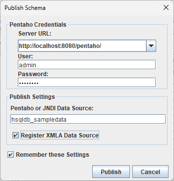
<figcaption>The Publish Schema dialog, filled in</figcaption>
</figure>
</div>
3. Select **Publish**.

> **Success:** Checkpoint: a **Publish** message reads `Publish Successful`.

4. Select **OK**.

<button data-launch="puc">Open Pentaho User Console</button>

5. In the User Console, signed in as `admin`, select **Tools > Refresh > Mondrian Schema Cache**.
6. On the **Home** perspective, select **Create New > Analysis Report**.
7. In the **Select Data Source** dialog, select **Miniature Models: Sales_FY2003_2005** and select **OK**.
8. Drag **Sales** to the **Measures** drop zone.
9. Drag **Territory**, then **Line**, to the **Rows** drop zone.

<div align="center">
<figure>
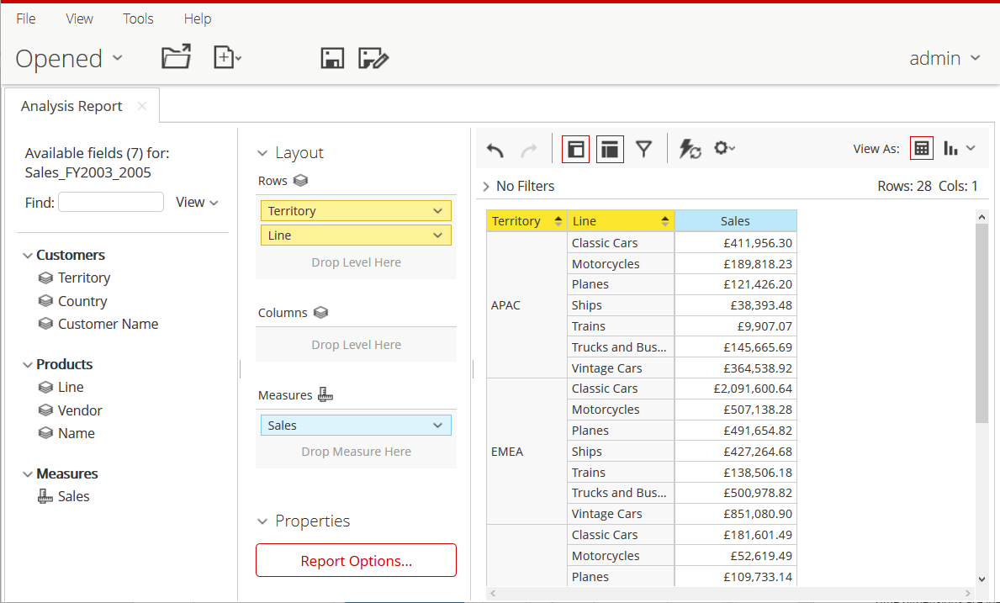
<figcaption>Sales by Territory and Line</figcaption>
</figure>
</div>

> **Success:** Checkpoint: 28 rows, the 7 lines for each of the 4 territories. The first is APAC, Classic Cars, £411,956.30. You built both three-level hierarchies on your own.

10. Close the report without saving it.

::::

## Lab Files

Click a file to download. Every file is also on disk in this workshop's folder, `C:\Workshop-SW-Associate\03-schemas\06-schemas-standard-model`: open a schema in Schema Workbench with **File > Open**.

_No starting files: this workshop builds the schema from nothing._

### Solution <!-- no-step -->

The finished schema for this lab. Open it in Schema Workbench (**File > Open**) alongside your own to compare, or publish it to see the expected result.

Also on disk at `C:\Workshop-SW-Associate\03-schemas\06-schemas-standard-model\solution`.

[miniaturemodels-original.xml](./files/solution/miniaturemodels-original.xml)
