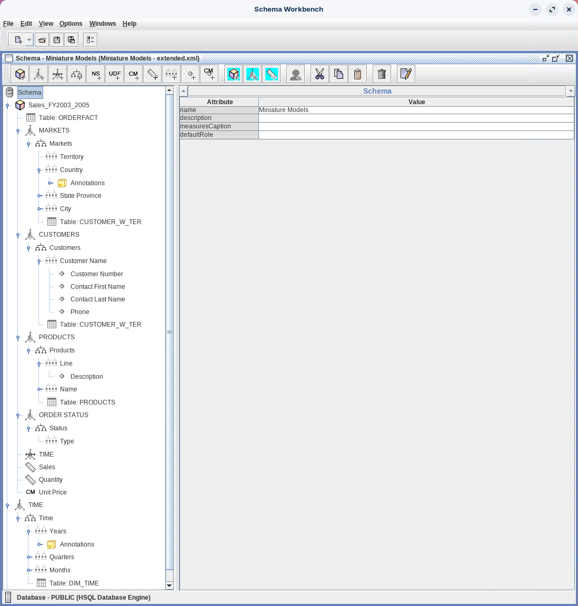
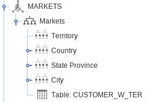
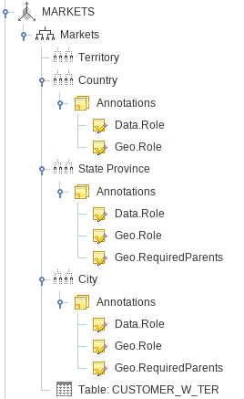
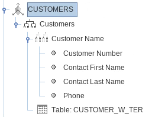
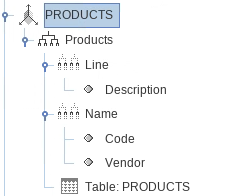
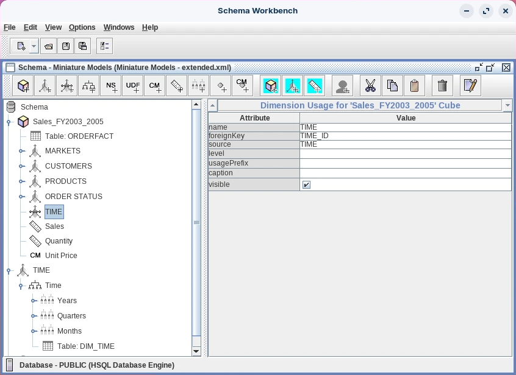
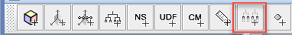
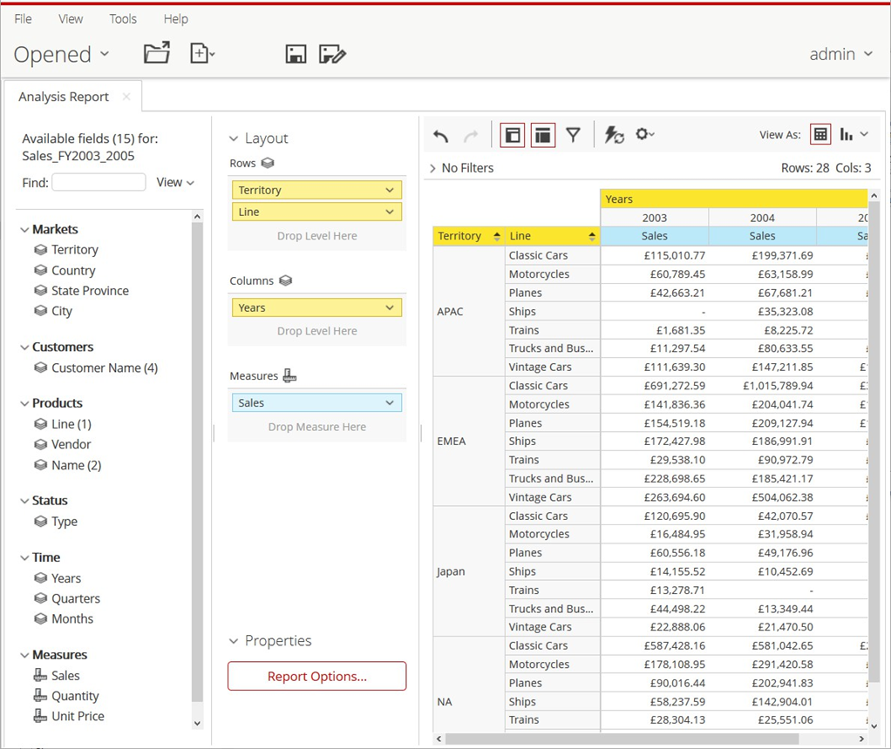
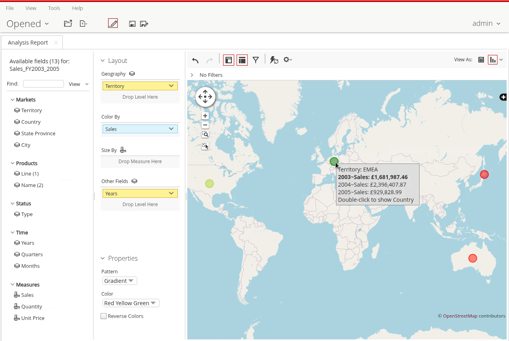
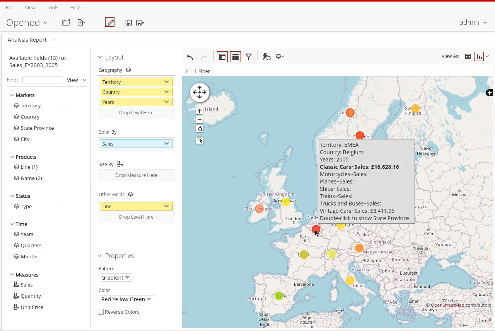

# Extended Model

> **Warning:**
>
> #### Workshop - Extended Model
>
> A production schema needs more than one cube with two dimensions. In this workshop you extend the Miniature Models schema with a geographic MARKETS dimension that Analyzer can draw on a map, member properties, a shared TIME dimension, a degenerate ORDER STATUS dimension and a Quantity measure.
>
> **What you'll do**
>
> * Add a four-level MARKETS dimension with geographic annotations for map visualizations
> * Replace levels with member properties in the CUSTOMERS and PRODUCTS dimensions
> * Build a shared TIME dimension with time level types and AnalyzerDateFormat annotations, and use it in the cube
> * Create the degenerate ORDER STATUS dimension from a fact table column
> * Add a Quantity measure, publish the schema, and test it in Analyzer
>
> **Prerequisites:** Complete [Standard Model](../06-schemas-standard-model/guide.md); the Pentaho Server running
>
> **Estimated time:** 90 minutes

<div align="center">
<figure>

<figcaption>What you build: the extended Miniature Models schema</figcaption>
</figure>
</div>

:::: tabs

### 1. MARKETS

> **Note:**
>
> #### MARKETS Dimension
>
> The MARKETS dimension lets users drill into the data by geography: Territory, Country, State Province and City, all read from the `CUSTOMER_W_TER` table.

1. Start Schema Workbench with the **Start Schema Workbench** button below, or from a terminal:

::: tabs

### Windows (PowerShell)

```powershell
Set-Location C:\Pentaho\design-tools\schema-workbench
.\workbench.bat
```

### macOS / Linux

```bash
cd ~/Pentaho/design-tools/schema-workbench
./workbench.sh
```

:::

<button data-launch="schema-workbench">Start Schema Workbench</button>

2. Make sure the Pentaho Server is running: it hosts the SampleData database on port `9001`. On a lab VM it starts with the machine. On your own machine, start it and wait until **http://localhost:8080/pentaho** shows the sign-in page:

::: tabs

### Windows (PowerShell)

```powershell
C:\Pentaho\server\pentaho-server\start-pentaho.bat
```

### macOS / Linux

```bash
cd ~/Pentaho/server/pentaho-server
./start-pentaho.sh
```

:::

3. Select **File > Open** and open `MiniatureModels.xml`, your schema from [Standard Model](../06-schemas-standard-model/guide.md).
4. Select **File > Save As** and save it as `MiniatureModels-extended.xml`, so your Standard Model schema stays as it was.
5. Right-click **Sales_FY2003_2005** and select **Add Dimension**.
6. Set the dimension's attributes:

| Attribute  | Value          |
| ---------- | -------------- |
| **name** | `MARKETS` |
| **foreignKey** | `CUSTOMERNUMBER` |
| **type** | StandardDimension |

7. Expand **MARKETS**, right-click **New Hierarchy 0** and select **Add Table**.
8. Set the table's attributes:

| Attribute | Value |
| --------- | ----- |
| **schema** | `PUBLIC` |
| **name** | `CUSTOMER_W_TER` |

9. Select **New Hierarchy 0** and set its attributes:

| Attribute     | Value          |
| ------------- | -------------- |
| **name** | `Markets` |
| **hasAll** | selected |
| **allMemberName** | `All Markets` |
| **primaryKey** | `CUSTOMERNUMBER` |

10. For each row of this table, in order, right-click **Markets**, select **Add Level**, and set the level's attributes. Each level is **type** String, **levelType** Regular and **hideMemberIf** Never.

| name | column | uniqueMembers |
| ---- | ------ | ------------- |
| `Territory` | `TERRITORY` | selected |
| `Country` | `COUNTRY` | cleared |
| `State Province` | `STATE` | cleared |
| `City` | `CITY` | cleared |

<div align="center">
<figure>

<figcaption>The MARKETS dimension</figcaption>
</figure>
</div>

11. Select **File > Save**.

> **Success:** Checkpoint: **MARKETS** shows no red cross, and **Markets** holds **Territory**, **Country**, **State Province**, **City** and **Table: CUSTOMER_W_TER**.

### 2. Annotations

> **Note:**
>
> #### Geographic Annotations
>
> Annotations mark Country, State Province and City as geography, so Analyzer can place them on a Geo Map, which draws its map tiles from OpenStreetMap. Each level takes an **Annotations** node, and one **Annotation** under it per name.

<div class="pcm-embed-card" data-href="https://www.loom.com/share/477584be32574fae8570a1219e2b38bd?hideEmbedTopBar=true&amp;hide_owner=true&amp;hide_share=true&amp;hide_title=true" data-title="Enabling Geography Levels for GeoMap Visualization in Analyzer" data-description="In this video, I demonstrate how to add annotations to enable the city level to be displayed in an Analyzer geomap visualization. I walk through the process of specifying geography levels, including setting the data.roll annotation to indicate it's a geography level and defining the Geo.Roll as city. Additionally, I explain the importance of establishing the hierarchy with the Geo.RequiredParents annotation for country and state. This setup allows users to leverage Analyzer's geomapping capabilities effectively. Please ensure you follow these steps to enhance your data visualization." data-thumb="../_assets/embeds/2631a0493553.png"></div>

1. Right-click **Country** and select **Add Annotations**.
2. Right-click the new **Annotations** node and select **Add Annotation**. Set **name** to `Data.Role` and **cdata** to `Geography`.
3. Right-click **Annotations** again, select **Add Annotation**, and set **name** to `Geo.Role` and **cdata** to `country`.
4. Add an **Annotations** node to **State Province** and **City** the same way, with these annotations:

| Level | name | cdata |
| ----- | ---- | ----- |
| **State Province** | `Data.Role` | `Geography` |
| **State Province** | `Geo.Role` | `state` |
| **State Province** | `Geo.RequiredParents` | `country` |
| **City** | `Data.Role` | `Geography` |
| **City** | `Geo.Role` | `city` |
| **City** | `Geo.RequiredParents` | `country,state` |

<div align="center">
<figure>

<figcaption>MARKETS - Annotations</figcaption>
</figure>
</div>

5. Select **File > Save**.

> **Under the hood:**
>
> #### Mondrian carries annotations; Analyzer acts on them
>
> Mondrian doesn't interpret Data.Role, Geo.Role or Geo.RequiredParents.
> It stores them on the level and hands them to any client that asks,
> and they never appear in the SQL it writes. Analyzer reads them:
> Data.Role marks a geography level, Geo.Role says which kind, and
> Geo.RequiredParents names the levels to send along with it.
>
> RequiredParents earns its place in this data: Glendale is a city in
> both California and Connecticut, so "Glendale" alone locates nothing,
> while USA, CA, Glendale does.
>
> **Why it matters:** annotations add behavior to a client without
> changing a single query.

### 3. CUSTOMERS

> **Note:**
>
> #### CUSTOMERS Dimension
>
> Territory and Country now live in MARKETS, so the CUSTOMERS dimension keeps only the Customer Name level, and gains member properties: details that describe each customer without adding levels to drill through.

1. Under **CUSTOMERS > Customers**, right-click **Territory** and select **Delete**.
2. Right-click **Country** and select **Delete**.
3. Right-click **Customer Name** and select **Add Property**. Type each **column** name: the property grid doesn't offer a list for it.
4. Set the property's attributes:

| Attribute | Value          |
| --------- | -------------- |
| **name** | `Customer Number` |
| **column** | `CUSTOMERNUMBER` |
| **type** | String |

5. Add three more properties to **Customer Name** the same way, each **type** String:

| name | column |
| ---- | ------ |
| `Contact First Name` | `CONTACTFIRSTNAME` |
| `Contact Last Name` | `CONTACTLASTNAME` |
| `Phone` | `PHONE` |

<div align="center">
<figure>

<figcaption>Properties - Customers</figcaption>
</figure>
</div>

6. Select **File > Save**.

> **Success:** Checkpoint: **Customers** holds only **Customer Name** and **Table: CUSTOMER_W_TER**, and **Customer Name** holds the four properties.

### 4. PRODUCTS

> **Note:**
>
> #### PRODUCTS Dimension
>
> Every property in this tab goes on the **Name** level: a property must have exactly one value per member, and descriptions, codes and vendors belong to products, not to product lines.

1. Under **PRODUCTS > Products**, right-click **Vendor** and select **Delete**.
2. Right-click **Name**, select **Add Property**, and set the property's attributes:

| Attribute | Value              |
| --------- | ------------------ |
| **name** | `Description` |
| **column** | `PRODUCTDESCRIPTION` |
| **type** | String |

3. Add two more properties to **Name** the same way, each **type** String:

| name | column |
| ---- | ------ |
| `Code` | `PRODUCTCODE` |
| `Vendor` | `PRODUCTVENDOR` |

<div align="center">
<figure>

<figcaption>PRODUCTS properties (the screenshot shows Description on Line; add it to Name)</figcaption>
</figure>
</div>

> **Under the hood:**
>
> #### A property comes back with its level's members
>
> Properties add no levels. Their columns are added to the query that
> reads the level's members: Customer Name's members come back in one
> statement with CUSTOMERNUMBER, CONTACTFIRSTNAME, CONTACTLASTNAME and
> PHONE beside them, grouped by all of them.
>
> That grouping is why a property needs exactly one value per member.
> Put PRODUCTDESCRIPTION on the Line level and every description becomes
> a member of its own: the 7 product lines turn into 94 rows of "Classic
> Cars", "Motorcycles" and so on, each carrying its whole line's total.
>
> **Why it matters:** on the Name level each product has one
> description, so the 7 lines stay 7.

4. Select **File > Save**.

> **Success:** Checkpoint: **Products** holds **Line**, **Name** and **Table: PRODUCTS**, and **Name** holds **Description**, **Code** and **Vendor**.

### 5. TIME

> **Note:**
>
> #### TIME, a Shared Dimension
>
> Some dimensions, such as Time, are used by several cubes. A shared dimension is defined once, at schema level. Because it belongs to no cube, it names its own table; each cube that uses it adds a **Dimension Usage** with the foreign key of its own fact table. When the hierarchy's relation is a join, the usage must also say which table in the join holds that key, usually the first.

This example shares a CUSTOMERS dimension between two cubes, joined through `ORDERFACT.CUSTOMERNUMBER` in one and `WAREHOUSEFACT.WAREHOUSE_CUSTOMERNUMBER` in the other:

```xml
<Dimension name="CUSTOMERS">
<Hierarchy hasAll="true" primaryKey="CUSTOMERNUMBER">
<Table name="CUSTOMER_W_TER"/>
<Level name="TERRITORY" column="TERRITORY" uniqueMembers="true"/>
</Hierarchy>
</Dimension>

<Cube name="Classic Models">
<Table name="ORDERFACT"/>
...
<DimensionUsage name="CUSTOMERS" source="CUSTOMERS" foreignKey="CUSTOMERNUMBER"/>
</Cube>

<Cube name="Warehouse">
<Table name="WAREHOUSEFACT"/>
...
<DimensionUsage name="CUSTOMERS" source="CUSTOMERS" foreignKey="WAREHOUSE_CUSTOMERNUMBER"/>
</Cube>
```

<div class="pcm-embed-card" data-href="https://www.loom.com/share/cc5f940551384a40a326537009003dcb?hideEmbedTopBar=true&amp;hide_owner=true&amp;hide_share=true&amp;hide_title=true" data-title="Creating a Time Period Dimension in Data Cubes" data-description="In this video, I demonstrate how to create a time period dimension for our Steel Wheel Sales Training Cube. I walk through the steps of adding levels for years, quarters, and months, ensuring to set the appropriate attributes such as Time ID and level types. I emphasize the importance of using uppercase letters for dimension names and the need to specify an all-member name for the hierarchy. Additionally, I highlight the need for further annotations to enhance filtering capabilities for Analyzer. Please pay attention to these details as we move forward with our data analysis." data-thumb="../_assets/embeds/2631a0493553.png"></div>

1. Right-click **Schema** and select **Add Dimension**.
2. Set the dimension's attributes. A shared dimension has no **foreignKey**: each cube supplies its own.

| Attribute | Value         |
| --------- | ------------- |
| **name** | `TIME` |
| **type** | TimeDimension |

3. Expand **TIME**, right-click **New Hierarchy 0** and select **Add Table**.
4. Set the table's attributes:

| Attribute | Value |
| --------- | ----- |
| **schema** | `PUBLIC` |
| **name** | `DIM_TIME` |

5. Select **New Hierarchy 0** and set its attributes:

| Attribute     | Value     |
| ------------- | --------- |
| **name** | `Time` |
| **hasAll** | selected |
| **allMemberName** | `All Years` |
| **primaryKey** | `TIME_ID` |

6. For each row of this table, in order, right-click **Time**, select **Add Level**, and set the level's attributes. Each level is **type** String and **hideMemberIf** Never.

| name | column | ordinalColumn | uniqueMembers | levelType |
| ---- | ------ | ------------- | ------------- | --------- |
| `Years` | `YEAR_ID` | | selected | TimeYears |
| `Quarters` | `QTR_NAME` | `QTR_ID` | cleared | TimeQuarters |
| `Months` | `MONTH_NAME` | `MONTH_ID` | cleared | TimeMonths |

7. Add an **Annotations** node to each level and, under it, one **Annotation** with **name** `AnalyzerDateFormat` and this **cdata**:

| Level | cdata |
| ----- | ----- |
| **Years** | `[yyyy]` |
| **Quarters** | `[yyyy].['QTR'q]` |
| **Months** | `[yyyy].['QTR'q].[MMM]` |

8. Right-click **Sales_FY2003_2005** and select **Add Dimension Usage**. Its icon differs from a dimension's: it points at a shared dimension.
9. Set the usage's attributes:

| Attribute  | Value   |
| ---------- | ------- |
| **name** | `TIME` |
| **foreignKey** | `TIME_ID` |
| **source** | `TIME` |

<div align="center">
<figure>

<figcaption>TIME - the cube's dimension usage</figcaption>
</figure>
</div>

10. Select **File > Save**.

> **Success:** Checkpoint: **TIME** sits at schema level with **Years**, **Quarters**, **Months** and **Table: DIM_TIME**, and the cube holds a **TIME** dimension usage with **foreignKey** `TIME_ID` and **source** `TIME`.

11. Select **View > View XML**, check the `<DimensionUsage source="TIME" ...>` element inside the cube, and select **View > View XML** again to hide it.

> **Under the hood:**
>
> #### One TIME definition, joined through each cube's foreign key
>
> The shared dimension names its table (DIM_TIME) and primary key
> (TIME_ID) once, at schema level. The DimensionUsage supplies the other
> half: the fact table's foreign key, TIME_ID on ORDERFACT. Sales by
> Years then joins `ORDERFACT.TIME_ID = DIM_TIME.TIME_ID` and groups by
> YEAR_ID: 3,677,384 for 2003, 4,987,740 for 2004 and 1,980,825 for
> 2005.
>
> A second cube over another fact table reuses the same definition with
> its own foreign key, so every cube agrees on what a year and a quarter
> are.
>
> **Why it matters:** a fix to TIME is a fix everywhere.

### 6. Degenerate

> **Note:**
>
> #### ORDER STATUS, a Degenerate Dimension
>
> A star dimension has one dimension table and a snowflake dimension two or more; a degenerate dimension has none. All the columns that describe it live in the fact table. Order status suits it: a handful of values, nothing more to describe them, and a dimension table would only add a join.

<div class="pcm-embed-card" data-href="https://www.loom.com/share/f93673283a184b31ae57261b9086cd84?hideEmbedTopBar=true&amp;hide_owner=true&amp;hide_share=true&amp;hide_title=true" data-title="Adding a Degenerate Dimension to the Steel Wheel Sales Training Cube" data-description="In this video, I demonstrate how to add a degenerate dimension, specifically the order status dimension, to the Steel Wheel Sales Training Cube. I explain that degenerate dimensions do not have their own tables, which can impact performance, so it's essential to discuss this with the data warehouse team before implementation. I walk through the steps of creating the dimension, naming it in uppercase, and adding a hierarchy and level without needing a foreign key. I also highlight the importance of careful navigation when using the toolbar to add levels. Please ensure to follow these steps accurately as we move forward with our cube development." data-thumb="../_assets/embeds/2631a0493553.png"></div>

1. Right-click **Sales_FY2003_2005** and select **Add Dimension**.
2. Set the dimension's attributes. It has no **foreignKey**: its column is in the fact table itself.

| Attribute  | Value       |
| ---------- | ----------- |
| **name** | `ORDER STATUS` |
| **type** | StandardDimension |

3. Expand **ORDER STATUS**, select **New Hierarchy 0**, and set its attributes. It gets no table.

| Attribute     | Value            |
| ------------- | ---------------- |
| **name** | `Status` |
| **hasAll** | selected |
| **allMemberName** | `All Status` |

4. With **Status** selected, select **Add Level** on the toolbar. The right-click menu keeps **Add Level** unavailable for a hierarchy without a table.

<div align="center">
<figure>

<figcaption>Add Level on the toolbar</figcaption>
</figure>
</div>

5. Set the level's attributes:

| Attribute     | Value    |
| ------------- | -------- |
| **name** | `Type` |
| **column** | `STATUS` |
| **type** | String |
| **uniqueMembers** | selected |
| **levelType** | Regular |
| **hideMemberIf** | Never |

6. Select **File > Save**.

> **Success:** Checkpoint: **ORDER STATUS** shows no red cross, and its **Status** hierarchy holds the **Type** level and no **Table** node.

### 7. Measures

> **Note:**
>
> #### Add the Quantity Measure
>
> Quantity sums the units ordered, which the distinct-count Quantity Ordered measure from Standard Model doesn't. Workshop 09 divides Sales by it in a calculated member.

1. Right-click **Quantity Ordered** and select **Delete**.
2. Right-click **Sales_FY2003_2005**, select **Add Measure**, and set the measure's attributes:

| Attribute    | Value           |
| ------------ | --------------- |
| **name** | `Quantity` |
| **aggregator** | sum |
| **column** | `QUANTITYORDERED` |
| **formatString** | `#,###` |
| **datatype** | Numeric |

3. Select **File > Save**.

> **Success:** Checkpoint: no red cross anywhere in the schema. The cube holds **Table: ORDERFACT**, **MARKETS**, **CUSTOMERS**, **PRODUCTS**, **ORDER STATUS**, **TIME**, **Sales** and **Quantity**.

### 8. Publish & Test

> **Note:**
>
> #### Publish the Schema and Test It
>
> Save before every change you publish: a saved file per version keeps the schema's history and helps you trace a problem to the change that caused it.

1. Select **File > Publish**.
2. In the **Publish Schema** dialog, make sure the fields hold the values from [Basic Model](../05-schemas-basic-model/guide.md): **Server URL** `http://localhost:8080/pentaho/`, **User** `admin`, **Password** `password` and **Pentaho or JNDI Data Source** `hsqldb_sampledata`.
3. Select **Publish**. If Schema Workbench asks whether to overwrite the Miniature Models schema you published in Standard Model, select **Yes**.

> **Success:** Checkpoint: a **Publish** message reads `Publish Successful`.

4. Select **OK**.

<button data-launch="puc">Open Pentaho User Console</button>

5. In the User Console, signed in as `admin`, select **Tools > Refresh > Mondrian Schema Cache**.
6. On the **Home** perspective, select **Create New > Analysis Report**.
7. In the **Select Data Source** dialog, select **Miniature Models: Sales_FY2003_2005** and select **OK**.
8. Drag **Sales** to the **Measures** drop zone.
9. Drag **Territory**, then **Line**, to the **Rows** drop zone.
10. Drag **Years** to the **Columns** drop zone.

<div align="center">
<figure>

<figcaption>Sales by Territory, Line and Year</figcaption>
</figure>
</div>

> **Success:** Checkpoint: 28 rows and 3 columns, one per year. The first row is APAC, Classic Cars: £115,010.77 in 2003, £199,371.69 in 2004 and £97,573.84 in 2005.

11. Optionally, if the machine is connected to the internet, try a Geo Map: change the report to a Geo Map chart, with **Territory** in **Geography** and **Sales** in **Color By**.

<div align="center">
<figure>

<figcaption>Geo Map by Territory</figcaption>
</figure>
</div>

<div align="center">
<figure>

<figcaption>Drilled to Country</figcaption>
</figure>
</div>

12. Close the report without saving it.

::::

## Lab Files

Click a file to download. For `.ktr` and `.kjb` files, **Open in Pentaho Data Integration** launches PDI with the file loaded. If PDI is already running, the path is copied to your clipboard — switch to PDI and press `Ctrl+O`, `Ctrl+V`, `Enter`.

### Solution <!-- no-step -->

The extended schema. Open it in Schema Workbench (**File > Open**) alongside your own to compare. It also holds the Unit Price calculated member that workshop 09 adds:

[miniaturemodels-extended.xml](./files/miniaturemodels-extended.xml)
