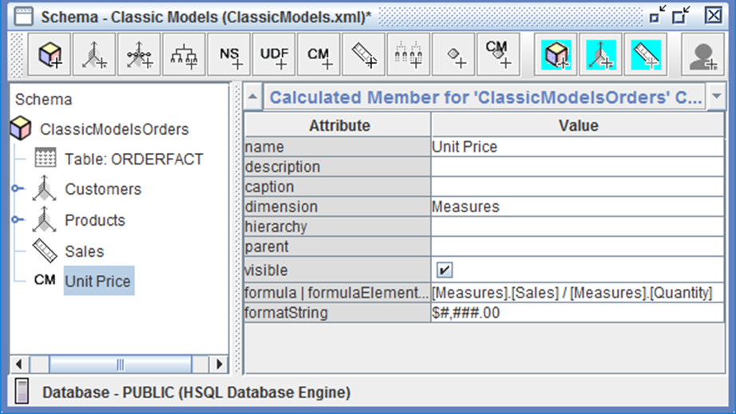

# Calculations

> **Warning:**
>
> #### Workshop - Calculations
>
> Base measures such as Sales and Quantity come straight from the fact table, but users also need derived figures: unit prices, margins, the share of the top customers. A calculated member defines such a figure once, in the schema, so every report computes it the same way.
>
> **What you'll do**
>
> * Add a Quantity measure and a Unit Price calculated member to the Classic Models schema
> * Set a calculated member's dimension, visibility, format string and MDX formula
> * Check Unit Price in an Analyzer report
> * Build a Top 10 Customers calculated member with the MDX functions Aggregate and TopCount
> * Test it with an MDX query in Schema Workbench
>
> **Prerequisites:** Complete [Basic Model](../05-schemas-basic-model/guide.md) and [Extended Model](../08-extend-model-extended-model/guide.md); the Pentaho Server running; a first look at MDX expressions
>
> **Estimated time:** 30 minutes

<div class="pcm-embed-card" data-href="https://www.loom.com/share/f90a125e5154469f86032d6515d4e99a?hideEmbedTopBar=true&amp;hide_owner=true&amp;hide_share=true&amp;hide_title=true" data-title="Adding Calculated Measures to the SteelWheels Sales Training Cube" data-description="In this video, I demonstrate how to add calculated measures to the SteelWheels Sales Training Cube using MDX formulas. I create two calculated measures: one for unit price, which divides sales by quantity, and another for year-to-date sales using the aggregate function with the sales measure. Both measures are formatted as U.S. currency with two decimal places. I encourage you to follow along and implement these calculations in your own cubes. Finally, I'll be testing the cube using MDX query mode in the next demonstration." data-thumb="../_assets/embeds/2631a0493553.png"></div>

:::: tabs

### 1. Calculated Member - Unit Price

> **Note:**
>
> #### Calculated Member - Unit Price
>
> A calculated member is a member computed from an MDX (Multidimensional Expressions) formula instead of read from a column. On the Measures dimension it acts as a calculated measure: Unit Price divides Sales by Quantity, the average price per unit sold.

1. Start Schema Workbench with the **Start Schema Workbench** button below, or from a terminal:

::: tabs

### Windows (PowerShell)

```powershell
Set-Location C:\Pentaho\design-tools\schema-workbench
.\workbench.bat
```

### macOS / Linux

```bash
cd ~/Pentaho/design-tools/schema-workbench
./workbench.sh
```

:::

<button data-launch="schema-workbench">Start Schema Workbench</button>

2. Make sure the Pentaho Server is running: it hosts the SampleData database on port `9001`. On a lab VM it starts with the machine. On your own machine, start it and wait until **http://localhost:8080/pentaho** shows the sign-in page:

::: tabs

### Windows (PowerShell)

```powershell
C:\Pentaho\server\pentaho-server\start-pentaho.bat
```

### macOS / Linux

```bash
cd ~/Pentaho/server/pentaho-server
./start-pentaho.sh
```

:::

3. Select **File > Open** and open `ClassicModels.xml`, your schema from [Basic Model](../05-schemas-basic-model/guide.md).
4. The formula divides by a Quantity measure, which the Classic Models cube doesn't have yet. Right-click **ClassicModelsOrders**, select **Add Measure**, and set the measure's attributes:

| Attribute | Value |
| --- | --- |
| **name** | `Quantity` |
| **aggregator** | sum |
| **column** | `QUANTITYORDERED` |
| **formatString** | `#,###` |
| **datatype** | Numeric |

5. Right-click **ClassicModelsOrders** and select **Add Calculated Member**.
6. Set the calculated member's attributes. In **formula | formulaElement**, enter the formula below the table.

| Attribute | Value |
| --- | --- |
| **name** | `Unit Price` |
| **dimension** | Measures |
| **visible** | selected |
| **formula \| formulaElement** | the formula below |
| **formatString** | `$#,###.00` |

```mdx
[Measures].[Sales] / [Measures].[Quantity]
```

<div align="center">
<figure>

<figcaption>The Unit Price calculated member</figcaption>
</figure>
</div>

7. Select **File > Save**.

> **Success:** Checkpoint: no red cross in the schema, and the cube lists **Sales**, **Quantity** and the calculated member **Unit Price**.

8. Select **File > Publish**, make sure the **Publish Schema** fields hold the values from [Basic Model](../05-schemas-basic-model/guide.md), and select **Publish**. If Schema Workbench asks whether to overwrite the Classic Models schema, select **Yes**.

> **Success:** Checkpoint: a **Publish** message reads `Publish Successful`.

9. Select **OK**.

<button data-launch="puc">Open Pentaho User Console</button>

10. In the User Console, signed in as `admin`, select **Tools > Refresh > Mondrian Schema Cache**.
11. On the **Home** perspective, select **Create New > Analysis Report**.
12. In the **Select Data Source** dialog, select **Classic Models: ClassicModelsOrders** and select **OK**.
13. Drag **Sales**, **Quantity** and **Unit Price** to the **Measures** drop zone.
14. Drag **Customer Name** to the **Rows** drop zone.

> **Success:** Checkpoint: a row for each of the 98 customers with orders, and on every row **Unit Price** is that row's **Sales** divided by its **Quantity**.

15. Optionally, select **File > Save As** and save the report as `Calculated Member report` in your home folder. Then close the report.

> **Under the hood:**
>
> #### A calculated member is computed after the SQL, cell by cell
>
> Unit Price has no column and never appears in SQL. Mondrian fetches
> Sales and Quantity for each cell, then evaluates the formula in that
> cell's context. For all customers that is 10,645,949.18 / 105,331 =
> 101.07: the price weighted by quantity, not the average of the
> territories' prices (99.53, 101.02, 102.37 and 101.50 average 101.11).
>
> A formula is checked when the schema loads, too. Without the Quantity
> measure from step 4 the whole schema fails to load: `MDX object
> '[Measures].[Quantity]' not found`.
>
> **Why it matters:** summing or averaging unit prices would be wrong
> and dividing the totals is right, which is why ratios belong in
> calculated members.

### 2. Calculated Member - Top 10 Customers

> **Note:**
>
> #### Calculated Member - Top 10 Customers
>
> A calculated member can use set functions as well as arithmetic. Top 10 Customers ranks the customers by Sales with `TopCount` and adds up the ten largest with `Aggregate`.

1. Select **File > Open** and open `MiniatureModels-extended.xml`, your schema from [Extended Model](../08-extend-model-extended-model/guide.md).
2. Right-click **Sales_FY2003_2005** and select **Add Calculated Member**.
3. Set the calculated member's attributes. The format string matches the cube's Sales measure.

| Attribute | Value |
| --- | --- |
| **name** | `Top 10 Customers` |
| **dimension** | Measures |
| **visible** | selected |
| **formula \| formulaElement** | the formula below |
| **formatString** | `£#,###.00` |

```mdx
Aggregate(
  TopCount([CUSTOMERS.Customers].[Customer Name].Members, 10, [Measures].[Sales]),
  [Measures].[Sales]
)
```

4. Select **File > Save**.

> **Success:** Checkpoint: no red cross in the schema, and the cube lists **Top 10 Customers** after its measures.

5. Select **File > New > MDX Query**. If the window title doesn't read **MDX Query - connected to MiniatureModels-extended.xml**, select the schema in the **Schema** list and select **Connect**.
6. Enter this query in the top pane and select **Execute**:

```mdx
SELECT {[Measures].[Sales], [Measures].[Top 10 Customers]} ON COLUMNS
FROM [Sales_FY2003_2005]
```

> **Success:** Checkpoint: one row: **Sales** £10,645,949.18 and **Top 10 Customers** £2,975,563.37, the sales of the ten biggest customers.

7. Change `ON COLUMNS` to `ON COLUMNS, [PRODUCTS.Products].[Line].Members ON ROWS` and select **Execute** again.

> **Under the hood:**
>
> #### TopCount is re-ranked in every cell
>
> The formula runs in each cell's context, so TopCount ranks customers
> by that cell's Sales. On its own the measure returns 2,975,563.37, the
> ten biggest customers overall. On a Classic Cars row it returns
> 1,476,061.45, the ten biggest Classic Cars customers; the overall top
> ten bought only 1,196,938.12 of Classic Cars.
>
> Aggregate's second argument names the measure to add up, and every
> name in the formula must match the schema exactly:
> `[CUSTOMERS.Customers].[Customer Name]`, with its space.
>
> **Why it matters:** a misspelled level is not a blank cell but a
> schema that won't load.

8. Close the MDX Query window. Select **File > Publish** and publish the schema as in step 8 of the first tab, so Analyzer reports can use **Top 10 Customers**.

> **Success:** Checkpoint: a **Publish** message reads `Publish Successful`. Both calculated members are now defined in the semantic layer, for every report built on these schemas.

::::

## Lab Files

Click a file to download. For `.ktr` and `.kjb` files, **Open in Pentaho Data Integration** launches Pentaho Data Integration with the file loaded. If Pentaho Data Integration is already running, the path is copied to your clipboard — switch to Pentaho Data Integration and press `Ctrl+O`, `Ctrl+V`, `Enter`.

### Solution <!-- no-step -->

Schemas to compare with your own in Schema Workbench (**File > Open**). The Classic Models schema as Basic Model finished it, before this workshop's Quantity measure and Unit Price:

[classicmodels.xml](./files/classicmodels.xml)

The extended Miniature Models schema, with a Unit Price calculated member on `Sales_FY2003_2005`:

[miniaturemodels-extended.xml](./files/miniaturemodels-extended.xml)
