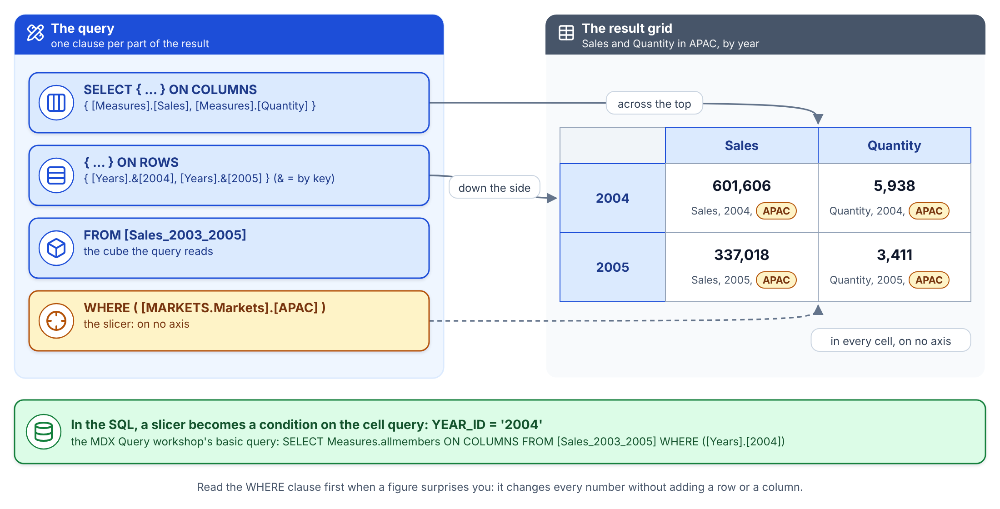

# Overview of MDX Query

<div class="pcm-intro">

Pentaho Analyzer gives business users a drag-and-drop interface — but schema developers often need to query cubes **directly** with **MDX** (Multidimensional Expressions), the SQL-equivalent language for OLAP. MDX lets you test your schema designs, validate calculated members, troubleshoot performance, and write analytical queries that go beyond the standard reporting interfaces.

</div>

> **Note:**
>
> #### Why learn MDX?
>
> Rather than waiting for users to discover issues in production reports, you can proactively **validate** your schema designs, **test** calculated members, and **verify** query behavior using direct MDX queries. This transforms you from a passive schema builder into an active analyst who can interrogate cubes and understand exactly how your model responds to different query patterns.

## MDX at a glance

> **Note:**
>
> #### Axes vs. slicers
>
> An MDX query selects **measures and members onto axes** (`COLUMNS`, `ROWS`) `FROM` a cube, and optionally restricts the result with a `WHERE` clause — the **slicer**. The slicer sets the dimensional context without placing a dimension on a visible axis.

```mdx
SELECT
  { [Measures].[Sales], [Measures].[Quantity] } ON COLUMNS,
  { [Years].&[2004], [Years].&[2005] }          ON ROWS
FROM [Sales_2003_2005]
WHERE ( [MARKETS.Markets].[APAC] )
```

`[MARKETS.Markets].[APAC]` is the full form: it names the MARKETS dimension, its Markets hierarchy and the APAC member. The [MDX Query](../11-mdx-query-mdx-query/guide.md) workshop runs the same query with the short form `[Markets].[APAC]`, which Mondrian resolves to the same member.

| Syntax | Meaning |
| --- | --- |
| `SELECT … ON COLUMNS, … ON ROWS` | Places sets of members/measures on visible axes. |
| `FROM [Cube]` | The cube being queried. |
| `WHERE ( … )` | The **slicer** — restricts the dimensional context. |
| `[Dimension].[Member]` | Bracket notation to reference a member by name. |
| `[Level].&[key]` | Ampersand (`&`) references a member by its **key**. |
| `.Members` / `.AllMembers` | Returns all members of a level/dimension. |

<div align="center">
<figure>

<figcaption>Where each part of a query lands in the result</figcaption>
</figure>
</div>

Read the diagram from each clause on the left to the part of the grid it fills. The `COLUMNS` set runs across the top and the `ROWS` set down the side, and `FROM` names the cube every cell is read from. The slicer adds no header: its APAC sits in the coordinates of every cell, so all four numbers are APAC's. Run in the **MDX Query** workshop, this query returns Sales 601,606 and Quantity 5,938 for 2004, and 337,018 and 3,411 for 2005. The strip underneath is from that workshop's first query, whose slicer, `[Years].[2004]`, reaches the database as the condition `YEAR_ID = '2004'`.

## What's in this module

| Lab | What you'll do |
| --- | --- |
| **MDX Query** | Launch MDX Query mode, write `SELECT`/`FROM`/`WHERE` queries against the SteelWheels schema's Sales_2003_2005 cube, use `AllMembers`, and build cross-tabular queries filtered by territory/market. |
| **Named Sets** | Define reusable collections of members (e.g. "Top 3 Territories") with the `WITH SET` clause, then embed them permanently in the schema. |

Start with **MDX Query**, then move on to **Named Sets**.
