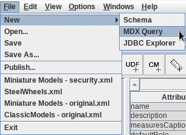
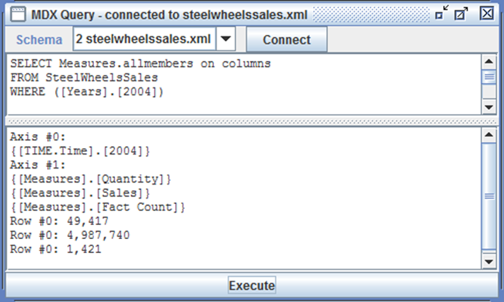
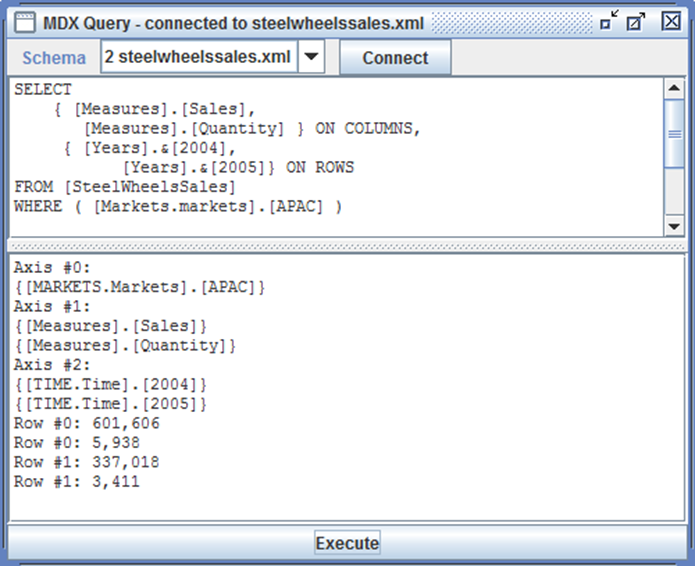

# MDX Query

> **Warning:**
>
> #### Workshop - MDX Query
>
> MDX (Multidimensional Expressions) is the query language of OLAP cubes, as SQL is of tables. Writing MDX yourself is how you test a schema, check a calculated member and find out why a report shows what it shows. In this workshop you query the SteelWheels sample cube in Schema Workbench's MDX Query window.
>
> **What you'll do**
>
> * Open the MDX Query window and connect it to a schema
> * Write a query with SELECT, FROM and WHERE that returns every measure for one year
> * Write a cross-tab query with measures on columns, years on rows and a territory as the slicer
> * Refer to members by name and by key
>
> **Prerequisites:** Complete [SteelWheels](../04-schemas-steelwheels/guide.md), so Schema Workbench has the `hsqldb_sampledata` connection; the Pentaho Server running
>
> **Estimated time:** 15 minutes

<figure>

<figcaption class="pcm-video-caption">Walkthrough: coming soon</figcaption>

</figure>

:::: tabs

### 1. Launch MDX Query Mode

> **Note:**
>
> #### Launch MDX Query Mode
>
> The MDX Query window runs queries against a schema open in Schema Workbench, through the workbench's own JDBC connection. This workshop queries the SteelWheels schema you explored in [SteelWheels](../04-schemas-steelwheels/guide.md): its cube is `Sales_2003_2005`.

1. Start Schema Workbench with the **Start Pentaho Schema Workbench** button below, or from PowerShell:

```powershell
Set-Location C:\Pentaho\design-tools\schema-workbench
.\workbench.bat
```

<button data-launch="schema-workbench">Start Pentaho Schema Workbench</button>

2. Make sure the Pentaho Server is running: it hosts the SampleData database on port `9001`. On a lab VM it starts with the machine. On your own machine, start it as [Before You Start](../00-before-you-start/guide.md) describes (its repository database first), and wait until **http://localhost:8080/pentaho** shows the sign-in page:

```powershell
C:\Pentaho\server\pentaho-server\start-pentaho.bat
```

3. Select **File > Open** and open `steelwheels.xml` from `C:\Workshop-SW-Associate\05-mdx-query\11-mdx-query-mdx-query`, or download it from **Lab Files** below.
4. With the schema's window selected, select **File > New > MDX Query**. Opening the schema first connects the query window to it; with no schema open, Schema Workbench answers `No Mondrian connection. Select a Schema to connect.`

<div align="center">
<figure>

<figcaption>File > New > MDX Query</figcaption>
</figure>
</div>

5. If the window title doesn't read **MDX Query - connected to steelwheels.xml**, select the schema in the **Schema** list and select **Connect**. When Schema Workbench reports `Mondrian connection Successful.`, select **OK**.

> **Success:** Checkpoint: the window title reads **MDX Query - connected to steelwheels.xml**.

### 2. A Basic Query

> **Note:**
>
> #### A Basic Query
>
> A query names what goes on each axis and which cube to read. This one puts every measure on the columns, `Measures.allmembers`, and fixes the year with a `WHERE` slicer.

1. Enter this query in the top pane:

```mdx
SELECT Measures.allmembers on columns
FROM [Sales_2003_2005]
WHERE ([Years].[2004])
```

2. Select **Execute**.

<div align="center">
<figure>

<figcaption>Quantity, Sales and Fact Count for 2004</figcaption>
</figure>
</div>

> **Success:** Checkpoint: one row of three measures for 2004: **Quantity** 49,417, **Sales** 4,987,740 and **Fact Count** 1,421.

3. Clear the top pane.

> **Under the hood:**
>
> #### WHERE sets the context of every cell
>
> The WHERE clause is a slicer, not a filter on rows. It fixes
> `[Years].[2004]` as part of every cell's coordinates, which is why
> 2004 appears on no axis. In the SQL Mondrian sends it becomes a
> condition on the cell query, `YEAR_ID = '2004'`.
>
> Fact Count is a measure you didn't define. Mondrian gives every cube a
> Fact Count, a `count(*)` of fact rows (1,421 order lines in 2004)
> loaded in the same statement as Quantity and Sales, and
> `Measures.AllMembers` returns it.
>
> **Why it matters:** a slicer changes every number in the result
> without adding a row or a column, so read the WHERE clause first when
> a figure surprises you.

### 3. A Cross-Tab Query

> **Note:**
>
> #### A Cross-Tab Query
>
> This query puts two measures on the columns and two years on the rows, and slices on the APAC territory. It refers to the years by key, `[Years].&[2004]`, and to the territory by name, `[Markets].[APAC]`.

1. Enter this query in the top pane:

```mdx
SELECT
{ [Measures].[Sales], [Measures].[Quantity] } ON COLUMNS,
{ [Years].&[2004],
[Years].&[2005]} ON ROWS
FROM [Sales_2003_2005]
WHERE ( [Markets].[APAC] )
```

2. Select **Execute**.

<div align="center">
<figure>

<figcaption>Sales and Quantity for 2004 and 2005 in APAC</figcaption>
</figure>
</div>

> **Success:** Checkpoint: two rows. 2004: **Sales** 601,606 and **Quantity** 5,938. 2005: **Sales** 337,018 and **Quantity** 3,411.

3. Close the MDX Query window, then close the schema.

> **Under the hood:**
>
> #### Names, keys and case
>
> `[Years].[2004]` finds a member by its name; `[Years].&[2004]` finds
> it by its key, the value of the level's column (YEAR_ID). In this
> schema the two are the same, but where a level has a separate name
> column, a key reference keeps working when the displayed name changes.
>
> `[Markets].[APAC]` is a short form: Mondrian finds the Markets
> hierarchy of the MARKETS dimension by name, and APAC in it. The full
> form names the dimension and the hierarchy, `[MARKETS.Markets].[APAC]`,
> as the results pane does. Schema Workbench matches names without
> regard to case
> (`mondrian.olap.case.sensitive` is left off in its
> mondrian.properties), so `[markets].[apac]` works there too; the
> Pentaho Server ships with it set to true, and the same lowercase query
> fails with "MDX object '[markets].[apac]' not found".
>
> **Why it matters:** write names in their exact case. And `[Years]`
> works on its own only because nothing else in the cube has that name;
> the full form, `[TIME.Time].[2004]`, never depends on that.

::::

## Lab Files

Click a file to download. Every file is also on disk in this workshop's folder, `C:\Workshop-SW-Associate\05-mdx-query\11-mdx-query-mdx-query`: open a schema in Schema Workbench with **File > Open**.

The schema this workshop queries, the same SteelWheels schema as in [SteelWheels](../04-schemas-steelwheels/guide.md):

[steelwheels.xml](./files/steelwheels.xml)

This workshop writes queries, not a schema, so it has no separate solution: the checkpoints give each query's result.
