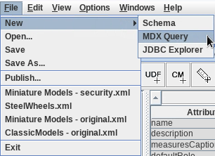
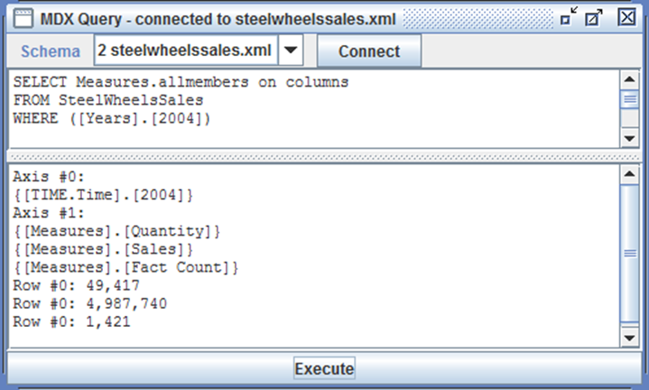
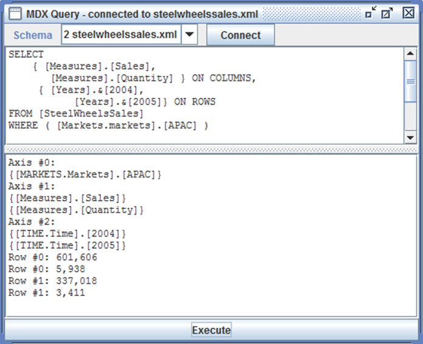

# MDX Query

> **Warning:**
>
> #### Workshop - MDX Query
>
> MDX (Multidimensional Expressions) is the query language of OLAP cubes, as SQL is of tables. Writing MDX yourself is how you test a schema, check a calculated member and find out why a report shows what it shows. In this workshop you query the SteelWheels sample cube in Schema Workbench's MDX Query window.
>
> **What you'll do**
>
> * Open the MDX Query window and connect it to a schema
> * Write a query with SELECT, FROM and WHERE that returns every measure for one year
> * Write a cross-tab query with measures on columns, years on rows and a territory as the slicer
> * Refer to members by name and by key
>
> **Prerequisites:** Complete [SteelWheels](../04-schemas-steelwheels/guide.md), so Schema Workbench has the `hsqldb_sampledata` connection; the Pentaho Server running
>
> **Estimated time:** 25 minutes

<div class="pcm-embed-card" data-href="https://www.loom.com/share/6404e8e60d424783933e7e48a6b443ad?hideEmbedTopBar=true&amp;hide_owner=true&amp;hide_share=true&amp;hide_title=true" data-title="Testing MDX Queries for the Steel Wheel Sales Training Cube 🛠️" data-description="In this video, I demonstrate how to test the Steel Wheel Sales Training Cube using MDX query mode. I write two MDX queries: the first displays all measures for the year 2004, confirming that both sales and quantity measures, along with calculated measures, are functioning correctly. I then modify the query to show only sales and quantity measures for 2005, illustrating how to select specific members from the year's level. I encourage you to explore variations of these queries to further test the schema. Finally, I will be publishing the schema to the repository in the next demonstration." data-thumb="../_assets/embeds/2631a0493553.png"></div>

:::: tabs

### 1. Launch MDX Query Mode

> **Note:**
>
> #### Launch MDX Query Mode
>
> The MDX Query window runs queries against a schema open in Schema Workbench, through the workbench's own JDBC connection. This workshop uses the SteelWheels sample schema that ships with Pentaho Report Designer: its cube is `SteelWheelsSales`.

1. Start Schema Workbench with the **Start Schema Workbench** button below, or from a terminal:

::: tabs

### Windows (PowerShell)

```powershell
Set-Location C:\Pentaho\design-tools\schema-workbench
.\workbench.bat
```

### macOS / Linux

```bash
cd ~/Pentaho/design-tools/schema-workbench
./workbench.sh
```

:::

<button data-launch="schema-workbench">Start Schema Workbench</button>

2. Make sure the Pentaho Server is running: it hosts the SampleData database on port `9001`. On a lab VM it starts with the machine. On your own machine, start it and wait until **http://localhost:8080/pentaho** shows the sign-in page:

::: tabs

### Windows (PowerShell)

```powershell
C:\Pentaho\server\pentaho-server\start-pentaho.bat
```

### macOS / Linux

```bash
cd ~/Pentaho/server/pentaho-server
./start-pentaho.sh
```

:::

3. Select **File > Open** and open the sample schema: `C:\Pentaho\design-tools\report-designer\samples\steelwheels.mondrian.xml` on Windows, `~/Pentaho/design-tools/report-designer/samples/steelwheels.mondrian.xml` on macOS and Linux.
4. Select **File > New > MDX Query**.

<div align="center">
<figure>

<figcaption>File > New > MDX Query</figcaption>
</figure>
</div>

5. If the window title doesn't read **MDX Query - connected to steelwheels.mondrian.xml**, select the schema in the **Schema** list and select **Connect**. When Schema Workbench reports `Mondrian connection Successful.`, select **OK**.

> **Success:** Checkpoint: the window title reads **MDX Query - connected to steelwheels.mondrian.xml**.

### 2. A Basic Query

> **Note:**
>
> #### A Basic Query
>
> A query names what goes on each axis and which cube to read. This one puts every measure on the columns, `Measures.allmembers`, and fixes the year with a `WHERE` slicer.

1. Enter this query in the top pane:

```mdx
SELECT Measures.allmembers on columns
FROM SteelWheelsSales
WHERE ([Years].[2004])
```

2. Select **Execute**.

<div align="center">
<figure>

<figcaption>Quantity, Sales and Fact Count for 2004 (taken on a copy of the schema saved as steelwheelssales.xml)</figcaption>
</figure>
</div>

> **Success:** Checkpoint: one row of three measures for 2004: **Quantity** 49,417, **Sales** 4,987,740 and **Fact Count** 1,421.

3. Clear the top pane.

> **Under the hood:**
>
> #### WHERE sets the context of every cell
>
> The WHERE clause is a slicer, not a filter on rows. It fixes
> `[Years].[2004]` as part of every cell's coordinates, which is why
> 2004 appears on no axis. In the SQL Mondrian sends it becomes a
> condition on the cell query, `YEAR_ID = '2004'`.
>
> Fact Count is a measure you didn't define. Mondrian gives every cube a
> Fact Count, a `count(*)` of fact rows (1,421 order lines in 2004)
> loaded in the same statement as Quantity and Sales, and
> `Measures.AllMembers` returns it.
>
> **Why it matters:** a slicer changes every number in the result
> without adding a row or a column, so read the WHERE clause first when
> a figure surprises you.

### 3. A Cross-Tab Query

> **Note:**
>
> #### A Cross-Tab Query
>
> This query puts two measures on the columns and two years on the rows, and slices on the APAC territory. It refers to the years by key, `[Years].&[2004]`, and to the territory by name, `[Markets].[APAC]`.

1. Enter this query in the top pane:

```mdx
SELECT
{ [Measures].[Sales], [Measures].[Quantity] } ON COLUMNS,
{ [Years].&[2004],
[Years].&[2005]} ON ROWS
FROM [SteelWheelsSales]
WHERE ( [Markets].[APAC] )
```

2. Select **Execute**.

<div align="center">
<figure>

<figcaption>Sales and Quantity for 2004 and 2005 in APAC (taken on a copy of the schema with a named Markets hierarchy)</figcaption>
</figure>
</div>

> **Success:** Checkpoint: two rows. 2004: **Sales** 601,606 and **Quantity** 5,938. 2005: **Sales** 337,018 and **Quantity** 3,411.

3. Close the MDX Query window, then close the schema.

> **Under the hood:**
>
> #### Names, keys and case
>
> `[Years].[2004]` finds a member by its name; `[Years].&[2004]` finds
> it by its key, the value of the level's column (YEAR_ID). In this
> schema the two are the same, but where a level has a separate name
> column, a key reference keeps working when the displayed name changes.
>
> `[Markets].[APAC]` names the hierarchy after its dimension, because in
> this sample the Markets hierarchy has no name of its own. Schema
> Workbench matches names without regard to case
> (`mondrian.olap.case.sensitive` is left off in its
> mondrian.properties), so `[markets].[apac]` works there too; the
> Pentaho Server ships with it set to true, and the same lowercase query
> fails with "MDX object '[markets].[apac]' not found".
>
> **Why it matters:** write names in their exact case. And `[Years]`
> works on its own only because nothing else in the cube has that name;
> the full form, `[Time].[2004]`, never depends on that.

::::

## Lab Files

Click a file to download. For `.ktr` and `.kjb` files, **Open in Pentaho Data Integration** launches PDI with the file loaded. If PDI is already running, the path is copied to your clipboard — switch to PDI and press `Ctrl+O`, `Ctrl+V`, `Enter`.

_No bundled files for this lab._ The schema it queries ships with your Pentaho install, at `C:\Pentaho\design-tools\report-designer\samples\steelwheels.mondrian.xml`.
