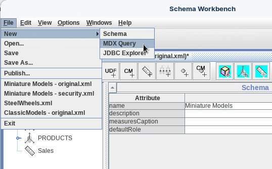
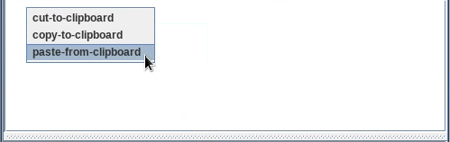
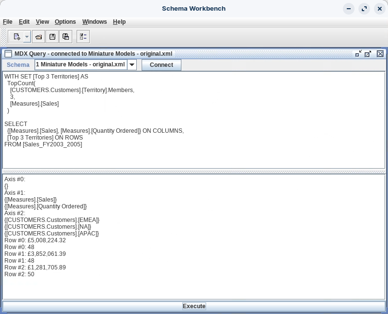
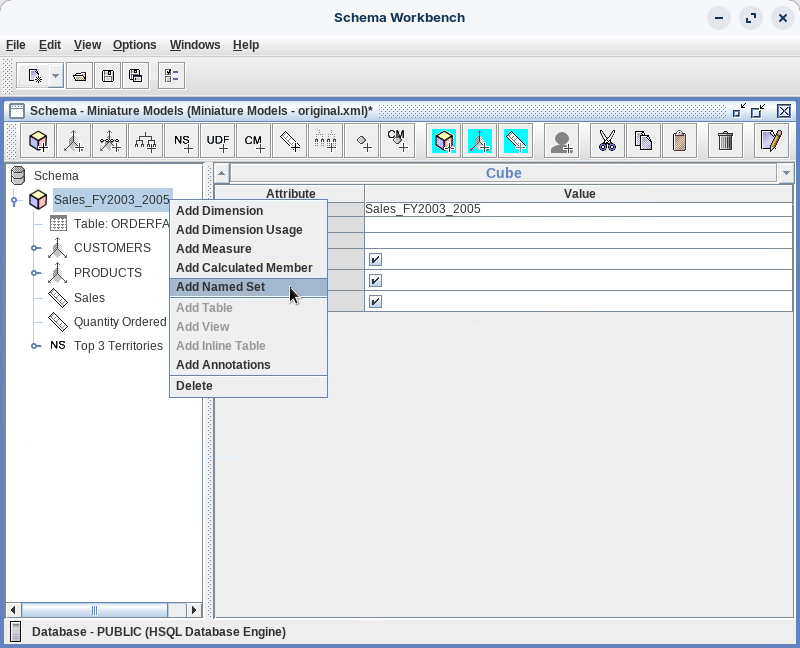
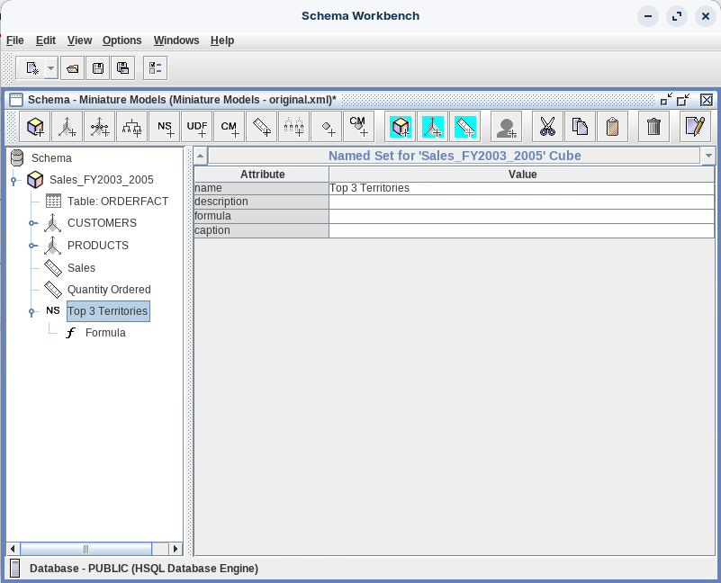
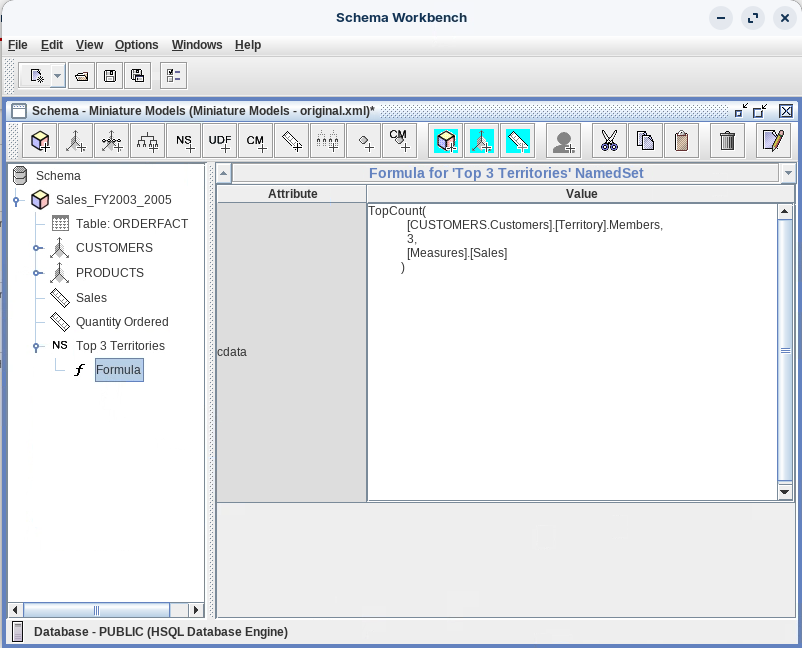

# Named Sets

> **Warning:**
>
> #### Workshop - Named Sets
>
> Users often work with the same collections of members: the top territories, the key accounts, the focus products. A named set defines such a collection once, in the schema, with an MDX expression that is evaluated against the current data every time a query uses it.
>
> **What you'll do**
>
> * Tell named sets (collections of members) from calculated members (single values)
> * Test a named set with a WITH SET clause in the MDX Query window
> * Rank territories by Sales with the TopCount function
> * Add the Top 3 Territories named set to the Miniature Models cube and publish it
>
> **Prerequisites:** Complete [Standard Model](../06-schemas-standard-model/guide.md) and [MDX Query](../11-mdx-query-mdx-query/guide.md); the Pentaho Server running
>
> **Estimated time:** 30 minutes

## Named Sets vs. Calculated Members <!-- no-step -->

| Aspect | Named Sets | Calculated Members |
| --- | --- | --- |
| **Returns** | Set of members | Single member/value |
| **Purpose** | Group members together | Calculate new values |
| **Definition** | WITH SET clause | WITH MEMBER clause |
| **Example** | Top 3 Territories by Sales | Profit (Sales - Cost) |

Named sets are useful for:

* Top or bottom N analysis: Top 10 Products, Bottom 3 Territories
* Strategic groupings: Key Accounts, Focus Markets, Priority Products
* Complex member selections: members meeting several criteria
* Simpler reports: less repeated MDX in frequently used queries
* Consistency: the same business logic in every report

The named set you add to the Miniature Models schema looks like this in the XML:

```xml
<!-- ============================================ -->
<!-- ADD YOUR NAMED SET HERE - LAST IN THE CUBE  -->
<!-- ============================================ -->
<NamedSet name="Top 3 Territories">
    <Formula>TopCount([CUSTOMERS.Customers].[Territory].Members,3,[Measures].[Sales])</Formula>
</NamedSet>

<!-- Calculated Members go BEFORE Named Sets, never after them -->
```

:::: tabs

### 1. Test the Named Set in MDX Query

> **Note:**
>
> #### Test in MDX Query
>
> A `WITH SET` clause defines a named set that lasts for one query. Test the formula that way first, then add it to the schema.

1. Start Schema Workbench with the **Start Schema Workbench** button below, or from a terminal:

::: tabs

### Windows (PowerShell)

```powershell
Set-Location C:\Pentaho\design-tools\schema-workbench
.\workbench.bat
```

### macOS / Linux

```bash
cd ~/Pentaho/design-tools/schema-workbench
./workbench.sh
```

:::

<button data-launch="schema-workbench">Start Schema Workbench</button>

2. Make sure the Pentaho Server is running: it hosts the SampleData database on port `9001`. On a lab VM it starts with the machine. On your own machine, start it and wait until **http://localhost:8080/pentaho** shows the sign-in page:

::: tabs

### Windows (PowerShell)

```powershell
C:\Pentaho\server\pentaho-server\start-pentaho.bat
```

### macOS / Linux

```bash
cd ~/Pentaho/server/pentaho-server
./start-pentaho.sh
```

:::

3. Select **File > Open** and open `miniaturemodels-original.xml`, which you downloaded from **Lab Files** below.
4. Select **File > New > MDX Query**.

<div align="center">
<figure>

<figcaption>File > New > MDX Query</figcaption>
</figure>
</div>

5. If the window title doesn't read **MDX Query - connected to miniaturemodels-original.xml**, select the schema in the **Schema** list and select **Connect**. When Schema Workbench reports `Mondrian connection Successful.`, select **OK**.
6. Enter this query in the top pane. To paste it, press `Ctrl+V`, or right-click the pane and select **paste-from-clipboard**.

<div align="center">
<figure>

<figcaption>Paste the query</figcaption>
</figure>
</div>

```mdx
WITH SET [Top 3 Territories] AS
  TopCount(
    [CUSTOMERS.Customers].[Territory].Members,
    3,
    [Measures].[Sales]
  )

SELECT
  {[Measures].[Sales], [Measures].[Quantity Ordered]} ON COLUMNS,
  [Top 3 Territories] ON ROWS
FROM [Sales_FY2003_2005]
```

7. Select **Execute**.

<div align="center">
<figure>

<figcaption>Named set query - Top 3 Territories</figcaption>
</figure>
</div>

> **Success:** Checkpoint: three rows, highest Sales first. EMEA: £5,008,224.32 and 48. NA: £3,852,061.39 and 48. APAC: £1,281,705.89 and 50.

8. Close the MDX Query window.

> **Under the hood:**
>
> #### TopCount went to the database as one sorted query
>
> Mondrian didn't fetch every territory and sort them in memory. With
> native evaluation on (`mondrian.native.topcount.enable`, true by
> default) it sent one SQL statement that sums TOTALPRICE per territory
> and orders by that sum, highest first, then kept the first three:
> EMEA, NA and APAC.
>
> Quantity Ordered is still workshop 06's distinct count (48, 48 and 50
> different quantities), not units.
>
> **Why it matters:** a ranking over thousands of members costs one
> sorted query, not a transfer of every member to the server.

**The WITH SET clause** defines the named set:

```mdx
WITH SET [Top 3 Territories] AS
```

It creates a temporary named set, `[Top 3 Territories]`, that exists only for this query.

**The TopCount function** fills it:

```mdx
TopCount(
[CUSTOMERS.Customers].[Territory].Members,
3,
[Measures].[Sales]
)
```

| Component | Explanation |
| --- | --- |
| `TopCount()` | MDX function that returns the top N items from a set |
| `[CUSTOMERS.Customers].[Territory].Members` | Every territory member of the Customers hierarchy |
| `3` | Returns the top 3 items |
| `[Measures].[Sales]` | Ranks territories by Sales, highest first |

It finds all territories, sorts them by Sales, highest first, and returns the first 3.

### 2. Add the Named Set to the Schema

> **Note:**
>
> #### Add the Named Set to the Schema
>
> A named set in the schema is available to every query and report on the cube. Schema Workbench gives each new named set a **Formula** node for its expression.

1. Right-click **Sales_FY2003_2005** and select **Add Named Set**.

<div align="center">
<figure>

<figcaption>Add Named Set</figcaption>
</figure>
</div>

2. Set **name** to `Top 3 Territories` and press `Tab`.

<div align="center">
<figure>

<figcaption>Named set - Top 3 Territories</figcaption>
</figure>
</div>

3. Expand **Top 3 Territories**, select its **Formula** node, and set **cdata** to this formula:

```mdx
TopCount(
    [CUSTOMERS.Customers].[Territory].Members,
    3,
    [Measures].[Sales]
  )
```

<div align="center">
<figure>

<figcaption>Enter the formula</figcaption>
</figure>
</div>

4. Select **File > Save**.

> **Success:** Checkpoint: no red cross in the schema, and the cube lists the named set **Top 3 Territories** after its measures.

5. Select **File > Publish**, make sure the **Publish Schema** fields hold the values from [Basic Model](../05-schemas-basic-model/guide.md), and select **Publish**. If Schema Workbench asks whether to overwrite the Miniature Models schema, select **Yes**.

> **Success:** Checkpoint: a **Publish** message reads `Publish Successful`. The schema now holds the reusable `Top 3 Territories` named set, for every report on the Miniature Models cube.

6. Select **OK**.

> **Under the hood:**
>
> #### The schema stores the formula, not three territories
>
> A named set is evaluated when a query uses it, in that query's
> context. Add `WHERE [PRODUCTS.Products].[Motorcycles]` and the same
> set returns NA (524,549.19) ahead of EMEA (507,138.28) and APAC: the
> ranking follows the data and the slicer.
>
> Its place in the XML matters. Inside a Cube, Mondrian reads its
> children in a fixed order (measures, then calculated members, then
> named sets) and skips an element that is out of order without an
> error. Put this named set above a calculated member and the calculated
> member silently vanishes from the cube.
>
> **Why it matters:** Schema Workbench writes the elements in order for
> you; it matters when you edit the XML by hand.

::::

## Lab Files

Click a file to download. For `.ktr` and `.kjb` files, **Open in Pentaho Data Integration** launches Pentaho Data Integration with the file loaded. If Pentaho Data Integration is already running, the path is copied to your clipboard — switch to Pentaho Data Integration and press `Ctrl+O`, `Ctrl+V`, `Enter`.

The Miniature Models schema from [Standard Model](../06-schemas-standard-model/guide.md), the starting point for this workshop:

[miniaturemodels-original.xml](./files/miniaturemodels-original.xml)
