# Mondrian Security

> **Warning:**
>
> #### Workshop - Mondrian Security
>
> A published cube must show each user only the data their role allows. Mondrian's role-based security works at several levels, the schema, a cube, a hierarchy and single members, and it decides what aggregated totals reveal. In this workshop you secure the Miniature Models schema with four roles, each more restrictive than the last.
>
> **What you'll do**
>
> * Create four platform users and roles in the User Console
> * Map platform roles to Mondrian roles with the Lookup Map role mapper
> * Grant schema and cube access with SchemaGrant and CubeGrant
> * Limit the levels a role can see with a HierarchyGrant's topLevel and bottomLevel
> * Restrict a role to three states with MemberGrants, and compare the rollup policies
>
> **Prerequisites:** Complete [Standard Model](../06-schemas-standard-model/guide.md); the Pentaho Server running, with administrator access to the User Console and to the server's files
>
> **Estimated time:** 120 minutes

The finished roles, for reference:

```xml
<Schema name="Miniature Models">
  <Cube name="Sales_FY2003_2005" visible="true" cache="true" enabled="true">
    <Table name="ORDERFACT" schema="PUBLIC">
    </Table>
    <Dimension type="StandardDimension" visible="true" foreignKey="CUSTOMERNUMBER" highCardinality="false" name="CUSTOMERS">
      <Hierarchy name="Customers" visible="true" hasAll="true" allMemberName="All Customers" primaryKey="CUSTOMERNUMBER">
        <Table name="CUSTOMER_W_TER" schema="PUBLIC">
        </Table>
        <Level name="Territory" visible="true" column="TERRITORY" type="String" uniqueMembers="true" levelType="Regular" hideMemberIf="Never">
        </Level>
        <Level name="Country" visible="true" column="COUNTRY" type="String" uniqueMembers="false" levelType="Regular" hideMemberIf="Never">
        </Level>
        <Level name="State" visible="true" table="CUSTOMER_W_TER" column="STATE" type="String" uniqueMembers="false" levelType="Regular" hideMemberIf="Never">
        </Level>
        <Level name="City" visible="true" table="CUSTOMER_W_TER" column="CITY" type="String" uniqueMembers="false" levelType="Regular" hideMemberIf="Never">
        </Level>
        <Level name="Customer Name" visible="true" column="CUSTOMERNAME" type="String" uniqueMembers="false" levelType="Regular" hideMemberIf="Never">
        </Level>
      </Hierarchy>
    </Dimension>
    <Dimension type="StandardDimension" visible="true" foreignKey="PRODUCTCODE" highCardinality="false" name="PRODUCTS">
      <Hierarchy name="Products" visible="true" hasAll="true" allMemberName="All Products" primaryKey="PRODUCTCODE">
        <Table name="PRODUCTS" schema="PUBLIC">
        </Table>
        <Level name="Line" visible="true" column="PRODUCTLINE" type="String" uniqueMembers="true" levelType="Regular" hideMemberIf="Never">
        </Level>
        <Level name="Vendor" visible="true" column="PRODUCTVENDOR" type="String" uniqueMembers="false" levelType="Regular" hideMemberIf="Never">
        </Level>
        <Level name="Name" visible="true" column="PRODUCTNAME" type="String" uniqueMembers="false" levelType="Regular" hideMemberIf="Never">
        </Level>
      </Hierarchy>
    </Dimension>
    <Measure name="Sales" column="TOTALPRICE" datatype="Numeric" formatString="&#163;#,###.00" aggregator="sum" visible="true">
    </Measure>
  </Cube>
  <Role name="Executive Role">
    <SchemaGrant access="all">
      <CubeGrant cube="Sales_FY2003_2005" access="all">
      </CubeGrant>
    </SchemaGrant>
  </Role>
  <Role name="Sales Manager Role">
    <SchemaGrant access="none">
      <CubeGrant cube="Sales_FY2003_2005" access="all">
      </CubeGrant>
    </SchemaGrant>
  </Role>
  <Role name="Analyst Role">
    <SchemaGrant access="none">
      <CubeGrant cube="Sales_FY2003_2005" access="all">
        <HierarchyGrant hierarchy="[CUSTOMERS.Customers]" topLevel="[CUSTOMERS.Customers].[Country]" bottomLevel="[CUSTOMERS.Customers].[City]" access="custom">
        </HierarchyGrant>
        <HierarchyGrant hierarchy="[PRODUCTS.Products]" access="all">
        </HierarchyGrant>
      </CubeGrant>
    </SchemaGrant>
  </Role>
  <Role name="Regional Manager Role">
    <SchemaGrant access="none">
      <CubeGrant cube="Sales_FY2003_2005" access="all">
        <HierarchyGrant hierarchy="[CUSTOMERS.Customers]" topLevel="[CUSTOMERS.Customers].[State]" access="custom">
          <MemberGrant member="[CUSTOMERS.Customers].[NA].[USA].[NJ]" access="all">
          </MemberGrant>
          <MemberGrant member="[CUSTOMERS.Customers].[NA].[USA].[NY]" access="all">
          </MemberGrant>
          <MemberGrant member="[CUSTOMERS.Customers].[NA].[USA].[PA]" access="all">
          </MemberGrant>
        </HierarchyGrant>
        <HierarchyGrant hierarchy="[PRODUCTS.Products]" access="all">
        </HierarchyGrant>
      </CubeGrant>
    </SchemaGrant>
  </Role>
</Schema>
```

> **Note:**
>
> #### Security Concepts
>
> Mondrian's grants form a hierarchy, from the whole schema down to single members. **Granting access to a child element implicitly grants access to its parent**: a grant on a cube also grants access to the schema.

| Grant Type | Description |
| --- | --- |
| SchemaGrant | Controls access to the entire schema |
| CubeGrant | Controls access to individual cubes within a schema |
| DimensionGrant | Controls access to entire dimensions |
| HierarchyGrant | Controls access to hierarchies and can restrict by level (topLevel, bottomLevel) |
| MemberGrant | Controls access to specific members within a hierarchy |

:::: tabs

### 1. Setup: Users, Roles and Role Mapper

> **Note:**
>
> #### Users, Roles and the Role Mapper
>
> Each test user gets one platform role in the User Console. The role mapper then turns each platform role into a Mondrian role, which the schema defines in the next tabs.

| Username | Role | Purpose |
| --- | --- | --- |
| `exec_user` | Executive | Full access to all data |
| `sales_mgr` | Sales Manager | Access to the sales cube only |
| `region_mgr` | Regional Manager | Limited to three states |
| `analyst` | Analyst | Summary levels only, no individual customers |

1. Make sure the Pentaho Server is running. On a lab VM it starts with the machine. On your own machine, start it and wait until **http://localhost:8080/pentaho** shows the sign-in page:

::: tabs

### Windows (PowerShell)

```powershell
C:\Pentaho\server\pentaho-server\start-pentaho.bat
```

### macOS / Linux

```bash
cd ~/Pentaho/server/pentaho-server
./start-pentaho.sh
```

:::

<button data-launch="puc">Open Pentaho User Console</button>

2. Sign in to the User Console as `admin`.
3. In the perspective list, which shows **Home**, select **Administration**.
4. Select **Users & Roles** and open the **Manage Users** tab.
5. For each user in the table above, select **+**, set **User Name** to the user name, set **Password** and **Confirm Password** to `password`, and select **OK**.

<div align="center">
<figure>
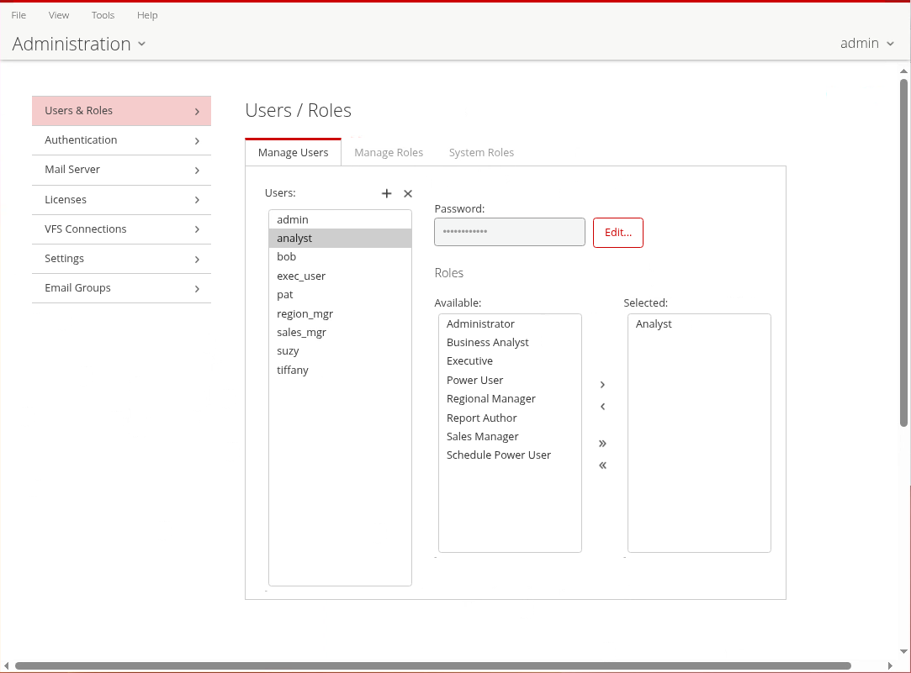
<figcaption>Add the users</figcaption>
</figure>
</div>

6. Open the **Manage Roles** tab. For each role in this table, select **+** and create the role, then, with the role selected, select its **Operation Permissions** and move its user to **Selected**:

| Role | Operation Permissions | User |
| --- | --- | --- |
| `Executive` | All the permissions | `exec_user` |
| `Sales Manager` | Schedule Content, Read Content, Publish Content, Create Content, Execute | `sales_mgr` |
| `Regional Manager` | Schedule Content, Read Content, Publish Content, Create Content, Execute | `region_mgr` |
| `Analyst` | Publish Content, Create Content | `analyst` |

<div align="center">
<figure>
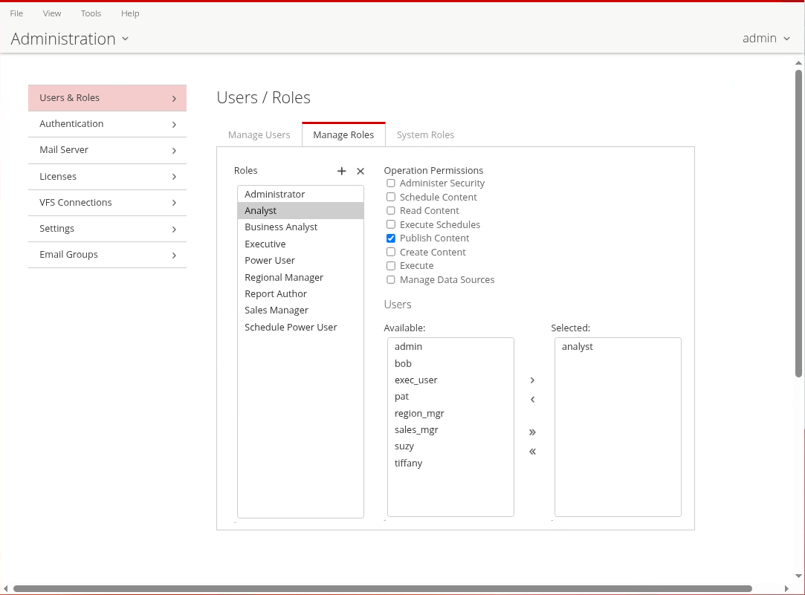
<figcaption>Assign permissions and users to the roles</figcaption>
</figure>
</div>

> **Success:** Checkpoint: **Manage Roles** lists **Analyst**, **Executive**, **Regional Manager** and **Sales Manager**, each with its one user under **Selected**.

7. On the server, open `pentahoObjects.spring.xml` in a text editor:

::: tabs

### Windows (PowerShell)

```powershell
notepad C:\Pentaho\server\pentaho-server\pentaho-solutions\system\pentahoObjects.spring.xml
```

### macOS / Linux

```bash
nano ~/Pentaho/server/pentaho-server/pentaho-solutions/system/pentahoObjects.spring.xml
```

:::

8. Find the `Mondrian-UserRoleMapper` beans, at about line 282 in Pentaho 11. The One-To-One mapper is the active one; comment it out:

```xml
<!-- Disabled for workshop
<bean id="Mondrian-UserRoleMapper"
  name="Mondrian-One-To-One-UserRoleMapper"
  class="org.pentaho.platform.plugin.action.mondrian.mapper.MondrianOneToOneUserRoleListMapper"
  scope="singleton" />
-->
```

9. Below it, the Lookup Map mapper sits inside a comment with sample entries. Add this active bean in its place. Each `key` is a Pentaho role name and each `value` the Mondrian role name the schema defines:

```xml
<bean id="Mondrian-UserRoleMapper"
  name="Mondrian-SampleLookupMap-UserRoleMapper"
  class="org.pentaho.platform.plugin.action.mondrian.mapper.MondrianLookupMapUserRoleListMapper"
  scope="singleton">
  <property name="lookupMap">
    <map>
      <entry key="Executive" value="Executive Role" />
      <entry key="Sales Manager" value="Sales Manager Role" />
      <entry key="Regional Manager" value="Regional Manager Role" />
      <entry key="Analyst" value="Analyst Role" />
    </map>
  </property>
</bean>
```

10. Save the file.

> **Under the hood:**
>
> #### The lookup map's values must be the schema's role names
>
> Mondrian knows nothing about Pentaho users. The role mapper turns the
> platform roles a user holds into role names, and Mondrian applies the
> schema's `<Role>` elements with exactly those names; a user with
> several mapped roles gets the union of their grants. Asked directly
> for a role the schema doesn't define, Mondrian refuses the connection:
> `Role 'No Such Role' not found`.
>
> **Why it matters:** "Sales Manager Role" in the map and in the schema
> must match character for character, the word "Role" included.

11. Restart the Pentaho Server: stop it, and start it again when it has stopped.

::: tabs

### Windows (PowerShell)

```powershell
C:\Pentaho\server\pentaho-server\stop-pentaho.bat
C:\Pentaho\server\pentaho-server\start-pentaho.bat
```

### macOS / Linux

```bash
cd ~/Pentaho/server/pentaho-server
./stop-pentaho.sh
./start-pentaho.sh
```

:::

> **Success:** Checkpoint: **http://localhost:8080/pentaho** shows the sign-in page again.

### 2. SchemaGrant (Executive & Sales Manager)

> **Note:**
>
> #### SchemaGrant
>
> A SchemaGrant sets a role's access to the whole Miniature Models schema. The Executive Role gets `all`. The Sales Manager Role gets `none`, which blocks every cube, and then a CubeGrant opens the `Sales_FY2003_2005` cube, which implicitly grants the schema too.
>
> After every save and publish in this workshop, refresh the Mondrian schema cache in the User Console, so the server reads the new roles.

1. Start Schema Workbench with the **Start Schema Workbench** button below, or from a terminal:

::: tabs

### Windows (PowerShell)

```powershell
Set-Location C:\Pentaho\design-tools\schema-workbench
.\workbench.bat
```

### macOS / Linux

```bash
cd ~/Pentaho/design-tools/schema-workbench
./workbench.sh
```

:::

<button data-launch="schema-workbench">Start Schema Workbench</button>

2. Select **File > Open** and open `miniaturemodels-original.xml`, which you downloaded from **Lab Files** below.
3. Select **File > Save As** and save it as `miniaturemodels-security.xml`.

<div align="center">
<figure>
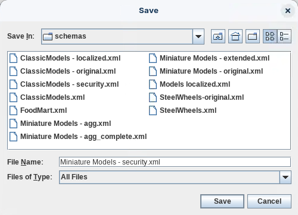
<figcaption>Save the security schema</figcaption>
</figure>
</div>

4. Right-click **Schema** and select **Add Role**.
5. Set **name** to `Executive Role` and press `Tab`.
6. Right-click **Executive Role** and select **Add Schema Grant**.

<div align="center">
<figure>
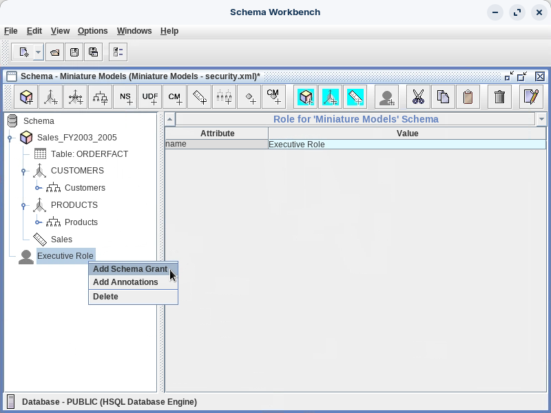
<figcaption>The Executive Role</figcaption>
</figure>
</div>

7. Set **access** to `all` and press `Tab`.

<div align="center">
<figure>
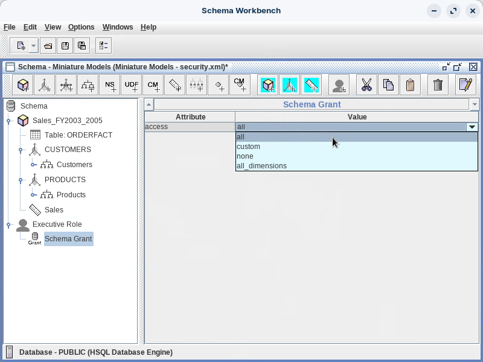
<figcaption>Schema Grant access = all</figcaption>
</figure>
</div>

8. Right-click **Schema Grant** and select **Add Cube Grant**.

<div align="center">
<figure>
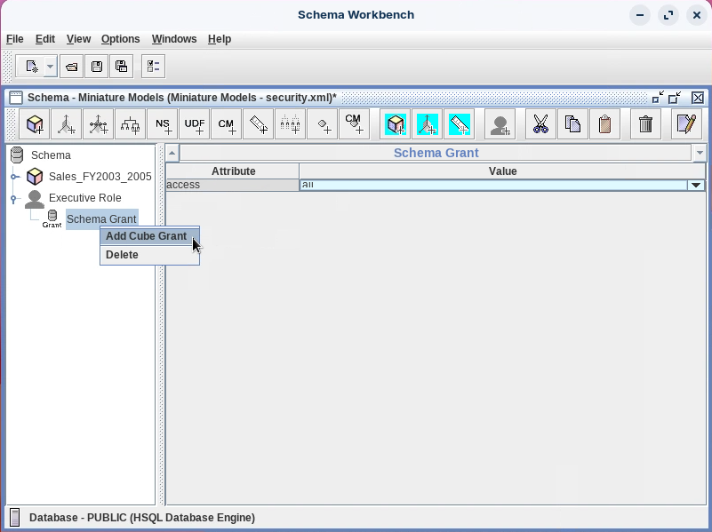
<figcaption>Add Cube Grant</figcaption>
</figure>
</div>

9. Set **access** to `all` and **cube** to `Sales_FY2003_2005`.

<div align="center">
<figure>
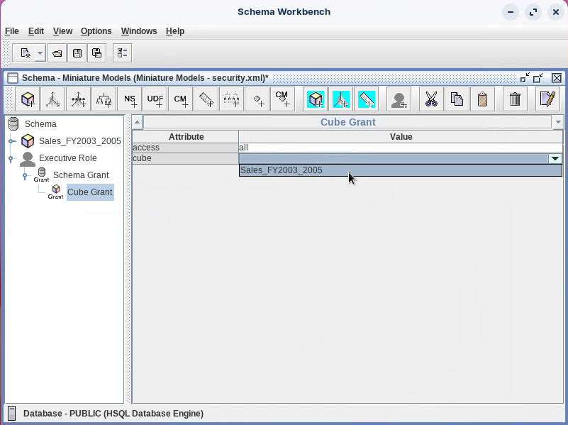
<figcaption>Cube Grant to the Sales_FY2003_2005 cube</figcaption>
</figure>
</div>

The role in the XML:

```xml
<Role name="Executive Role">
    <SchemaGrant access="all">
        <CubeGrant cube="Sales_FY2003_2005" access="all">
        </CubeGrant>
    </SchemaGrant>
</Role>
```

10. Select **File > Save**, then **File > Publish**, with the **Publish Schema** values from [Basic Model](../05-schemas-basic-model/guide.md). If Schema Workbench asks whether to overwrite the Miniature Models schema, select **Yes**.

> **Success:** Checkpoint: a **Publish** message reads `Publish Successful`.

11. Select **OK**. In the User Console, signed in as `admin`, select **Tools > Refresh > Mondrian Schema Cache**.

<div align="center">
<figure>
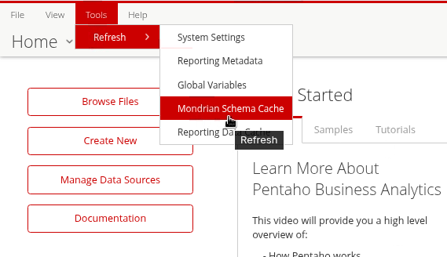
<figcaption>Refresh the Mondrian schema cache</figcaption>
</figure>
</div>

12. Select **Log Out**, sign in as `exec_user`, and select **Create New > Analysis Report**.

<div align="center">
<figure>
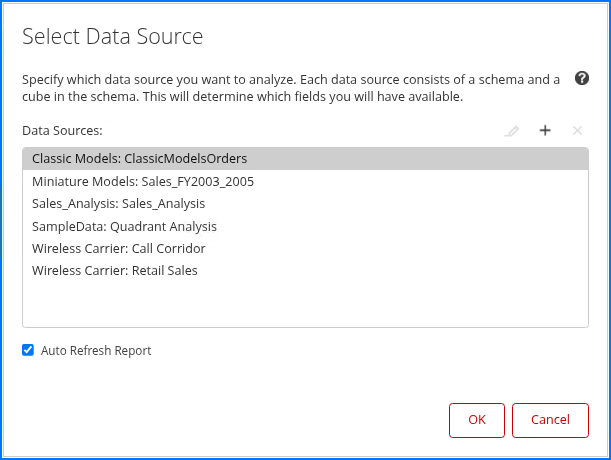
<figcaption>exec_user's data sources</figcaption>
</figure>
</div>

> **Success:** Checkpoint: **Select Data Source** lists **Miniature Models: Sales_FY2003_2005**.

13. Select **Cancel**, select **Log Out**, sign in as `analyst`, and select **Create New > Analysis Report**.

<div align="center">
<figure>
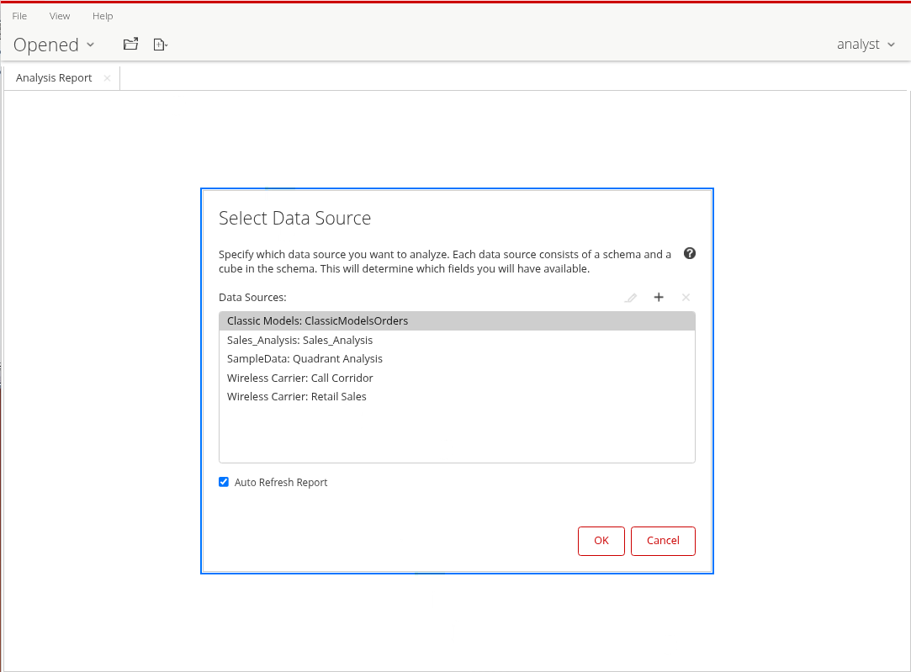
<figcaption>analyst's data sources: no Miniature Models</figcaption>
</figure>
</div>

> **Success:** Checkpoint: no Miniature Models in the list. So far only the Executive Role has access to the schema.

14. Select **Cancel**. In Schema Workbench, right-click **Schema**, select **Add Role**, and set **name** to `Sales Manager Role`.
15. Right-click **Sales Manager Role**, select **Add Schema Grant**, and set **access** to `none`.

<div align="center">
<figure>
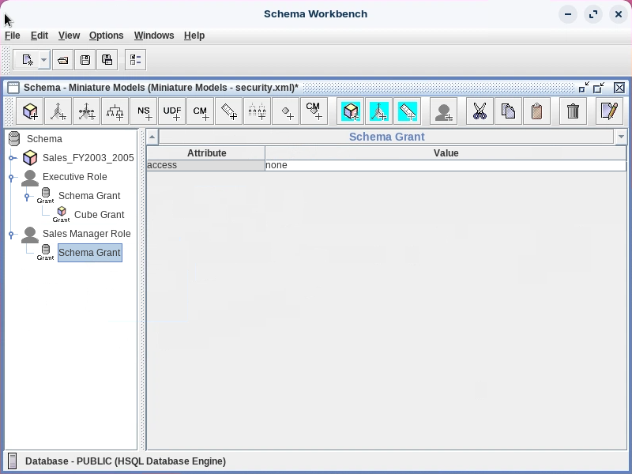
<figcaption>Schema Grant access = none</figcaption>
</figure>
</div>

16. Right-click the Sales Manager Role's **Schema Grant**, select **Add Cube Grant**, and set **access** to `all` and **cube** to `Sales_FY2003_2005`.

<div align="center">
<figure>
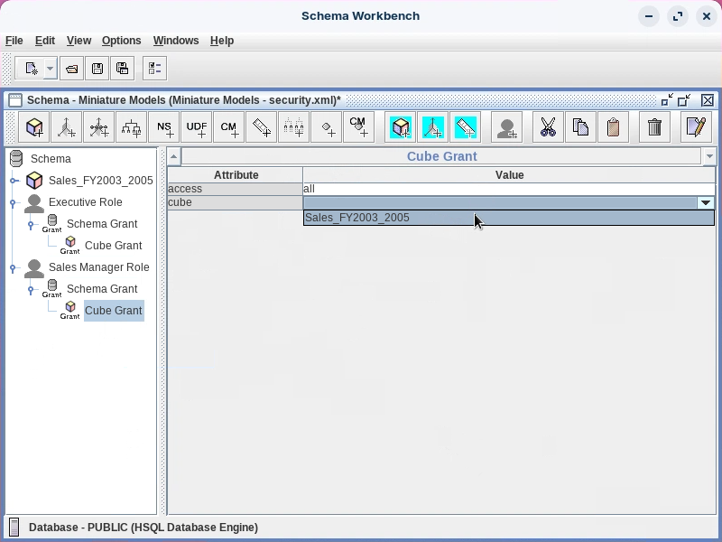
<figcaption>The Sales Manager Role's Cube Grant</figcaption>
</figure>
</div>

The role in the XML:

```xml
<Role name="Sales Manager Role">
    <SchemaGrant access="none">
        <CubeGrant cube="Sales_FY2003_2005" access="all">
        </CubeGrant>
    </SchemaGrant>
</Role>
```

17. Save and publish the schema, and refresh the Mondrian schema cache, as in steps 10 and 11.
18. Sign in as `sales_mgr` and select **Create New > Analysis Report**.

<div align="center">
<figure>
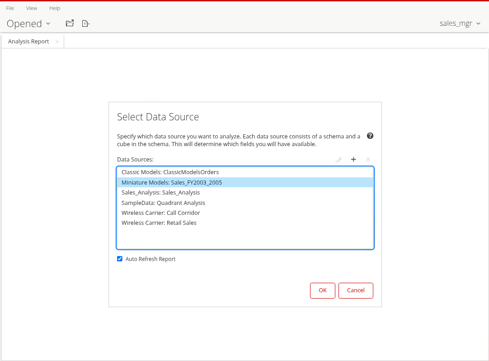
<figcaption>sales_mgr's data sources</figcaption>
</figure>
</div>

> **Success:** Checkpoint: **Select Data Source** lists **Miniature Models: Sales_FY2003_2005**: the cube grant opened the cube, and with it the schema.

19. Select **Cancel**.

### 3. HierarchyGrant (Analyst)

> **Note:**
>
> #### HierarchyGrant
>
> A HierarchyGrant controls which levels of a hierarchy a role can reach, with its topLevel and bottomLevel attributes. The Analyst Role sees summaries only: Country down to City, without individual customers. That takes more levels in the Customers hierarchy: All, Territory, Country, State, City, Customer Name.

1. Right-click the **Customers** hierarchy under **CUSTOMERS**, select **Add Level**, and set the level's attributes:

| Attribute | Value |
| --- | --- |
| **name** | `State` |
| **table** | `CUSTOMER_W_TER` |
| **column** | `STATE` |
| **type** | String |
| **uniqueMembers** | cleared |
| **levelType** | Regular |
| **hideMemberIf** | Never |

2. Right-click **State** and select **Move Level Up** until it sits directly below **Country**.
3. Add a `City` level the same way, with **column** `CITY` and the other attributes as for State, and move it up until it sits directly below **State**.

> **Success:** Checkpoint: **Customers** holds **Territory**, **Country**, **State**, **City** and **Customer Name**, in that order.

4. Right-click **Schema**, select **Add Role**, and set **name** to `Analyst Role`.
5. Right-click **Analyst Role**, select **Add Schema Grant**, and set **access** to `none`.
6. Right-click its **Schema Grant**, select **Add Cube Grant**, and set **access** to `all` and **cube** to `Sales_FY2003_2005`.
7. Right-click the **Cube Grant** and select **Add Hierarchy Grant**.

<div align="center">
<figure>
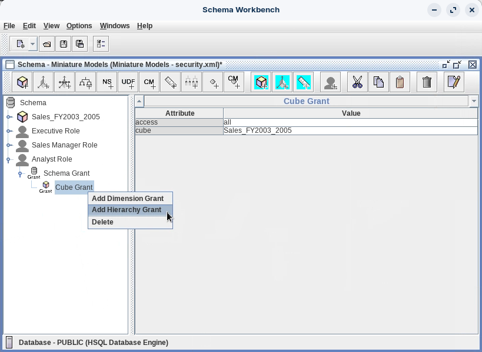
<figcaption>Add Hierarchy Grant - CUSTOMERS.Customers</figcaption>
</figure>
</div>

8. Set the hierarchy grant's attributes, selecting each value from its list:

| Attribute | Value |
| --- | --- |
| **access** | custom |
| **hierarchy** | `[CUSTOMERS.Customers]` |
| **topLevel** | `[CUSTOMERS.Customers].[Country]` |
| **bottomLevel** | `[CUSTOMERS.Customers].[City]` |

<div align="center">
<figure>
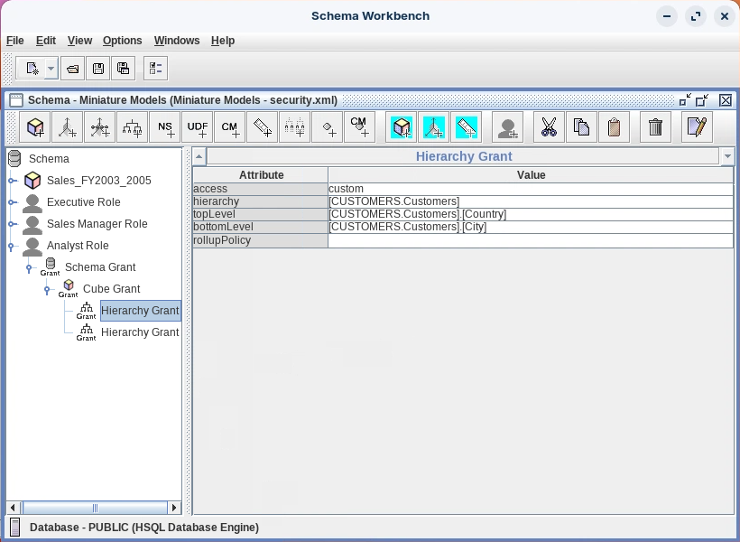
<figcaption>topLevel and bottomLevel on [CUSTOMERS.Customers]</figcaption>
</figure>
</div>

> **Note:**
>
> #### Top and Bottom Level
>
> * **topLevel**: the highest, most aggregated level the role can see. Set to Country, the role can't see Territory or the All level.
> * **bottomLevel**: the lowest, most detailed level the role can see. Set to City, the role can't see individual customers, the Customer Name level.
>
> **Result:** the Analyst can see Country, State and City, but not Territory or Customer Name.

9. Right-click the **Cube Grant**, select **Add Hierarchy Grant**, and set **access** to `all` and **hierarchy** to `[PRODUCTS.Products]`.

<div align="center">
<figure>
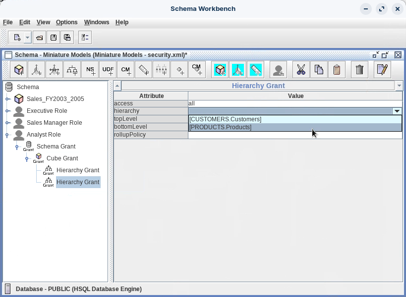
<figcaption>Hierarchy Grant on [PRODUCTS.Products]</figcaption>
</figure>
</div>

The role in the XML:

```xml
<Role name="Analyst Role">
    <SchemaGrant access="none">
        <CubeGrant cube="Sales_FY2003_2005" access="all">
            <HierarchyGrant hierarchy="[CUSTOMERS.Customers]"
                            access="custom"
                            topLevel="[CUSTOMERS.Customers].[Country]"
                            bottomLevel="[CUSTOMERS.Customers].[City]">
            </HierarchyGrant>
            <HierarchyGrant hierarchy="[PRODUCTS.Products]" access="all">
            </HierarchyGrant>
        </CubeGrant>
    </SchemaGrant>
</Role>
```

10. Save and publish the schema. In the User Console, signed in as `admin`, select **Tools > Refresh > Mondrian Schema Cache**.

<div align="center">
<figure>

<figcaption>Refresh the Mondrian schema cache</figcaption>
</figure>
</div>

11. Sign in as `analyst`, select **Create New > Analysis Report**, select **Miniature Models: Sales_FY2003_2005**, and select **OK**.

<div align="center">
<figure>
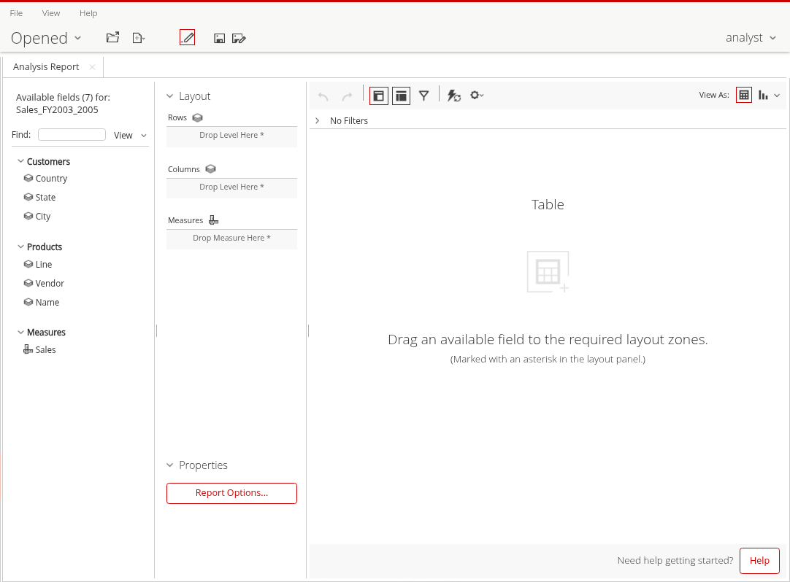
<figcaption>What analyst can see</figcaption>
</figure>
</div>

> **Success:** Checkpoint: the field list offers 7 fields: **Country**, **State** and **City** under Customers, **Line**, **Vendor** and **Name** under Products, and **Sales**. There is no **Territory** and no **Customer Name**.

12. Drag **Sales** to the **Measures** drop zone and **Country** to the **Rows** drop zone.

> **Under the hood:**
>
> #### custom without MemberGrants means everything between two levels
>
> The Analyst's grant is `access="custom"` with a topLevel and a
> bottomLevel but no MemberGrant. For each member Mondrian checks the
> level first, denying anything above Country or below City, and then,
> finding no member grants at all, allows the rest. On SampleData the
> Analyst gets all 33 Country members and 45 State members, and no rows
> at all for Territory or Customer Name.
>
> **Why it matters:** the number behind a report that doesn't break down
> by customer is still the company total, 10,645,949.18. Hiding levels
> restricts where a user can navigate, not what the totals contain.

13. Close the report without saving it.

### 4. MemberGrant (Regional Manager)

> **Note:**
>
> #### MemberGrant
>
> MemberGrants restrict a role to single members. The Regional Manager Role sees only the Eastern USA region: New Jersey, New York and Pennsylvania.

1. In Schema Workbench, right-click **Schema**, select **Add Role**, and set **name** to `Regional Manager Role`.
2. Right-click **Regional Manager Role**, select **Add Schema Grant**, and set **access** to `none`.
3. Right-click its **Schema Grant**, select **Add Cube Grant**, and set **access** to `all` and **cube** to `Sales_FY2003_2005`.
4. Right-click the **Cube Grant**, select **Add Hierarchy Grant**, and set its attributes:

| Attribute | Value |
| --- | --- |
| **access** | custom |
| **hierarchy** | `[CUSTOMERS.Customers]` |
| **topLevel** | `[CUSTOMERS.Customers].[State]` |

<div align="center">
<figure>
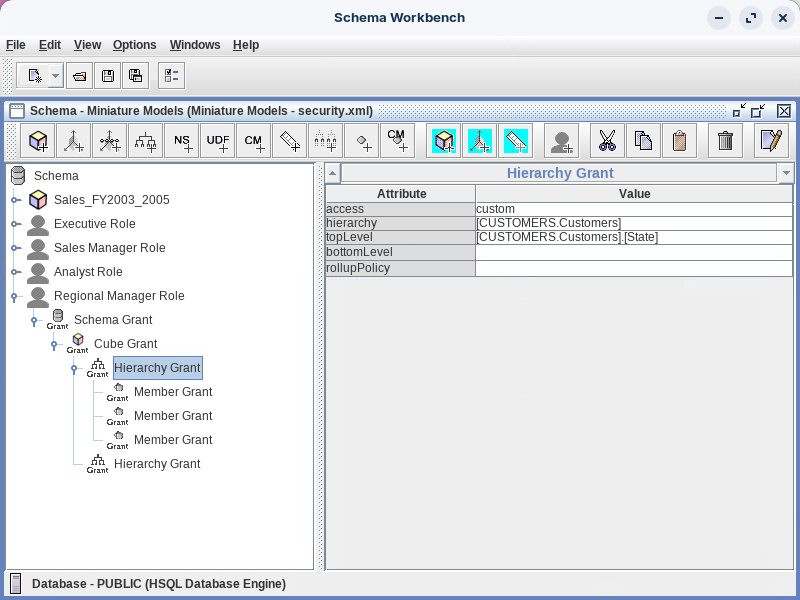
<figcaption>topLevel on [CUSTOMERS.Customers]</figcaption>
</figure>
</div>

5. For each state, right-click the **Hierarchy Grant**, select **Add Member Grant**, and set **access** to `all` and **member** to the state's member:

| access | member |
| --- | --- |
| all | `[CUSTOMERS.Customers].[NA].[USA].[NJ]` |
| all | `[CUSTOMERS.Customers].[NA].[USA].[NY]` |
| all | `[CUSTOMERS.Customers].[NA].[USA].[PA]` |

<div align="center">
<figure>
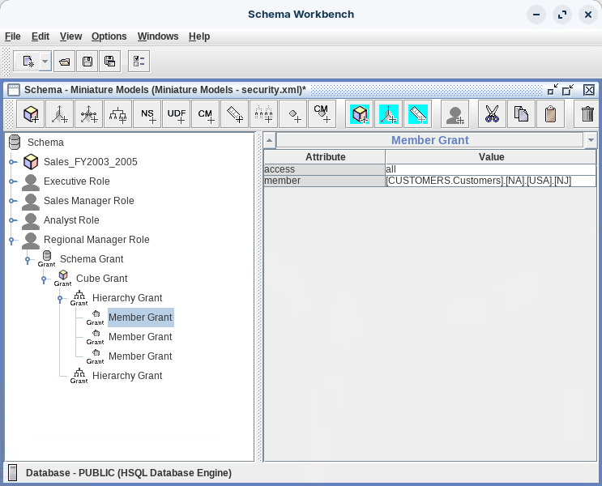
<figcaption>Member Grant [CUSTOMERS.Customers].[NA].[USA].[NJ]</figcaption>
</figure>
</div>

6. Right-click the **Cube Grant**, select **Add Hierarchy Grant**, and set **access** to `all` and **hierarchy** to `[PRODUCTS.Products]`.

<div align="center">
<figure>
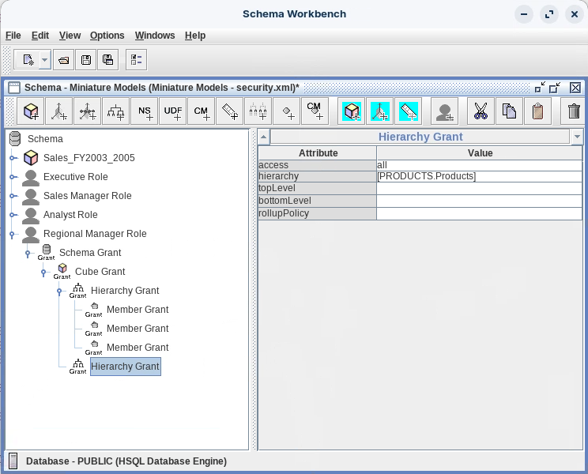
<figcaption>Hierarchy Grant on [PRODUCTS.Products]</figcaption>
</figure>
</div>

The role in the XML:

```xml
<Role name="Regional Manager Role">
    <SchemaGrant access="none">
        <CubeGrant cube="Sales_FY2003_2005" access="all">
            <HierarchyGrant hierarchy="[CUSTOMERS.Customers]" access="custom" topLevel="[CUSTOMERS.Customers].[State]">
                <!-- Only grant access to specific states - do NOT grant to NA or USA -->
                <MemberGrant member="[CUSTOMERS.Customers].[NA].[USA].[NJ]" access="all">
                </MemberGrant>
                <MemberGrant member="[CUSTOMERS.Customers].[NA].[USA].[NY]" access="all">
                </MemberGrant>
                <MemberGrant member="[CUSTOMERS.Customers].[NA].[USA].[PA]" access="all">
                </MemberGrant>
            </HierarchyGrant>
            <HierarchyGrant hierarchy="[PRODUCTS.Products]" access="all">
            </HierarchyGrant>
        </CubeGrant>
    </SchemaGrant>
</Role>
```

> **Note:** With `access="custom"`, Mondrian denies every member by default and allows only what you grant. Granting NJ, NY and PA makes them the only states the role sees.

7. Save and publish the schema. In the User Console, signed in as `admin`, select **Tools > Refresh > Mondrian Schema Cache**.

<div align="center">
<figure>

<figcaption>Refresh the Mondrian schema cache</figcaption>
</figure>
</div>

8. Sign in as `region_mgr`, select **Create New > Analysis Report**, select **Miniature Models: Sales_FY2003_2005**, and select **OK**.
9. Drag **Sales** to the **Measures** drop zone, and **State**, then **Line**, to the **Rows** drop zone.

<div align="center">
<figure>
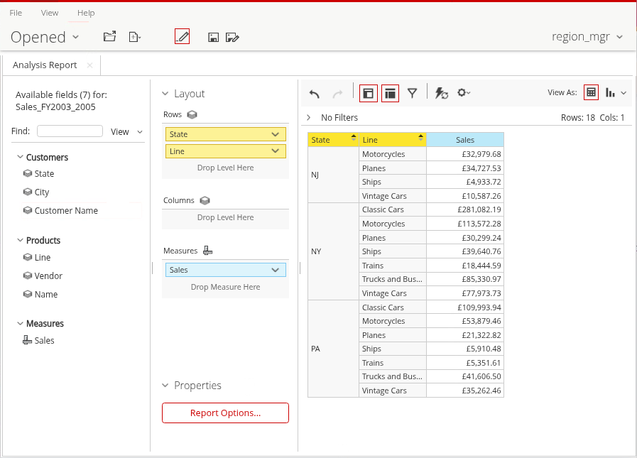
<figcaption>What region_mgr can see</figcaption>
</figure>
</div>

> **Success:** Checkpoint: 18 rows, for NJ, NY and PA only: 4 product lines in NJ and 7 in each of the others. The first is NJ, Motorcycles, £32,979.68.

10. Close the report without saving it.

> **Under the hood:**
>
> #### MemberGrants make custom an allow-list, but not for totals
>
> Once a custom grant has MemberGrants, a member is allowed only if it
> or one of its ancestors is granted. region_mgr sees NJ (83,228.19), NY
> (646,343.76) and PA (273,327.27), with their cities and customers, and
> nothing else.
>
> The hidden members still count, though. With no rollupPolicy the
> policy is full, so a report of Sales with no Customers hierarchy on it
> shows region_mgr 10,645,949.18, the whole company. With
> `rollupPolicy="partial"` on this HierarchyGrant the same report shows
> 1,002,899.22, the three states (see the next tab).
>
> **Why it matters:** hiding members and hiding their share of the
> totals are separate decisions.

### 5. Rollup Policies

> **Note:**
>
> #### Rollup Policies
>
> A rollup policy decides how measures aggregate when a role can't see some members of a hierarchy: should the totals above them include the hidden data or not? Set it in the HierarchyGrant's **rollupPolicy** attribute.

| Policy | Behavior |
| --- | --- |
| full | The default when a HierarchyGrant has no rollupPolicy. Shows the complete total including hidden members. Users see true totals, and can work out what the hidden members add up to by subtracting the visible ones. |
| partial | Shows the total of the visible members only. Users see accurate subtotals for the data they may see. Useful when users should see only their scope. |
| hidden | Hides a total completely if any of its children is hidden. The most restrictive option: no hidden data can be inferred. |

| Role Type | Recommended Policy | Reason |
| --- | --- | --- |
| Executive / VP | full | Needs the complete picture, with restricted drill-down |
| Regional Manager | partial | Should see only the region's totals |
| Contributor | partial or hidden | Limited scope, no need for aggregates |
| Analyst (restricted data) | full | Needs the context of the full data while working with a subset |

The aggregation follows the access restrictions. If the Regional Manager needs complete totals but limited drill-down, use a top-down grant with denials:

```xml
<HierarchyGrant hierarchy="[CUSTOMERS.Customers]"
              rollupPolicy="full"
              access="custom">
    <MemberGrant member="[CUSTOMERS.Customers].[NA].[USA]" access="all"/>
    <!-- Then deny all states -->
    <MemberGrant member="[CUSTOMERS.Customers].[NA].[USA].[CA]" access="none"/>
    <MemberGrant member="[CUSTOMERS.Customers].[NA].[USA].[CT]" access="none"/>
    <!-- ... deny all others ... -->
    <!-- Then grant access to the 3 states -->
    <MemberGrant member="[CUSTOMERS.Customers].[NA].[USA].[NJ]" access="all"/>
    <MemberGrant member="[CUSTOMERS.Customers].[NA].[USA].[NY]" access="all"/>
    <MemberGrant member="[CUSTOMERS.Customers].[NA].[USA].[PA]" access="all"/>
</HierarchyGrant>
```

> **Under the hood:**
>
> #### What each policy did with the same grant
>
> Grant NJ, NY and PA with no topLevel, so their ancestors stay visible,
> and the policy decides what those ancestors show. full, or no policy
> at all: All Customers 10,645,949.18, NA 3,852,061.39, USA
> 3,627,982.83. partial: All Customers, NA and USA each 1,002,899.22.
> hidden: all three empty.
>
> **Why it matters:** full is the one to think about. USA minus the three
> visible states is 2,625,083.61, so a user with full totals can work
> out exactly what the states they can't see add up to.

::::

## Lab Files

Click a file to download. For `.ktr` and `.kjb` files, **Open in Pentaho Data Integration** launches PDI with the file loaded. If PDI is already running, the path is copied to your clipboard — switch to PDI and press `Ctrl+O`, `Ctrl+V`, `Enter`.

The Miniature Models schema from [Standard Model](../06-schemas-standard-model/guide.md), the starting point for this workshop:

[miniaturemodels-original.xml](./files/miniaturemodels-original.xml)

### Solution <!-- no-step -->

The secured schema with all four roles. Open it in Schema Workbench (**File > Open**) alongside your own to compare:

[miniaturemodels-security.xml](./files/miniaturemodels-security.xml)

For comparison, a Classic Models schema with two roles, Administrator and Power User:

[classicmodels-security.xml](./files/classicmodels-security.xml)
