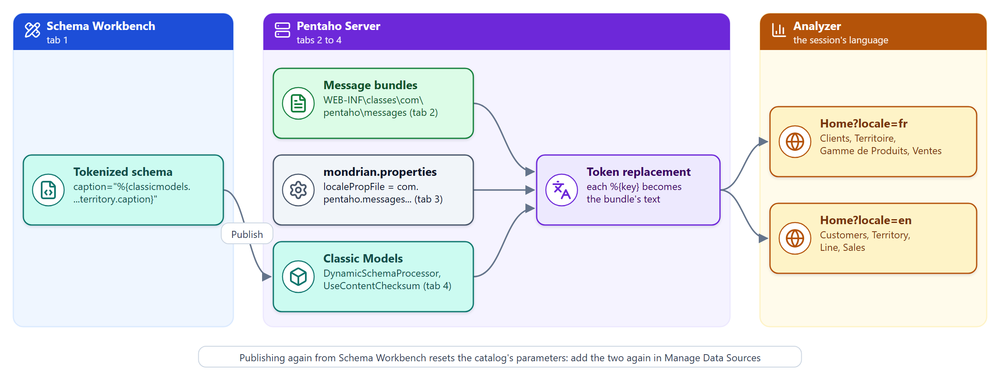
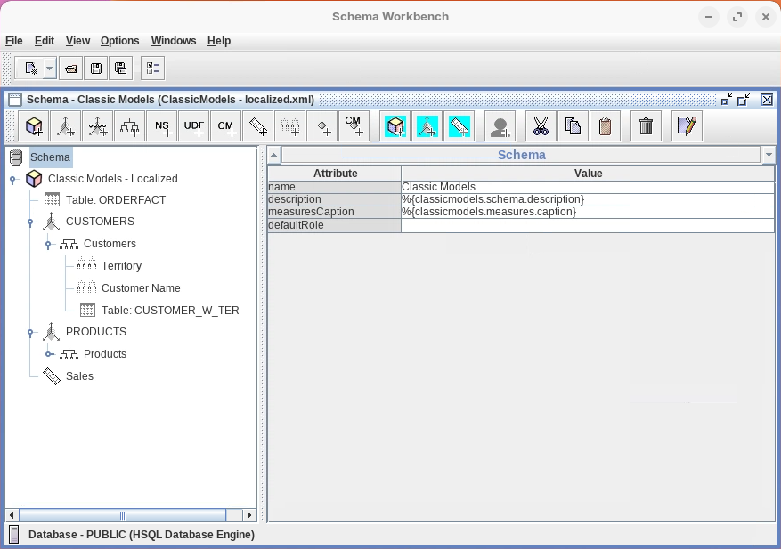
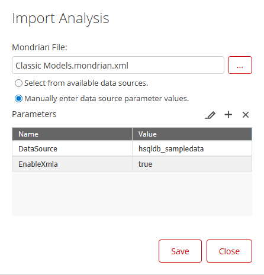
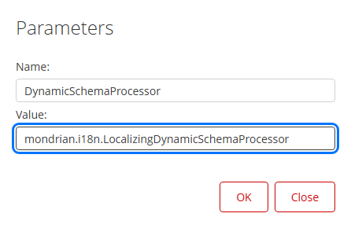
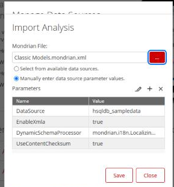

# FR Localization

> **Warning:**
>
> #### Workshop - FR Localization
>
> One schema can serve users in several languages. In this workshop you replace the Classic Models schema's captions and descriptions with tokens, deploy English and French message bundles on the Pentaho Server, and configure Mondrian's dynamic schema processor to swap each token for the text of the user's language.
>
> **What you'll do**
>
> * Replace the captions and descriptions of the Classic Models schema with `%{...}` tokens
> * Deploy the English and French message bundles on the Pentaho Server
> * Point Mondrian at the bundles with `mondrian.rolap.localePropFile` in `mondrian.properties`
> * Add the DynamicSchemaProcessor and UseContentChecksum parameters to the published data source
> * See the same cube in French and in English in Analyzer
>
> **Prerequisites:** Complete [Basic Model](../05-schemas-basic-model/guide.md); the Pentaho Server running, with administrator access to the User Console and to the server's files
>
> **Estimated time:** 60 minutes

<figure>

<figcaption class="pcm-video-caption">Walkthrough: coming soon</figcaption>

</figure>

One schema, four pieces. Three are files and stay where you put them; the fourth, the processor parameters, belongs to the published catalog:

<div align="center">
<figure>

<figcaption>Where each piece lives</figcaption>
</figure>
</div>

Read the diagram from left to right, tab by tab. Tab 1 replaces the schema's captions with `%{...}` tokens, and publishing puts it on the server as the Classic Models catalog. Tabs 2 to 4 add the three things token replacement needs: the message bundles, the `localePropFile` setting in `mondrian.properties` that points Mondrian at them, and the catalog's DynamicSchemaProcessor and UseContentChecksum parameters. Analyzer then shows each token as the text of the session's language: French at `Home?locale=fr`, English at `Home?locale=en`. The note at the foot is the trap tab 4 explains: the parameters belong to the catalog, so publishing again from Schema Workbench removes them.

:::: tabs

### 1. Tokenized Schema

> **Note:**
>
> #### Tokenized Schema
>
> Each caption and description in the schema becomes a token, `%{key}`. At run time Mondrian replaces every token with the text the message bundle of the user's language holds for that key. This tab tokenizes the Classic Models schema from Basic Model: the `ClassicModelsOrders` cube, the CUSTOMERS dimension (Territory, Customer Name), the PRODUCTS dimension (Product Line, Vendor) and the Sales measure.

The tokenized Classic Models schema:

```xml
<?xml version="1.0" encoding="UTF-8"?>
<Schema name="Classic Models"
        description="%{classicmodels.schema.description}"
        measuresCaption="%{classicmodels.measures.caption}">

  <Cube name="ClassicModelsOrders"
        caption="%{classicmodels.cube.orders.caption}"
        description="%{classicmodels.cube.orders.description}"
        visible="true"
        cache="true"
        enabled="true">

    <Table name="ORDERFACT" schema="PUBLIC">
    </Table>

    <Dimension type="StandardDimension"
               visible="true"
               foreignKey="CUSTOMERNUMBER"
               highCardinality="false"
               name="CUSTOMERS"
               caption="%{classicmodels.dimension.customers.caption}"
               description="%{classicmodels.dimension.customers.description}">

      <Hierarchy name="Customers"
                 caption="%{classicmodels.hierarchy.customers.caption}"
                 description="%{classicmodels.hierarchy.customers.description}"
                 visible="true"
                 hasAll="true"
                 allMemberName="All Customers"
                 allMemberCaption="%{classicmodels.dimension.customers.allmember.caption}"
                 primaryKey="CUSTOMERNUMBER">

        <Table name="CUSTOMER_W_TER" schema="PUBLIC">
        </Table>

        <Level name="Territory"
               caption="%{classicmodels.dimension.customers.territory.caption}"
               description="%{classicmodels.dimension.customers.territory.description}"
               visible="true"
               column="TERRITORY"
               type="String"
               uniqueMembers="true"
               levelType="Regular"
               hideMemberIf="Never">
        </Level>

        <Level name="Customer Name"
               caption="%{classicmodels.dimension.customers.customername.caption}"
               description="%{classicmodels.dimension.customers.customername.description}"
               visible="true"
               column="CUSTOMERNAME"
               type="String"
               uniqueMembers="false"
               levelType="Regular"
               hideMemberIf="Never">
        </Level>
      </Hierarchy>
    </Dimension>

    <Dimension type="StandardDimension"
               visible="true"
               foreignKey="PRODUCTCODE"
               highCardinality="false"
               name="PRODUCTS"
               caption="%{classicmodels.dimension.products.caption}"
               description="%{classicmodels.dimension.products.description}">

      <Hierarchy name="Products"
                 caption="%{classicmodels.hierarchy.products.caption}"
                 description="%{classicmodels.hierarchy.products.description}"
                 visible="true"
                 hasAll="true"
                 allMemberName="All Products"
                 allMemberCaption="%{classicmodels.dimension.products.allmember.caption}"
                 primaryKey="PRODUCTCODE">

        <Table name="PRODUCTS" schema="PUBLIC">
        </Table>

        <Level name="Product Line"
               caption="%{classicmodels.dimension.products.line.caption}"
               description="%{classicmodels.dimension.products.line.description}"
               visible="true"
               column="PRODUCTLINE"
               type="String"
               uniqueMembers="true"
               levelType="Regular"
               hideMemberIf="Never">
        </Level>

        <Level name="Vendor"
               caption="%{classicmodels.dimension.products.vendor.caption}"
               description="%{classicmodels.dimension.products.vendor.description}"
               visible="true"
               column="PRODUCTVENDOR"
               type="String"
               uniqueMembers="false"
               levelType="Regular"
               hideMemberIf="Never">
        </Level>
      </Hierarchy>
    </Dimension>

    <Measure name="Sales"
             caption="%{classicmodels.measures.sales.caption}"
             description="%{classicmodels.measures.sales.description}"
             column="TOTALPRICE"
             datatype="Numeric"
             formatString="$#,###.00"
             aggregator="sum"
             visible="true">
    </Measure>
  </Cube>
</Schema>
```

Every token follows the pattern `%{classicmodels.[component].[element].[property]}`, where:

* **component** = schema, cube, dimension, hierarchy, or measures
* **element** = the specific name (customers, products, territory, and so on)
* **property** = caption or description

| Schema Element | Attribute | Token |
| --- | --- | --- |
| Schema | description | `%{classicmodels.schema.description}` |
| Schema | measuresCaption | `%{classicmodels.measures.caption}` |
| Cube: ClassicModelsOrders | caption | `%{classicmodels.cube.orders.caption}` |
| Cube: ClassicModelsOrders | description | `%{classicmodels.cube.orders.description}` |
| Dimension: CUSTOMERS | caption | `%{classicmodels.dimension.customers.caption}` |
| Dimension: CUSTOMERS | description | `%{classicmodels.dimension.customers.description}` |
| Hierarchy: Customers | allMemberCaption | `%{classicmodels.dimension.customers.allmember.caption}` |
| Hierarchy: Customers | caption | `%{classicmodels.hierarchy.customers.caption}` |
| Hierarchy: Customers | description | `%{classicmodels.hierarchy.customers.description}` |
| Level: Territory | caption | `%{classicmodels.dimension.customers.territory.caption}` |
| Level: Territory | description | `%{classicmodels.dimension.customers.territory.description}` |
| Level: Customer Name | caption | `%{classicmodels.dimension.customers.customername.caption}` |
| Level: Customer Name | description | `%{classicmodels.dimension.customers.customername.description}` |
| Dimension: PRODUCTS | caption | `%{classicmodels.dimension.products.caption}` |
| Dimension: PRODUCTS | description | `%{classicmodels.dimension.products.description}` |
| Hierarchy: Products | allMemberCaption | `%{classicmodels.dimension.products.allmember.caption}` |
| Hierarchy: Products | caption | `%{classicmodels.hierarchy.products.caption}` |
| Hierarchy: Products | description | `%{classicmodels.hierarchy.products.description}` |
| Level: Product Line | caption | `%{classicmodels.dimension.products.line.caption}` |
| Level: Product Line | description | `%{classicmodels.dimension.products.line.description}` |
| Level: Vendor | caption | `%{classicmodels.dimension.products.vendor.caption}` |
| Level: Vendor | description | `%{classicmodels.dimension.products.vendor.description}` |
| Measure: Sales | caption | `%{classicmodels.measures.sales.caption}` |
| Measure: Sales | description | `%{classicmodels.measures.sales.description}` |

1. Start Schema Workbench with the **Start Pentaho Schema Workbench** button below, or from PowerShell:

```powershell
Set-Location C:\Pentaho\design-tools\schema-workbench
.\workbench.bat
```

<button data-launch="schema-workbench">Start Pentaho Schema Workbench</button>

2. Make sure the Pentaho Server is running: it hosts the SampleData database on port `9001`. On a lab VM it starts with the machine. On your own machine, start it as [Before You Start](../00-before-you-start/guide.md) describes (its repository database first), and wait until **http://localhost:8080/pentaho** shows the sign-in page:

```powershell
C:\Pentaho\server\pentaho-server\start-pentaho.bat
```

3. Select **File > Open** and open `ClassicModels.xml`, your schema from [Basic Model](../05-schemas-basic-model/guide.md), in `C:\Workshop-SW-Associate\03-schemas\05-schemas-basic-model`.
4. Select **File > Save As** and save it as `ClassicModels-localized.xml` in `C:\Workshop-SW-Associate\07-localization\16-localization-fr-localization`.
5. For each row of the token table, select the element in the left pane, set the attribute to the token, and press `Tab`. The XML above shows every token in place.

<div align="center">
<figure>

<figcaption>Tokens on the Schema element</figcaption>
</figure>
</div>

6. Select **File > Save**.

> **Success:** Checkpoint: select **View > View XML**: the schema holds the 24 tokens of the table, as in the XML above. Select **View > View XML** again to hide it.

7. Select **File > Publish**, with the **Publish Schema** values from [Basic Model](../05-schemas-basic-model/guide.md) (data source `hsqldb_sampledata`), and select **Publish**. The schema is still called Classic Models, so it replaces the catalog you published in Basic Model: when Schema Workbench asks whether to overwrite it, select **Yes**.

> **Success:** Checkpoint: a **Publish** message reads `Publish Successful`.

8. Select **OK**.

> **Under the hood:**
>
> #### Tokens are replaced in the XML text before Mondrian parses it
>
> The DynamicSchemaProcessor,
> `mondrian.i18n.LocalizingDynamicSchemaProcessor`, works on the raw
> schema text. It finds every `%{...}`, looks the key up in the message
> bundle for the connection's locale and substitutes the translation;
> only then is the result parsed as an ordinary schema. In French this
> schema's 24 tokens become Clients, Territoire, Gamme de Produits,
> Ventes and the rest.
>
> Until tab 4 nothing runs that processor, so a report on the catalog
> you just published shows the tokens themselves:
> `%{classicmodels.dimension.customers.territory.caption}` as a field
> name. A key a bundle lacks does the same: the token is left where it
> was.
>
> **Why it matters:** every token must match a key in the properties
> files character for character.

### 2. Properties

> **Note:**
>
> #### MondrianMessages_[locale].properties
>
> The message bundles are Java properties files, one per language, named `MondrianMessages_` plus the language code. They go on the web application's classpath, in a `com\pentaho\messages` folder under `WEB-INF\classes`, which doesn't exist until you create it.

1. Create the folder:

```powershell
New-Item -ItemType Directory -Force C:\Pentaho\server\pentaho-server\tomcat\webapps\pentaho\WEB-INF\classes\com\pentaho\messages
```

2. Copy the two bundles into it from this workshop's folder (they are also under **Lab Files** below):

```powershell
Copy-Item C:\Workshop-SW-Associate\07-localization\16-localization-fr-localization\MondrianMessages_*.properties C:\Pentaho\server\pentaho-server\tomcat\webapps\pentaho\WEB-INF\classes\com\pentaho\messages\
```

3. List the folder:

```powershell
Get-ChildItem C:\Pentaho\server\pentaho-server\tomcat\webapps\pentaho\WEB-INF\classes\com\pentaho\messages
```

> **Success:** Checkpoint: the folder holds `MondrianMessages_en.properties` and `MondrianMessages_fr.properties`, 25 keys each.

### 3. mondrian.properties

> **Note:**
>
> #### Configure mondrian.properties
>
> One property tells Mondrian where the message bundles are: `mondrian.rolap.localePropFile`, set in the server's `mondrian.properties`. The server reads that file when it starts.

1. Keep a copy of the server's `mondrian.properties`, then open it in Notepad:

```powershell
$f = 'C:\Pentaho\server\pentaho-server\pentaho-solutions\system\mondrian\mondrian.properties'
Copy-Item $f "$f.before-localization-lab"
notepad $f
```

2. Add this line at the end of the file. It names the bundle without its language suffix.

```properties
mondrian.rolap.localePropFile=com.pentaho.messages.MondrianMessages
```

> **Under the hood:**
>
> #### localePropFile is a Java resource-bundle name
>
> Mondrian passes `com.pentaho.messages.MondrianMessages` to Java's
> `ResourceBundle.getBundle` with the connection's `Locale` property.
> In the User Console that is the language of your session. Java then
> looks for `com/pentaho/messages/MondrianMessages_fr.properties` on the
> web application's classpath, which includes `WEB-INF/classes` (hence
> the folders), and falls back to a less specific file when there is no
> exact match.
>
> **Why it matters:** on Java 9 and later, properties files are read as
> UTF-8, so the accents in the French file arrive intact.

3. Save the file and close Notepad.
4. Restart the Pentaho Server: stop it, wait until **http://localhost:8080/pentaho** no longer answers, and start it again.

```powershell
C:\Pentaho\server\pentaho-server\stop-pentaho.bat
C:\Pentaho\server\pentaho-server\start-pentaho.bat
```

> **Success:** Checkpoint: **http://localhost:8080/pentaho** shows the sign-in page again. The server takes a few minutes to start.

### 4. Manage Data Source

> **Note:**
>
> #### The data source's parameters
>
> Publishing from Schema Workbench stores three parameters with the catalog: `Provider`, `DataSource` and `EnableXmla`. Two more make the localization work, and you add them in the User Console:
>
> * **DynamicSchemaProcessor** names a class implementing `mondrian.spi.DynamicSchemaProcessor`, which filters the schema text before Mondrian's core reads it. Mondrian's own, `mondrian.i18n.LocalizingDynamicSchemaProcessor`, replaces the tokens with values from the message bundles.
> * **UseContentChecksum** makes Mondrian find a cached schema by an MD5 checksum of the processed schema text, so connections that produce the same text share one cached schema. Mondrian runs the schema processor on every connection request either way; see [Overview of Localization](../15-localization/guide.md) for how the cache keeps one schema per language.

<button data-launch="puc">Open Pentaho User Console</button>

1. Sign in to the User Console as `admin`, and on the **Home** perspective select **Manage Data Sources**.
2. Select the **Classic Models** analysis data source, open the gear menu, and select **Edit...**.
3. In **Import Analysis**, select **Manually enter data source parameter values.** The **Parameters** list shows `DataSource` (`hsqldb_sampledata`) and `EnableXmla` (`true`).

<div align="center">
<figure>

<figcaption>The parameters before you add any</figcaption>
</figure>
</div>

> **Warning:** Don't save with **Select from available data sources.** selected: its list starts at the first connection in alphabetical order, not `hsqldb_sampledata`, and saving would point the catalog at that connection.

4. Select **+** (Add). In **Parameters**, set **Name** to `DynamicSchemaProcessor` and **Value** to `mondrian.i18n.LocalizingDynamicSchemaProcessor`, and select **OK**.

<div align="center">
<figure>

<figcaption>The DynamicSchemaProcessor parameter</figcaption>
</figure>
</div>

5. Select **+** again, set **Name** to `UseContentChecksum` and **Value** to `true`, and select **OK**.

> **Success:** Checkpoint: the **Parameters** list holds four rows: `DataSource`, `EnableXmla`, `DynamicSchemaProcessor` and `UseContentChecksum`.

<div align="center">
<figure>

<figcaption>The four parameters in Import Analysis</figcaption>
</figure>
</div>

6. Select **Save**, then **Close**.
7. Select **Tools > Refresh > Mondrian Schema Cache**, and **OK** on the message `Mondrian schema cache flushed successfully.`

> **Under the hood:**
>
> #### One cached schema per language
>
> Mondrian caches each processed schema. A language you opened before
> the parameters were in place keeps the schema it built then, tokens
> and all, until the cache is flushed; flushing makes the next request
> in each language run the processor again.
>
> The parameters belong to the published catalog, not to the schema
> file. Publish from Schema Workbench again and the catalog gets
> `Provider`, `DataSource` and `EnableXmla` back without the other two:
> the captions turn back into tokens until you repeat steps 2 to 7.
>
> **Why it matters:** the same three settings (bundles, localePropFile,
> processor) must all be in place, and only the third lives in the
> catalog that every publish replaces.

8. Open the User Console in French, at `http://localhost:8080/pentaho/Home?locale=fr`. The console's own labels switch to French.
9. Select `Créer nouveau` > `Rapport d'analyse` (Create New > Analysis Report). The list of data sources shows **Classic Models: Commandes Classic Models**; select it and select **OK**.

> **Success:** Checkpoint: the field list reads **Commandes Classic Models**, with **Clients** (Territoire, Nom du Client), **Mesures** (Ventes) and **Produits** (Gamme de Produits, Vendeur), the captions from `MondrianMessages_fr.properties`.

10. Open `http://localhost:8080/pentaho/Home?locale=en` and create an Analysis Report on the same data source.

> **Success:** Checkpoint: the same cube in English: **Classic Models Orders**, with Customers (Territory, Customer Name), Sales, and Products (Line, Vendor).

11. Close both reports without saving them.

> **Under the hood:**
>
> #### The session's language picks the bundle
>
> `?locale=fr` on the Home page sets the language of your User Console
> session. Each connection Analyzer opens passes that language to
> Mondrian as its `Locale`, so the French session reads
> `MondrianMessages_fr.properties` and the English one
> `MondrianMessages_en.properties`, from one published schema.
>
> **Why it matters:** a user's browser or account language decides the
> captions. Nobody maintains a French copy of the schema.

::::

## Lab Files

Click a file to download. Every file is also on disk in this workshop's folder, `C:\Workshop-SW-Associate\07-localization\16-localization-fr-localization`.

The English and French message bundles you deploy in tab 2:

[MondrianMessages_en.properties](./files/MondrianMessages_en.properties)

[MondrianMessages_fr.properties](./files/MondrianMessages_fr.properties)

### Solution <!-- no-step -->

The tokenized Classic Models schema. Open it in Schema Workbench (**File > Open**) alongside your own to compare, or publish it in place of your own.

Also on disk at `C:\Workshop-SW-Associate\07-localization\16-localization-fr-localization\solution`.

[classicmodels-localized.xml](./files/solution/classicmodels-localized.xml)
