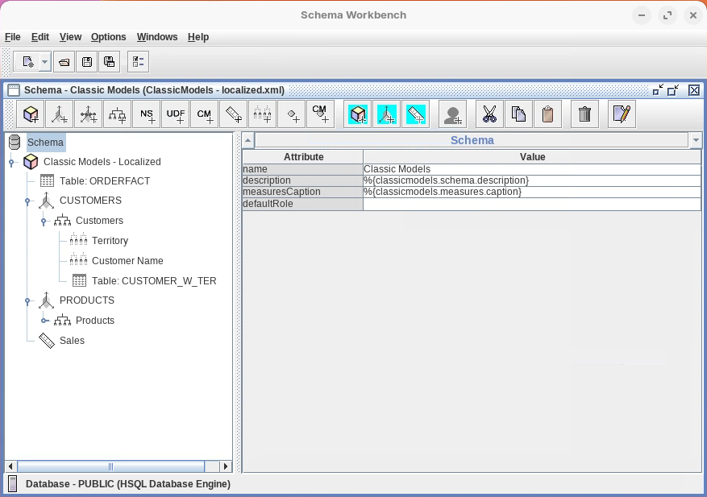

# FR Localization

> **Warning:**
>
> #### Workshop - FR Localization
>
> One schema can serve users in several languages. In this workshop you replace the Classic Models schema's captions and descriptions with tokens, deploy English and French message bundles on the Pentaho Server, and configure Mondrian's dynamic schema processor to swap each token for the text of the user's language.
>
> **What you'll do**
>
> * Replace the captions and descriptions of the Classic Models schema with `%{...}` tokens
> * Deploy the English and French message bundles on the Pentaho Server
> * Point Mondrian at the bundles with `mondrian.rolap.localePropFile` in `mondrian.properties`
> * Check the data source's DynamicSchemaProcessor and UseContentChecksum settings
> * Test the translated captions in Analyzer
>
> **Prerequisites:** Complete [Basic Model](../05-schemas-basic-model/guide.md); the Pentaho Server running, with administrator access to the User Console and to the server's files
>
> **Estimated time:** 60 minutes

:::: tabs

### 1. Tokenized Schema

> **Note:**
>
> #### Tokenized Schema
>
> Each caption and description in the schema becomes a token, `%{key}`. At run time Mondrian replaces every token with the text the message bundle of the user's language holds for that key. This tab tokenizes the Classic Models schema from Basic Model: the `ClassicModelsOrders` cube, the CUSTOMERS dimension (Territory, Customer Name), the PRODUCTS dimension (Product Line, Vendor) and the Sales measure.

The tokenized Classic Models schema:

```xml
<?xml version="1.0" encoding="UTF-8"?>
<Schema name="Classic Models"
        description="%{classicmodels.schema.description}"
        measuresCaption="%{classicmodels.measures.caption}">

  <Cube name="ClassicModelsOrders"
        caption="%{classicmodels.cube.orders.caption}"
        description="%{classicmodels.cube.orders.description}"
        visible="true"
        cache="true"
        enabled="true">

    <Table name="ORDERFACT" schema="PUBLIC">
    </Table>

    <Dimension type="StandardDimension"
               visible="true"
               foreignKey="CUSTOMERNUMBER"
               highCardinality="false"
               name="CUSTOMERS"
               caption="%{classicmodels.dimension.customers.caption}"
               description="%{classicmodels.dimension.customers.description}">

      <Hierarchy name="Customers"
                 caption="%{classicmodels.hierarchy.customers.caption}"
                 description="%{classicmodels.hierarchy.customers.description}"
                 visible="true"
                 hasAll="true"
                 allMemberName="All Customers"
                 allMemberCaption="%{classicmodels.dimension.customers.allmember.caption}"
                 primaryKey="CUSTOMERNUMBER">

        <Table name="CUSTOMER_W_TER" schema="PUBLIC">
        </Table>

        <Level name="Territory"
               caption="%{classicmodels.dimension.customers.territory.caption}"
               description="%{classicmodels.dimension.customers.territory.description}"
               visible="true"
               column="TERRITORY"
               type="String"
               uniqueMembers="true"
               levelType="Regular"
               hideMemberIf="Never">
        </Level>

        <Level name="Customer Name"
               caption="%{classicmodels.dimension.customers.customername.caption}"
               description="%{classicmodels.dimension.customers.customername.description}"
               visible="true"
               column="CUSTOMERNAME"
               type="String"
               uniqueMembers="false"
               levelType="Regular"
               hideMemberIf="Never">
        </Level>
      </Hierarchy>
    </Dimension>

    <Dimension type="StandardDimension"
               visible="true"
               foreignKey="PRODUCTCODE"
               highCardinality="false"
               name="PRODUCTS"
               caption="%{classicmodels.dimension.products.caption}"
               description="%{classicmodels.dimension.products.description}">

      <Hierarchy name="Products"
                 caption="%{classicmodels.hierarchy.products.caption}"
                 description="%{classicmodels.hierarchy.products.description}"
                 visible="true"
                 hasAll="true"
                 allMemberName="All Products"
                 allMemberCaption="%{classicmodels.dimension.products.allmember.caption}"
                 primaryKey="PRODUCTCODE">

        <Table name="PRODUCTS" schema="PUBLIC">
        </Table>

        <Level name="Product Line"
               caption="%{classicmodels.dimension.products.line.caption}"
               description="%{classicmodels.dimension.products.line.description}"
               visible="true"
               column="PRODUCTLINE"
               type="String"
               uniqueMembers="true"
               levelType="Regular"
               hideMemberIf="Never">
        </Level>

        <Level name="Vendor"
               caption="%{classicmodels.dimension.products.vendor.caption}"
               description="%{classicmodels.dimension.products.vendor.description}"
               visible="true"
               column="PRODUCTVENDOR"
               type="String"
               uniqueMembers="false"
               levelType="Regular"
               hideMemberIf="Never">
        </Level>
      </Hierarchy>
    </Dimension>

    <Measure name="Sales"
             caption="%{classicmodels.measures.sales.caption}"
             description="%{classicmodels.measures.sales.description}"
             column="TOTALPRICE"
             datatype="Numeric"
             formatString="$#,###.00"
             aggregator="sum"
             visible="true">
    </Measure>
  </Cube>
</Schema>
```

Every token follows the pattern `%{classicmodels.[component].[element].[property]}`, where:

* **component** = schema, cube, dimension, hierarchy, or measures
* **element** = the specific name (customers, products, territory, and so on)
* **property** = caption or description

| Schema Element | Attribute | Token |
| --- | --- | --- |
| Schema | description | `%{classicmodels.schema.description}` |
| Schema | measuresCaption | `%{classicmodels.measures.caption}` |
| Cube: ClassicModelsOrders | caption | `%{classicmodels.cube.orders.caption}` |
| Cube: ClassicModelsOrders | description | `%{classicmodels.cube.orders.description}` |
| Dimension: CUSTOMERS | caption | `%{classicmodels.dimension.customers.caption}` |
| Dimension: CUSTOMERS | description | `%{classicmodels.dimension.customers.description}` |
| Hierarchy: Customers | allMemberCaption | `%{classicmodels.dimension.customers.allmember.caption}` |
| Hierarchy: Customers | caption | `%{classicmodels.hierarchy.customers.caption}` |
| Hierarchy: Customers | description | `%{classicmodels.hierarchy.customers.description}` |
| Level: Territory | caption | `%{classicmodels.dimension.customers.territory.caption}` |
| Level: Territory | description | `%{classicmodels.dimension.customers.territory.description}` |
| Level: Customer Name | caption | `%{classicmodels.dimension.customers.customername.caption}` |
| Level: Customer Name | description | `%{classicmodels.dimension.customers.customername.description}` |
| Dimension: PRODUCTS | caption | `%{classicmodels.dimension.products.caption}` |
| Dimension: PRODUCTS | description | `%{classicmodels.dimension.products.description}` |
| Hierarchy: Products | allMemberCaption | `%{classicmodels.dimension.products.allmember.caption}` |
| Hierarchy: Products | caption | `%{classicmodels.hierarchy.products.caption}` |
| Hierarchy: Products | description | `%{classicmodels.hierarchy.products.description}` |
| Level: Product Line | caption | `%{classicmodels.dimension.products.line.caption}` |
| Level: Product Line | description | `%{classicmodels.dimension.products.line.description}` |
| Level: Vendor | caption | `%{classicmodels.dimension.products.vendor.caption}` |
| Level: Vendor | description | `%{classicmodels.dimension.products.vendor.description}` |
| Measure: Sales | caption | `%{classicmodels.measures.sales.caption}` |
| Measure: Sales | description | `%{classicmodels.measures.sales.description}` |

1. Start Schema Workbench with the **Start Schema Workbench** button below, or from a terminal:

::: tabs

### Windows (PowerShell)

```powershell
Set-Location C:\Pentaho\design-tools\schema-workbench
.\workbench.bat
```

### macOS / Linux

```bash
cd ~/Pentaho/design-tools/schema-workbench
./workbench.sh
```

:::

<button data-launch="schema-workbench">Start Schema Workbench</button>

2. Make sure the Pentaho Server is running. On a lab VM it starts with the machine. On your own machine, start it and wait until **http://localhost:8080/pentaho** shows the sign-in page:

::: tabs

### Windows (PowerShell)

```powershell
C:\Pentaho\server\pentaho-server\start-pentaho.bat
```

### macOS / Linux

```bash
cd ~/Pentaho/server/pentaho-server
./start-pentaho.sh
```

:::

3. Select **File > Open** and open `ClassicModels.xml`, your schema from [Basic Model](../05-schemas-basic-model/guide.md).
4. Select **File > Save As** and save it as `ClassicModels-localized.xml`.
5. For each row of the token table, select the element in the left pane, set the attribute to the token, and press `Tab`.

<div align="center">
<figure>

<figcaption>Tokens on the Schema element</figcaption>
</figure>
</div>

6. Select **File > Save**.

> **Success:** Checkpoint: select **View > View XML**: the schema holds the 24 tokens of the table, as in the XML above. Select **View > View XML** again to hide it.

7. Select **File > Publish**, with the **Publish Schema** values from [Basic Model](../05-schemas-basic-model/guide.md), and select **Publish**. If Schema Workbench asks whether to overwrite the Classic Models schema, select **Yes**.

> **Success:** Checkpoint: a **Publish** message reads `Publish Successful`.

8. Select **OK**.

> **Under the hood:**
>
> #### Tokens are replaced in the XML text before Mondrian parses it
>
> The DynamicSchemaProcessor,
> `mondrian.i18n.LocalizingDynamicSchemaProcessor`, works on the raw
> schema text. It finds every `%{...}`, looks the key up in the message
> bundle for the connection's locale and substitutes the translation;
> only then is the result parsed as an ordinary schema. In French this
> schema's 24 tokens become CLIENTS, Territoire, Gamme de Produits,
> Ventes and the rest.
>
> A key the bundle lacks is logged (`Missing resource for key [...]`)
> and its token is left where it was, so it becomes the caption: users
> would see `%{classicmodels.dimension.customers.caption}` as the
> dimension's name.
>
> **Why it matters:** every token must match a key in the properties
> files character for character.

### 2. Properties

> **Note:**
>
> #### MondrianMessages_[locale].properties
>
> The message bundles are Java properties files, one per language, named `MondrianMessages_` plus the language code. They go on the web application's classpath, in a `com\pentaho\messages` folder under `WEB-INF\classes`, which doesn't exist until you create it.

1. Create the folder:

::: tabs

### Windows (PowerShell)

```powershell
New-Item -ItemType Directory -Force C:\Pentaho\server\pentaho-server\tomcat\webapps\pentaho\WEB-INF\classes\com\pentaho\messages
```

### macOS / Linux

```bash
mkdir -p ~/Pentaho/server/pentaho-server/tomcat/webapps/pentaho/WEB-INF/classes/com/pentaho/messages
```

:::

2. Download `MondrianMessages_en.properties` and `MondrianMessages_fr.properties` from **Lab Files** below.
3. Copy them into the folder:

::: tabs

### Windows (PowerShell)

```powershell
Copy-Item "$env:USERPROFILE\Downloads\MondrianMessages_*.properties" C:\Pentaho\server\pentaho-server\tomcat\webapps\pentaho\WEB-INF\classes\com\pentaho\messages\
```

### macOS / Linux

```bash
cp ~/Downloads/MondrianMessages_*.properties ~/Pentaho/server/pentaho-server/tomcat/webapps/pentaho/WEB-INF/classes/com/pentaho/messages/
```

:::

4. List the folder:

::: tabs

### Windows (PowerShell)

```powershell
Get-ChildItem C:\Pentaho\server\pentaho-server\tomcat\webapps\pentaho\WEB-INF\classes\com\pentaho\messages
```

### macOS / Linux

```bash
ls -l ~/Pentaho/server/pentaho-server/tomcat/webapps/pentaho/WEB-INF/classes/com/pentaho/messages/
```

:::

> **Success:** Checkpoint: the folder holds `MondrianMessages_en.properties` and `MondrianMessages_fr.properties`, 25 keys each.

### 3. mondrian.properties

> **Note:**
>
> #### Configure mondrian.properties
>
> One property tells Mondrian where the message bundles are: `mondrian.rolap.localePropFile`, set in the server's `mondrian.properties`.

1. Open the server's `mondrian.properties` in a text editor:

::: tabs

### Windows (PowerShell)

```powershell
notepad C:\Pentaho\server\pentaho-server\pentaho-solutions\system\mondrian\mondrian.properties
```

### macOS / Linux

```bash
nano ~/Pentaho/server/pentaho-server/pentaho-solutions/system/mondrian/mondrian.properties
```

:::

2. Add this line at the end of the file. It names the bundle without its language suffix.

```properties
mondrian.rolap.localePropFile=com.pentaho.messages.MondrianMessages
```

> **Under the hood:**
>
> #### localePropFile is a Java resource-bundle name
>
> Mondrian passes `com.pentaho.messages.MondrianMessages` to Java's
> `ResourceBundle.getBundle` with the connection's `Locale` property, or
> the server's default locale when the connection carries none. Java
> then looks for `com/pentaho/messages/MondrianMessages_fr.properties`
> on the web application's classpath, which includes `WEB-INF/classes`
> (hence the folders), and falls back to a less specific file when there
> is no exact match.
>
> **Why it matters:** on Java 9 and later, properties files are read as
> UTF-8, so the accents in the French file (Modèles Classiques) arrive
> intact.

3. Save the file. In nano, press `Ctrl+O`, `Enter`, then `Ctrl+X`.
4. Restart the Pentaho Server: stop it, and start it again when it has stopped.

::: tabs

### Windows (PowerShell)

```powershell
C:\Pentaho\server\pentaho-server\stop-pentaho.bat
C:\Pentaho\server\pentaho-server\start-pentaho.bat
```

### macOS / Linux

```bash
cd ~/Pentaho/server/pentaho-server
./stop-pentaho.sh
./start-pentaho.sh
```

:::

> **Success:** Checkpoint: **http://localhost:8080/pentaho** shows the sign-in page again.

### 4. Manage Data Source

> **Note:**
>
> #### The Data Source's Settings
>
> Two settings in the published data source's DataSourceInfo make the localization work:
>
> * **DynamicSchemaProcessor** names a class implementing `mondrian.spi.DynamicSchemaProcessor`, which filters the schema text before Mondrian's core reads it. Mondrian's own, `mondrian.i18n.LocalizingDynamicSchemaProcessor`, replaces the tokens with values from the Java message bundles.
> * **UseContentChecksum** makes Mondrian keep a checksum of the schema XML and expose it through `mondrian.olap.Schema.getId()`. Pentaho Analyzer uses it to detect a changed schema and refresh its caches. With it on, Mondrian calls the schema processor on every connection request, so a custom processor should cache its results.

<button data-launch="puc">Open Pentaho User Console</button>

1. Sign in to the User Console as `admin`, and on the **Home** perspective select **Manage Data Sources**.
2. Select the **Classic Models** analysis data source, open the gear menu, and select **Edit**.
3. Check that the data source's parameters include `DynamicSchemaProcessor` set to `mondrian.i18n.LocalizingDynamicSchemaProcessor` and `UseContentChecksum` set to `true`. Then close the dialog, and close **Manage Data Sources**.
4. Open the User Console in French, at `http://localhost:8080/pentaho/Home?locale=fr`, and create an Analysis Report on the Classic Models cube.

> **Success:** Checkpoint: the field list shows the French captions from `MondrianMessages_fr.properties`, such as **Territoire**, **Nom du Client**, **Gamme de Produits** and **Ventes**. Opened in English, the same report shows the English captions.

::::

## Lab Files

Click a file to download. For `.ktr` and `.kjb` files, **Open in Pentaho Data Integration** launches Pentaho Data Integration with the file loaded. If Pentaho Data Integration is already running, the path is copied to your clipboard — switch to Pentaho Data Integration and press `Ctrl+O`, `Ctrl+V`, `Enter`.

The English and French message bundles you deploy in tab 2:

[MondrianMessages_en.properties](./files/MondrianMessages_en.properties)

[MondrianMessages_fr.properties](./files/MondrianMessages_fr.properties)

### Solution <!-- no-step -->

The tokenized Classic Models schema. Open it in Schema Workbench (**File > Open**) alongside your own to compare:

[classicmodels-localized.xml](./files/classicmodels-localized.xml)
