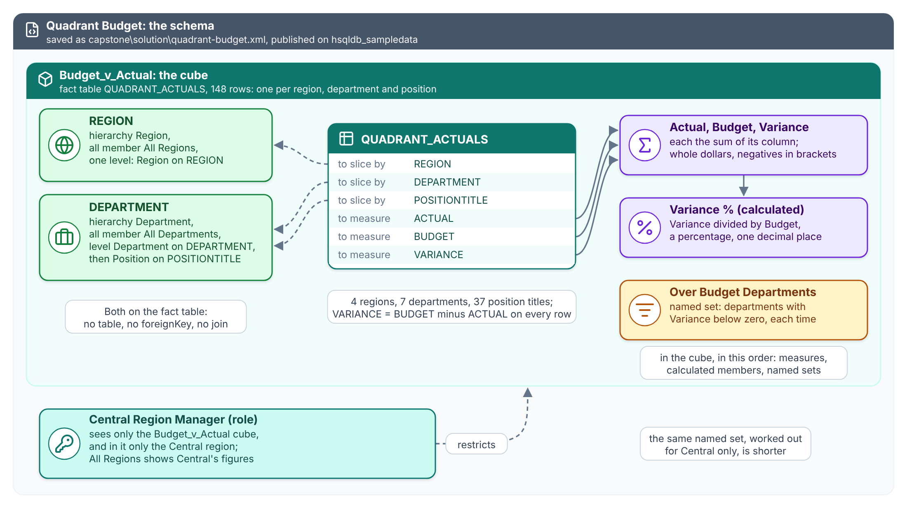

# Budget v Actual

> **Capstone Project — bring it all together.**

You're the BI developer for Steel Wheels' finance team. Every quarter the
controller compares what each region and department spent with what it
was budgeted, and today that means a spreadsheet. Your job is a cube the
controller can slice in Analyzer: actuals, budget and variance by region
and department, the variance as a percentage, the departments that ran
over budget ready to drop onto a report, and a view for the Central
region's manager that shows Central and nothing else.

This capstone exercises every part of the course: a schema built from
nothing, dimensions, measures, a calculated member, a named set, role
security and publishing.

> **Objectives:**
>
> - Build a new Mondrian schema in **Schema Workbench** on a table no workshop has used, `QUADRANT_ACTUALS`.
> - Give it a calculated member, a named set and a role, each working the way the controller needs.
> - Publish it to the Pentaho Server and hand in both your schema file and the server's copy of it, the way the checks read them.
> - Produce something portfolio-worthy ("I built this for my Practitioner course accreditation").
>
> **Estimated time:** 60-90 minutes for a clean, well-named schema. Re-shape and revisit as you'd like.

---

> **Warning:**
>
> #### Required for your course accreditation: five checks on your own folders
>
> The course accreditation is issued only when all five of these checks
> pass. They read your workshop folder, so put your work in exactly
> these places **before you take the exam**:
>
> | # | What must be there | Where |
> | --- | --- | --- |
> | 1 | Your schema, `quadrant-budget.xml`, built on `QUADRANT_ACTUALS` | `C:\Workshop-SW-Practitioner\capstone\solution\` |
> | 2 | In it, the calculated member `Variance %` | the same file |
> | 3 | In it, the named set `Over Budget Departments` | the same file |
> | 4 | In it, the role `Central Region Manager` | the same file |
> | 5 | The published schema, exported from the User Console as `Quadrant Budget.mondrian.xml`, with your named set in it | `C:\Workshop-SW-Practitioner\capstone\out\` |
>
> Use these names exactly, spaces and capitals included: the checks look
> for them. Select **Run checks** under **Verification checks** to see
> where you stand.

## Inputs

There is nothing to download. The data is already on your Pentaho Server,
in the SampleData database the course has used throughout:

| Source | What it is | Where you use it |
| --- | --- | --- |
| **QUADRANT_ACTUALS** | 148 rows, one per region, department and position: `REGION`, `DEPARTMENT`, `POSITIONTITLE`, `ACTUAL`, `BUDGET`, `VARIANCE` | The cube's fact table, and its dimensions |
| **hsqldb_sampledata** | The connection you made in [Basic Model](../05-schemas-basic-model/guide.md), in Schema Workbench and on the server | Building, testing and publishing |

The table has 4 regions (Central, Eastern, Southern, Western), 7
departments and 37 position titles. `VARIANCE` is `BUDGET` minus
`ACTUAL` on every row: positive when a line came in under budget,
negative when it went over.

---

## Required behavior

Build the schema in six stages. Each maps to a part of the course, so you
can look back at the workshop that taught it.

### 1. The schema and its cube *(Basic Model)*

A new schema named `Quadrant Budget`, saved as
`C:\Workshop-SW-Practitioner\capstone\solution\quadrant-budget.xml`,
holding one cube, `Budget_v_Actual`, whose fact table is
`QUADRANT_ACTUALS`.

### 2. Two dimensions, both on the fact table *(Standard Model, Extended Model)*

- `REGION`, with a hierarchy `Region` (all member `All Regions`) and one level, `Region`, on the `REGION` column.
- `DEPARTMENT`, with a hierarchy `Department` (all member `All Departments`) and two levels: `Department` on `DEPARTMENT`, and below it `Position` on `POSITIONTITLE`. A position title repeats across departments.
- Neither dimension has a table of its own: their columns are in the fact table.

### 3. Three measures *(Basic Model, Standard Model)*

`Actual`, `Budget` and `Variance`, each the sum of its column, shown as
whole-dollar currency. Show a negative variance in brackets.

### 4. Variance % *(Calculations)*

A calculated member `Variance %` on the measures: Variance divided by
Budget, formatted as a percentage with one decimal place.

### 5. Over Budget Departments *(Named Sets)*

A named set `Over Budget Departments`: the departments whose Variance is
below zero. It must be worked out from the data each time it is used,
never a typed list of department names.

### 6. Central Region Manager, then publish and hand in *(Mondrian Security, Basic Model)*

- A role `Central Region Manager` that sees only the `Budget_v_Actual` cube, and in it only the Central region. Its totals must not give away the other regions: **All Regions** shows Central's figures.
- Publish the schema to the Pentaho Server, on the `hsqldb_sampledata` data source.
- In the User Console's **Manage Data Sources**, export the published **Quadrant Budget** schema and save it as `C:\Workshop-SW-Practitioner\capstone\out\Quadrant Budget.mondrian.xml`.

---

## Suggested shape

<div align="center">
<figure>

<figcaption>What you build: one schema, one cube, one role</figcaption>
</figure>
</div>

Read the diagram from the fact table outward. Its first three columns are read by the two dimensions on the left, with dashed arrows because neither has a table of its own; its last three are summed by the measures on the right. Down that right-hand column the cube holds its parts in the order a hint below gives: measures, then `Variance %`, then `Over Budget Departments`. The role sits outside the cube, in the schema, and its box says what it must do, not how: the grants that do it are yours to work out. The note beside it is the result the **Verification checks** explain: the same named set, worked out for Central alone, holds fewer departments.

```text
C:\Workshop-SW-Practitioner\capstone\    (your machine)
├── solution\quadrant-budget.xml         your schema, as Schema Workbench saves it
└── out\Quadrant Budget.mondrian.xml     the published schema, exported from the User Console
```

The installer makes `capstone\solution\` and `capstone\out\` for you,
empty. If `C:\Workshop-SW-Practitioner\` has no `capstone` folder (the
course was installed before the capstone was added), create
`capstone\solution\` and `capstone\out\` there yourself.

---

## Hints for the tricky bits

- **A dimension on the fact table** has no table and no **foreignKey**, like ORDER STATUS in [Extended Model](../08-extend-model-extended-model/guide.md). Schema Workbench then reads its level's column from the cube's own table.
- **Variance is already a column.** Sum it as it is; don't compute Budget minus Actual again. Variance % is the one calculated value.
- **A format string can have two sections**, separated by `;`: the first for positive numbers, the second for negative ones.
- **A named set that filters** uses MDX's `Filter(set, condition)`. Test it with a `WITH SET` in the MDX Query window first, as in [Named Sets](../12-mdx-query-named-sets/guide.md), then add it to the cube.
- **Order matters inside a cube**: measures, then calculated members, then named sets. Schema Workbench writes them in that order for you.
- **"Only Central" is a member grant** inside a hierarchy grant with custom access. Which **rollupPolicy** keeps the hidden regions out of All Regions? [Overview of Data Security](../13-data-security/guide.md) has the table.
- **Once the schema has a role, `admin` can't open it in Analyzer.** The server's role mapper refuses a user whose roles match none of the schema's, and `admin` holds no role called Central Region Manager: Analyzer answers with an error page, and the server is fine. Check the figures in Schema Workbench's MDX Query window, which applies no role.
- **Test the role before you hand it in.** In [Mondrian Security](../14-data-security-mondrian-security/guide.md) you gave a user a role of the same name; do the same here, sign in as that user and open the cube in Analyzer.
- **The export** downloads a file named after the published schema. Move it into `capstone\out\` without renaming it.

---

## Lab Files

_No bundled files for this lab._ The data is the SampleData database on
your server, your schema is built from nothing in Schema Workbench, and
the accreditation checks read `C:\Workshop-SW-Practitioner\capstone\`.
Nothing else in the capstone is supplied: the schema is yours to build.

---

## Verification checks

> **Warning:** These five checks decide your course accreditation, and
> they look only in `C:\Workshop-SW-Practitioner\capstone\`: in
> `solution\` your `quadrant-budget.xml` on `QUADRANT_ACTUALS`, with the
> `Variance %` calculated member, the `Over Budget Departments` named set
> and the `Central Region Manager` role; and in `out\` the published
> schema, `Quadrant Budget.mondrian.xml`. Save and export your work
> there before you take the exam.

After saving the schema and exporting the published copy, select **Run
checks** below to confirm each landed where expected. The checks confirm
that the files exist and hold the parts by name. Check the numbers
yourself: a correct cube gives these figures, whatever formats you
chose.

By region, with the four measures on the columns:

| Region | Actual | Budget | Variance | Variance % |
| --- | ---: | ---: | ---: | ---: |
| Central | $37,893,162 | $38,397,600 | $504,438 | 1.3% |
| Eastern | $35,248,940 | $35,487,861 | $238,921 | 0.7% |
| Southern | $35,248,940 | $34,803,861 | ($445,079) | -1.3% |
| Western | $35,248,940 | $34,510,067 | ($738,873) | -2.1% |
| **All Regions** | **$143,639,982** | **$143,199,389** | **($440,593)** | **-0.3%** |

**Over Budget Departments** holds five of the seven departments: Finance
($136,814 over), Human Resource ($86,122), Marketing & Communication
($140,486), Professional Services ($219,443) and Sales ($195,381).
Executive Management and Product Development came in under budget.

As **Central Region Manager**, **All Regions** shows Central's own
figures ($37,893,162 actual, $38,397,600 budget, 1.3%), and the same
named set holds only four departments: Finance, Human Resource,
Marketing & Communication and Sales, with Sales $184,603 (6.8%) over.

> **Under the hood:**
>
> #### Why the Central manager sees a different set
>
> A named set stores its formula, not its members. Mondrian evaluates
> `Filter(...)` each time a query uses the set, inside that query's
> context, and for this role the context is Central only: Professional
> Services is over budget across the four regions together, but within
> budget in Central, so it drops out.
>
> **Why it matters:** one set definition serves every role and every
> slicer correctly. A typed list of five departments would have shown
> the Central manager a department that is not over budget in their
> region.

---

## Deliverables

Your schema on the server, and the capstone folder on disk:

1. `Quadrant Budget`: the schema, with the `Budget_v_Actual` cube, its two dimensions, three measures, `Variance %` and `Over Budget Departments`
2. `Central Region Manager`: the role, seeing Central only
3. `C:\Workshop-SW-Practitioner\capstone\solution\quadrant-budget.xml`: your schema file
4. `C:\Workshop-SW-Practitioner\capstone\out\Quadrant Budget.mondrian.xml`: the published schema, exported

> **Warning:** Save into `capstone\solution\`, not into the course
> folder. Course content is refreshed from the repository on every
> launch, so anything you leave there will be overwritten. Reinstalling
> or upgrading the course never touches `capstone\solution\` or
> `capstone\out\`.

This becomes a portfolio piece: name things clearly, and be ready to
explain why the Central manager's list of over-budget departments is
shorter.

---

## Build outline and hints <!-- no-step -->

One section per piece, in the order you build them. Each says what the
piece must do, which requirement it meets, and what a correct build
shows. The hints name a dialog or a technique; the settings are yours to
work out.

:::: tabs

### 1. The schema and cube

**Must do:** the schema, cube and fact table of requirement 1, saved as
`capstone\solution\quadrant-budget.xml`.

> **Success:** Checkpoint: the schema tree shows **Schema** `Quadrant Budget`, cube `Budget_v_Actual` and **Table: QUADRANT_ACTUALS**, with no red cross; the row **Your schema, built on QUADRANT_ACTUALS** turns green.

<details>
<summary>Hints</summary>

- **File > New > Schema**, then the schema's **name**, as in [Basic Model](../05-schemas-basic-model/guide.md). Schema Workbench connects through **Options > Connection**, still `hsqldb_sampledata`.
- **Add Cube**, then the cube's **Table**: the table list comes from the connection, so `QUADRANT_ACTUALS` is there to pick.
- **File > Save As** straight into `capstone\solution\`, so every later **File > Save** lands there.

</details>

### 2. REGION and DEPARTMENT

**Must do:** the two dimensions of requirement 2.

> **Success:** Checkpoint: in **File > New > MDX Query**, `SELECT {} ON COLUMNS, [REGION.Region].Members ON ROWS FROM [Budget_v_Actual]` lists All Regions and the four regions, and `[DEPARTMENT.Department].[Department].Members` lists seven departments.

<details>
<summary>Hints</summary>

- **Add Dimension** on the cube, a name, and no **foreignKey**. The new hierarchy, **New Hierarchy 0**, gets its name and **allMemberName**; it needs no table.
- Each level's **column** is a column of `QUADRANT_ACTUALS`. **uniqueMembers** is true where a member's name is unique on its own; is a position title?
- The MDX names follow the course's convention, `[DIMENSION.Hierarchy]`: name the dimension and the hierarchy exactly as requirement 2 does.

</details>

### 3. The measures

**Must do:** the three measures of requirement 3.

> **Success:** Checkpoint: `SELECT {[Measures].[Actual], [Measures].[Budget], [Measures].[Variance]} ON COLUMNS FROM [Budget_v_Actual]` returns $143,639,982, $143,199,389 and ($440,593).

<details>
<summary>Hints</summary>

- **Add Measure** on the cube: **name**, **column**, **aggregator** and **formatString**, as in [Standard Model](../06-schemas-standard-model/guide.md).
- A whole-dollar format has no decimal places. The negative section of Variance's format string puts the brackets around the same pattern.

</details>

### 4. Variance %

**Must do:** the calculated member of requirement 4.

> **Success:** Checkpoint: by region, Central 1.3%, Eastern 0.7%, Southern -1.3% and Western -2.1%; All Regions -0.3%.

<details>
<summary>Hints</summary>

- **Add Calculated Member**, its **dimension** set to `Measures`, and a **formula** that refers to the other measures by their MDX names, as in [Calculations](../09-extend-model-calculations/guide.md).
- A percentage format multiplies by 100 for you.

</details>

### 5. Over Budget Departments

**Must do:** the named set of requirement 5.

> **Success:** Checkpoint: `SELECT {[Measures].[Variance]} ON COLUMNS, [Over Budget Departments] ON ROWS FROM [Budget_v_Actual]` returns five departments, each with a bracketed variance.

<details>
<summary>Hints</summary>

- Write it as a `WITH SET` query first; when the five rows come back, move the expression into the schema with **Add Named Set** and its **Formula**.
- The set is of departments, not positions: filter the members of the `Department` level.

</details>

### 6. Central Region Manager, publish and export

**Must do:** the role of requirement 6, the schema published, and the
published copy exported into `capstone\out\`. The five checks.

> **Success:** Checkpoint: Schema Workbench reports `Publish Successful`; as a user with the Central Region Manager role, Analyzer shows only Central, and All Regions shows $37,893,162 actual; every check under **Verification checks** is green.

<details>
<summary>Hints</summary>

- **Add Role** on the schema, then **Add Schema Grant**, **Add Cube Grant**, **Add Hierarchy Grant** and **Add Member Grant**, as in [Mondrian Security](../14-data-security-mondrian-security/guide.md). Which level of grant needs `access="none"` so the role sees only this cube?
- **File > Publish** with the [Basic Model](../05-schemas-basic-model/guide.md) values: data source `hsqldb_sampledata`.
- **Manage Data Sources** in the User Console lists **Quadrant Budget** as an Analysis data source; **Export...** is on its gear menu.
- If a check fails, its message says which file it looked for and where. Save, publish or export again, and **Run checks** again.

</details>

::::
