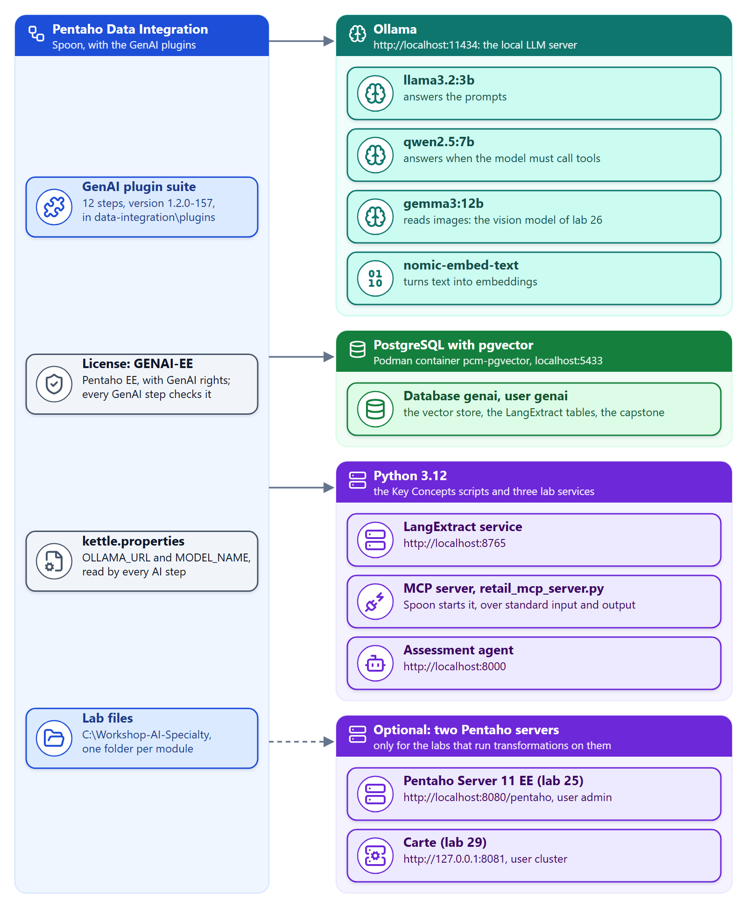

# Before You Start

> **Note:**
>
> #### Get Ready — Before You Start
>
> Before the first workshop, check that Pentaho Data Integration starts with the GenAI plugin suite and its license, that Ollama has the course's four models, that the pgvector database answers, and that Python and the workshop folder are in place. The course builds AI pipelines that run entirely on this machine, and **none of the lab time should go on setup**: this page does it in advance.
>
> **What you'll do:**
>
> * Learn how the guide works: progress, copy buttons, the assistant.
> * See how Spoon, the GenAI plugins, Ollama and pgvector fit together.
> * Confirm the plugins, the license, the models, the database and Python.
> * Check the workshop folder: *C:\Workshop-AI-Specialty*
>
> **Prerequisites:** Some experience building transformations in Pentaho Data Integration, and a basic understanding of SQL.
>
> **Estimated time:** 5 minutes on a lab VM; about 45 minutes the first time on your own machine, most of it downloading models.

## Meet your lab guide

This panel stays beside your tools for the whole workshop:

- **Float or dock** — drag the title bar to move the window anywhere
  (any monitor), or use the dock button to pin it to the right edge of
  the screen so maximized apps make room for it.
- **The sidebar** lists every section and lab. A <span data-icon="video"></span> badge means the lab
  includes a video; the `~15 min` tag is a time estimate.
- Use the **font-size** and **reading-mode** controls in the toolbar if
  you're on a small VM screen.

## Track your progress

Each workshop's steps sit in a numbered row at the top of the lab, one
dot per step. Work through them in order: the button at the end of a
step names the next one, and moving on puts a check mark on the step
you leave. Your progress is saved on this machine and survives
restarts, so you can pick up exactly where you left off. (This page has
no steps: tracking starts in the first workshop.)

## Copy code from the guide

Every code block has a **copy button**: hover over the block and select
it, then paste into your tool. Try it:

```sql
SELECT 'hello from the lab guide' AS greeting;
```

## How the pieces fit

Four things run on your machine for this course:

* **Pentaho Data Integration** (Spoon) with the **Pentaho GenAI plugin suite**: 12 steps that read documents, call a Large Language Model (LLM), make embeddings, write and search a vector store, call Model Context Protocol (MCP) tools and find named entities. Every one of them needs a Pentaho Enterprise Edition (EE) license with GenAI (GENAI-EE) rights.
* **Ollama**, the local LLM server on `http://localhost:11434`, with four models: `llama3.2:3b` answers the prompts, `qwen2.5:7b` answers when the model must call tools, `gemma3:12b` reads images, and `nomic-embed-text` turns text into embeddings. Your data never leaves the machine.
* **PostgreSQL with pgvector**, in a Podman container, on port `5433`: the vector store of the Retrieval-Augmented Generation (RAG) workshops, and the database the LangExtract workshops load. Port `5432` stays free for a Pentaho Server repository.
* **Python 3.12 or later**, for the Key Concepts scripts, the LangExtract service, the MCP server and the agent.

<div align="center">
<figure>

<figcaption>The four things that run on your machine, and the ports they answer on</figcaption>
</figure>
</div>

> **Under the hood:**
>
> #### The transformations reach Ollama through two variables
>
> Every AI step in the course's transformations names its server and its model as `${OLLAMA_URL}` and `${MODEL_NAME}`. The course's setup writes both into `kettle.properties`, the file Spoon reads at start-up, so a transformation that only uses the variables finds the same server and model without a setting of its own. The workshops' transformations also declare `OLLAMA_URL` and `MODEL_NAME` as parameters, with the same values as their defaults, so they run on any machine.
>
> **Why it matters:** to try another model for one run, set `MODEL_NAME` in the **Run Options** dialog, and every AI step follows. A parameter's default value wins over `kettle.properties`, so a changed line there reaches a transformation that declares the parameter only once you clear or change its default.

## Set up your environment

Launch your main tool straight from the guide:

<button data-launch="spoon">Start Pentaho Data Integration</button>

If it is already open from a previous session, the button focuses
the running window instead of starting a second copy.

### Do you need to set anything up?

:::: tabs

### I'm using a lab VM

Nothing to install. Pentaho Data Integration, the GenAI plugin suite and its license, Ollama with the four models, the pgvector database and Python are already on the machine, and the workshop files are in `C:\Workshop-AI-Specialty`.

The pgvector database runs in a Podman container that the course starts when it needs it. **Check your environment**, below these tabs, shows whether everything answers.

If something looks wrong later, tell your instructor rather than
reinstalling anything.

### I'm installing on my own machine

Everything here is a **one-off setup** for your own Windows 11 machine. Work through the tabs in order; the panel underneath checks your machine as you go. The last tab is a reference card of every port and login.

::: tabs

### 1. Pentaho Data Integration

1. Install Pentaho Data Integration 11 Enterprise Edition to `C:\Pentaho`, so Spoon is at `C:\Pentaho\design-tools\data-integration\Spoon.bat`.
2. Run it on Java 21. Pentaho's bundled Java is at `C:\Pentaho\java`; `Spoon.bat` uses `PENTAHO_JAVA_HOME` first, then that folder, then `JAVA_HOME`. In PowerShell, run:

   ```powershell
   & C:\Pentaho\java\bin\java.exe -version
   ```

   > **Success:** Checkpoint: the first line says `openjdk version "21.0.3"` (or another 21 release).

3. Start Spoon once with the button at the top of this page and let it finish loading.
4. Only for the [Run on Pentaho Server](../25-production-server/guide.md) workshop: install Pentaho Server 11 Enterprise Edition to `C:\Pentaho\server\pentaho-server`, with its repository PostgreSQL on port `5432` and the same GenAI license. The workshop installs the plugins on it.

<details>
<summary>Troubleshooting</summary>

**The Start button does nothing.** The launcher runs `C:\Pentaho\design-tools\data-integration\Spoon.bat`. Install Pentaho Data Integration there.

**Spoon opens then closes.** Almost always Java. Run `Spoon.bat` from PowerShell in `C:\Pentaho\design-tools\data-integration` and read the first error line; check that `PENTAHO_JAVA_HOME`, if set, points to a Java 21.

</details>

### 2. The GenAI Plugin Suite

The suite comes as one bundled archive, `pdi-genai-plugins-bundle-1.2.0-157.zip`, from your Pentaho account team or Pentaho Support; it is not in the Pentaho Marketplace. The archive holds one `.zip` per plugin, and each of those holds one plugin folder.

> **Note:** Suite 1.2.0 supports Pentaho 11 only: Pentaho Data Integration 11 on Java 17 or 21, and Pentaho Server 11.x. It is not supported on Pentaho 10.2.x, where an enhancement to support it is a Pentaho services contract. This course was checked on Pentaho 11.0.0.3.

1. Close Spoon.
2. **Upgrading from an earlier version?** Delete the old plugin folders first: extracting a new version over an old folder leaves old libraries in its `lib` folder, where they conflict with the new ones. In PowerShell, run:

   ```powershell
   Get-ChildItem C:\Pentaho\design-tools\data-integration\plugins -Directory -Filter "pdi-step-*" | Remove-Item -Recurse -Force
   ```

   A standard Pentaho Data Integration install has no other `pdi-step-*` folders, but list them first with the same command without `| Remove-Item -Recurse -Force` if you added plugins of your own.

3. Save the bundle in your **Downloads** folder and extract every plugin archive into the `plugins` folder. In PowerShell, run:

   ```powershell
   Set-Location $env:USERPROFILE\Downloads
   Expand-Archive pdi-genai-plugins-bundle-1.2.0-157.zip -DestinationPath genai-bundle
   Get-ChildItem genai-bundle\*.zip | ForEach-Object {
     Expand-Archive $_.FullName -DestinationPath "C:\Pentaho\design-tools\data-integration\plugins"
   }
   Remove-Item genai-bundle -Recurse
   ```

   Pentaho Data Integration loads plugin **folders**: copying the bundle, or the plugin `.zip` files, into `plugins` installs nothing.

4. Check that the 12 plugin folders are directly inside `plugins`. In PowerShell, run:

   ```powershell
   (Get-ChildItem C:\Pentaho\design-tools\data-integration\plugins -Directory -Filter "pdi-step-*").Name
   ```

   > **Success:** Checkpoint: 12 names, from `pdi-step-ai-chat-messagebox-plugin` to `pdi-step-tika-plugin`. Each folder holds the plugin's `.jar`, a `lib` folder, `docs` and `samples`; none holds another folder of the same name.

5. Start Spoon and select **Tools > Show plugin information**. In the **Plugin browser**, set **Plugin type** to `Step` and type `AI` in the filter.

   > **Success:** Checkpoint: the **Detected plugins** list shows the AI steps, among them **AI Chat**, **Text to Vector**, **Vector Writer** and **MCP Client**. Select **Close**. On the **Design** tab, the **AI** folder holds eight steps; **HTML Parser** and **Read Unstructured Document** are in **Input**, **Discover Metadata from Unstructured Documents** in **Metadata Discovery**, and **Base64 Encoder** in **Transform**.

6. **The license.** Every step of the suite checks, when a transformation starts, for a Pentaho EE license with GenAI (GENAI-EE) rights; install it as Pentaho's license instructions describe. Without it, the steps are in the palette and their dialogs open, but a transformation that uses one stops before it reads a row, and the log says:

   ```text
   License validation failed. Ensure you have the GenAI Plugin Suite (GENAI-EE) subscription available.
   ```

<details>
<summary>Troubleshooting</summary>

**A step is missing from the palette.** Its folder is not directly inside `plugins`, or its `lib` folder is missing: an extra level such as `plugins\pdi-step-tika-plugin\pdi-step-tika-plugin` loads nothing. Plugin loading errors are in `C:\Pentaho\design-tools\data-integration\logs`.

**Transformations that run on Carte or the Pentaho Server** need the same folders there too: in the Carte installation's `plugins` folder, or in `pentaho-server\pentaho-solutions\system\kettle\plugins`. The course's Moving to Production module covers it.

</details>

### 3. Ollama and the Models

Every LLM call in the course goes to Ollama on this machine.

1. If you used this course's installer, Ollama is already installed. Otherwise, from the app's install folder, in PowerShell, run:

   ```powershell
   provisioning\install-ollama.ps1
   ```

2. Pull the models and write the two variables the transformations read, `OLLAMA_URL` and `MODEL_NAME`, into `kettle.properties`. In PowerShell, run:

   ```powershell
   provisioning\setup-ollama.ps1 -Profile cpu -LabModel llama3.2:3b
   ```

   It pulls `llama3.2:3b` (2.0 GB), and the three models the labs also need: `qwen2.5:7b` (4.7 GB), the tool-calling model of the MCP Tools workshop, which its transformations name in the `TOOL_MODEL` parameter, `gemma3:12b` (8.1 GB), the vision model of the Invoices workshop, and `nomic-embed-text` (274 MB) for embeddings.

3. Check the models and the variables. In PowerShell, run:

   ```powershell
   ollama list
   Select-String -Path "$env:USERPROFILE\.kettle\kettle.properties" -Pattern "OLLAMA_URL|MODEL_NAME"
   ```

   > **Success:** Checkpoint: `ollama list` shows `llama3.2:3b`, `qwen2.5:7b`, `gemma3:12b` and `nomic-embed-text:latest`, and `kettle.properties` has `OLLAMA_URL=http://localhost:11434` and `MODEL_NAME=llama3.2:3b`. Restart Spoon if it was open, so it reads them.

<details>
<summary>Troubleshooting</summary>

**`ollama list` says it cannot connect.** Ollama is not running: start the Ollama app, or run `ollama serve` in a PowerShell window of its own.

**A model is missing.** Pull it by name, for example `ollama pull qwen2.5:7b`.

**The Chat tab says the assistant is unavailable, but `ollama list` works.** Ollama refuses the app's origin. `setup-ollama.ps1` sets `OLLAMA_ORIGINS` and restarts Ollama: run it again, then restart this app.

**Generation is slow.** Expected on a CPU: 15 to 30 seconds per call for `llama3.2:3b`. With a supported NVIDIA GPU, Ollama uses it by itself.

</details>

### 4. The pgvector Database

The course's PostgreSQL with the pgvector extension runs in a Podman container, `pcm-pgvector`, from the image `docker.io/pgvector/pgvector:pg17`. Its lab kit is `C:\PGVector\run-podman-pgvector.ps1`, which the course installer lays down.

1. Install Podman Desktop, and create and start its Podman machine, if you have not already:

   ```powershell
   winget install -e --id RedHat.Podman-Desktop
   podman machine init
   podman machine start
   ```

2. Start the database. The first run pulls the image and creates the container and its data volume; later runs start the same container. In PowerShell, run:

   ```powershell
   C:\PGVector\run-podman-pgvector.ps1
   ```

   > **Success:** Checkpoint: the script ends with `PostgreSQL with pgvector is up.`, `Host     : localhost   Port: 5433` and `Database : genai   Login: genai / genai`.

3. Check the extension. In PowerShell, run:

   ```powershell
   podman exec pcm-pgvector psql -U genai -d genai -tAc "SELECT extversion FROM pg_extension WHERE extname = 'vector';"
   ```

   > **Success:** Checkpoint: one line, the pgvector version, `0.8.7` with the current image.

To stop it and keep the data, run `C:\PGVector\run-podman-pgvector.ps1 -Stop`; `-Reset` removes the container and its data and starts fresh.

<details>
<summary>Troubleshooting</summary>

**The kit is not in C:\PGVector.** A **Minimal (app only)** install skips the lab kits. Its source is `lab-kits\PGVector` in the course installer's folder; copy `run-podman-pgvector.ps1` and `pgvector-init.sql` to `C:\PGVector`.

**`podman` is not recognized.** Open a new PowerShell window after installing Podman Desktop, so it picks up the new `PATH`.

**Port 5433 is already in use.** Another PostgreSQL holds it. Stop it, or find it with `Get-NetTCPConnection -LocalPort 5433`.

**`crun: controller pids is not available`.** A known Windows Subsystem for Linux (WSL) cgroups problem; the script retries with `--cgroups=disabled` by itself.

</details>

### 5. Python 3.12

The Key Concepts workshop, the LangExtract service, the MCP server of the MCP Tools workshop and the agent of Deploy & Run the Agent run on Python.

1. Install Python 3.12:

   ```powershell
   winget install -e --id Python.Python.3.12
   ```

2. Open a **new** PowerShell window and run:

   ```powershell
   python --version
   ```

   > **Success:** Checkpoint: `Python 3.12` or later.

3. Install the MCP library, which the MCP Tools workshop's server (`retail_mcp_server.py`, an MCP server on FastMCP that Spoon starts over standard input and output) imports. In PowerShell, run:

   ```powershell
   python -m pip install "mcp<2"
   ```

   The server uses FastMCP from the 1.x releases of the library; release 2 renamed it, so the version stays below 2.

   > **Success:** Checkpoint: pip ends with `Successfully installed`, naming `mcp-1.` and a version number, or says `Requirement already satisfied: mcp<2`.

The other workshops' libraries (the Key Concepts scripts' `requirements.txt`, the LangExtract service's) go into their own virtual environments when you reach them.

<details>
<summary>Troubleshooting</summary>

**`python` is not recognized.** `PATH` changes reach only new windows: close PowerShell and open it again. If it persists, try `py --version`.

**A Microsoft Store window opens instead.** Windows' app alias for `python` is in the way. In **Settings > Apps > Advanced app settings > App execution aliases**, turn off the two `python` entries.

</details>

### 6. Lab Files on Disk

The installer lays this course's lab files out under **`C:\Workshop-AI-Specialty`**, one folder per module, so every workshop's data and solution are on disk before you start.

<details>
<summary>The folder isn't there</summary>

It is an optional component, so a **Minimal (app only)** install, or a cleared **Workshop lab files** box, skips it. Lay it down at any time from the `provisioning` folder of the app's install folder:

```powershell
.\install-workshop.ps1
```

It only ever adds and refreshes files, and never deletes your work.

</details>

### 7. Ports and Logins

Everything this course uses, all local to your machine:

> **Warning:** These are workshop credentials, widely known. Change them on any database reachable beyond your own machine.

| Service | Address | Username | Password | Used by |
| --- | --- | --- | --- | --- |
| Ollama | `http://localhost:11434` | *none* | *none* | Every AI step, the Chat tab |
| PostgreSQL with pgvector | `localhost:5433`, database `genai` | `genai` | `genai` | Retrieval-Augmented Generation, LangExtract, the capstone |
| LangExtract service | `http://localhost:8765` | *none* | *none* | The LangExtract module |
| Assessment agent | `http://localhost:8000` | *none* | *none* | Deploy & Run the Agent |
| Pentaho Server | `http://localhost:8080/pentaho` | `admin` | `password` | Run on Pentaho Server |
| Carte | `http://127.0.0.1:8081` | `cluster` | `cluster` | Project: Pentaho MCP Server |
| Your Pentaho MCP server (`--http`) | `http://127.0.0.1:8766/mcp` | *none* | *none* | Project: Pentaho MCP Server |

:::

When the last tab is done, **Check your environment** below these tabs should be all green.

::::

## Check your environment

This panel probes the machine live: Pentaho Data Integration, Ollama and its models, Python, and the lab services the later modules start. Each row reports one of four states:

* **<span class="pcm-c-ok">Green</span>** — the check passed; that piece is present and answering.
* **<span class="pcm-c-warn">Amber</span>** — usable, but worth tidying before the session.
* **<span class="pcm-c-danger">Red</span>** — it will block a lab, and the row tells you the exact fix.
* **<span class="pcm-c-muted">Grey</span>** — skipped, because this course doesn't use it.

The LangExtract service and the assessment agent stay amber until you start them in their modules. The panel does not check the GenAI license: the first workshop that runs a GenAI step does, with the message above.

<div data-env-check="ai"></div>

> **Success:** Checkpoint: every row is green, or amber for the two lab services.

## Check the working folders

The installer lays every lab's files out under **`C:\Workshop-AI-Specialty`**, one folder per module, in the order the sidebar reads. A file at a lab's top level is data the workshop reads; its `solution` folder holds the finished transformations. You save your own work in the lab's folder, beside its data. Getting Started has no lab files, so the numbering starts at `02`.

```text
C:\Workshop-AI-Specialty
├── 02-ai-pipelines
│   └── 18-key-concepts-workshop               the five Python scripts and requirements.txt
├── 03-documents-to-text
│   ├── 03-genai-html-parser
│   │   ├── homepage.html, landingpage.html
│   │   └── solution\                          html_xpath.ktr, html_css.ktr, html_stream.ktr
│   └── 04-genai-apache-tika
│       ├── product-brief.docx, quarterly-report-protected.pdf
│       ├── documents\                         five mixed documents
│       └── solution\                          tika_word.ktr ... tika_metadata.ktr
├── 04-llm-integration
│   └── 06-llm-sentiment-analysis ... 11-llm-multi-staged, 26-llm-vision-documents
├── 05-retrieval-augmented-generation
│   └── 20-rag-knowledge-base, 21-rag-answer-questions, 27-rag-evaluation
├── 06-langextract
│   ├── 12-langextract                         the extraction service, in langextract-service\
│   └── 13-langextract-support-tickets ... 15-langextract-contract-documents
├── 07-agents-and-tools
│   └── 22-mcp-tools, 17-agent-deploy, 29-project-pentaho-mcp
├── 08-moving-to-production
│   └── 25-production-server, 28-pii-guardrails
└── capstone
    ├── data\                              tickets.csv, manuals\
    ├── solution\                          your capstone work, checked for your accreditation
    └── out\                               what your job writes
```

**Confirm the files are there**, not only the folders: open
`03-documents-to-text\04-genai-apache-tika` and check you can see
`product-brief.docx` and the `documents` folder. An empty folder is the
one thing worth catching now rather than in the middle of a lab.

## Check the database

The Retrieval-Augmented Generation workshops, the LangExtract workshops and the capstone use the pgvector database. Its steps and connections read these values from the `PG_*` parameters of each transformation:

| Field | Value |
| --- | --- |
| Connection type | PostgreSQL |
| Host Name | `localhost` |
| Port Number | `5433` |
| Database Name | `genai` |
| Username | `genai` |
| Password | `genai` |

The **Vector Writer** step creates the vector extension's tables itself, and the LangExtract workshops create their `helpdesk` and `staging` schemas, so the database starts empty.

## Ask the AI assistant

The **Chat** tab in the bottom panel answers questions about Pentaho,
grounded in the official docs — ask it anything from "what does this
step do?" to "why did my transformation fail?". A model on this machine
writes the answers, and it grounds them in a live search of the official
Pentaho documentation. Without an internet connection that search is
unavailable, so only the local model answers.

## How this course is organized

Each section starts with an **overview page** (<span data-icon="page"></span> — background reading,
no check boxes) followed by **hands-on workshops** (<span data-icon="workshop"></span> — tracked steps).
Select a heading to open that section's page, or the chevron beside it to
expand the workshops underneath.

## The exam and your course accreditation

When you have worked through the sections, take the **exam** in the sidebar. It is open-book: browse any page, or ask the assistant. Your answers are saved as you go, and the explanations show afterwards. Complete the capstone project and pass the exam, and your **Pentaho Developer - AI Pipelines - Specialty Level** course accreditation appears on the results screen to download.

Head to the first section whenever you're ready.

---

> **Tip:** You can revisit this page any time from the sidebar.
