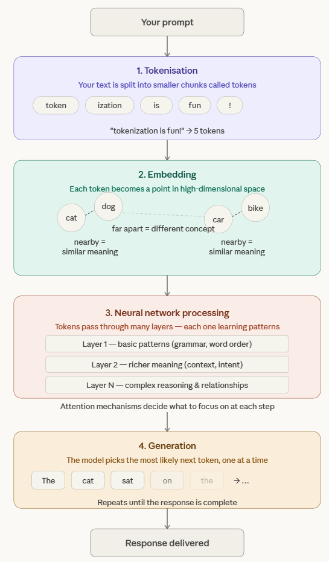

# Overview of a Prompt

> **Note:**
>
> #### What Happens When You Send a Prompt
>
> Every time you send a message to a chatbot built on a Large Language Model (LLM), the same four stages run: tokenization, embedding, neural network processing and generation. This page gives the big picture; the workshop after it runs each stage against your local Ollama.

<figure>

<figcaption>The four stages between a prompt and a response</figcaption>
</figure>

**Tokenization** splits your message into pieces the model can process. A token is not always a whole word: parts of words and punctuation can be tokens of their own, so "tokenization is fun!" is five tokens. It turns any text into a sequence from a fixed vocabulary before any other processing happens.

**Embedding** maps each token to a point in a high-dimensional space, where meaning is encoded as position. Words with similar meanings end up close together, which is how the model represents *dog* and *cat* as more closely related than *dog* and *bicycle*.

**Neural network processing** is the heavy lifting. The tokens flow through layer after layer of the transformer, each layer building a richer representation: early layers capture basic patterns such as grammar and word order, deeper layers context and intent. The attention mechanism lets the model relate words that are far apart in the prompt, weighing which parts matter most to each other.

**Generation** builds the answer one token at a time. The model predicts the next token from everything before it, appends it, and repeats until the response is complete; that is why an answer appears word by word.

### Ten Business Problems, Mapped to the Workshops

These stages are the same whatever the business asks of them. The table maps ten common business problems to the workshops that teach the pipeline for each.

| Area | Problem | Workshops |
| --- | --- | --- |
| Finance | Turn financial reports in PDF into tables an analyst can query | [Text Summarization](../10-llm-text-summarization/guide.md), [Apache Tika](../04-genai-apache-tika/guide.md) |
| Accounts | Capture the fields of invoices and receipts from scanned images | [Invoices with a Vision Model](../26-llm-vision-documents/guide.md) |
| Legal | Take in contracts and flag the clauses that carry risk | [Contract Documents](../15-langextract-contract-documents/guide.md) |
| Customer service | Triage feedback, score its sentiment and draft a reply | [Sentiment Analysis](../06-llm-sentiment-analysis/guide.md), [Support Tickets](../13-langextract-support-tickets/guide.md), [Capstone: Support Desk Copilot](../23-capstone-support-copilot/guide.md) |
| Marketing | Summarize what competitors publish on their web pages | [HTML Parser](../03-genai-html-parser/guide.md), [Text Summarization](../10-llm-text-summarization/guide.md) |
| Risk and insurance | Pull the people, objects, locations and events (POLE) out of incident reports | [Named Entity Recognition](../09-llm-ner/guide.md) |
| Compliance | Find and redact personal data without it leaving your network | [Guard Personal Data](../28-pii-guardrails/guide.md) |
| HR | Answer staff questions from the policy documents, citing the source | [Build the Knowledge Base](../20-rag-knowledge-base/guide.md), [Answer Questions](../21-rag-answer-questions/guide.md) |
| E-commerce | Find duplicate products in a catalog and fill in missing details | [Catalog Duplicates and Enrichment](../30-catalog-duplicates/guide.md) |
| IT and operations | Let an operations agent run and monitor jobs through MCP tools | [MCP Tools](../22-mcp-tools/guide.md), [Project: Pentaho MCP Server](../29-project-pentaho-mcp/guide.md) |

---

> **Note:** Ready to try these ideas in code? The [Key Concepts Workshop](../18-key-concepts-workshop/guide.md) is next: it runs a small script for each concept against your local Ollama.
