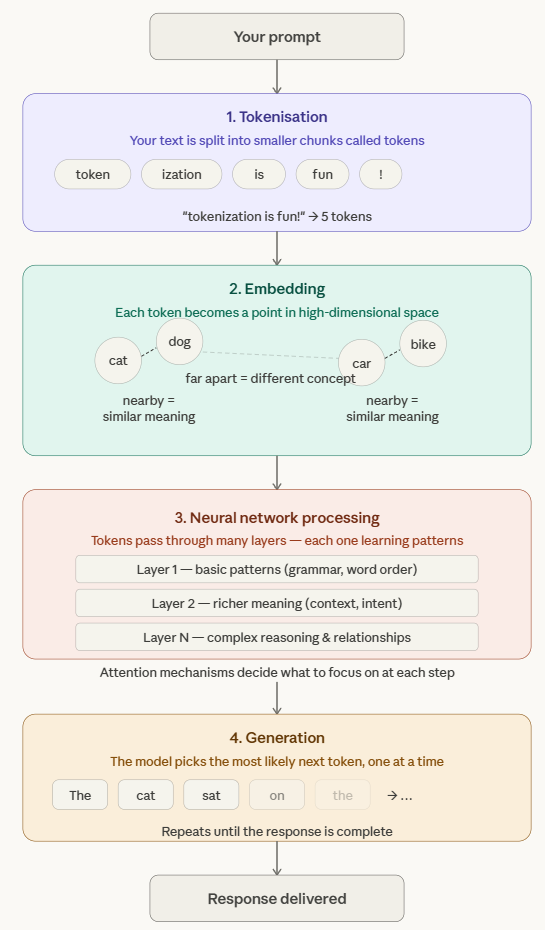

# Overview of a Prompt

> **Note:**
>
> #### What Happens When You Send a Prompt
>
> Every time you send a message to a chatbot built on a Large Language Model (LLM), the same four stages run: tokenization, embedding, neural network processing and generation. This page gives the big picture; the workshop after it runs each stage against your local Ollama.

<figure>

<figcaption>The four stages between a prompt and a response</figcaption>
</figure>

**Tokenization** splits your message into pieces the model can process. A token is not always a whole word: parts of words and punctuation can be tokens of their own, so "tokenization is fun!" is five tokens. It turns any text into a sequence from a fixed vocabulary before any other processing happens.

**Embedding** maps each token to a point in a high-dimensional space, where meaning is encoded as position. Words with similar meanings end up close together, which is how the model represents *dog* and *cat* as more closely related than *dog* and *bicycle*.

**Neural network processing** is the heavy lifting. The tokens flow through layer after layer of the transformer, each layer building a richer representation: early layers capture basic patterns such as grammar and word order, deeper layers context and intent. The attention mechanism lets the model relate words that are far apart in the prompt, weighing which parts matter most to each other.

**Generation** builds the answer one token at a time. The model predicts the next token from everything before it, appends it, and repeats until the response is complete; that is why an answer appears word by word.

---

> **Note:** Ready to try these ideas in code? The [Key Concepts Workshop](../18-key-concepts-workshop/guide.md) is next: it runs a small script for each concept against your local Ollama.
