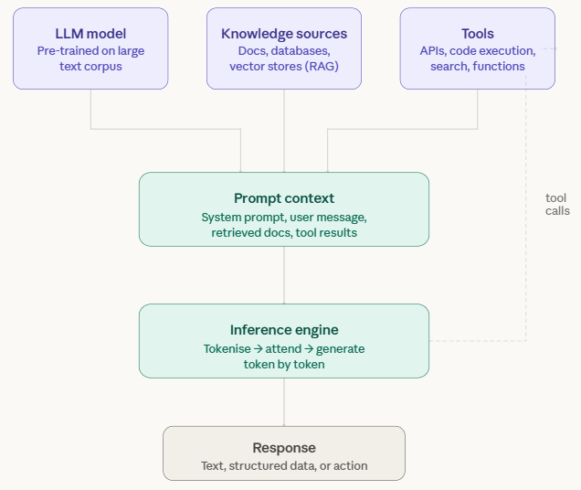

# Overview

<div align="center">
<figure>

<figcaption>GenAI components: everything the model sees is assembled into the prompt context</figcaption>
</figure>
</div>

> **Note:**
>
> #### How Does It Work?
>
> At its core, a GenAI system is built around a Large Language Model (LLM): a neural network trained on large amounts of text. Through that training it learns patterns in language: grammar, facts, reasoning styles, and how ideas connect. When you interact with it, the model isn't looking things up; it generates a response from those learned patterns.
>
> Before the model generates anything, everything relevant is assembled into a **prompt context**: a system prompt (instructions that define how it should behave), your message, any documents retrieved from a knowledge source, and any results of tool calls made earlier in the conversation. The more relevant this context, the better the output.
>
> Knowledge sources extend what the model knows beyond its training data. With Retrieval-Augmented Generation (RAG), the system searches a database or document store for content relevant to your query and adds it to the context. This is how a GenAI system can answer questions about your own documents or recent information.
>
> Tools let the model act, not only respond. During a conversation the model can decide to call an external API, run code, or search the web; the result comes back into the context, and the model uses it to form its answer. This loop is what makes agentic AI possible.
>
> Finally, the **inference engine** takes the assembled context and generates a response token by token: each word, or part of a word, is predicted from everything that came before it, until the response is complete. The output can be plain text, structured data, or a trigger for another action.

***

The Pentaho GenAI plugin, an Enterprise Edition (EE) plugin for Pentaho Data Integration, adds GenAI steps to Spoon. To look at them, start Spoon with the **Start Pentaho Data Integration** button below, or from a terminal:

::: tabs

### Windows (PowerShell)

```powershell
Set-Location C:\Pentaho\design-tools\data-integration
.\spoon.bat
```

### macOS / Linux

```bash
cd ~/Pentaho/design-tools/data-integration
./spoon.sh
```

:::

<button data-launch="spoon" data-path="">Start Pentaho Data Integration</button>

***

## Workshops <!-- no-step -->

* **HTML Parser** — extract text from HTML and XML with XPath and CSS selectors, to feed GenAI steps.
* **Apache Tika** — extract text from Office documents and PDFs: a Word document, a password-protected PDF, and a folder of mixed files.
