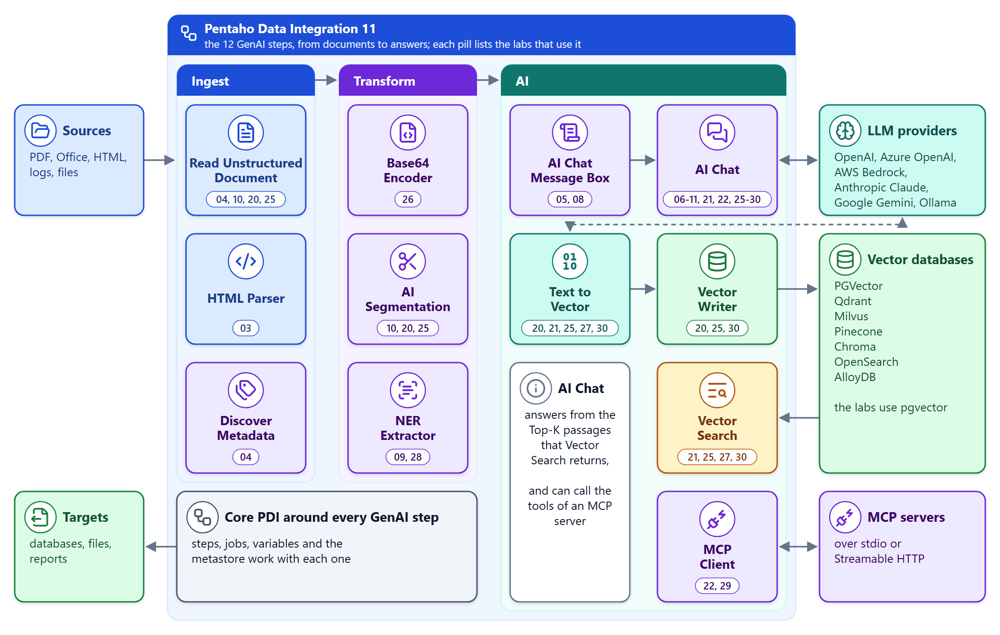
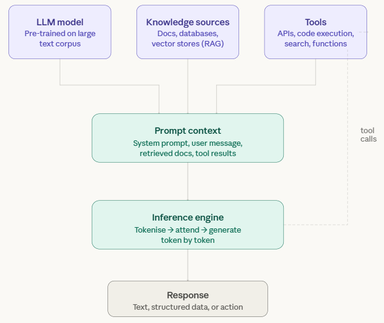

# Overview

<div class="pcm-intro">

A Large Language Model (LLM) reads text, but the text a business holds arrives as web pages, Word documents, slide decks and PDFs. This module turns those documents into clean text with two steps of the Pentaho GenAI plugin suite, **HTML Parser** and **Read Unstructured Document**, and reads their metadata with a third. It also introduces the whole suite, the 12 steps the rest of the course builds on, and the license they need.

</div>

<div align="center">
<figure>

<figcaption>The suite's 12 steps from ingest to AI, with the providers, vector databases and MCP servers they talk to; each pill lists the labs that use the step</figcaption>
</figure>
</div>

**What You'll Learn**

* Why documents are turned into text before an LLM sees them
* The 12 steps of the GenAI plugin suite, where each sits in Spoon's palette, and which lab of this course uses it
* The license every step checks for, and the error you see without it
* How this course's modules fit together

:::: tabs

### 1. Documents to Text

Everything an LLM receives is text, assembled into one **prompt context**: the instruction that tells the model what to do, the message it works on, any documents retrieved from a knowledge base, and the results of any tools it called. The model generates its answer from that context alone.

<div align="center">
<figure>

<figcaption>Everything the model sees is assembled into the prompt context</figcaption>
</figure>
</div>

The documents that feed that context are rarely text to begin with:

| The document | What is in the way | The step that extracts the text |
| --- | --- | --- |
| A web page or an HTML e-mail | Tags, attributes, scripts and style sheets | **HTML Parser** (jsoup) |
| A Word document or a PowerPoint deck | A ZIP archive of XML parts | **Read Unstructured Document** (Apache Tika) |
| A PDF, perhaps password-protected | Text positioned line by line on pages, perhaps encrypted | **Read Unstructured Document** |
| Any of these, for its author, title or page count | Metadata stored apart from the text | **Discover Metadata from Unstructured Documents** (Apache Tika) |

Clean text matters twice. Every token in a prompt costs time and memory, and markup is tokens that mean nothing to the model. And a model answers from what it is given, so a page footer repeated through a document, or a script in a web page, is noise it may repeat.

The two workshops of this module build the extraction: [HTML Parser](../03-genai-html-parser/guide.md) reads two web pages and a set of HTML e-mails with XPath and CSS selectors, and [Apache Tika](../04-genai-apache-tika/guide.md) reads a Word document, a password-protected PDF and a folder of mixed documents, and lists their metadata.

<div class="pcm-embed-card" data-href="https://tika.apache.org/" data-title="Apache Tika"></div>

<div class="pcm-embed-card" data-href="https://jsoup.org/" data-title="jsoup: Java HTML parser"></div>

### 2. The GenAI Plugin Suite

The Pentaho GenAI plugin suite (version 1.2.0-157 in this course) adds 12 steps to Pentaho Data Integration. Each is its own plugin folder under `C:\Pentaho\design-tools\data-integration\plugins`, and each appears in a folder of Spoon's **Design** palette:

| Step | Palette folder | What it does | Used in |
| --- | --- | --- | --- |
| **HTML Parser** | Input | Extracts the text of HTML or XML, whole or by CSS selector or XPath expression | HTML Parser (lab 03) |
| **Read Unstructured Document** | Input | Extracts the text of a TXT, PDF, DOC, DOCX, PPT or PPTX file into one field, with its password if it has one | Apache Tika (04), Text Summarization (10), Build the Knowledge Base (20), Run on Pentaho Server (25) |
| **Discover Metadata from Unstructured Documents** | Metadata Discovery | Writes one row per metadata key of a document, such as `dc:creator` or `Content-Type` | Apache Tika (04) |
| **Base64 Encoder** | Transform | Encodes a file or a value as Base64 text, mainly to send images to **AI Chat** | Invoices with a Vision Model (26) |
| **AI Chat** | AI | Sends a prompt, with an instruction and optional documents, to an LLM provider and returns the answer; can call MCP tools | LLM Integration (labs 06 to 11, 26), Answer Questions (21), Evaluate the Answers (27), MCP Tools (22), Project: Pentaho MCP Server (29), Run on Pentaho Server (25), Guard Personal Data (28), Catalog Duplicates (30) |
| **AI Chat Message Box** | AI | Adds a prompt and a run instruction, typed in the dialog, as two fields for an **AI Chat** downstream | The LLM Integration [Overview](../05-llm-integration/guide.md) (05), [Data Enrichment](../08-llm-data-enrichment/guide.md) (08) |
| **AI Segmentation** | AI | Splits a long text into chunks, one row each, by paragraph, line, sentence, word, character or pattern, sized in characters or tokens, with an overlap | Text Summarization (10), Build the Knowledge Base (20), Run on Pentaho Server (25) |
| **Text to Vector** | AI | Turns text into an embedding, a vector of numbers, with an embedding model | Build the Knowledge Base (20), Answer Questions (21), Evaluate the Answers (27), Run on Pentaho Server (25), Catalog Duplicates (30) |
| **Vector Writer** | AI | Writes embeddings, their text and metadata to a vector store: PGVector, Qdrant, Milvus, Pinecone, Chroma, OpenSearch or AlloyDB; creates the collection on demand and upserts or inserts. The labs use pgvector | Build the Knowledge Base (20), Run on Pentaho Server (25), Catalog Duplicates (30) |
| **Vector Search** | AI | Finds the stored texts closest to a query's embedding, in the same seven vector stores as **Vector Writer** | Answer Questions (21), Evaluate the Answers (27), Run on Pentaho Server (25), Catalog Duplicates (30) |
| **MCP Client** | AI | Lists and calls the tools and resources of a Model Context Protocol (MCP) server | MCP Tools (22), Project: Pentaho MCP Server (29) |
| **NER Extractor** | AI | Finds named entities (people, organizations, places, dates) with Stanford CoreNLP, no LLM involved | Named Entity Recognition (09), Guard Personal Data (28) |

In this course every LLM call goes to a local **Ollama** server on `http://localhost:11434`, with the chat model in the `MODEL_NAME` variable and `nomic-embed-text` for embeddings. **AI Chat** also speaks to OpenAI, Azure OpenAI, AWS Bedrock, Anthropic Claude and Google Gemini, and **Text to Vector** embeds with OpenAI, Azure OpenAI, AWS Bedrock or Google Gemini as well as Ollama; only the provider and its credentials change.

> **Under the hood:**
>
> #### Each step is a plugin folder with its own libraries
>
> Spoon finds the steps at start-up by scanning the `plugins` folder: each `pdi-step-...` folder holds the step's JAR and a `lib` folder with the libraries it needs, such as Apache Tika for the two document steps, jsoup for **HTML Parser**, LangChain4j for the AI steps and Stanford CoreNLP for **NER Extractor**. A step whose folder is missing, or that lost its `lib` folder, is not in the palette.
>
> **Why it matters:** the steps are installed, upgraded and removed folder by folder, and a transformation that runs on a Carte server or the Pentaho Server needs the same folders there.

### 3. The License

Every step of the suite checks, when a transformation starts, for a Pentaho Enterprise Edition (EE) license with **GenAI (GENAI-EE)** rights. Without one, every GenAI step fails to initialize, so the transformation stops before it reads a row, and the log says:

```text
License validation failed. Ensure you have the GenAI Plugin Suite (GENAI-EE) subscription available.
```

The steps around them, such as **CSV file input** or **Text file output**, initialize normally; it is the GenAI steps alone that need the license. On a lab machine the license is installed. On your own machine, [Before You Start](../00-before-you-start/guide.md) shows how to install the suite and check it; the license itself comes from your Pentaho account team. The suite is not in the Pentaho Marketplace.

### 4. The Course's Modules

| Module | What you build |
| --- | --- |
| **AI Pipelines** | The ideas under every AI step, prompts, tokens, embeddings and search, run as Python scripts against Ollama |
| **Documents to Text** (this module) | Clean text from HTML, Office documents and PDFs, and their metadata |
| **LLM Integration** | **AI Chat** on Ollama: sentiment, data quality, enrichment, named entities, summaries, chained prompts, and invoices read by a vision model |
| **Retrieval-Augmented Generation** | A knowledge base in pgvector, built from documents, answers to questions that cite their sources, and a scorecard that evaluates those answers |
| **LangExtract** | Structured rows extracted from support tickets, clinical notes and contracts by a small extraction service |
| **Agents and Tools** | MCP tools called from Pentaho Data Integration, an AI agent that Pentaho Data Integration runs as a service, and a project: an MCP server of your own in front of Carte |
| **Moving to Production** | The same transformations run on the Pentaho Server, with the plugins and the license there too, and personal data masked before an LLM sees it |
| **Capstone Project** | A support desk copilot: triage tickets, retrieve manual passages, draft replies and load the results |

::::
