# HTML Parser

> **Warning:**
>
> #### Workshop - HTML Parser
>
> Web pages and exports arrive as HTML, but a Large Language Model (LLM) prompt needs clean text. Use the **HTML Parser** step of the Pentaho GenAI plugin to pull text out of HTML, from a file or from a field in the stream, with XPath expressions and CSS selectors.
>
> **What you'll do**
>
> * Extract all the text of an HTML page, with every tag removed
> * Select parts of a page with XPath expressions
> * Select the same kind of parts with CSS selectors
> * Read the HTML from a file path, from a path in a field, and from the HTML itself in a field
>
> **Prerequisites:**
>
> * The GenAI [Overview](../02-genai/guide.md)
> * Pentaho Data Integration with the Pentaho GenAI plugin, which adds **HTML Parser** to the **Input** folder
> * The lab machine's `Projects/genai/html` folder, with `HTML Parser - Xpath.ktr`, `HTML Parser - CSS.ktr` and, in its `data` folder, `homepage.html` and `landingpage.html`
>
> **Estimated time:** 15 minutes

<div align="center">
<figure>
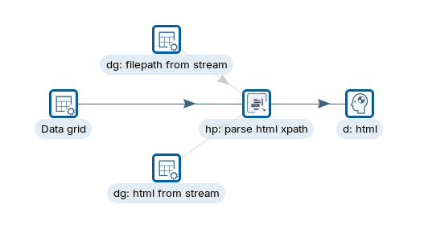
<figcaption>What you work with: one parser, three possible sources, two of them disabled</figcaption>
</figure>
</div>

> **Note:**
>
> #### HTML Parser
>
> **HTML Parser** extracts text from HTML or XML. It reads a single file or many inputs from the stream, works with local and virtual file systems, and selects content with an XPath expression or a CSS selector. It is built on jsoup, a Java library for parsing real-world HTML, and you find it in the **Input** folder.

<div class="pcm-embed-card" data-href="https://jsoup.org/" data-title="jsoup.org"></div>

:::: tabs

### 1. XPath from a File

> **Note:**
>
> #### XPath
>
> XPath (XML Path Language) is a query language for selecting nodes from an XML or HTML document. In this part the parser reads `homepage.html` from its path, first with no expression, then with expressions that select parts of the page.

**XPath syntax:**

| Expression | Selects |
| --- | --- |
| `/` | From the root node |
| `//` | Nodes anywhere in the document |
| `.` | The current node |
| `..` | The parent of the current node |
| `@` | Attributes |
| `[]` | A predicate (a condition) |

For example, `//div` selects every `div` element, `//div[@class='content']` every `div` with the class `content`, `//h1/text()` the text of every `h1`, and `//div[@class='content']/p` every `p` directly inside such a `div`.

**The page, `homepage.html`:**

```html
<!DOCTYPE html>
<html lang="en">
<head>
    <meta charset="UTF-8">
    <title>XPath Example Page</title>
</head>
<body>
    <header>
        <h1 id="main-title">Welcome to Our Website</h1>
        <nav>
            <ul>
                <li><a href="#home">Home</a></li>
                <li><a href="#about">About</a></li>
                <li><a href="#contact">Contact</a></li>
            </ul>
        </nav>
    </header>

    <main>
        <section id="featured-articles">
            <h2>Featured Articles</h2>
            <article>
                <h3>Article 1</h3>
                <p class="content">This is the content of article 1.</p>
                <span class="author">By John Doe</span>
            </article>
            <article>
                <h3>Article 2</h3>
                <p class="content">This is the content of article 2.</p>
                <span class="author">By Jane Smith</span>
            </article>
        </section>

        <section id="latest-news">
            <h2>Latest News</h2>
            <ul>
                <li>News item 1</li>
                <li>News item 2</li>
                <li>News item 3</li>
            </ul>
        </section>
    </main>

    <footer>
        <p>&copy; 2024 Our Website. All rights reserved.</p>
    </footer>
</body>
</html>
```

1. Start Spoon with the **Start Pentaho Data Integration** button below, or from a terminal:

::: tabs

### Windows (PowerShell)

```powershell
Set-Location C:\Pentaho\design-tools\data-integration
.\spoon.bat
```

### macOS / Linux

```bash
cd ~/Pentaho/design-tools/data-integration
./spoon.sh
```

:::

<button data-launch="spoon" data-path="">Start Pentaho Data Integration</button>

2. Select **File > Open** (`Ctrl+O`) and open `HTML Parser - Xpath.ktr` from the `Projects/genai/html` folder: `C:/Projects/genai/html` on Windows, `~/Projects/genai/html` on Linux.
3. Check that only the hop from **Data grid** to **hp: parse html xpath** is enabled. A disabled hop is drawn gray; to change one, right-click it and select **Enable** or **Disable**.
4. Double-click **hp: parse html xpath**. On the **Main** tab:
   * Under **Source**, select **File**, and set **File name** to the full path of `homepage.html` in the `data` folder, for example `/home/pentaho/Projects/genai/html/data/homepage.html` on Linux.
   * Under **Selector**, select **Xpath** and leave **Xpath Selector** empty.
   * Under **Target**, keep **Result Field name** `result`.

<div align="center">
<figure>
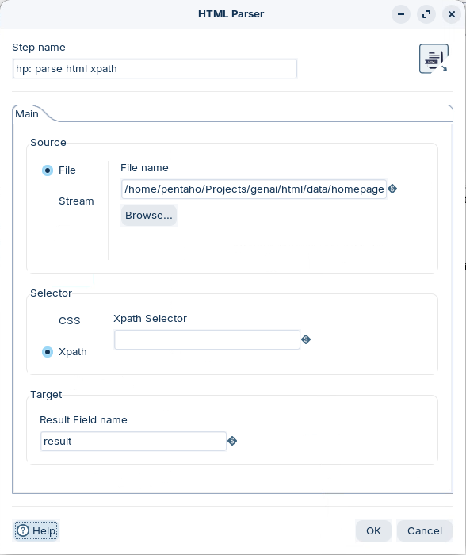
<figcaption>Source File, Xpath with no expression</figcaption>
</figure>
</div>

5. Select **OK**.
6. Press `F9` (**Action > Run**), and select **Run** in the **Run Options** dialog.
7. Select **d: html** on the canvas and open the **Preview data** tab.

<div align="center">
<figure>
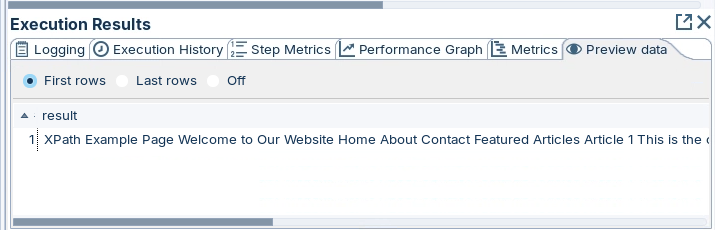
<figcaption>No expression: the text of the whole page</figcaption>
</figure>
</div>

> **Success:** Checkpoint: one row whose `result` holds the page's text with every tag removed. It starts `XPath Example Page Welcome to Our Website Home About Contact Featured Articles Article 1 This is the content of article 1.`

8. Double-click **hp: parse html xpath** and set **Xpath Selector** to `//h1[@id='main-title']`. Select **OK**, run the transformation again, and open the **Preview data** tab of **d: html**.

> **Success:** Checkpoint: `result` now holds only the selected element's text, the page title `Welcome to Our Website`, instead of the whole page.

9. Try the other expressions below in **Xpath Selector**, one at a time, and compare each `result` with the page:

| To select | Xpath Selector |
| --- | --- |
| All navigation links | `//nav//a` |
| All article titles (`h3` inside `article`) | `//article/h3` |
| The paragraph content of the articles | `//article/p[@class='content']` |
| All author names | `//span[@class='author']` |
| The latest news items | `//section[@id='latest-news']//li` |
| The footer text | `//footer/p/text()` |
| All section titles (`h2` directly in `section`) | `//section/h2` |
| The second article | `(//article)[2]` |
| Every element with a class attribute | `//*[@class]` |

> **Under the hood:**
>
> #### With no expression, the parser returned the text of every node
>
> The step parsed the page into a document tree with jsoup, then returned the text of the whole tree: the title, each heading, link, paragraph and list item, in document order, separated by spaces, with every tag and attribute dropped. An expression narrows that to the nodes it selects.
>
> **Why it matters:** an LLM prompt pays for every token. Tags, attributes and scripts are tokens that carry no meaning for the model; the parser's text is the content alone.

### 2. XPath from the Stream

> **Note:**
>
> #### XPath from a Field
>
> The parser can also take its input from an incoming field: either a file path (**Format** `File`), or the HTML itself (**Format** `Binary Datum`). Two data grids on the canvas supply each kind.

1. Right-click the hop from **dg: filepath from stream** to **hp: parse html xpath** and select **Enable**.
2. Right-click the hop from **Data grid** to **hp: parse html xpath** and select **Disable**. Leave the hop from **dg: html from stream** disabled.

<div align="center">
<figure>
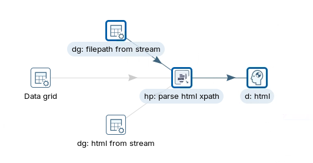
<figcaption>The file path now comes from dg: filepath from stream</figcaption>
</figure>
</div>

3. Double-click **hp: parse html xpath**. Under **Source**, select **Stream**, set **Format** to `File` and **Field name** to `filepath`. Leave **Xpath Selector** empty and keep **Result Field name** `result`.

<div align="center">
<figure>
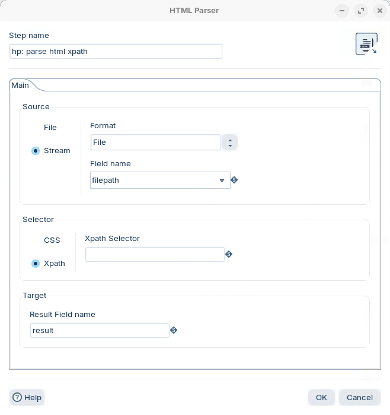
<figcaption>Source Stream, Format File: the field holds a path</figcaption>
</figure>
</div>

4. Select **OK**.
5. Press `F9` (**Action > Run**), and select **Run** in the **Run Options** dialog.
6. Select **d: html** on the canvas and open the **Preview data** tab.

<div align="center">
<figure>
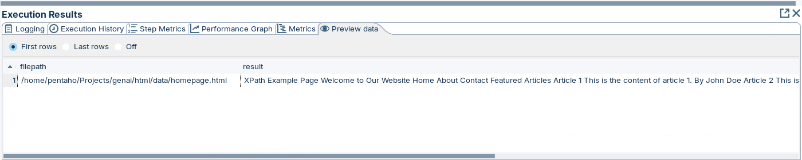
<figcaption>The path from the stream, and the page's text</figcaption>
</figure>
</div>

> **Success:** Checkpoint: one row with `filepath`, the path to `homepage.html`, and the same `result` as before, starting `XPath Example Page Welcome to Our Website`.

7. Right-click the hop from **dg: html from stream** to **hp: parse html xpath** and select **Enable**.
8. Right-click the hop from **dg: filepath from stream** to **hp: parse html xpath** and select **Disable**. Leave the hop from **Data grid** disabled.

<div align="center">
<figure>
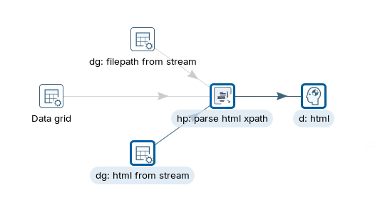
<figcaption>The HTML itself now comes from dg: html from stream</figcaption>
</figure>
</div>

9. Double-click **hp: parse html xpath**. Under **Source**, keep **Stream**, set **Format** to `Binary Datum` and **Field name** to `html`.

<div align="center">
<figure>
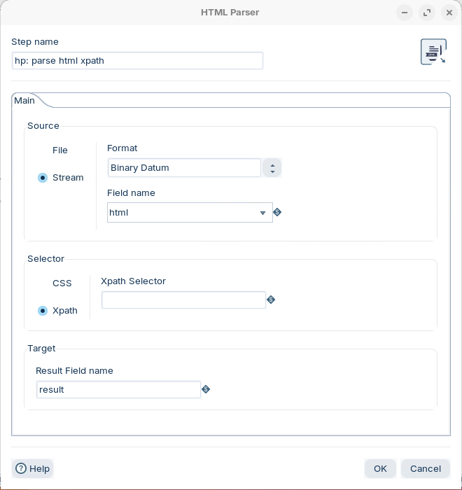
<figcaption>Source Stream, Format Binary Datum: the field holds the HTML</figcaption>
</figure>
</div>

10. Select **OK**, run the transformation, and open the **Preview data** tab of **d: html**.

<div align="center">
<figure>
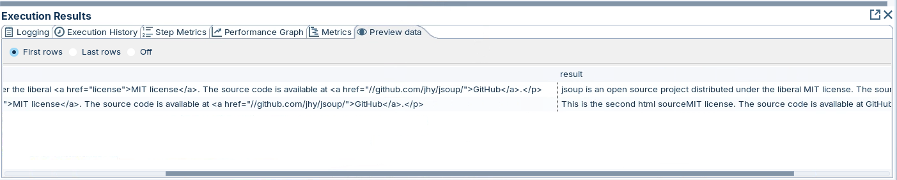
<figcaption>Two HTML values in, two lines of text out</figcaption>
</figure>
</div>

> **Success:** Checkpoint: two rows, one per HTML value in **dg: html from stream**. The `result` of the first starts `jsoup is an open source project distributed under the liberal MIT license.`, the second starts `This is the second html source`.

**Why Binary Datum:** a Pentaho Data Integration field can carry a large text object such as an HTML page as binary data, one uninterpreted block. The page passes through the transformation untouched until the parser reads it, with nothing trying to interpret or change the HTML on the way.

### 3. CSS from a File

> **Note:**
>
> #### CSS Selectors
>
> CSS selectors are the patterns style sheets use to target elements, and they select elements for extraction in the same way. In this part the parser reads `landingpage.html` with **CSS** as the selector type.

**CSS selector syntax:**

| Kind | Selector | Selects |
| --- | --- | --- |
| Element | `p` | All `p` elements |
| Class | `.highlight`, `p.highlight` | Elements (or `p` elements) with `class="highlight"` |
| ID | `#header` | The element with `id="header"` |
| Universal | `*` | All elements |
| Descendant | `div p` | `p` elements anywhere inside a `div` |
| Child | `ul > li` | `li` elements directly inside a `ul` |
| Adjacent sibling | `h1 + p` | The first `p` right after an `h1` |
| General sibling | `h1 ~ p` | All `p` siblings after an `h1` |
| Attribute | `[type]`, `[type="text"]` | Elements with the attribute, or with that value |
| Attribute word | `[class~="highlight"]` | A class list that contains the word `highlight` |
| Attribute start, end, contains | `[href^="https"]`, `[href$=".pdf"]`, `[href*="example"]` | An `href` that starts with, ends with, or contains the value |
| Pseudo-class | `a:first-child`, `p:last-child`, `li:nth-child(2n)`, `input:not(:checked)` | First child, last child, every even item, unchecked inputs |
| Group | `div.highlight, p.important` | Either selector |

**The page, `landingpage.html`:**

```html
<!DOCTYPE html>
<html lang="en">
<head>
    <meta charset="UTF-8">
    <title>TechGadgets - Your Electronics Store</title>
</head>
<body>
    <header id="main-header">
        <h1>TechGadgets</h1>
        <nav>
            <ul>
                <li><a href="#home">Home</a></li>
                <li><a href="#products">Products</a></li>
                <li><a href="#about">About</a></li>
                <li><a href="#contact">Contact</a></li>
            </ul>
        </nav>
    </header>

    <main>
        <section id="featured-products">
            <h2>Featured Products</h2>
            <div class="product">
                <h3>Smartphone X</h3>
                <p class="description">The latest smartphone with advanced features.</p>
                <span class="price">$999</span>
            </div>
            <div class="product">
                <h3>Laptop Pro</h3>
                <p class="description">Powerful laptop for professionals.</p>
                <span class="price">$1499</span>
            </div>
        </section>

        <section id="about">
            <h2>About Us</h2>
            <p>TechGadgets is your one-stop shop for all electronics needs.</p>
        </section>

        <section id="newsletter">
            <h2>Subscribe to Our Newsletter</h2>
            <form>
                <input type="email" name="email" placeholder="Enter your email">
                <button type="submit">Subscribe</button>
            </form>
        </section>
    </main>

    <footer>
        <p>&copy; 2024 TechGadgets. All rights reserved.</p>
    </footer>
</body>
</html>
```

<div align="center">
<figure>
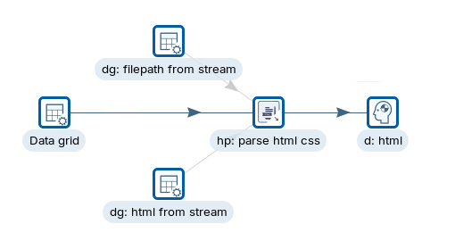
<figcaption>The CSS transformation has the same three sources</figcaption>
</figure>
</div>

1. Select **File > Open** (`Ctrl+O`) and open `HTML Parser - CSS.ktr` from the `Projects/genai/html` folder.
2. Check that only the hop from **Data grid** to **hp: parse html css** is enabled.
3. Double-click **hp: parse html css**. On the **Main** tab:
   * Under **Source**, select **File**, and set **File name** to the full path of `landingpage.html` in the `data` folder.
   * Under **Selector**, select **CSS** and leave **CSS Selector** empty.
   * Under **Target**, keep **Result Field name** `result`.

<div align="center">
<figure>
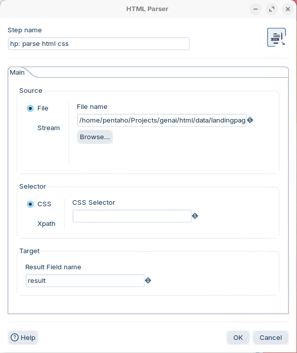
<figcaption>Source File, CSS with no selector</figcaption>
</figure>
</div>

4. Select **OK**.
5. Press `F9` (**Action > Run**), and select **Run** in the **Run Options** dialog.
6. Select **d: html** on the canvas and open the **Preview data** tab.

<div align="center">
<figure>
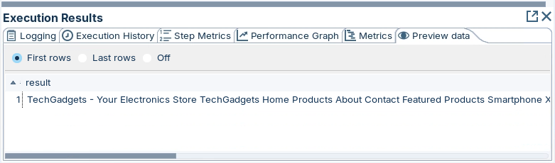
<figcaption>No selector: the text of the whole page</figcaption>
</figure>
</div>

> **Success:** Checkpoint: one row whose `result` starts `TechGadgets - Your Electronics Store TechGadgets Home Products About Contact Featured Products Smartphone X`.

7. Try these selectors in **CSS Selector**, one at a time, running and previewing after each:

| To select | CSS Selector |
| --- | --- |
| The main title | `h1` |
| All navigation links | `nav a` |
| All product titles | `.product h3` |
| All product descriptions | `.product .description` |
| All product prices | `.product .price` |
| The About Us section | `#about` |
| The newsletter form | `#newsletter form` |
| All section titles | `main h2` |
| The footer text | `footer p` |
| Every element with the class `product` | `.product` |

> **Success:** Checkpoint: each selector narrows `result` to the selected elements' text; `.product .price`, for example, returns the two prices, `$999` and `$1499`, instead of the whole page.

### 4. CSS from the Stream

> **Note:**
>
> #### CSS from a Field
>
> The same two stream sources as in the XPath part, with the CSS parser.

1. Right-click the hop from **dg: filepath from stream** to **hp: parse html css** and select **Enable**.
2. Right-click the hop from **Data grid** to **hp: parse html css** and select **Disable**. Leave the hop from **dg: html from stream** disabled.

<div align="center">
<figure>
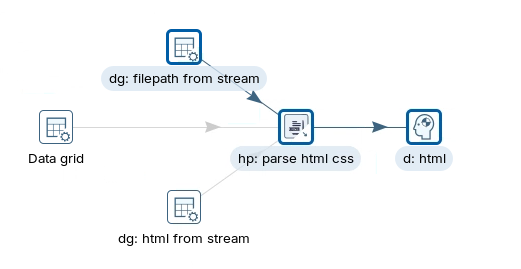
<figcaption>The file path comes from the stream</figcaption>
</figure>
</div>

3. Double-click **hp: parse html css**. Under **Source**, select **Stream**, set **Format** to `File` and **Field name** to `filepath`. Leave **CSS Selector** empty.

<div align="center">
<figure>
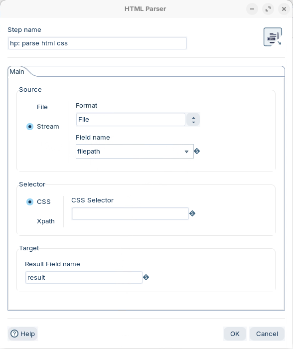
<figcaption>Source Stream, Format File</figcaption>
</figure>
</div>

4. Select **OK**, run the transformation, and open the **Preview data** tab of **d: html**.

<div align="center">
<figure>
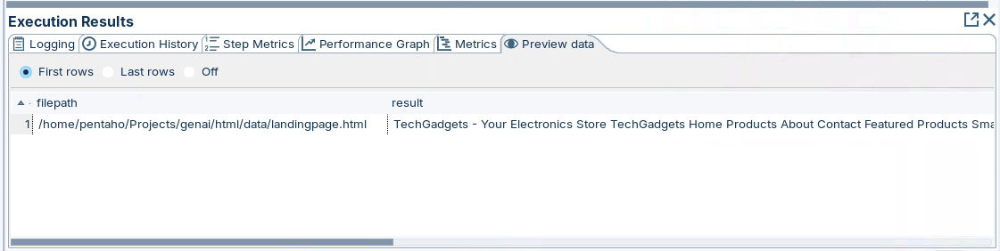
<figcaption>The path from the stream, and the page's text</figcaption>
</figure>
</div>

> **Success:** Checkpoint: one row with `filepath`, the path to `landingpage.html`, and a `result` that starts `TechGadgets - Your Electronics Store`.

5. Right-click the hop from **dg: html from stream** to **hp: parse html css** and select **Enable**.
6. Right-click the hop from **dg: filepath from stream** to **hp: parse html css** and select **Disable**.

<div align="center">
<figure>
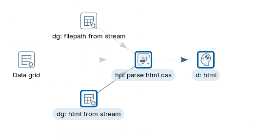
<figcaption>The HTML itself comes from the stream</figcaption>
</figure>
</div>

7. Double-click **hp: parse html css**. Under **Source**, keep **Stream**, set **Format** to `Binary Datum` and **Field name** to `html`.

<div align="center">
<figure>
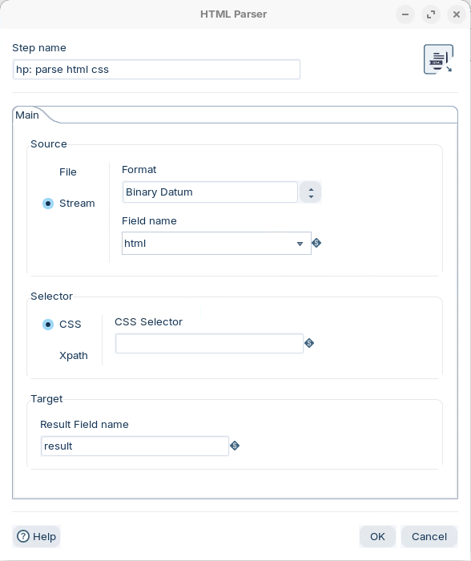
<figcaption>Source Stream, Format Binary Datum</figcaption>
</figure>
</div>

8. Select **OK**, run the transformation, and open the **Preview data** tab of **d: html**.

> **Success:** Checkpoint: one row per HTML value in **dg: html from stream**, each with its text, tags removed, in `result`.

::::

## Lab Files

Click a file to download. For `.ktr` and `.kjb` files, **Open in Pentaho Data Integration** launches Pentaho Data Integration with the file loaded. If Pentaho Data Integration is already running, the path is copied to your clipboard — switch to Pentaho Data Integration and press `Ctrl+O`, `Ctrl+V`, `Enter`.

_No bundled files for this lab._ The transformations and the two HTML pages are on the lab machine, in `Projects/genai/html` and its `data` folder.
