# HTML Parser

> **Warning:**
>
> #### Workshop - HTML Parser
>
> Web pages and help desk exports arrive as HTML, but a Large Language Model (LLM) prompt needs clean text. Build three Pentaho Data Integration transformations that pull text out of HTML with the **HTML Parser** step of the GenAI plugin suite: from a file, from file paths in the stream, and from HTML held in a field, with XPath expressions and CSS selectors.
>
> **What you'll do**
>
> * Extract the whole text of a page, with every tag removed
> * Select the article titles and authors of a page with XPath expressions
> * Select product names, prices and a paragraph with CSS selectors
> * Read the title of every page in a folder from file paths in the stream
> * Clean the HTML bodies of support e-mails held in a field
>
> **Prerequisites:**
>
> * The GenAI plugin suite installed, with a license that includes GenAI (GENAI-EE) rights, as set up in [Before You Start](../00-before-you-start/guide.md)
> * The Documents to Text [Overview](../02-genai/guide.md)
>
> **Estimated time:** 35 minutes

<figure>

<figcaption class="pcm-video-caption">Walkthrough: coming soon</figcaption>

</figure>

<div align="center">
<figure>
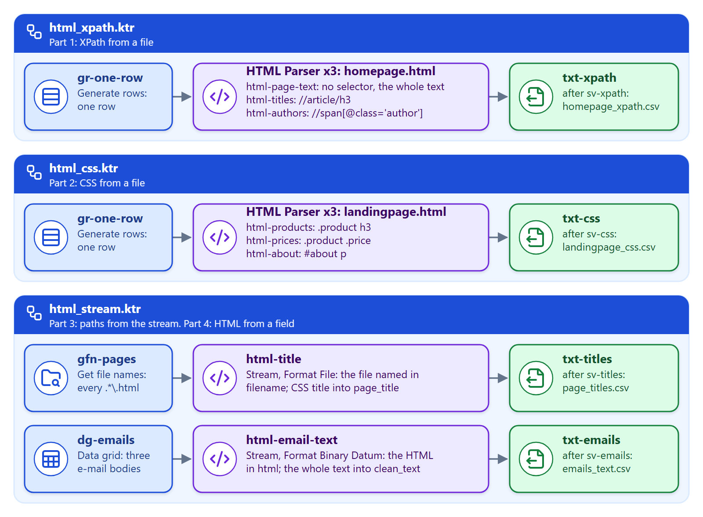
<figcaption>What you build: three transformations and the file each flow writes</figcaption>
</figure>
</div>

:::: tabs

### 1. XPath from a File

> **Note:**
>
> #### The HTML Parser and XPath
>
> **HTML Parser** extracts text from HTML or XML, from a file or from a field, and can narrow it to the elements a selector picks. In this part it reads `homepage.html`, a blog's home page, three times: once for the whole text, once for the article titles and once for the authors.

**XPath** (XML Path Language) selects nodes from an XML or HTML document by their place in the tree:

| Expression | Selects |
| --- | --- |
| `/` | From the root node |
| `//` | Nodes anywhere in the document |
| `.` | The current node |
| `..` | The parent of the current node |
| `@` | Attributes |
| `[]` | A predicate (a condition) |

For example, `//article/h3` selects every `h3` directly inside an `article`, and `//span[@class='author']` every `span` whose `class` is `author`.

**The page:** `homepage.html` has a header with the title `Welcome to the Northwind Data Blog` (`h1` with the id `main-title`) and a navigation list, a **Featured Articles** section with three `article` elements (each an `h3` title, a `p` with the class `content` and a `span` with the class `author`), a **Latest News** list, a footer, and in its `head` a style sheet and a script. Open it in a browser or a text editor to see the markup.

1. Start Spoon with the **Start Pentaho Data Integration** button below, or from PowerShell:

```powershell
Set-Location C:\Pentaho\design-tools\data-integration
.\Spoon.bat
```

<button data-launch="spoon" data-path="">Start Pentaho Data Integration</button>

2. Select **File > New > Transformation** (`Ctrl+N`).
3. Select **File > Save as** and save it as `html_xpath.ktr` in `C:\Workshop-AI-Specialty\03-documents-to-text\03-genai-html-parser`, next to `homepage.html`. (On your own machine, download `homepage.html` and `landingpage.html` from **Lab Files** below into the folder you save in.)
4. On the **Design** tab, open the **Input** folder and drag **Generate rows** onto the canvas.
5. Double-click **Generate rows**. Set **Step name** to `gr-one-row` and **Limit** to `1`.
6. In the **Fields** grid, add one row: **Name** `page`, **Type** `String`, **Value** `homepage.html`. Select **OK**.

> **Under the hood:**
>
> #### The parser runs once for every row it receives
>
> **HTML Parser** has no rows of its own: it reads its file once for each incoming row and adds the text to that row. With no hop into it, it would never run. One generated row makes it read the page once.
>
> **Why it matters:** the same rule explains the later parts. Ten rows into a step in **File** mode read the same file ten times; to read ten files, the paths come from the stream instead.

7. On the **Design** tab, open the **Input** folder and drag **HTML Parser** onto the canvas.
8. Create a hop from **gr-one-row** to **HTML Parser**: hold `Shift` and drag from one step to the other.
9. Double-click **HTML Parser** and set **Step name** to `html-page-text`.

<div align="center">
<figure>
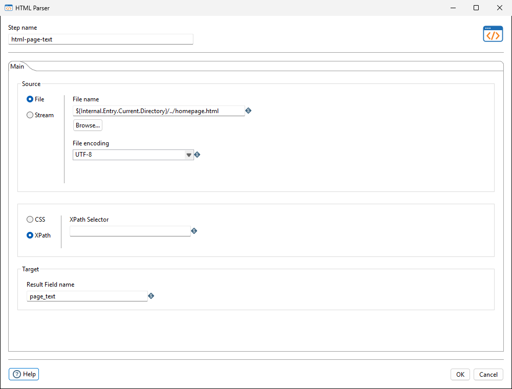
<figcaption>html-page-text: its settings</figcaption>
</figure>
</div>

10. On the **Main** tab, under **Source**, select **File** and set **File name** to `${Internal.Entry.Current.Directory}/homepage.html`. Keep **File encoding** `UTF-8`, its default.
11. Under **Selector**, select **XPath** and leave **XPath Selector** empty.
12. Under **Target**, set **Result Field name** to `page_text`. Select **OK**.
13. Add two more **HTML Parser** steps with the same **Source** settings (**File**, `${Internal.Entry.Current.Directory}/homepage.html`) and **Selector** **XPath**, and create the hops **html-page-text** to **html-titles** and **html-titles** to **html-authors**:

| Step name | XPath Selector | Result Field name |
| --- | --- | --- |
| `html-titles` | `//article/h3` | `article_titles` |
| `html-authors` | `//span[@class='author']` | `authors` |

<div align="center">
<figure>
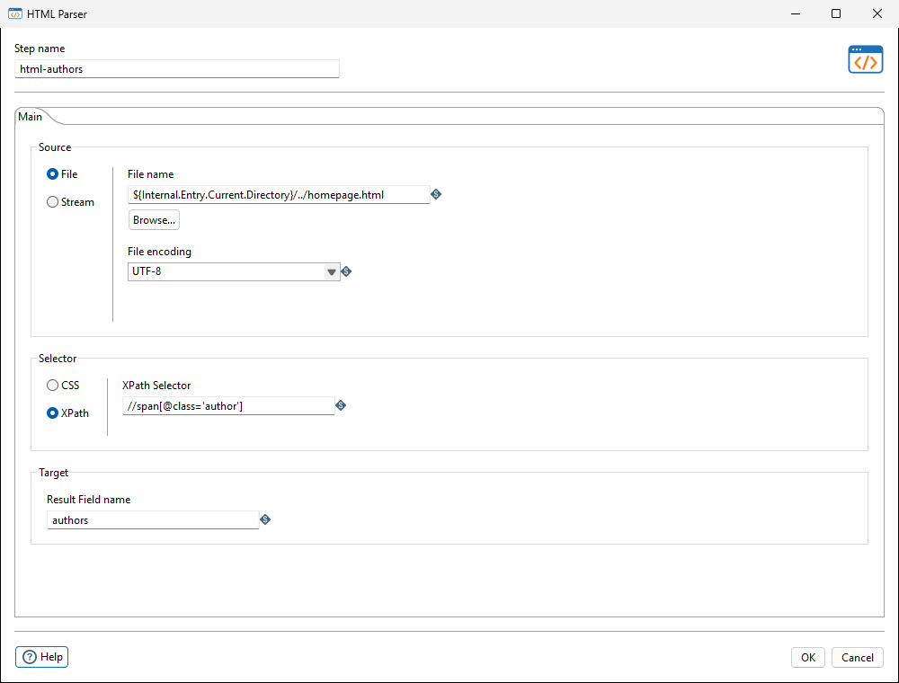
<figcaption>html-authors: its settings</figcaption>
</figure>
</div>

<div align="center">
<figure>
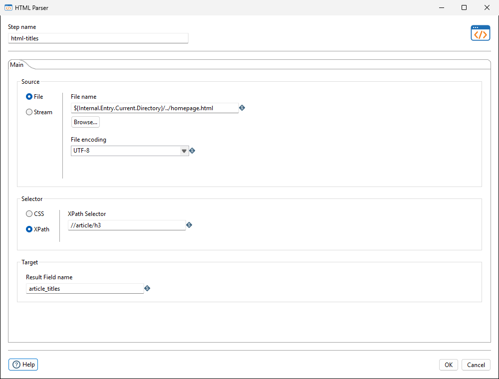
<figcaption>html-titles: its settings</figcaption>
</figure>
</div>

14. On the **Design** tab, open the **Transform** folder and drag **Select values** onto the canvas. Create a hop from **html-authors** to **Select values**.
15. Double-click **Select values**, set **Step name** to `sv-xpath`, and on the **Select & Alter** tab list these fields in this order: `page`, `article_titles`, `authors`, `page_text`. Select **OK**.
16. On the **Design** tab, open the **Output** folder and drag **Text file output** onto the canvas. Create a hop from **sv-xpath** to **Text file output**.
17. Double-click **Text file output** and set **Step name** to `txt-xpath`. On the **File** tab, set **Filename** to `${Internal.Entry.Current.Directory}/homepage_xpath` and **Extension** to `csv`, and select **Create Parent folder**. On the **Content** tab, set **Encoding** to `UTF-8`. On the **Fields** tab, select **Get Fields**, then **Minimal width**, and select **OK**.
18. Save the transformation (`Ctrl+S`).
19. Press `F9` (**Action > Run**), and select **Run** in the **Run Options** dialog.
20. Select **txt-xpath** on the canvas and open the **Preview data** tab.

<!-- UNPROVEN: the HTML Parser cannot run without a GENAI-EE license. The values below are what jsoup 1.23.2, the library the step calls (Jsoup.parse, then selectXpath(...).text() or text()), returns for homepage.html; confirm them in Spoon once the license arrives. -->

> **Success:** Checkpoint: one row. `article_titles` is `Cleaning Web Pages Before a Prompt Five Lessons from Our First RAG Pipeline Local Models on a Laptop`, `authors` is `By Maria Lopez By Daniel Chen By Priya Natarajan`, and `page_text` starts `Northwind Data Blog Welcome to the Northwind Data Blog Home Articles About Contact Featured Articles`.

Compare the values with the page in your browser: the titles and authors are those of the three articles, in page order.

> **Under the hood:**
>
> #### The step parsed the page into a tree and joined the text of the nodes it selected
>
> **HTML Parser** hands the page to jsoup, a Java library that parses real-world HTML into a document tree. With an XPath expression, it returns the text of every node the expression selects, joined by single spaces; with none, the text of the whole page in document order. Tags, attributes, and the contents of the `style` and `script` elements are not text, so none of them reach `page_text`.
>
> **Why it matters:** an LLM prompt pays for every token. Markup and scripts are tokens that carry no meaning for the model, and a selector keeps only the part of the page the prompt is about.

21. Try other expressions. Double-click **html-titles**, replace its **XPath Selector** with one from the table, select **OK**, run, and preview **txt-xpath** again. Set it back to `//article/h3` when you are done.

| To select | XPath Selector |
| --- | --- |
| The page title in the header | `//h1[@id='main-title']` |
| All navigation links | `//nav//a` |
| The article paragraphs | `//article/p[@class='content']` |
| The latest news items | `//section[@id='latest-news']//li` |
| All section titles | `//section/h2` |
| The second article, title, text and author | `(//article)[2]` |
| Every element with a class attribute | `//*[@class]` |

### 2. CSS from a File

> **Note:**
>
> #### CSS Selectors
>
> CSS selectors are the patterns style sheets use to target elements, and the parser accepts them as a second kind of selector. Build `html_css.ktr`, which reads `landingpage.html`, an online store's landing page, for its product names, its prices and its About Us text.

**CSS selector syntax:**

| Kind | Selector | Selects |
| --- | --- | --- |
| Element | `p` | All `p` elements |
| Class | `.price`, `span.price` | Elements (or `span` elements) with `class="price"` |
| ID | `#about` | The element with `id="about"` |
| Descendant | `.product h3` | `h3` elements anywhere inside an element with the class `product` |
| Child | `ul > li` | `li` elements directly inside a `ul` |
| Attribute | `[data-sku]`, `[type="email"]` | Elements with the attribute, or with that value |
| Attribute start, end, contains | `[href^="https"]`, `[href$=".pdf"]`, `[href*="example"]` | An `href` that starts with, ends with, or contains the value |
| Pseudo-class | `li:first-child`, `li:nth-child(2n)` | The first item, every even item |
| Group | `h1, h2` | Either selector |

**The page:** `landingpage.html` has a header (`header` with the id `main-header`) with the store's name in an `h1`, a **Featured Products** section with three `div` elements of the class `product` (each an `h3` name, a `p` with the class `description` and a `span` with the class `price`), an **About Us** section (`section` with the id `about`), a newsletter form and a footer.

1. Select **File > New > Transformation** (`Ctrl+N`), then **File > Save as**, and save it as `html_css.ktr` in `C:\Workshop-AI-Specialty\03-documents-to-text\03-genai-html-parser`.
2. Add **Generate rows** as in the first part: **Step name** `gr-one-row`, **Limit** `1`, one field **Name** `page`, **Type** `String`, **Value** `landingpage.html`.
3. Add three **HTML Parser** steps, each after the one before it, the first after **gr-one-row**. In each, under **Source**, select **File** and set **File name** to `${Internal.Entry.Current.Directory}/landingpage.html`; under **Selector**, select **CSS**:

| Step name | CSS Selector | Result Field name |
| --- | --- | --- |
| `html-products` | `.product h3` | `product_names` |
| `html-prices` | `.product .price` | `prices` |
| `html-about` | `#about p` | `about_text` |

<div align="center">
<figure>
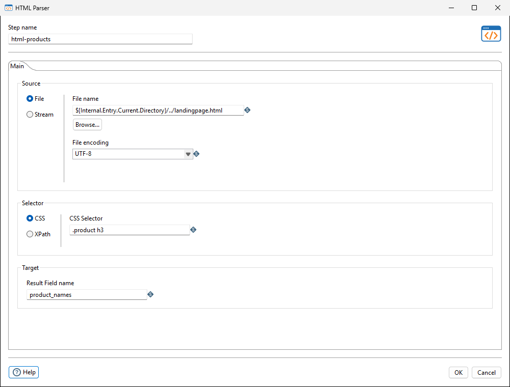
<figcaption>html-products: its settings</figcaption>
</figure>
</div>

<div align="center">
<figure>
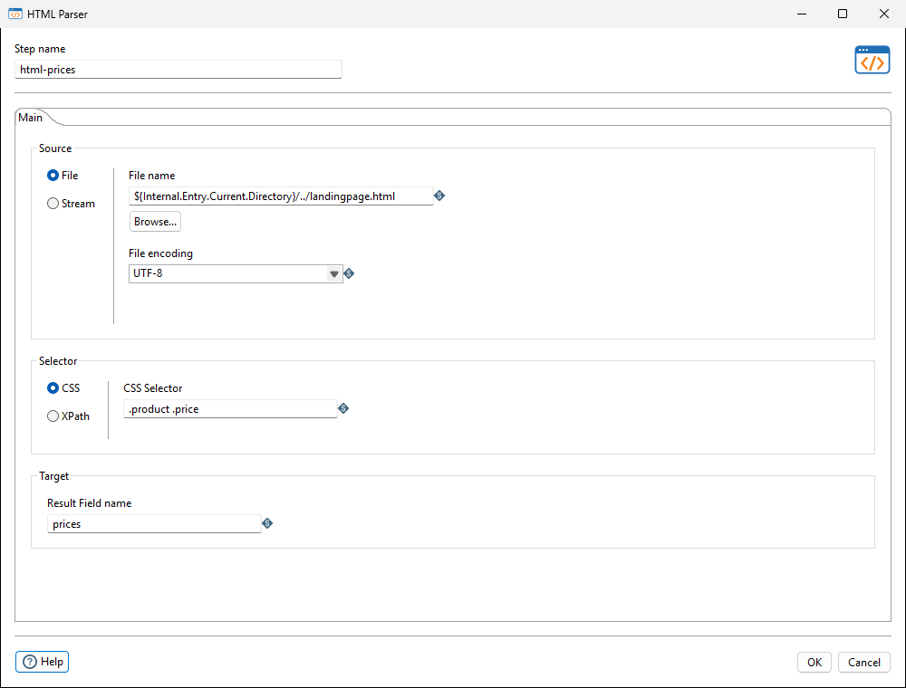
<figcaption>html-prices: its settings</figcaption>
</figure>
</div>

<div align="center">
<figure>
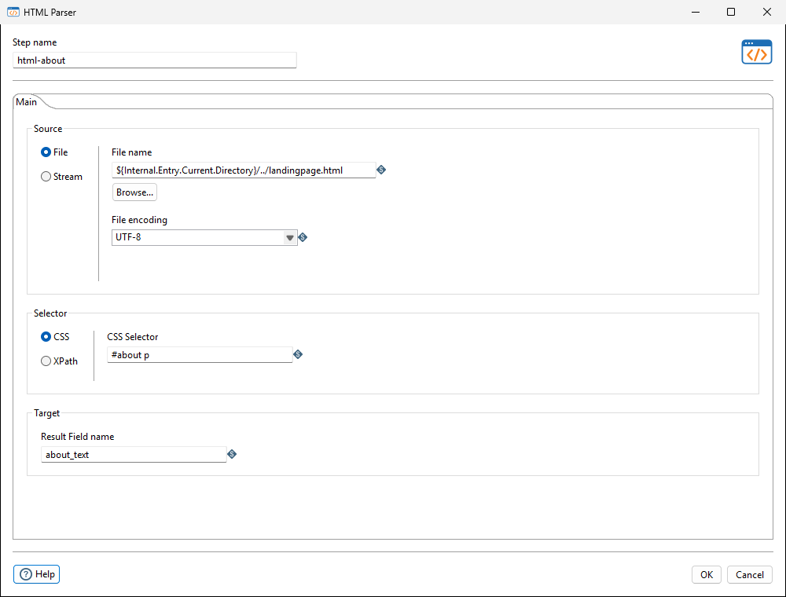
<figcaption>html-about: its settings</figcaption>
</figure>
</div>

4. Add **Select values** after **html-about**: **Step name** `sv-css`, and on the **Select & Alter** tab the fields `page`, `product_names`, `prices`, `about_text`, in this order.
5. Add **Text file output** after **sv-css**: **Step name** `txt-css`, **Filename** `${Internal.Entry.Current.Directory}/landingpage_css`, **Extension** `csv`, **Create Parent folder** selected, **Encoding** `UTF-8`, and on the **Fields** tab **Get Fields**, then **Minimal width**.
6. Save the transformation (`Ctrl+S`), press `F9` (**Action > Run**), and select **Run** in the **Run Options** dialog.
7. Select **txt-css** on the canvas and open the **Preview data** tab.

<!-- UNPROVEN: values computed with jsoup 1.23.2 (select(...).text()), as above; confirm in Spoon once the GENAI-EE license arrives. -->

> **Success:** Checkpoint: one row. `product_names` is `Smartphone X Laptop Pro 15 Noise-Cancelling Headphones`, `prices` is `$999 $1,499 $249`, and `about_text` is `TechGadgets has sold electronics online since 2012 and ships to every state.`

8. Open `C:\Workshop-AI-Specialty\03-documents-to-text\03-genai-html-parser\landingpage_css.csv`.

<!-- UNPROVEN: the file's shape follows from the Text file output settings; confirm once the GENAI-EE license lets the solution run. -->

> **Success:** Checkpoint: its first line is `page,product_names,prices,about_text`, followed by 1 row. `prices` is written in quotes, because its value contains the separator: `"$999 $1,499 $249"`.

9. Try other selectors in **html-about**, running and previewing after each, then set it back to `#about p`:

| To select | CSS Selector |
| --- | --- |
| The store name | `h1` |
| All navigation links | `nav a` |
| The product descriptions | `.product .description` |
| The About Us section, heading included | `#about` |
| All section titles | `main h2` |
| Every element with a `data-sku` attribute | `[data-sku]` |
| The footer text | `footer p` |

> **Under the hood:**
>
> #### Several matches became one value, not several rows
>
> `.product .price` matches three elements, and the step returned their text in one field, separated by spaces: one row in, one row out, whatever the selector matches. The prices `$999 $1,499 $249` are therefore one string, not a list.
>
> **Why it matters:** for a prompt, one block of clean text per page is what you want. When each match must become its own row, select the whole page (or the section) here and split the text in a later step.

### 3. Paths from the Stream

> **Note:**
>
> #### File Paths in a Field
>
> In **Stream** mode with **Format** `File`, every incoming row names a file to read. Build `html_stream.ktr`: **Get File Names** lists the HTML pages in the lab folder, and one **HTML Parser** reads each page's title.

1. Select **File > New > Transformation** (`Ctrl+N`), then **File > Save as**, and save it as `html_stream.ktr` in `C:\Workshop-AI-Specialty\03-documents-to-text\03-genai-html-parser`.
2. On the **Design** tab, open the **Input** folder and drag **Get file names** onto the canvas.
3. Double-click **Get file names** and set **Step name** to `gfn-pages`.
4. On the **File** tab, set **File or directory** to `${Internal.Entry.Current.Directory}` and **Wildcard (RegExp)** to `.*\.html`, and select **Add**. The pair moves to the **Selected files** grid.
5. Select **Show filename(s)...**.

> **Success:** Checkpoint: the list shows 2 files, `homepage.html` and `landingpage.html`, in the lab folder. Select **Close**, then **OK**.

6. Add **HTML Parser** after **gfn-pages**. Set **Step name** to `html-title`. Under **Source**, select **Stream**, keep **Format** `File`, and set **Field name** to `filename`. Under **Selector**, select **CSS** and set **CSS Selector** to `title`. Under **Target**, set **Result Field name** to `page_title`. Select **OK**.

<div align="center">
<figure>
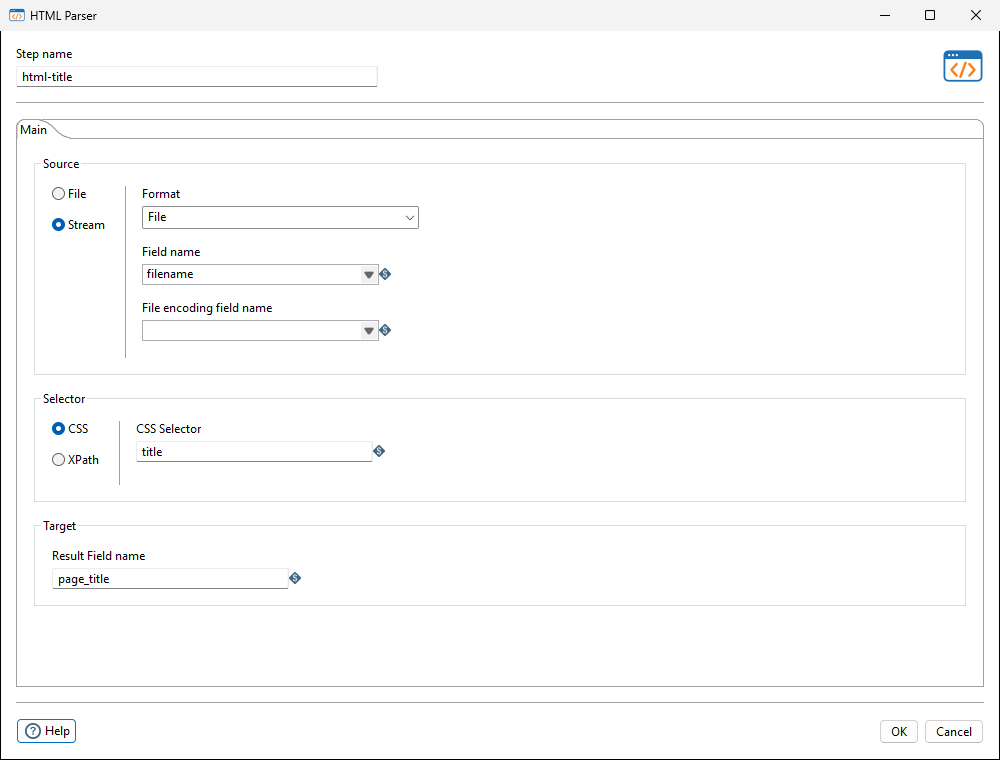
<figcaption>html-title: its settings</figcaption>
</figure>
</div>

7. Add **Select values** after **html-title**: **Step name** `sv-titles`, and on the **Select & Alter** tab the fields `short_filename` and `page_title`.
8. Add **Text file output** after **sv-titles**: **Step name** `txt-titles`, **Filename** `${Internal.Entry.Current.Directory}/page_titles`, **Extension** `csv`, **Create Parent folder** selected, **Encoding** `UTF-8`, and on the **Fields** tab **Get Fields**, then **Minimal width**.
9. Save the transformation (`Ctrl+S`), press `F9` (**Action > Run**), and select **Run** in the **Run Options** dialog.
10. Select **txt-titles** on the canvas and open the **Preview data** tab.

<!-- UNPROVEN: titles computed with jsoup 1.23.2; confirm in Spoon once the GENAI-EE license arrives. -->

> **Success:** Checkpoint: 2 rows: `homepage.html` with `page_title` `Northwind Data Blog`, and `landingpage.html` with `TechGadgets - Your Electronics Store`.

Each row keeps the fields **Get file names** added, so `short_filename` says which page each title came from.

> **Under the hood:**
>
> #### Get File Names gave every page its own row, and the parser read the file each row named
>
> **Get file names** writes one row per matching file, with its full path in `filename`, its name in `short_filename`, and its size, extension and dates. In **Stream** mode with **Format** `File`, the parser opens the file named in `filename` on each row, so the same step reads two pages, or two thousand.
>
> **Why it matters:** the folder decides how many pages the transformation reads, not the transformation. Drop a third page into the folder and the next run reads it, with no change to the steps.

### 4. HTML from a Field

> **Note:**
>
> #### HTML in a Field
>
> With **Format** `Binary Datum`, the field holds the HTML itself, not a path. Help desks and CRMs export message bodies that way. Add a second flow to `html_stream.ktr` that cleans the HTML bodies of three support e-mails.

1. On the **Design** tab, open the **Input** folder and drag **Data grid** onto the canvas, below the first flow.
2. Double-click **Data grid** and set **Step name** to `dg-emails`. On the **Meta** tab, fill the grid:

| Name | Type |
| --- | --- |
| `ticket_id` | Integer |
| `html` | String |

3. On the **Data** tab, enter these 3 rows. Copy each `html` value as it is, on one line:

| ticket_id | html |
| --- | --- |
| `1001` | `<div><p>Hello,</p><p>My <b>Laptop Pro 15</b> will not charge since the last update. I tried a second charger.</p><p>Thanks, <i>Ana</i></p></div>` |
| `1002` | `<p>Order <a href="https://example.com/orders/58812">#58812</a> arrived with a cracked screen. Please send a replacement.</p>` |
| `1003` | `<table><tr><td>Product</td><td>Smartphone X</td></tr><tr><td>Issue</td><td>Battery drains in four hours</td></tr></table>` |

4. Select **OK**.
5. Add **HTML Parser** after **dg-emails**. Set **Step name** to `html-email-text`. Under **Source**, select **Stream**, set **Format** to `Binary Datum` and **Field name** to `html`. Under **Selector**, select **XPath** and leave **XPath Selector** empty. Under **Target**, set **Result Field name** to `clean_text`. Select **OK**.

<div align="center">
<figure>
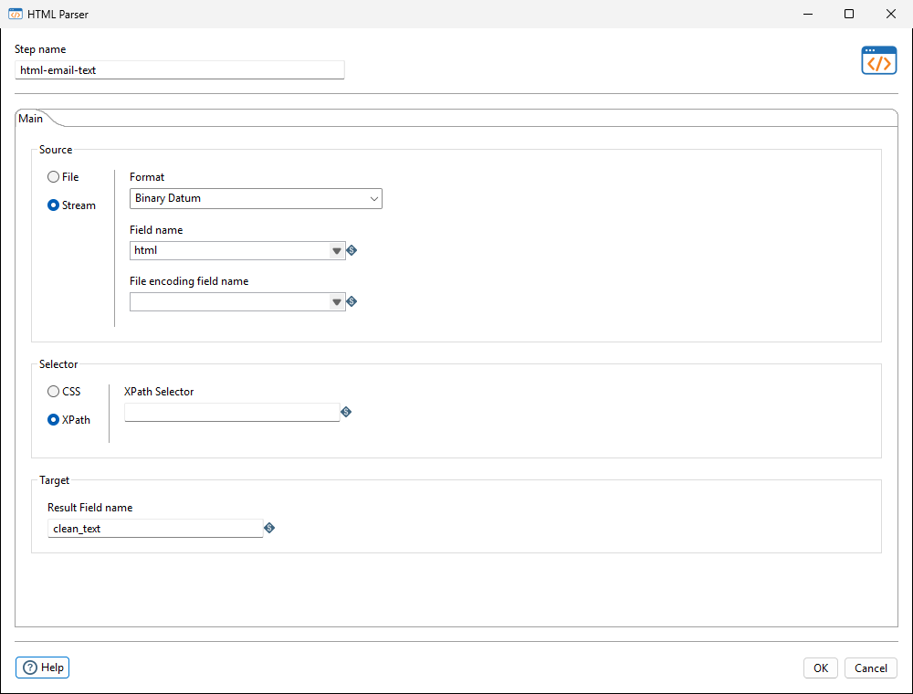
<figcaption>html-email-text: its settings</figcaption>
</figure>
</div>

6. Add **Select values** after **html-email-text**: **Step name** `sv-emails`, and on the **Select & Alter** tab the fields `ticket_id` and `clean_text`.
7. Add **Text file output** after **sv-emails**: **Step name** `txt-emails`, **Filename** `${Internal.Entry.Current.Directory}/emails_text`, **Extension** `csv`, **Create Parent folder** selected, **Encoding** `UTF-8`, and on the **Fields** tab **Get Fields**, then **Minimal width**.
8. Save the transformation (`Ctrl+S`), press `F9` (**Action > Run**), and select **Run** in the **Run Options** dialog. Both flows run.
9. Select **txt-emails** on the canvas and open the **Preview data** tab.

<!-- UNPROVEN: texts computed with jsoup 1.23.2 (Jsoup.parse(html).text()); confirm in Spoon once the GENAI-EE license arrives. -->

> **Success:** Checkpoint: 3 rows. Ticket `1001` reads `Hello, My Laptop Pro 15 will not charge since the last update. I tried a second charger. Thanks, Ana`, `1002` reads `Order #58812 arrived with a cracked screen. Please send a replacement.`, and `1003` reads `Product Smartphone X Issue Battery drains in four hours`.

The tags are gone, and the words they separated stay apart.

> **Under the hood:**
>
> #### One step replaced a regular expression that would get HTML wrong
>
> Without the plugin, cleaning these bodies takes a **Modified JavaScript value** or a **Replace in string** step with a regular expression such as `<[^>]+>`. That pattern leaves entities such as `&amp;` encoded, keeps the contents of `script` and `style` elements, and runs words together where a tag stood between them. **HTML Parser** parses each value as HTML, the way a browser does, and returns its text with entities decoded and whitespace normalized; in **Binary Datum** format the HTML never touches the file system.
>
> **Why it matters:** the text a prompt receives is the text a person would read, and a table such as ticket `1003`'s keeps its words apart, ready for the AI Chat step in the LLM Integration module.

::::

## Troubleshooting <!-- no-step -->

<details>
<summary>Error initializing step: License validation failed</summary>

The Pentaho license on this machine has no GenAI rights. Every step of the GenAI plugin suite checks, when the transformation starts, for a license with the GenAI Plugin Suite (GENAI-EE) subscription, and **HTML Parser** is one of them. Install a license that includes it, as described in [Before You Start](../00-before-you-start/guide.md).

</details>

<details>
<summary>The result field is empty</summary>

The selector matched nothing. Check that the **Selector** option matches the expression: an XPath expression in **CSS Selector**, or a CSS selector in **XPath Selector**, selects nothing. XPath attribute values need quotes: `//span[@class='author']`.

</details>

<details>
<summary>The step fails with Invalid File found</summary>

The file in **File name**, or in the `filename` field, does not exist. Check that `homepage.html` and `landingpage.html` are in the same folder as the transformation, and that the transformation was saved there, since `${Internal.Entry.Current.Directory}` is the folder of the saved file.

</details>

## Lab Files

Click a file to download. For `.ktr` and `.kjb` files, **Open in Pentaho Data Integration** launches Pentaho Data Integration with the file loaded. If Pentaho Data Integration is already running, the path is copied to your clipboard — switch to Pentaho Data Integration and press `Ctrl+O`, `Ctrl+V`, `Enter`.

The blog home page the first part reads with XPath, and the store landing page the second part reads with CSS:

[homepage.html](./files/homepage.html)

[landingpage.html](./files/landingpage.html)

### Solution <!-- no-step -->

The finished transformations for this lab. Open them alongside your own to compare, or run them to see the expected result. They read the pages from the lab folder and write their CSV files beside themselves.

Also on disk at `C:\Workshop-AI-Specialty\03-documents-to-text\03-genai-html-parser\solution`.

[html_xpath.ktr](./files/solution/html_xpath.ktr) <button data-launch="spoon" data-path="files/solution/html_xpath.ktr">Open in Pentaho Data Integration</button> <button data-graph="files/solution/html_xpath.ktr">View graph</button>

html_xpath in Spoon, with its note:

<div align="center">
<figure>
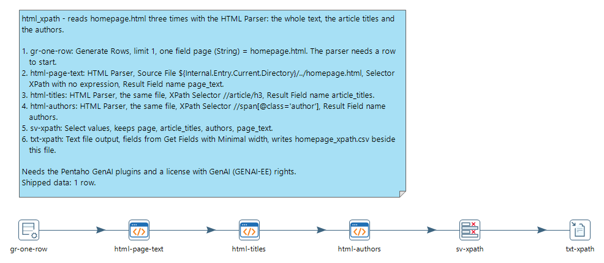
<figcaption>html_xpath.ktr in Spoon</figcaption>
</figure>
</div>

[html_css.ktr](./files/solution/html_css.ktr) <button data-launch="spoon" data-path="files/solution/html_css.ktr">Open in Pentaho Data Integration</button> <button data-graph="files/solution/html_css.ktr">View graph</button>

html_css in Spoon, with its note:

<div align="center">
<figure>
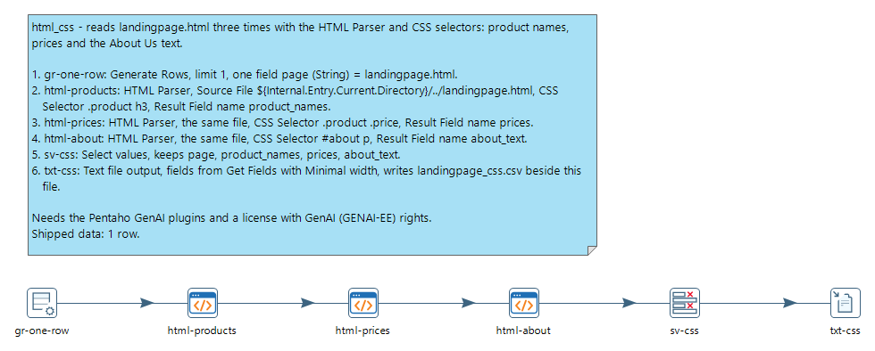
<figcaption>html_css.ktr in Spoon</figcaption>
</figure>
</div>

[html_stream.ktr](./files/solution/html_stream.ktr) <button data-launch="spoon" data-path="files/solution/html_stream.ktr">Open in Pentaho Data Integration</button> <button data-graph="files/solution/html_stream.ktr">View graph</button>

html_stream in Spoon, with its note:

<div align="center">
<figure>
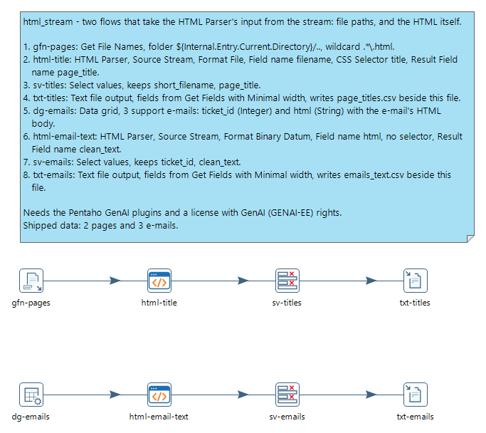
<figcaption>html_stream.ktr in Spoon</figcaption>
</figure>
</div>
