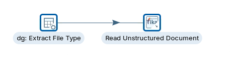
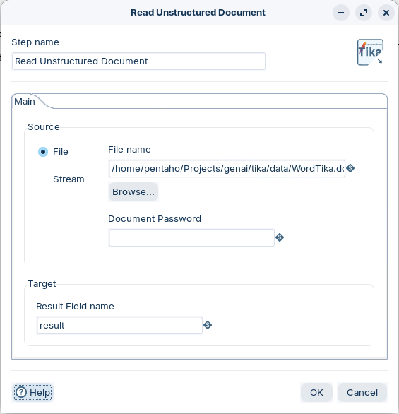
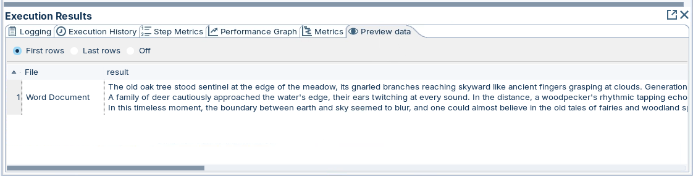
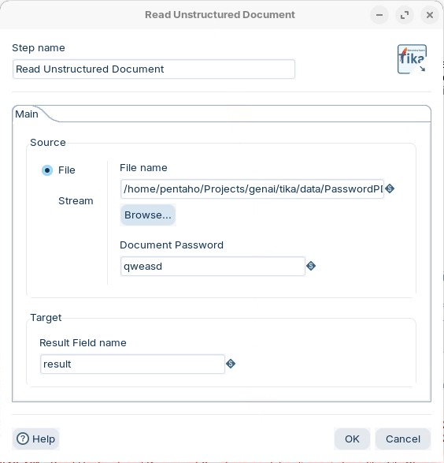
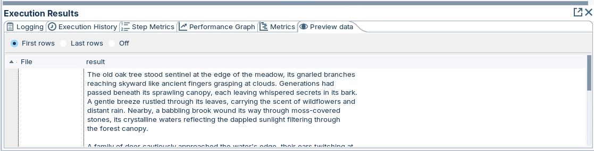
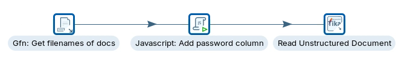
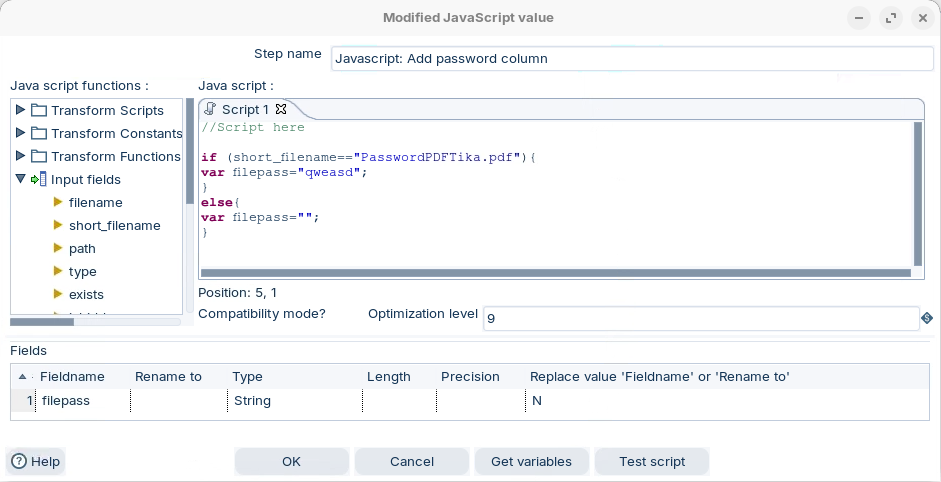
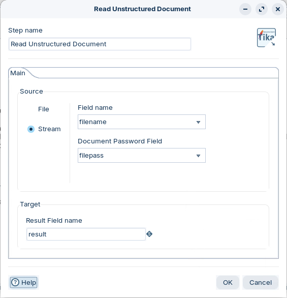
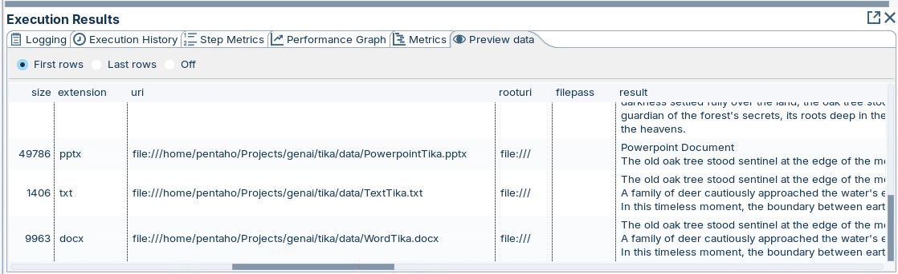

# Apache Tika

> **Warning:**
>
> #### Workshop - Apache Tika
>
> Office documents and PDFs hold the text a Large Language Model (LLM) prompt needs, locked in binary formats. Use the **Read Unstructured Document** step of the Pentaho GenAI plugin, built on Apache Tika, to extract that text: from a Word document, from a password-protected PDF, and from a whole folder of mixed files.
>
> **What you'll do**
>
> * Extract the text of a Word document named in the step
> * Open a password-protected PDF with its document password
> * Read every file in a folder, whatever its format, from file names in the stream
> * Supply a password per file from a field
>
> **Prerequisites:**
>
> * [HTML Parser](../03-genai-html-parser/guide.md)
> * Pentaho Data Integration with the Pentaho GenAI plugin, which adds **Read Unstructured Document** to the **Input** folder
> * The lab machine's `Projects/genai/tika` folder, with the three transformations below and, in its `data` folder, `WordTika.docx`, `PasswordPDFTika.pdf` and the other sample documents
>
> **Estimated time:** 15 minutes

<div align="center">
<figure>

<figcaption>The first two transformations: a data grid and the Tika step</figcaption>
</figure>
</div>

> **Note:**
>
> #### Apache Tika
>
> Apache Tika is a content analysis toolkit: it detects the format of a file and extracts its text and metadata, such as author, title, creation date and language. It reads PDFs, Word and PowerPoint documents, HTML and plain text among many formats, which makes it a common first step in pipelines that index, classify or summarize documents.

<div class="pcm-embed-card" data-href="https://tika.apache.org/" data-title="tika.apache.org"></div>

:::: tabs

### 1. Word Document

> **Note:**
>
> #### A Word Document
>
> The step reads one file, `WordTika.docx`, named in its **File name** setting. A data grid supplies one row, labeled `Word Document`, to trigger it.

**The document's text:**

```text
The old oak tree stood sentinel at the edge of the meadow, its gnarled branches reaching skyward like ancient fingers grasping at clouds. Generations had passed beneath its sprawling canopy, each leaving whispered secrets in its bark. A gentle breeze rustled through its leaves, carrying the scent of wildflowers and distant rain. Nearby, a babbling brook wound its way through moss-covered stones, its crystalline waters reflecting the dappled sunlight filtering through the forest canopy.
A family of deer cautiously approached the water's edge, their ears twitching at every sound. In the distance, a woodpecker's rhythmic tapping echoed through the trees, nature's own percussion. As the sun began its slow descent, the meadow came alive with the soft glow of fireflies, their bioluminescent dance a magical display against the deepening twilight. A lone owl hooted softly, heralding the arrival of night and all its mysterious inhabitants. The air grew cooler, and dew began to form on blades of grass, each droplet a miniature world reflecting the stars above.
In this timeless moment, the boundary between earth and sky seemed to blur, and one could almost believe in the old tales of fairies and woodland spirits. As darkness settled fully over the land, the oak tree stood as it always had, a silent guardian of the forest's secrets, its roots deep in the earth, its crown brushing the heavens.
```

1. Start Spoon with the **Start Pentaho Data Integration** button below, or from a terminal:

::: tabs

### Windows (PowerShell)

```powershell
Set-Location C:\Pentaho\design-tools\data-integration
.\spoon.bat
```

### macOS / Linux

```bash
cd ~/Pentaho/design-tools/data-integration
./spoon.sh
```

:::

<button data-launch="spoon" data-path="">Start Pentaho Data Integration</button>

2. Select **File > Open** (`Ctrl+O`) and open `Read Unstructured Document- Word Doc.ktr` from the `Projects/genai/tika` folder: `C:/Projects/genai/tika` on Windows, `~/Projects/genai/tika` on Linux.
3. Double-click **Read Unstructured Document**. On the **Main** tab:
   * Under **Source**, select **File**, and set **File name** to the full path of `WordTika.docx` in the `data` folder, for example `/home/pentaho/Projects/genai/tika/data/WordTika.docx` on Linux.
   * Leave **Document Password** empty.
   * Under **Target**, keep **Result Field name** `result`.

<div align="center">
<figure>

<figcaption>Source File: one Word document, no password</figcaption>
</figure>
</div>

4. Select **OK**.
5. Press `F9` (**Action > Run**), and select **Run** in the **Run Options** dialog.
6. Select **Read Unstructured Document** on the canvas and open the **Preview data** tab.

<div align="center">
<figure>

<figcaption>The Word document's text in one field</figcaption>
</figure>
</div>

> **Success:** Checkpoint: one row, with `File` `Word Document` and a `result` that holds the document's three paragraphs, starting `The old oak tree stood sentinel at the edge of the meadow`.

### 2. Password Protected

> **Note:**
>
> #### A Password-Protected PDF
>
> The same transformation shape reads `PasswordPDFTika.pdf`, a PDF that cannot be opened without its password. The step passes the password to Tika's PDF parser.

1. Select **File > Open** (`Ctrl+O`) and open `Read Unstructured Document- Password PDF.ktr` from the `Projects/genai/tika` folder.
2. Double-click **Read Unstructured Document**. On the **Main** tab:
   * Under **Source**, select **File**, and set **File name** to the full path of `PasswordPDFTika.pdf` in the `data` folder.
   * Set **Document Password** to `qweasd`, the sample document's password.
   * Keep **Result Field name** `result`.

<div align="center">
<figure>

<figcaption>Source File with a Document Password</figcaption>
</figure>
</div>

3. Select **OK**.
4. Press `F9` (**Action > Run**), and select **Run** in the **Run Options** dialog.
5. Select **Read Unstructured Document** on the canvas and open the **Preview data** tab.

<div align="center">
<figure>

<figcaption>The PDF's text, with its line breaks</figcaption>
</figure>
</div>

> **Success:** Checkpoint: one row whose `result` holds the PDF's text, the same story about the oak tree, now broken into the PDF's lines.

### 3. Multiple Documents

> **Note:**
>
> #### A Folder of Mixed Documents
>
> **Get File Names** lists every file in the `data` folder, a **Modified JavaScript value** step adds the password for the one protected PDF, and **Read Unstructured Document** reads each file named in the stream.

1. Select **File > Open** (`Ctrl+O`) and open `Read Unstructured Document- Stream Multiple Files.ktr` from the `Projects/genai/tika` folder.

<div align="center">
<figure>

<figcaption>File names, a password column, and the Tika step</figcaption>
</figure>
</div>

2. Double-click **Javascript: Add password column** and read its script: it sets `filepass` to the password for `PasswordPDFTika.pdf` and to an empty string for every other file.

```javascript
//Script here

if (short_filename=="PasswordPDFTika.pdf"){
var filepass="qweasd";
}
else{
var filepass="";
}
```

<div align="center">
<figure>

<figcaption>One output field, filepass</figcaption>
</figure>
</div>

3. Check that the **Fields** grid has one row: **Fieldname** `filepass`, **Type** String, **Replace value 'Fieldname' or 'Rename to'** `N`. Select **OK**.
4. Double-click **Read Unstructured Document**. On the **Main** tab:
   * Under **Source**, select **Stream**, and set **Field name** to `filename` and **Document Password Field** to `filepass`.
   * Keep **Result Field name** `result`.

<div align="center">
<figure>

<figcaption>Source Stream: the file name and its password come from fields</figcaption>
</figure>
</div>

5. Select **OK**.
6. Press `F9` (**Action > Run**), and select **Run** in the **Run Options** dialog.
7. Select **Read Unstructured Document** on the canvas and open the **Preview data** tab.

<div align="center">
<figure>

<figcaption>One row per document, whatever its format</figcaption>
</figure>
</div>

> **Success:** Checkpoint: one row per file in the `data` folder, among them `PowerpointTika.pptx`, `TextTika.txt` and `WordTika.docx`. Each keeps the fields **Get File Names** added (`size`, `extension`, `uri` and others), `filepass`, and its text in `result`; the PowerPoint's text starts `Powerpoint Document`.

8. Scroll to the row for `PasswordPDFTika.pdf` and check its `result`: the PDF's text, read with the password from `filepass`.

> **Under the hood:**
>
> #### One step read four formats, because Tika chose the parser per file
>
> The step hands each file to Apache Tika, which detects the file's format and passes it to the parser for that format: the Word, PowerPoint, PDF and text parsers each return plain text. The password travels in the row with its file, so only the PDF that needs one gets one, and an empty `filepass` is ignored by the others.
>
> **Why it matters:** a folder of mixed documents becomes one stream of text rows, ready for the same prompt, without a branch per format.

::::

## Lab Files

Click a file to download. For `.ktr` and `.kjb` files, **Open in Pentaho Data Integration** launches Pentaho Data Integration with the file loaded. If Pentaho Data Integration is already running, the path is copied to your clipboard — switch to Pentaho Data Integration and press `Ctrl+O`, `Ctrl+V`, `Enter`.

_No bundled files for this lab._ The transformations and the sample documents are on the lab machine, in `Projects/genai/tika` and its `data` folder.
