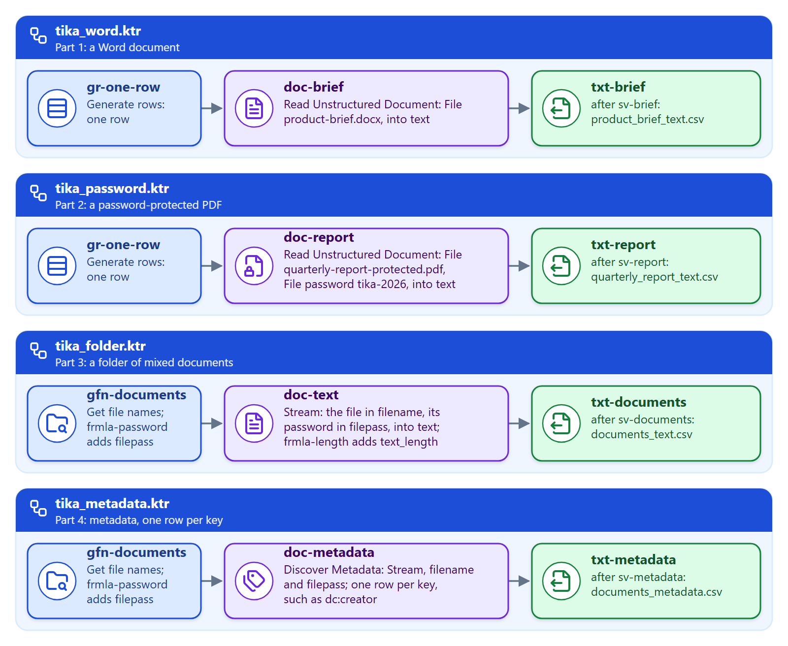
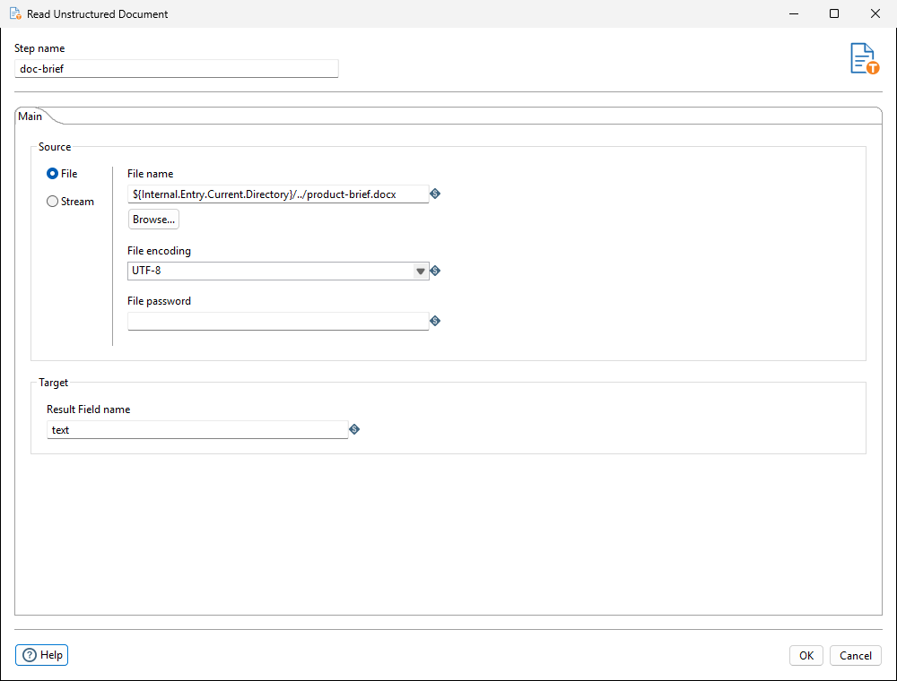
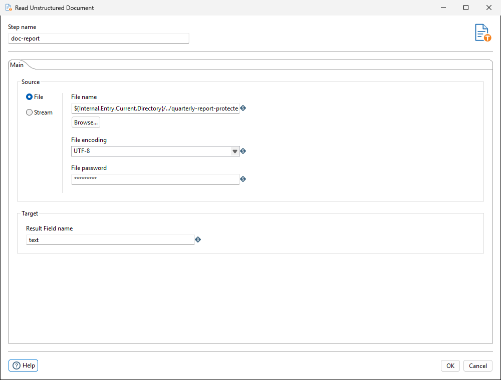
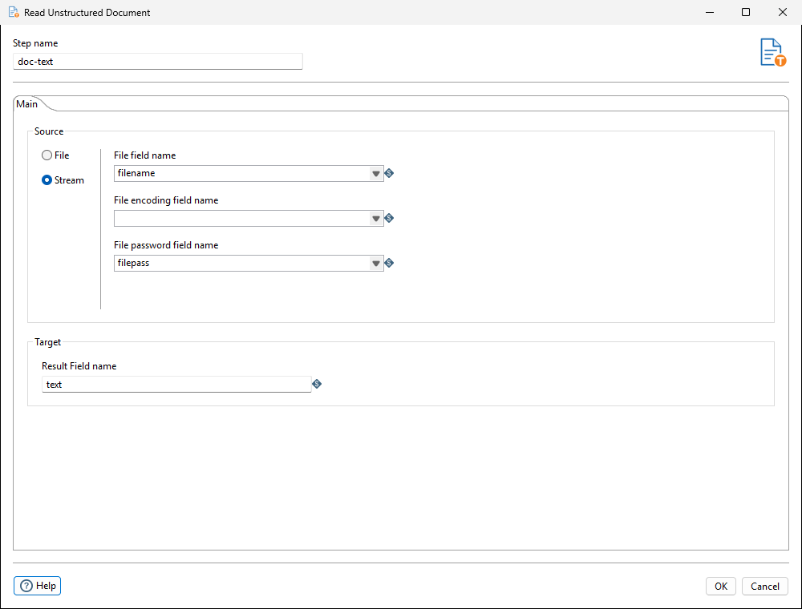
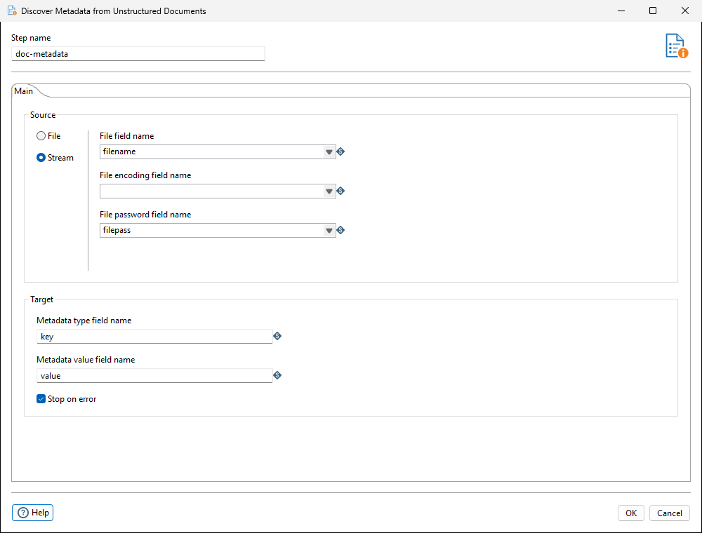
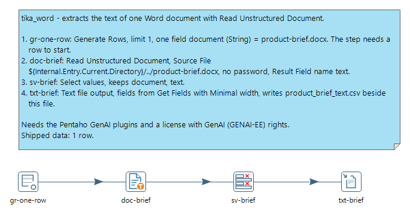
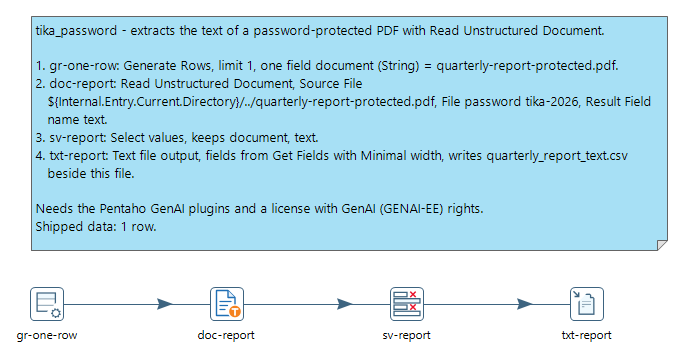
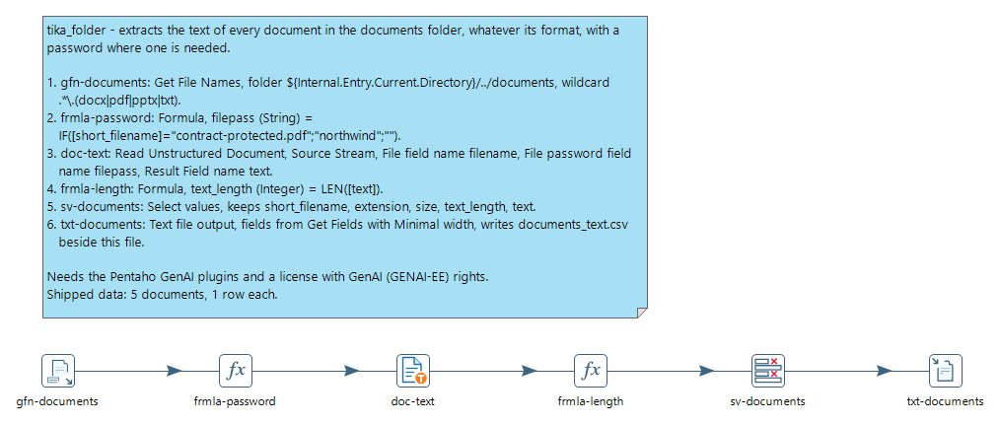
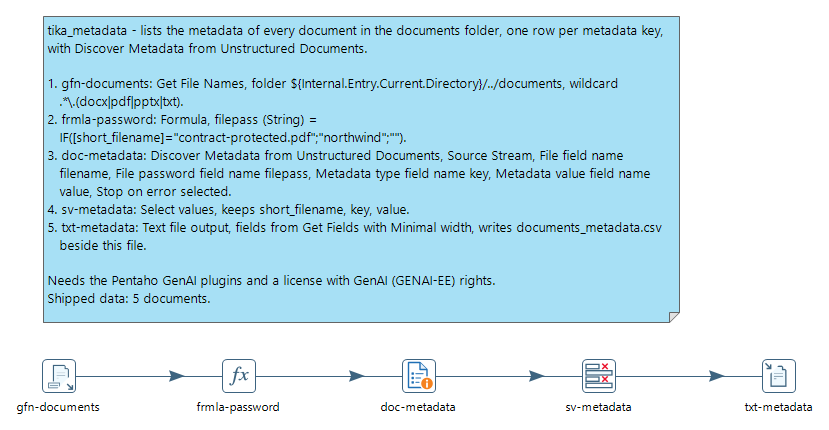

# Apache Tika

> **Warning:**
>
> #### Workshop - Apache Tika
>
> Office documents and PDFs hold the text a Large Language Model (LLM) prompt needs, locked in binary formats. Build four Pentaho Data Integration transformations with the **Read Unstructured Document** and **Discover Metadata from Unstructured Documents** steps of the GenAI plugin suite, both built on Apache Tika: they extract the text of a Word document, of a password-protected PDF and of a whole folder of mixed files, and list each document's metadata.
>
> **What you'll do**
>
> * Extract the text of a Word document named in the step
> * Open a password-protected PDF with its password
> * Read every document in a folder, whatever its format, from file names in the stream, with a password for the one that needs it
> * List the metadata of every document, one row per key, such as `dc:creator`, `Content-Type` and the page count
>
> **Prerequisites:**
>
> * The GenAI plugin suite installed, with a license that includes GenAI (GENAI-EE) rights, as set up in [Before You Start](../00-before-you-start/guide.md)
> * [HTML Parser](../03-genai-html-parser/guide.md): **Generate rows**, **Get file names** and the **File** and **Stream** sources
>
> **Estimated time:** 40 minutes

<figure>

<figcaption class="pcm-video-caption">Walkthrough: coming soon</figcaption>

</figure>

<div align="center">
<figure>

<figcaption>What you build: four transformations and the file each one writes</figcaption>
</figure>
</div>

:::: tabs

### 1. A Word Document

> **Note:**
>
> #### Read Unstructured Document
>
> Apache Tika is a content analysis toolkit: it detects the format of a file and extracts its text and its metadata. **Read Unstructured Document** puts the extracted text of a file into one field. It reads files with the extensions TXT, PDF, DOC, DOCX, PPT and PPTX. In this part it reads one Word document, `product-brief.docx`, named in its **File name** setting.

**The document:** `product-brief.docx` is a one-page product brief by Maria Lopez: the heading `Laptop Pro 15`, three paragraphs on the laptop's memory, display and warranty, and three bullet points (weight, ports and colors). Open it in Word to see it.

1. Start Spoon with the **Start Pentaho Data Integration** button below, or from PowerShell:

```powershell
Set-Location C:\Pentaho\design-tools\data-integration
.\Spoon.bat
```

<button data-launch="spoon" data-path="">Start Pentaho Data Integration</button>

2. Select **File > New > Transformation** (`Ctrl+N`).
3. Select **File > Save as** and save it as `tika_word.ktr` in `C:\Workshop-AI-Specialty\03-documents-to-text\04-genai-apache-tika`, next to `product-brief.docx`. (On your own machine, download `product-brief.docx`, `quarterly-report-protected.pdf` and the five files of the `documents` folder from **Lab Files** below, keeping `documents` as a subfolder of the folder you save in.)
4. On the **Design** tab, open the **Input** folder and drag **Generate rows** onto the canvas.
5. Double-click **Generate rows**. Set **Step name** to `gr-one-row` and **Limit** to `1`. In the **Fields** grid, add one row: **Name** `document`, **Type** `String`, **Value** `product-brief.docx`. Select **OK**.
6. On the **Design** tab, open the **Input** folder and drag **Read Unstructured Document** onto the canvas.
7. Create a hop from **gr-one-row** to **Read Unstructured Document**: hold `Shift` and drag from one step to the other.
8. Double-click **Read Unstructured Document** and set **Step name** to `doc-brief`.

<div align="center">
<figure>

<figcaption>doc-brief: its settings</figcaption>
</figure>
</div>

9. On the **Main** tab, under **Source**, select **File** and set **File name** to `${Internal.Entry.Current.Directory}/product-brief.docx`. Keep **File encoding** `UTF-8` and leave **File password** empty.
10. Under **Target**, set **Result Field name** to `text`. Select **OK**.
11. On the **Design** tab, open the **Transform** folder and drag **Select values** onto the canvas. Create a hop from **doc-brief** to **Select values**.
12. Double-click **Select values**, set **Step name** to `sv-brief`, and on the **Select & Alter** tab list the fields `document` and `text`. Select **OK**.
13. On the **Design** tab, open the **Output** folder and drag **Text file output** onto the canvas. Create a hop from **sv-brief** to **Text file output**.
14. Double-click **Text file output** and set **Step name** to `txt-brief`. On the **File** tab, set **Filename** to `${Internal.Entry.Current.Directory}/product_brief_text` and **Extension** to `csv`, and select **Create Parent folder**. On the **Content** tab, set **Encoding** to `UTF-8`. On the **Fields** tab, select **Get Fields**, then **Minimal width**, and select **OK**.
15. Save the transformation (`Ctrl+S`).
16. Press `F9` (**Action > Run**), and select **Run** in the **Run Options** dialog.
17. Select **txt-brief** on the canvas and open the **Preview data** tab.

<!-- UNPROVEN: Read Unstructured Document cannot run without a GENAI-EE license. The text below is what Apache Tika 3.2.3 returns for product-brief.docx when called as the step calls it (AutoDetectParser, BodyContentHandler(-1), trimmed); confirm in Spoon once the license arrives. -->

> **Success:** Checkpoint: one row, `document` `product-brief.docx`, and a `text` of 580 characters on 7 lines: the heading `Laptop Pro 15`, the three paragraphs, starting `The Laptop Pro 15 is a 15-inch laptop for developers and analysts.`, and the three bullet points, starting `Weight: 1.6 kg`.

The text keeps the document's order, one paragraph or bullet point per line.

> **Under the hood:**
>
> #### Tika chose the Word parser from the file's content, not from its name
>
> The step opens the file and hands it to Tika's auto-detecting parser, which reads the first bytes, recognizes a Word document (a DOCX file is a ZIP archive of XML parts), and passes it to the parser for that format. The parser walks the document's paragraphs, headings and list items and writes their text, one per line, into a content handler with no size limit; the step trims the result into `text`. The step then adds the field to the row it received, so `document` passes through beside it.
>
> **Why it matters:** without this step, Pentaho Data Integration has no step that turns a DOCX or a PDF into text. **Load file content in memory** reads a file's bytes, which for a Word document are compressed XML. The alternative is a **User Defined Java Class** that calls Tika itself, the code this step already is.

### 2. A Password-Protected PDF

> **Note:**
>
> #### A Password-Protected PDF
>
> `quarterly-report-protected.pdf` is a two-page sales summary that cannot be opened without its password, `tika-2026`. The step passes the password to Tika's PDF parser in its **File password** setting.

1. Select **File > New > Transformation** (`Ctrl+N`), then **File > Save as**, and save it as `tika_password.ktr` in `C:\Workshop-AI-Specialty\03-documents-to-text\04-genai-apache-tika`.
2. Add **Generate rows** as in the first part: **Step name** `gr-one-row`, **Limit** `1`, one field **Name** `document`, **Type** `String`, **Value** `quarterly-report-protected.pdf`.
3. Add **Read Unstructured Document** after **gr-one-row** and set **Step name** to `doc-report`. Under **Source**, select **File** and set **File name** to `${Internal.Entry.Current.Directory}/quarterly-report-protected.pdf`. Set **File password** to `tika-2026`. Under **Target**, set **Result Field name** to `text`. Select **OK**.

<div align="center">
<figure>

<figcaption>doc-report: its settings</figcaption>
</figure>
</div>

4. Add **Select values** after **doc-report**: **Step name** `sv-report`, and on the **Select & Alter** tab the fields `document` and `text`.
5. Add **Text file output** after **sv-report**: **Step name** `txt-report`, **Filename** `${Internal.Entry.Current.Directory}/quarterly_report_text`, **Extension** `csv`, **Create Parent folder** selected, **Encoding** `UTF-8`, and on the **Fields** tab **Get Fields**, then **Minimal width**.
6. Save the transformation (`Ctrl+S`), press `F9` (**Action > Run**), and select **Run** in the **Run Options** dialog.
7. Select **txt-report** on the canvas and open the **Preview data** tab.

<!-- UNPROVEN: text computed with Apache Tika 3.2.3 as the step calls it; confirm in Spoon once the GENAI-EE license arrives. -->

> **Success:** Checkpoint: one row whose `text` (675 characters) starts `Q3 2026 Sales Summary` and holds both pages, the second starting `Outlook`. The lines break where the PDF's lines break, mid-sentence, with blank lines between paragraphs, and each page's footer, such as `TechGadgets Q3 2026 Sales Summary - page 1 of 2`, is part of the text.

8. Double-click **doc-report**, change **File password** to `wrong`, select **OK**, and run again.

<!-- UNPROVEN: Tika 3.2.3 throws "Unable to process: document is encrypted" (InvalidPasswordException) for the wrong password; how the step reports it is to be confirmed once the GENAI-EE license arrives. -->

> **Success:** Checkpoint: **doc-report** reports an error in the log: Tika cannot decrypt the document with that password, and `text` gets none of the report. Set **File password** back to `tika-2026` and save.

The step needs the exact password; Tika has no way to guess it.

> **Under the hood:**
>
> #### A PDF keeps lines, not paragraphs
>
> A PDF stores where each line of text sits on the page, not which lines form a paragraph. Tika's PDF parser rebuilds the text line by line, so a sentence that wraps on the page is broken in `text`, and page footers become text too. With the password, the parser decrypts the file before it reads it; this one is encrypted with AES-256.
>
> **Why it matters:** an LLM reads broken lines without trouble, but a footer repeated on every page is noise in a summary and in a search index. The AI Segmentation step in the later modules splits this text into chunks; cleaning it first, with a **Replace in string** step, is often worth it.

### 3. A Folder of Mixed Documents

> **Note:**
>
> #### Stream Mode
>
> In **Stream** mode, every incoming row names a file to read, in a field. Build `tika_folder.ktr`: **Get file names** lists the five documents in the `documents` folder, a **Formula** adds the password for the one protected PDF, and one **Read Unstructured Document** reads every file, whatever its format.

**The folder:** `documents` holds five files: `contract-protected.pdf` (a supplier agreement, password `northwind`), `onboarding-deck.pptx` (a three-slide deck), `release-notes.txt` (firmware release notes), `support-policy.docx` (the returns and support policy) and `warranty-terms.pdf` (a two-page warranty).

1. Select **File > New > Transformation** (`Ctrl+N`), then **File > Save as**, and save it as `tika_folder.ktr` in `C:\Workshop-AI-Specialty\03-documents-to-text\04-genai-apache-tika`.
2. On the **Design** tab, open the **Input** folder and drag **Get file names** onto the canvas.
3. Double-click **Get file names** and set **Step name** to `gfn-documents`. On the **File** tab, set **File or directory** to `${Internal.Entry.Current.Directory}/documents` and **Wildcard (RegExp)** to `.*\.(docx|pdf|pptx|txt)`, and select **Add**.
4. Select **Show filename(s)...**.

> **Success:** Checkpoint: the list shows 5 files: `contract-protected.pdf`, `onboarding-deck.pptx`, `release-notes.txt`, `support-policy.docx` and `warranty-terms.pdf`. Select **Close**, then **OK**.

5. On the **Design** tab, open the **Scripting** folder and drag **Formula** onto the canvas. Create a hop from **gfn-documents** to **Formula**.
6. Double-click **Formula** and set **Step name** to `frmla-password`. Fill one row of the grid: **New field** `filepass`, **Formula** `IF([short_filename]="contract-protected.pdf";"northwind";"")`, **Value type** `String`. Select **OK**.
7. Add **Read Unstructured Document** after **frmla-password** and set **Step name** to `doc-text`. Under **Source**, select **Stream**, set **File field name** to `filename` and **File password field name** to `filepass`, and leave **File encoding field name** empty. Under **Target**, set **Result Field name** to `text`. Select **OK**.

<div align="center">
<figure>

<figcaption>doc-text: its settings</figcaption>
</figure>
</div>

8. Add a second **Formula** after **doc-text**: **Step name** `frmla-length`, one row with **New field** `text_length`, **Formula** `LEN([text])`, **Value type** `Integer`.
9. Add **Select values** after **frmla-length**: **Step name** `sv-documents`, and on the **Select & Alter** tab the fields `short_filename`, `extension`, `size`, `text_length` and `text`, in this order.
10. Add **Text file output** after **sv-documents**: **Step name** `txt-documents`, **Filename** `${Internal.Entry.Current.Directory}/documents_text`, **Extension** `csv`, **Create Parent folder** selected, **Encoding** `UTF-8`, and on the **Fields** tab **Get Fields**, then **Minimal width**.
11. Save the transformation (`Ctrl+S`), press `F9` (**Action > Run**), and select **Run** in the **Run Options** dialog.
12. Select **txt-documents** on the canvas and open the **Preview data** tab.

<!-- UNPROVEN: lengths computed with Apache Tika 3.2.3 as the step calls it (trimmed text); confirm in Spoon once the GENAI-EE license arrives. -->

> **Success:** Checkpoint: 5 rows, one per document. `text_length` is `326` for `contract-protected.pdf`, `266` for `onboarding-deck.pptx`, `265` for `release-notes.txt`, `422` for `support-policy.docx` and `479` for `warranty-terms.pdf`. The contract's `text` starts `Supplier Agreement`, read with the password from `filepass`; the deck's holds each slide's title and bullet points, starting `Welcome to TechGadgets Support`.

Scroll the **Preview data** tab to compare the five texts.

> **Under the hood:**
>
> #### One step read four formats, and the password traveled with its file
>
> For each row the step opens the file named in `filename`, and Tika detects its format and picks the parser: Word, PowerPoint, PDF or plain text. The password is a field of the row, so only `contract-protected.pdf` gets one; for the other rows **Formula** returns an empty string, which Pentaho Data Integration treats as null, and the parsers ignore it. The wildcard lists only the extensions the step accepts: a PNG or an HTML file in the folder would not reach it.
>
> **Why it matters:** a folder of mixed documents becomes one stream of text rows, ready for the same prompt, without a branch per format. A folder of a thousand files needs the same four steps.

### 4. Discover Metadata

> **Note:**
>
> #### Discover Metadata from Unstructured Documents
>
> A document also carries data about itself: its author, its title, its type, its dates, its number of pages. **Discover Metadata from Unstructured Documents** reads them with the same Tika parsers and writes **one row per metadata key**, the key in one field and its value in another. Build `tika_metadata.ktr` over the same folder.

1. Select **File > New > Transformation** (`Ctrl+N`), then **File > Save as**, and save it as `tika_metadata.ktr` in `C:\Workshop-AI-Specialty\03-documents-to-text\04-genai-apache-tika`.
2. Open `tika_folder.ktr`, select **gfn-documents**, hold `Ctrl` and select **frmla-password** on its canvas, press `Ctrl+C`, switch back to `tika_metadata.ktr`, and press `Ctrl+V`. Spoon pastes both steps with their settings and the hop between them.
3. On the **Design** tab, open the **Metadata Discovery** folder and drag **Discover Metadata from Unstructured Documents** onto the canvas. Create a hop from **frmla-password** to it.
4. Double-click **Discover Metadata from Unstructured Documents** and set **Step name** to `doc-metadata`.

<div align="center">
<figure>

<figcaption>doc-metadata: its settings</figcaption>
</figure>
</div>

5. On the **Main** tab, under **Source**, select **Stream**, set **File field name** to `filename` and **File password field name** to `filepass`, and leave **File encoding field name** empty.
6. Under **Target**, keep **Metadata type field name** `key`, **Metadata value field name** `value` and **Stop on error** selected. Select **OK**.
7. Add **Select values** after **doc-metadata**: **Step name** `sv-metadata`, and on the **Select & Alter** tab the fields `short_filename`, `key` and `value`.
8. Add **Text file output** after **sv-metadata**: **Step name** `txt-metadata`, **Filename** `${Internal.Entry.Current.Directory}/documents_metadata`, **Extension** `csv`, **Create Parent folder** selected, **Encoding** `UTF-8`, and on the **Fields** tab **Get Fields**, then **Minimal width**.
9. Save the transformation (`Ctrl+S`), press `F9` (**Action > Run**), and select **Run** in the **Run Options** dialog.
10. Select **txt-metadata** on the canvas and open the **Preview data** tab.

<!-- UNPROVEN: keys and counts computed with Apache Tika 3.2.3 as the step calls it (AutoDetectParser, Metadata.names(), Content-Encoding set); confirm in Spoon once the GENAI-EE license arrives. -->

> **Success:** Checkpoint: 128 rows: 42 for each PDF, 20 for `support-policy.docx`, 18 for `onboarding-deck.pptx` and 6 for `release-notes.txt`. Among them, `dc:creator` is `Procurement` for the contract, `Priya Natarajan` for the deck and the policy, and `Legal Team` for the warranty; `Content-Type` is `application/pdf` for the PDFs and `text/plain; charset=UTF-8` for the release notes; `xmpTPg:NPages` is `2` for the warranty and `meta:page-count` is `1` for the policy.

The keys come from the formats, so they differ by file type:

| Key | Holds | Found in |
| --- | --- | --- |
| `Content-Type` | The detected format | Every file |
| `dc:creator`, `dc:title` | The author and the title | Word, PowerPoint and PDF |
| `dcterms:created`, `dcterms:modified` | When the document was created and last saved | Word, PowerPoint and PDF |
| `meta:page-count` | The number of pages Word recorded | Word |
| `xmpTPg:NPages` | The number of pages | PDF and Word |
| `pdf:encrypted` | `true` for a password-protected PDF | PDF |
| `X-TIKA:Parsed-By` | The Tika parser that read the file | Every file |

> **Under the hood:**
>
> #### Every document became many rows, one per metadata key
>
> For each incoming row, the step parses the file and asks Tika for every metadata name it found. It writes one output row per name, with the incoming fields repeated, so `short_filename` tells you which document each key belongs to. The text is parsed too, because some keys, such as a PDF's characters per page, come from reading it, but only the metadata reaches the stream.
>
> **Why it matters:** metadata is what a knowledge base filters on. An author, a title and a page count stored next to a document's text let a later search answer "only the policies" or cite "page 2 of the warranty". A **Filter rows** step after this one keeps only the keys you need.

::::

## Troubleshooting <!-- no-step -->

<details>
<summary>Error initializing step: License validation failed</summary>

The Pentaho license on this machine has no GenAI rights. Every step of the GenAI plugin suite checks, when the transformation starts, for a license with the GenAI Plugin Suite (GENAI-EE) subscription. Install a license that includes it, as described in [Before You Start](../00-before-you-start/guide.md).

</details>

<details>
<summary>The step fails with File Not Found Exception</summary>

The path in **File name**, or in the `filename` field, does not exist. Check that the documents are in the same folder as the transformation, with the five folder documents in its `documents` subfolder, and that the transformation was saved there: `${Internal.Entry.Current.Directory}` is the folder of the saved file.

</details>

<details>
<summary>Unable to process: document is encrypted</summary>

The PDF needs a password and the step had none, or the wrong one. In File mode, look at **File password**; in Stream mode, make sure **File password field name** is `filepass` and that the **Formula** names the file exactly, `contract-protected.pdf`.

</details>

<details>
<summary>A file in the folder returns no text</summary>

The step reads only TXT, PDF, DOC, DOCX, PPT and PPTX files. Keep the **Wildcard (RegExp)** to those extensions. A scanned PDF holds pictures of text, not text, so Tika returns little or nothing from it without OCR.

</details>

## Lab Files

Click a file to download. For `.ktr` and `.kjb` files, **Open in Pentaho Data Integration** launches Pentaho Data Integration with the file loaded. If Pentaho Data Integration is already running, the path is copied to your clipboard — switch to Pentaho Data Integration and press `Ctrl+O`, `Ctrl+V`, `Enter`.

The Word document for the first part, and the PDF for the second, whose password is `tika-2026`:

[product-brief.docx](./files/product-brief.docx)

[quarterly-report-protected.pdf](./files/quarterly-report-protected.pdf)

The `documents` folder for the third and fourth parts. Save these five files in a `documents` subfolder; the password of `contract-protected.pdf` is `northwind`:

[contract-protected.pdf](./files/documents/contract-protected.pdf)

[onboarding-deck.pptx](./files/documents/onboarding-deck.pptx)

[release-notes.txt](./files/documents/release-notes.txt)

[support-policy.docx](./files/documents/support-policy.docx)

[warranty-terms.pdf](./files/documents/warranty-terms.pdf)

### Solution <!-- no-step -->

The finished transformations for this lab. Open them alongside your own to compare, or run them to see the expected result. They read the documents from the lab folder and write their CSV files beside themselves.

Also on disk at `C:\Workshop-AI-Specialty\03-documents-to-text\04-genai-apache-tika\solution`.

[tika_word.ktr](./files/solution/tika_word.ktr) <button data-launch="spoon" data-path="files/solution/tika_word.ktr">Open in Pentaho Data Integration</button> <button data-graph="files/solution/tika_word.ktr">View graph</button>

tika_word in Spoon, with its note:

<div align="center">
<figure>

<figcaption>tika_word.ktr in Spoon</figcaption>
</figure>
</div>

[tika_password.ktr](./files/solution/tika_password.ktr) <button data-launch="spoon" data-path="files/solution/tika_password.ktr">Open in Pentaho Data Integration</button> <button data-graph="files/solution/tika_password.ktr">View graph</button>

tika_password in Spoon, with its note:

<div align="center">
<figure>

<figcaption>tika_password.ktr in Spoon</figcaption>
</figure>
</div>

[tika_folder.ktr](./files/solution/tika_folder.ktr) <button data-launch="spoon" data-path="files/solution/tika_folder.ktr">Open in Pentaho Data Integration</button> <button data-graph="files/solution/tika_folder.ktr">View graph</button>

tika_folder in Spoon, with its note:

<div align="center">
<figure>

<figcaption>tika_folder.ktr in Spoon</figcaption>
</figure>
</div>

[tika_metadata.ktr](./files/solution/tika_metadata.ktr) <button data-launch="spoon" data-path="files/solution/tika_metadata.ktr">Open in Pentaho Data Integration</button> <button data-graph="files/solution/tika_metadata.ktr">View graph</button>

tika_metadata in Spoon, with its note:

<div align="center">
<figure>

<figcaption>tika_metadata.ktr in Spoon</figcaption>
</figure>
</div>
