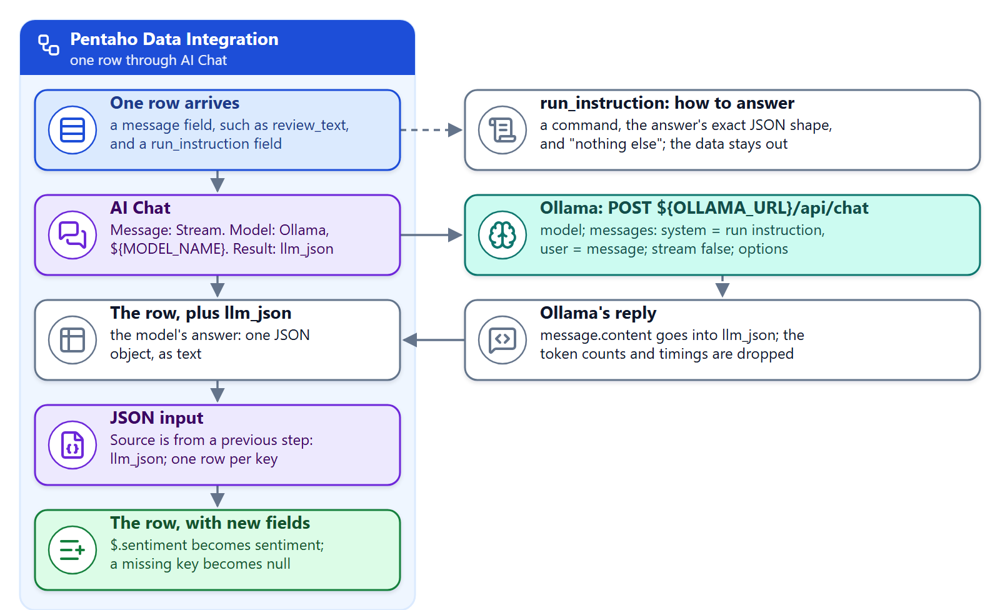

# Overview

<div class="pcm-intro">

These workshops share one pattern: Pentaho Data Integration is the orchestration layer, and a locally hosted Large Language Model (LLM), served by Ollama, does the work that rule-based ETL cannot do well. The step that connects the two is **AI Chat**, from the GenAI plugin suite: for every row, it sends a message and a run instruction to the model and adds the answer to the row. The seven use cases, Sentiment Analysis, Data Quality, Data Enrichment, Named Entity Recognition, Text Summarization, Multi-staged and Invoices with a Vision Model, all build on it.

</div>

<div align="center">
<figure>

<figcaption>What AI Chat does with one row: one chat request to Ollama, and the answer as fields</figcaption>
</figure>
</div>

**What You'll Learn**

* What the **AI Chat** step does with a row, tab by tab
* The difference between a Script and a Stream message, and why the workshops use Stream
* The Model Configuration rows that matter for Ollama
* Why the run instruction asks for JSON, and how the answer becomes fields
* How **AI Chat Message Box** builds a prompt template from variables
* The chat request the step sends to Ollama for you

:::: tabs

### 1. The AI Chat Step

**AI Chat** sits in the **AI** folder of Spoon's **Design** tab. For each row it receives, it makes one request to the model and adds the model's answer to that row as a new field. Rows are not batched: ten rows are ten requests, which is why the workshops run several copies of the step.

Its dialog has five tabs:

| Tab | What it sets | What the workshops use |
| --- | --- | --- |
| **Message** | The message (prompt) and the run instruction, typed in the step (**Script**) or read from fields (**Stream**); optionally an attached document or image | **Stream**, with a message field and a run-instruction field |
| **Model** | **LLM Provider**, **Model name**, and the **Model Configuration** grid of parameters | `Ollama`, `${MODEL_NAME}`, and the rows in the **Model Configuration** tab of this page |
| **Tools** | Model Context Protocol (MCP) servers whose tools the model may call | Not used in this module; the [MCP Tools](../22-mcp-tools/guide.md) workshop uses it |
| **Proxy** | A proxy host, port and credentials between Pentaho Data Integration and the model | Empty: Ollama runs on the same machine |
| **Response** | **Response format** (`text` or `json_object`), **Result Field name**, **Stop on error**, and embedding outputs for attached documents | `text`, a result field such as `llm_json`, **Stop on error** selected |

The provider list also offers OpenAI, Azure OpenAI, AWS Bedrock, Anthropic Claude and Google Gemini. The workshops use Ollama, so nothing leaves the machine and no API key is needed.

> **Note:**
>
> Every GenAI plugin step checks for a Pentaho license with the GenAI Plugin Suite (GENAI-EE) subscription when the transformation starts. Without it, the transformation stops with `License validation failed`; see [Before You Start](../00-before-you-start/guide.md).

### 2. Messages

**Script or Stream:**

| | Script | Stream |
| --- | --- | --- |
| Where the text comes from | **Ask your question** and **Run instruction for LLM**, typed in the step | **Message Field name** and **Run instruction for LLM Field name**, fields of the incoming row |
| What changes per row | Nothing: every row gets the same text | Everything: each row sends its own field values |
| Variables | `${VARIABLE}` is replaced once, when the transformation starts | The fields are sent as they are |
| Use it for | A fixed question, a test | Every workshop in this module |

**Field values never reach a Script message.** In **AI Chat**, `${...}` is a Pentaho Data Integration variable, not a field. To put a row's values into the message, build the message in a field upstream, with **Modified JavaScript value**, **Formula** or **Concat Fields**, and select **Stream**. Sentiment Analysis sends one field as it is; Data Quality joins five fields into one labeled message:

```text
Name: john smith
Email: JSMITH@GMAIL.COM
Phone: 555.123.4567
Address: 123 main st apt 5, new york, ny
Company: acme corp
```

**The run instruction** is the system message: it tells the model how to behave and what to return, while the message is the text to work on. When it is the same for every row, the workshops add it as a field with **Add constants**, named `run_instruction`. When it depends on the row, a script builds it, as Stage 3 of Multi-staged does for each document type. With no run-instruction field, the step uses `You are a helpful assistant`.

**A good run instruction** is short and precise:

* **It is a command, not a question.** "You classify the sentiment of one customer review", not "Can you tell me the sentiment?".
* **It shows the answer's shape**, every key and the values each allows, instead of describing it.
* **It says "nothing else"**, so the model does not add a sentence before the JSON.
* **It keeps the data out.** The review, the record or the document is the message; the instruction never changes from row to row, so a word in the data is less likely to be read as an instruction.

### 3. Model Configuration

On the **Model** tab, **LLM Provider** `Ollama` and **Model name** `${MODEL_NAME}` choose the model; `MODEL_NAME` and `OLLAMA_URL` are transformation parameters, so a run can switch model or server in the **Run Options** dialog. The **Model Configuration** grid holds one parameter per row. Rows the provider does not use are ignored, so delete them. For Ollama, the workshops set:

| Parameter | Value | What it does |
| --- | --- | --- |
| `endpoint` | `${OLLAMA_URL}` | The Ollama server, `http://localhost:11434`. **Get models** on the **Model** tab lists the models this server has pulled |
| `temperature` | `0` | How random the answer is. `0` makes the model pick its most likely answer, so the same row gets the same answer on every run; the default is `0.7` |
| `numCtx` | `2048` to `8192` | The context window in tokens: the instruction, the message and the answer must all fit. A token is about four characters of English |
| `timeout` | `120` to `300` | Seconds to wait for one answer. A long document on a CPU-only machine can need minutes |

Other Ollama parameters the grid accepts include `numPredict` (the most tokens the answer may have), `topP`, `topK`, `seed`, `stop`, `repeatPenalty` and `maxRetries`. A value in the wrong format fails the row with a message such as `Expected decimal, e.g. 0.9`.

> **Tip:**
>
> Size `numCtx` for the longest row, not the average. Ollama does not fail when the input is longer than the window: it cuts the input to fit and the model answers about what is left. Text Summarization shows how to split a document that is too long for any window.

### 4. JSON Answers

A pipeline needs the answer as fields, so every workshop asks for one JSON object and parses it with **JSON input**.

**Ask for it in the instruction.** The **Response** tab offers **Response format** `json_object`, but in this version of the plugin that setting is not passed to Ollama. What makes the model answer in JSON is the run instruction:

```text
You classify the sentiment of one customer review.
Answer with one JSON object and nothing else, in exactly this shape:
{"sentiment": "positive" | "negative" | "neutral", "score": a number from -1.0 to 1.0, "confidence": an integer from 0 to 100, "key_phrases": ["up to four short phrases from the review"], "summary": "one sentence"}
```

**Parse it with JSON input.** Select **Source is from a previous step**, choose the result field, and add one row per key, such as `$.sentiment`. With **Ignore missing path** and **Default path leaf to null** selected, a key the model leaves out becomes a null field, and an answer that is not JSON at all gives null fields instead of failing the row. A path with `[*]`, such as `$.entities[*].text`, gives one row per array element.

**Check what comes back.** A model can still answer outside the shape. The workshops route on what they parse: Data Quality sends a record with no readable verdict to review, and Multi-staged replaces a missing answer with a safe default before the next stage.

| Mistake | What happens | The fix |
| --- | --- | --- |
| Instruction describes the JSON instead of showing it | Keys come back with other names | Show the exact shape, with every key |
| Too many fields in one call | A small model fills some of them by guessing | Split the work into stages, as Multi-staged does |
| Temperature left at `0.7` | The same row gets a different answer on the next run | `temperature` `0` for extraction and classification |
| `numCtx` too small | The answer is about part of the input only | Size it for the longest row, or split the text |

### 5. Prompt Templates

**AI Chat Message Box**, in the same **AI** folder, adds two fields to every row: a prompt and a run instruction, typed once in its **Message** and **Run Instruction** tabs. Any `${VARIABLE}` in them is replaced by the variable's value, so a template can be filled from transformation parameters or `kettle.properties`:

```text
industry: one of ${INDUSTRY_LIST}, judged from the company name and the email domain.
employee_range: one of ${EMPLOYEE_RANGES}, estimated from the company name.
```

Its fields then feed **AI Chat** in Stream mode. Like a Script message, it substitutes variables only, never field values: Data Enrichment uses it for the instruction and the task sentence, and joins the record's own values to the task in a script. The step needs an incoming row, and has no error hop.

### 6. Under the Hood

> **Under the hood:**
>
> #### AI Chat sends one Ollama chat request per row
>
> For each row, the step posts a request to Ollama's chat API at `${OLLAMA_URL}/api/chat`. The run instruction becomes the `system` message and the message field the `user` message; the model name and the **Model Configuration** rows become the request's model and options. Ollama answers with one JSON object, and the step copies the model's reply, `message.content`, into the result field.
>
> **Why it matters:** this is the request you can send by hand to check Ollama when a run fails, and it is what the first version of these workshops built itself, in three steps per call.

The request, as you would send it yourself from PowerShell:

```powershell
$body = @{
  model    = "llama3.2:3b"
  stream   = $false
  options  = @{ temperature = 0; num_ctx = 2048 }
  messages = @(
    @{ role = "system"; content = 'You classify the sentiment of one customer review. Answer with one JSON object and nothing else: {"sentiment": "positive|negative|neutral"}' }
    @{ role = "user";   content = "This product is amazing! Best purchase ever." }
  )
} | ConvertTo-Json -Depth 4
(Invoke-RestMethod -Uri http://localhost:11434/api/chat -Method Post -ContentType "application/json" -Body $body).message.content
```

What each part does, and what the step does for you:

| Part of the request | What it does | In AI Chat |
| --- | --- | --- |
| `model` | Which pulled model answers | **Model name**, `${MODEL_NAME}` |
| `messages`, role `system` | How to behave and what to return | **Run instruction for LLM Field name** |
| `messages`, role `user` | The text to work on | **Message Field name** |
| `stream: false` | One complete answer instead of a stream of tokens: a pipeline writes one value per row | Always |
| `options.temperature`, `options.num_ctx` | Randomness and context window | The `temperature` and `numCtx` rows |
| `message.content` in the reply | The model's answer, as text, inside Ollama's JSON | Copied into the **Result Field name** |

The reply also carries timing and token counts: `prompt_eval_count` (tokens in the input), `eval_count` (tokens in the answer), and `total_duration` in nanoseconds. They are useful when you tune `numCtx` by hand, but the step does not pass them on.

Before the plugin, each call took three steps: a **Modified JavaScript value** that built this body as JSON text with `getVariable("MODEL_NAME", ...)`, because `${...}` is not replaced inside a script; a **REST client** that posted it; and a second script or two **JSON input** steps to take the answer out of Ollama's reply before parsing the model's own JSON. A request body named wrong, or text the script did not escape, failed silently. **AI Chat** builds, sends and unwraps the request from its settings.

<div class="pcm-embed-card" data-href="https://github.com/ollama/ollama/blob/main/docs/api.md" data-title="Ollama API reference"></div>

::::

## Workshops <!-- no-step -->

This module includes seven hands-on use cases, each a self-contained workshop on the **AI Chat** step and a locally hosted LLM:

* [Sentiment Analysis](../06-llm-sentiment-analysis/guide.md) — classify customer reviews as positive, negative or neutral, with a score, as JSON.
* [Data Quality](../07-llm-data-quality/guide.md) — clean messy customer records and split them by the model's quality verdict.
* [Data Enrichment](../08-llm-data-enrichment/guide.md) — add an inferred city, state, country, industry and employee range, from a prompt template.
* [Named Entity Recognition](../09-llm-ner/guide.md) — extract entities with the **NER Extractor** step (no LLM) and with **AI Chat**, and compare them.
* [Text Summarization](../10-llm-text-summarization/guide.md) — summarize documents, and a report too long for one call by map-reduce over its chunks.
* [Multi-staged](../11-llm-multi-staged/guide.md) — chain five AI Chat calls, each stage building on the last.
* [Invoices with a Vision Model](../26-llm-vision-documents/guide.md) — read invoice and receipt images with the vision model `gemma3:12b`, and check that subtotal plus tax equals total.
