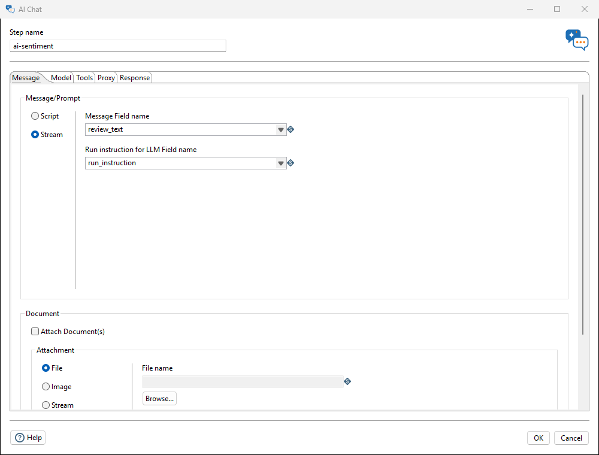
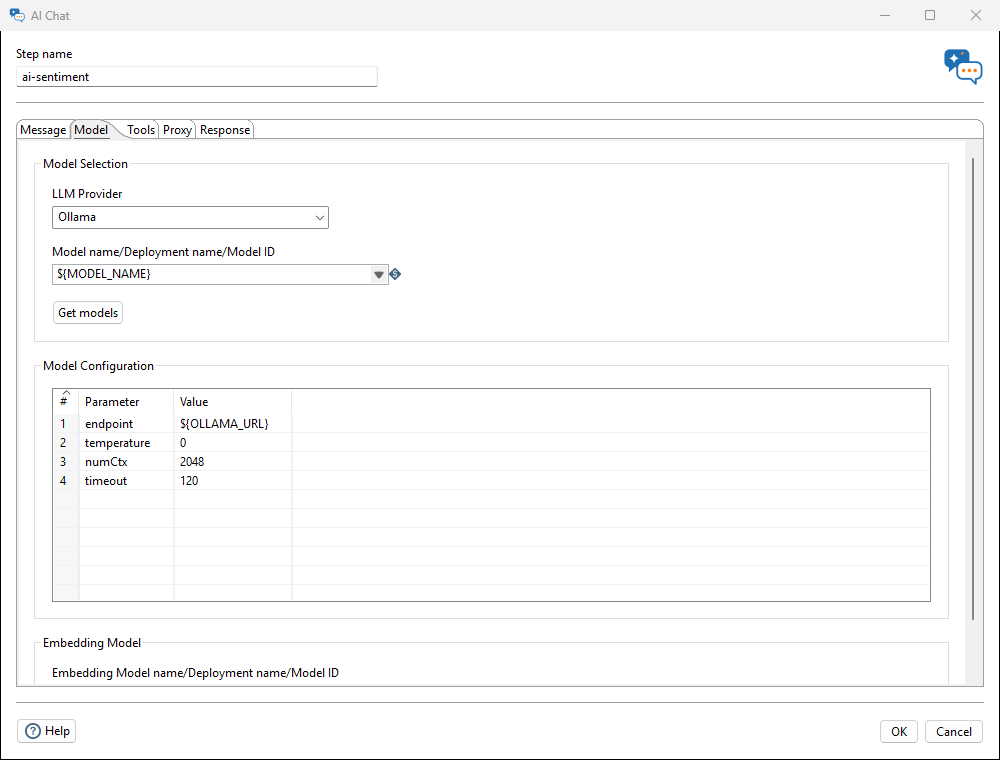
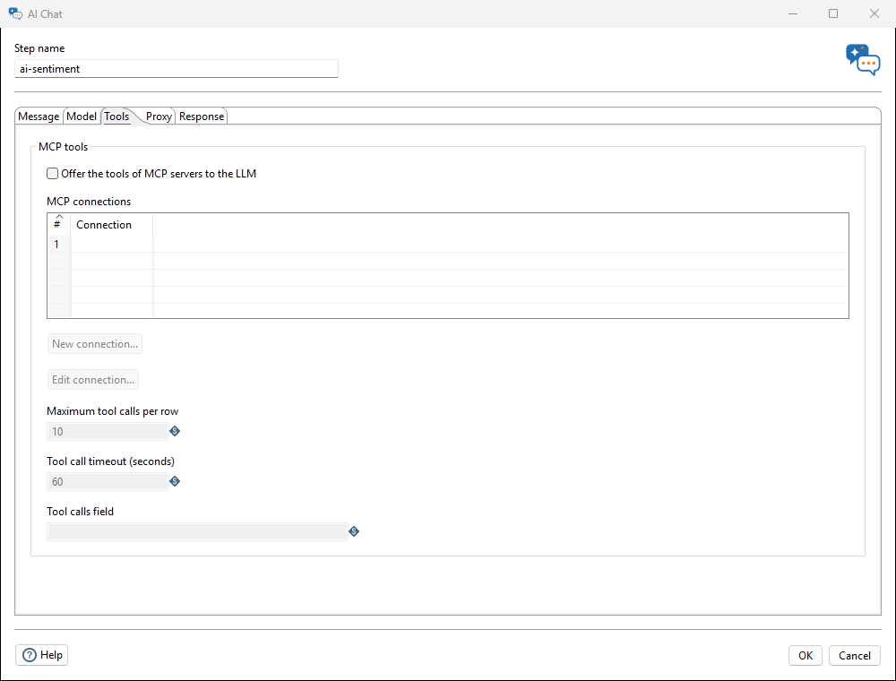
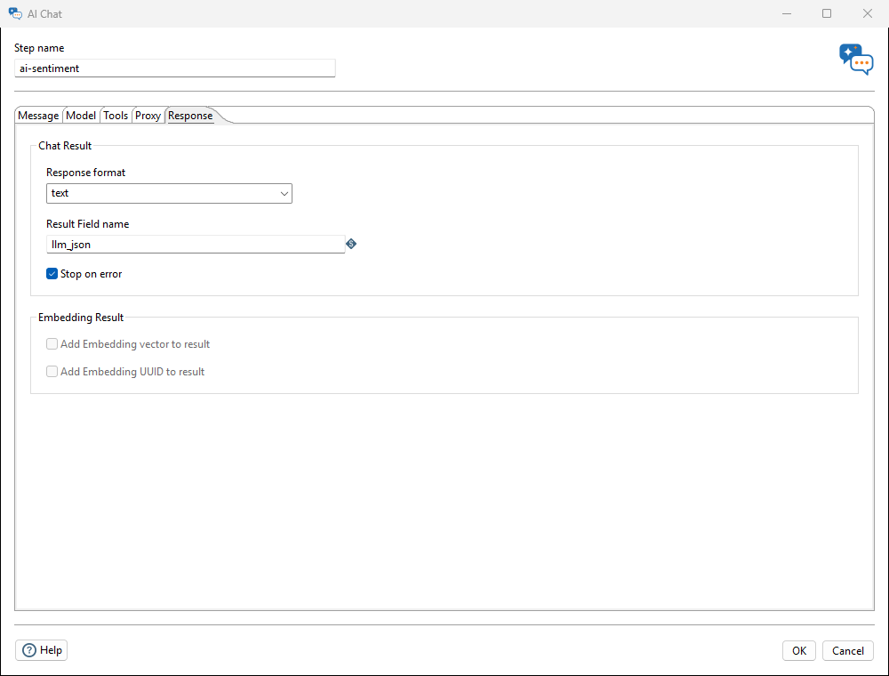
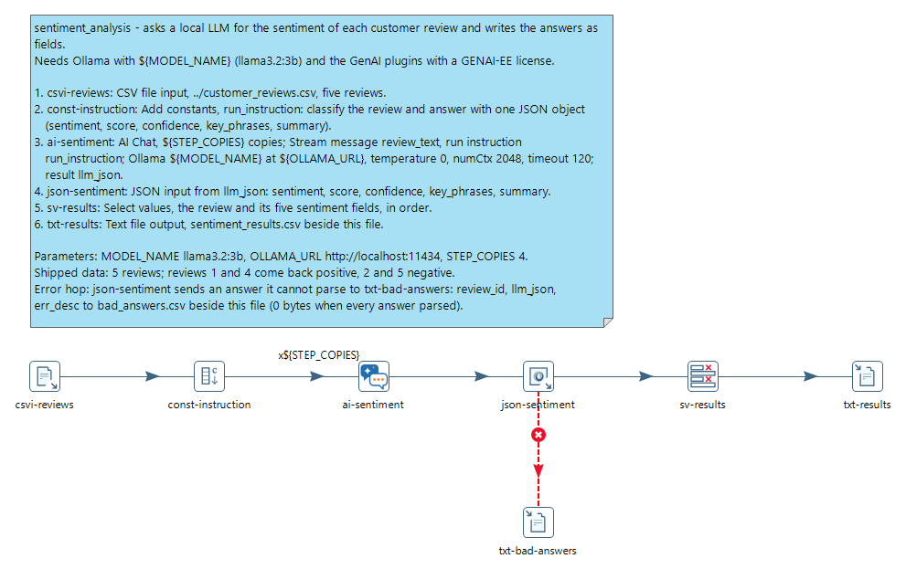

# Sentiment Analysis

> **Warning:**
>
> #### Workshop - Sentiment Analysis
>
> Build a Pentaho Data Integration transformation that reads five customer reviews, asks a local Large Language Model (LLM) served by Ollama for the sentiment of each one with the **AI Chat** step, and writes the answers to a CSV file as structured fields.
>
> **What you'll do**
>
> * Check that Ollama answers, and see what one sentiment request looks like
> * Read the reviews with **CSV file input**
> * Give the model its instructions as a run instruction with **Add constants**
> * Ask the model about every review with **AI Chat**, in four parallel copies
> * Parse the model's JSON answer with **JSON input** and write it with **Text file output**
>
> **Prerequisites:**
>
> * Ollama running on `http://localhost:11434` with `llama3.2:3b` pulled, and the GenAI plugins installed, as set up in [Before You Start](../00-before-you-start/guide.md)
> * The LLM Integration [Overview](../05-llm-integration/guide.md): what the AI Chat step does with a row
>
> **Estimated time:** 40 minutes

<figure>

<figcaption class="pcm-video-caption">Walkthrough: coming soon</figcaption>

</figure>

<div align="center">
<figure>

<figcaption>What you build: the steps of sentiment_analysis.ktr and what each one reads, calls and writes</figcaption>
</figure>
</div>

:::: tabs

### 1. Sentiment Analysis

> **Note:**
>
> #### What Is Sentiment Analysis?
>
> Sentiment analysis identifies the opinion a piece of text expresses and classifies it as positive, negative or neutral. This workshop asks the LLM for that label, a score, its confidence, the phrases that drove the decision, and a one-sentence summary.

**Example input:**

```text
"This laptop exceeded my expectations! The battery life is incredible and the
performance is blazing fast. Highly recommend for anyone looking for a quality machine."
```

**Example output:**

```json
{
  "sentiment": "positive",
  "score": 0.9,
  "confidence": 95,
  "key_phrases": ["exceeded expectations", "incredible battery", "blazing fast", "highly recommend"],
  "summary": "Customer extremely satisfied with laptop performance and battery life"
}
```

**Where it is used:**

1. **Customer feedback analysis** - categorize thousands of reviews to find satisfaction trends.
2. **Brand monitoring** - track sentiment about a brand across social media and review sites.
3. **Product improvement** - find the features customers like and the ones that need work.
4. **Support prioritization** - route the most negative messages to experienced agents first.
5. **Crisis detection** - spot a spike in negative sentiment early.

**Keyword rules compared with an LLM:**

| Text | Keyword rule | What the text means |
| --- | --- | --- |
| "This isn't bad" | Negative (contains "bad") | Mildly positive |
| "Oh great, another software bug" | Positive (contains "great") | Negative (sarcasm) |
| "Not good at all" | Positive (contains "good") | Negative (negation) |

An LLM reads the whole sentence, so it can handle context, negation and much sarcasm, extract key phrases, and return its answer in the JSON shape you ask for, without labeled training data. It is slower than a rule and its answers can vary between runs, so a pipeline checks what comes back.

**The fields this workshop extracts:**

| Field | Meaning | Example |
| --- | --- | --- |
| `sentiment` | `positive`, `negative` or `neutral` | `"positive"` |
| `score` | -1.0 (very negative) to +1.0 (very positive) | `0.9` |
| `confidence` | How sure the model is, 0 to 100; a low value can mean mixed or ambiguous text | `95` |
| `key_phrases` | The phrases that drove the decision | `["exceeded expectations", "blazing fast"]` |
| `summary` | One sentence on the review's main point | `"Customer extremely satisfied with laptop performance"` |

**The data:** `customer_reviews.csv` holds five reviews. Reviews 1 (Laptop Pro 15) and 4 (Mechanical Keyboard) are clearly positive, 2 (Wireless Mouse) and 5 (Webcam HD Pro) clearly negative, and 3 (USB-C Hub) is mixed: "Good product overall ... though it gets a bit warm".

### 2. Check Ollama

> **Note:**
>
> #### One Request by Hand
>
> Before Pentaho Data Integration sends the requests, send one yourself. The **AI Chat** step makes this same kind of call for every row, so this is also how you check Ollama when a run fails.

1. Check that Ollama answers and has the model. In PowerShell, run:

```powershell
(Invoke-RestMethod http://localhost:11434/api/tags).models | Select-Object name
```

> **Success:** Checkpoint: the list of models includes `llama3.2:3b`.

2. Send one review to the model, with the instruction this workshop gives it. In PowerShell, run:

```powershell
$body = @{
  model    = "llama3.2:3b"
  stream   = $false
  messages = @(
    @{ role = "system"; content = 'You classify the sentiment of one customer review. Answer with one JSON object and nothing else: {"sentiment": "positive|negative|neutral", "score": -1.0 to 1.0}' }
    @{ role = "user";   content = "This product is amazing! Best purchase ever." }
  )
} | ConvertTo-Json -Depth 4
(Invoke-RestMethod -Uri http://localhost:11434/api/chat -Method Post -ContentType "application/json" -Body $body).message.content
```

The first call can take longer while Ollama loads the model into memory.

> **Success:** Checkpoint: one line of JSON with a `sentiment` and a `score`, such as `{"sentiment": "positive", "score": 0.9}`. The values are the model's and can differ between runs.

The **AI Chat** step you set up in the **Ask the Model** tab sends this same request for every review.

> **Under the hood:**
>
> #### A chat request has two messages: the instruction and the text
>
> Ollama's chat API takes a list of messages. The **system** message tells the model how to behave and what to return; the **user** message is the text to work on. The **AI Chat** step builds exactly this request for each row: its **Run instruction for LLM** becomes the system message and its **Message** the user message. Ollama answers with the model's reply in `message.content`.
>
> **Why it matters:** the instruction is the same for every review and the review changes, so the instruction belongs in one place and the review comes from the stream. Keeping them apart also makes the model less likely to treat words in a review as instructions.

### 3. Read the Reviews

> **Note:**
>
> #### Read the Reviews
>
> Create the transformation, give it the parameters its steps read, and read `customer_reviews.csv` with **CSV file input**.

1. Start Pentaho Data Integration with the **Start Pentaho Data Integration** button below, or from PowerShell:

```powershell
Set-Location C:\Pentaho\design-tools\data-integration
.\Spoon.bat
```

<button data-launch="spoon" data-path="">Start Pentaho Data Integration</button>

2. Select **File > New > Transformation** (`Ctrl+N`).
3. Select **File > Save as** and save it as `sentiment_analysis.ktr` in `C:\Workshop-AI-Specialty\04-llm-integration\06-llm-sentiment-analysis`, next to `customer_reviews.csv`. (On your own machine, download `customer_reviews.csv` from **Lab Files** below into the folder you save in.)
4. Double-click an empty part of the canvas. **Transformation properties** opens.
5. Open the **Parameters** tab and fill the grid:

| Parameter | Default Value | Description |
| --- | --- | --- |
| `MODEL_NAME` | `llama3.2:3b` | Ollama chat model |
| `OLLAMA_URL` | `http://localhost:11434` | Ollama server |
| `STEP_COPIES` | `4` | Parallel copies of ai-sentiment |

6. Select **OK**.
7. On the **Design** tab, open the **Input** folder and drag **CSV file input** onto the canvas.
8. Double-click **CSV file input**.
9. Set **Step name** to `csvi-reviews`.
10. Set **Filename** to `${Internal.Entry.Current.Directory}/customer_reviews.csv`.
11. Keep **Delimiter** `,`, **Enclosure** `"` and **Header row present?** selected. Clear **Lazy conversion?**.
12. Select **Get Fields**, then **Close** on the summary, and compare the **Fields** grid with this table:

| Name | Type | Length |
| --- | --- | --- |
| `review_id` | Integer | 15 |
| `customer_name` | String | 100 |
| `product` | String | 200 |
| `review_text` | String | 5000 |
| `date` | String | 20 |

13. Select **OK**.
14. Save the transformation (`Ctrl+S`).
15. Select **csvi-reviews** on the canvas, press `F10` (**Action > Preview**), and select **Quick Launch**.

> **Success:** Checkpoint: **Examine preview data** shows 5 rows, `review_id` `1` to `5`. The first is `Sarah Johnson`, `Laptop Pro 15`, dated `2024-02-15`.

16. Select **Close**.

### 4. The Instruction

> **Note:**
>
> #### Add Constants
>
> The instruction tells the model what to do with each review and the exact JSON shape to answer in. It is the same for every row, so **Add constants** adds it as a field, `run_instruction`, that **AI Chat** reads.

1. On the **Design** tab, open the **Transform** folder and drag **Add constants** onto the canvas.
2. Create a hop from **csvi-reviews** to **Add constants**: hold `Shift` and drag from one step to the other.
3. Double-click **Add constants**.
4. Set **Step name** to `const-instruction`.
5. In the **Fields** grid, add one row: **Name** `run_instruction`, **Type** `String`, and in **Value** this text:

```text
You classify the sentiment of one customer review.
Answer with one JSON object and nothing else, in exactly this shape:
{"sentiment": "positive" | "negative" | "neutral", "score": a number from -1.0 to 1.0, "confidence": an integer from 0 to 100, "key_phrases": ["up to four short phrases from the review"], "summary": "one sentence"}
```

6. Select **OK**.

> **Under the hood:**
>
> #### The instruction asks for JSON, because the step cannot force it on Ollama
>
> **AI Chat** has a **Response format** of `json_object`, but in this plugin version that setting is not passed to Ollama. What makes the model answer in JSON is the instruction: it names every key, the values each one allows, and "nothing else". A temperature of `0`, set in the next tab, makes the model pick its most likely answer every time, so the same review gets the same shape.
>
> **Why it matters:** a step downstream reads the answer by its keys. An instruction that spells out the shape is the contract between the model and the rest of the pipeline.

### 5. Ask the Model

> **Note:**
>
> #### AI Chat
>
> **AI Chat** sends each row to the model, with the review as the message and `run_instruction` as the run instruction, and adds the model's answer to the row as `llm_json`.

1. On the **Design** tab, open the **AI** folder and drag **AI Chat** onto the canvas.
2. Create a hop from **const-instruction** to **AI Chat**.
3. Double-click **AI Chat**.
4. Set **Step name** to `ai-sentiment`.
5. On the **Message** tab, under **Message/Prompt**, select **Stream**. Set **Message Field name** to `review_text` and **Run instruction for LLM Field name** to `run_instruction`. Keep **Attach Document(s)** cleared.
6. On the **Model** tab, set **LLM Provider** to `Ollama` and **Model name/Deployment name/Model ID** to `${MODEL_NAME}`.
7. Fill the **Model Configuration** grid. Delete any row that is not in this table:

| Parameter | Value |
| --- | --- |
| `endpoint` | `${OLLAMA_URL}` |
| `temperature` | `0` |
| `numCtx` | `2048` |
| `timeout` | `120` |

8. On the **Response** tab, keep **Response format** `text`, set **Result Field name** to `llm_json`, and keep **Stop on error** selected.
<div align="center">
<figure>

<figcaption>ai-sentiment: the Message tab</figcaption>
</figure>
</div>

<div align="center">
<figure>

<figcaption>ai-sentiment: the Model tab</figcaption>
</figure>
</div>

<div align="center">
<figure>

<figcaption>ai-sentiment: the Tools tab</figcaption>
</figure>
</div>

<div align="center">
<figure>

<figcaption>ai-sentiment: the Response tab</figcaption>
</figure>
</div>

9. Select **OK**.

> **Under the hood:**
>
> #### One step replaced a script, a REST call and a JSON unwrap
>
> Without the plugin, this call takes three steps: a **Modified JavaScript value** that builds the request body as JSON text, a **REST client** that posts it to Ollama, and a **JSON input** that digs the model's answer out of Ollama's response. **AI Chat** builds the request from the settings, sends it with the right method and headers, and puts only the model's reply in `llm_json`. `numCtx` sets the model's context window: 2,048 tokens hold one review, the instruction and the answer, and use less memory than a larger window. `timeout` gives each request up to two minutes, which a slow CPU-only machine can need.
>
> **Why it matters:** the settings that change from one run to the next, the model and the server, are variables in the step, so the same transformation runs against another model by changing a parameter.

10. Right-click **ai-sentiment** and select **Change Number of Copies to Start...**.
11. In **Nr of copies of step...**, enter `${STEP_COPIES}` and select **OK**. Spoon shows `x${STEP_COPIES}` above the step.

> **Under the hood:**
>
> #### Four copies of the step send four requests at a time
>
> With `STEP_COPIES` at `4`, Pentaho Data Integration starts four copies of **ai-sentiment**, each its own thread, and the hop hands the rows to them in turn. Each copy waits for its own answer, so up to four requests are open at once, and Ollama runs as many of them in parallel as its settings and the machine's memory allow.
>
> **Why it matters:** the time per row is the model's, not Pentaho Data Integration's. Parallel copies keep Ollama busy instead of waiting for each answer in turn; the rows can leave the step in a different order than they entered it.

### 6. Parse the Answer

> **Note:**
>
> #### JSON Input
>
> **JSON input** reads the model's answer from `llm_json`, instead of a file, and splits it into the five sentiment fields.

1. On the **Design** tab, open the **Input** folder and drag **JSON input** onto the canvas.
2. Create a hop from **ai-sentiment** to **JSON input**.
3. Double-click **JSON input**.
4. Set **Step name** to `json-sentiment`.
5. On the **File** tab, select **Source is from a previous step** and set **Select field** to `llm_json`.
6. On the **Content** tab, make sure **Ignore missing path** and **Default path leaf to null** are selected.
7. On the **Fields** tab, fill the grid:

| Name | Path | Type |
| --- | --- | --- |
| `sentiment` | `$.sentiment` | String |
| `score` | `$.score` | Number |
| `confidence` | `$.confidence` | Integer |
| `key_phrases` | `$.key_phrases` | String |
| `summary` | `$.summary` | String |

8. Select **OK**.

> **Under the hood:**
>
> #### The answer is parsed once, because the step already unwrapped it
>
> Ollama's own response is a JSON object with the reply inside it as text. **AI Chat** takes the reply out, so `llm_json` holds only the model's JSON, and one **JSON input** reads it. With **Ignore missing path** selected, a key the model leaves out becomes a null field instead of failing the row.
>
> **Why it matters:** a model can still return text that is not JSON. The null fields show which rows to look at, without stopping the other reviews.

### 7. Write the Results

> **Note:**
>
> #### Select Values and Text File Output
>
> Keep the review and its sentiment fields, in order, and write them to `sentiment_results.csv` next to the transformation.

1. On the **Design** tab, open the **Transform** folder and drag **Select values** onto the canvas.
2. Create a hop from **json-sentiment** to **Select values**.
3. Double-click **Select values**, set **Step name** to `sv-results`, and on the **Select & Alter** tab list these fields in this order: `review_id`, `customer_name`, `product`, `review_text`, `date`, `sentiment`, `score`, `confidence`, `key_phrases`, `summary`. Select **OK**.
4. On the **Design** tab, open the **Output** folder and drag **Text file output** onto the canvas.
5. Create a hop from **sv-results** to **Text file output**.
6. Double-click **Text file output** and set **Step name** to `txt-results`.
7. On the **File** tab, set **Filename** to `${Internal.Entry.Current.Directory}/sentiment_results` and **Extension** to `csv`. Select **Create Parent folder**.
8. On the **Content** tab, keep **Separator** `,`, **Enclosure** `"` and **Header** selected, and set **Encoding** to `UTF-8`.
9. On the **Fields** tab, select **Get Fields**, then **Minimal width**. The grid lists the ten fields in the order **sv-results** gives them, with no fixed lengths, so long reviews are not padded with spaces.
10. Select **OK**, and save the transformation (`Ctrl+S`).

### 8. Run

> **Note:**
>
> #### Run the Transformation
>
> Each review is one model call. On a CPU-only machine a call takes about 15 to 30 seconds, so allow a few minutes for the five.

1. Press `F9` (**Action > Run**), and select **Run** in the **Run Options** dialog.
2. In **Execution Results**, open the **Step Metrics** tab.

<!-- UNPROVEN: the checkpoints below describe the expected shape; replace with measured figures once the GENAI-EE license lets the solution run. -->

> **Success:** Checkpoint: every step finishes without errors. **csvi-reviews** shows 5 under **Written**. **ai-sentiment** has four lines, copies 0 to 3, that between them read the 5 rows. **txt-results** shows 5 under **Written**.

3. Select **txt-results** on the canvas and open the **Preview data** tab.

> **Success:** Checkpoint: 5 rows, one per review, each with a `sentiment` of `positive`, `negative` or `neutral`, a `score` between -1 and 1, a `confidence`, `key_phrases` and a one-sentence `summary`. The labels and numbers are the model's, so they can differ from run to run; reviews 1 and 4 should come back positive and 2 and 5 negative.

4. Open `C:\Workshop-AI-Specialty\04-llm-integration\06-llm-sentiment-analysis\sentiment_results.csv`.

> **Success:** Checkpoint: its first line is `review_id,customer_name,product,review_text,date,sentiment,score,confidence,key_phrases,summary`, followed by 5 rows.

5. Try another model: press `F9` again and, in the **Run Options** dialog, change `MODEL_NAME` to `qwen2.5:7b` (pull it first with `ollama pull qwen2.5:7b`) or `STEP_COPIES` to `1` before you select **Run**. A larger model answers more slowly and usually more consistently; one copy shows how much the parallel copies saved.

::::

## Troubleshooting <!-- no-step -->

<details>
<summary>Error initializing step: License validation failed</summary>

The Pentaho license on this machine has no GenAI rights. Every GenAI plugin step checks for a license with the GenAI Plugin Suite (GENAI-EE) subscription when the transformation starts. Install a license that includes it, as described in [Before You Start](../00-before-you-start/guide.md).

</details>

<details>
<summary>ai-sentiment fails with Connection refused</summary>

Ollama is not running. Start the Ollama app, or run `ollama serve` in a terminal, and check it with the first command of the **Check Ollama** tab.

</details>

<details>
<summary>ai-sentiment fails with model not found</summary>

Ollama does not have the model named in `MODEL_NAME`. Run `ollama list`, and pull the model or change the parameter.

</details>

<details>
<summary>The sentiment fields are null on a row</summary>

The model's answer was not the JSON the instruction asked for. Preview **ai-sentiment** and read `llm_json` for that row. A larger model, or an instruction that repeats "nothing else", usually fixes it.

</details>

## Lab Files

Click a file to download. For `.ktr` and `.kjb` files, **Open in Pentaho Data Integration** launches Pentaho Data Integration with the file loaded. If Pentaho Data Integration is already running, the path is copied to your clipboard — switch to Pentaho Data Integration and press `Ctrl+O`, `Ctrl+V`, `Enter`.

The five customer reviews the transformation reads:

[customer_reviews.csv](./files/customer_reviews.csv)

### Solution <!-- no-step -->

The finished transformation for this lab. Open it alongside your own to compare, or run it to see the expected result. It reads `customer_reviews.csv` from the lab folder and writes `sentiment_results.csv` beside itself.

Also on disk at `C:\Workshop-AI-Specialty\04-llm-integration\06-llm-sentiment-analysis\solution`.

[sentiment_analysis.ktr](./files/solution/sentiment_analysis.ktr) <button data-launch="spoon" data-path="files/solution/sentiment_analysis.ktr">Open in Pentaho Data Integration</button> <button data-graph="files/solution/sentiment_analysis.ktr">View graph</button>

sentiment_analysis in Spoon, with its note:

<div align="center">
<figure>

<figcaption>sentiment_analysis.ktr in Spoon</figcaption>
</figure>
</div>
