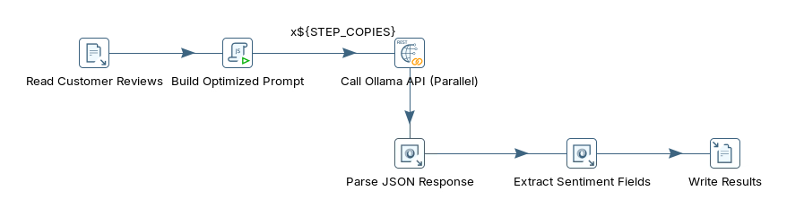
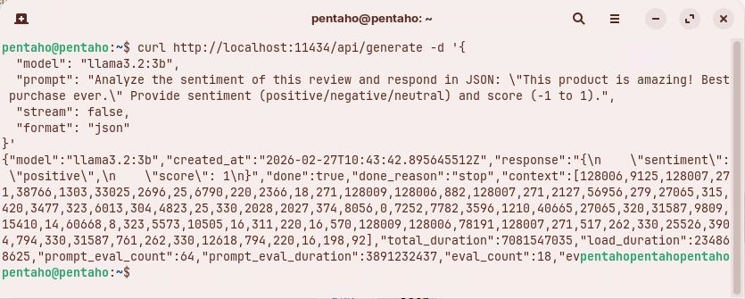
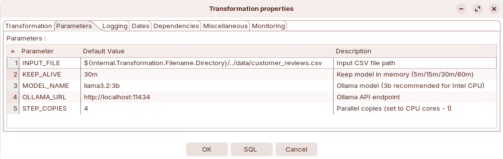
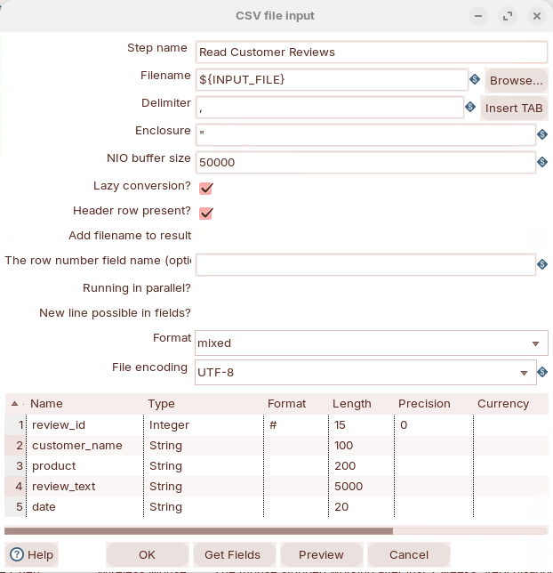
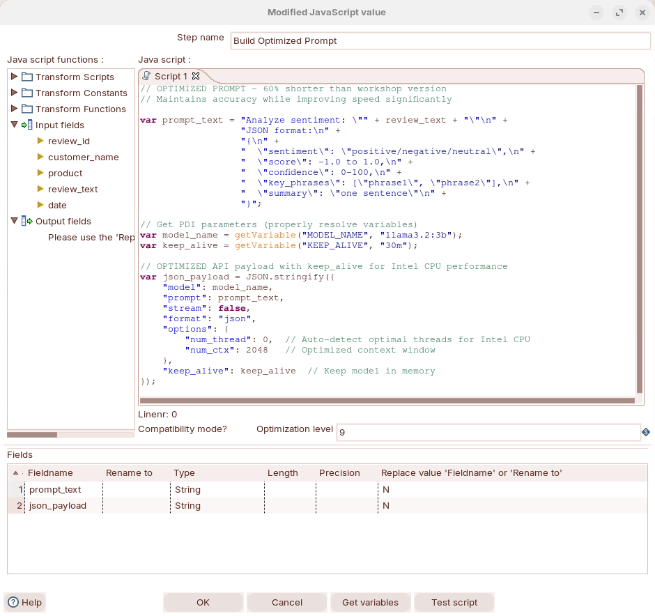
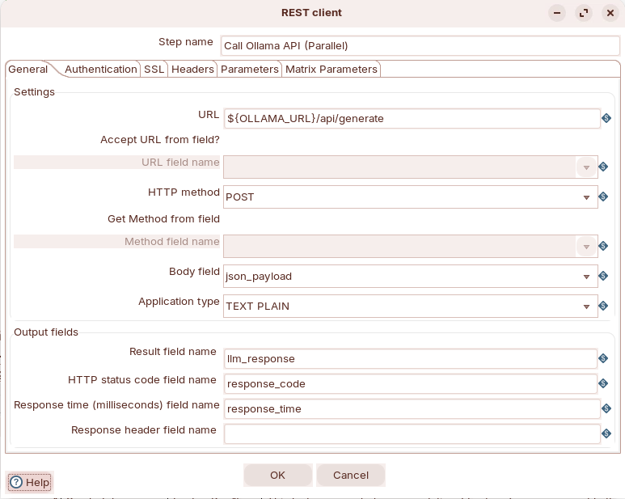
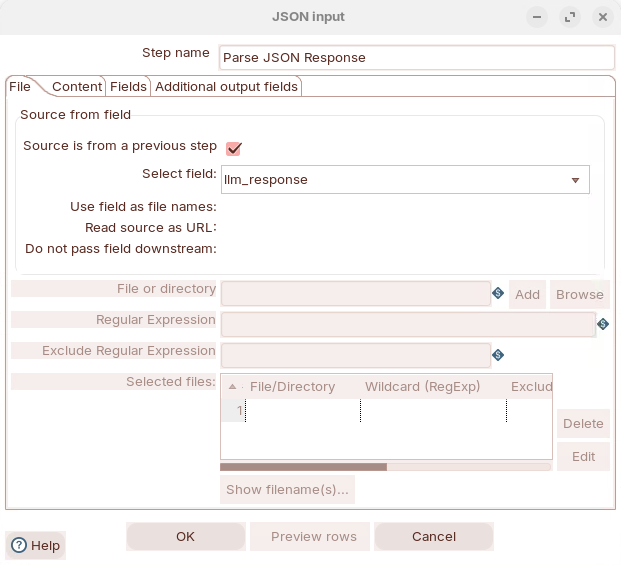
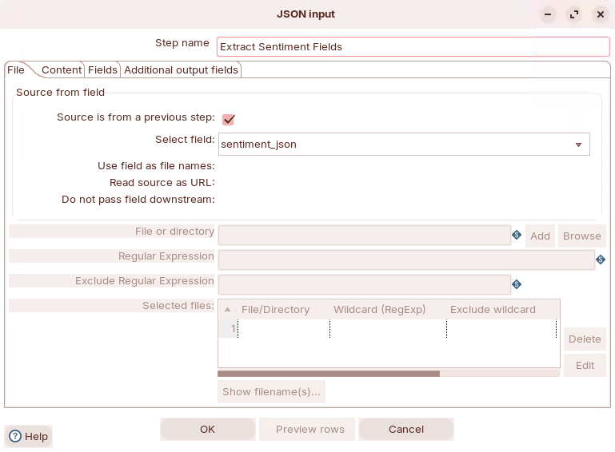
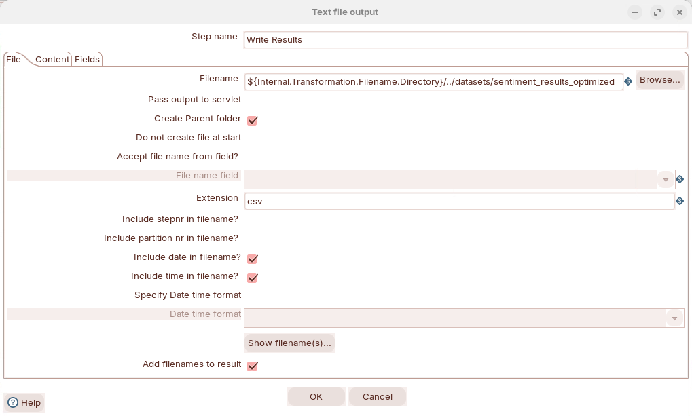
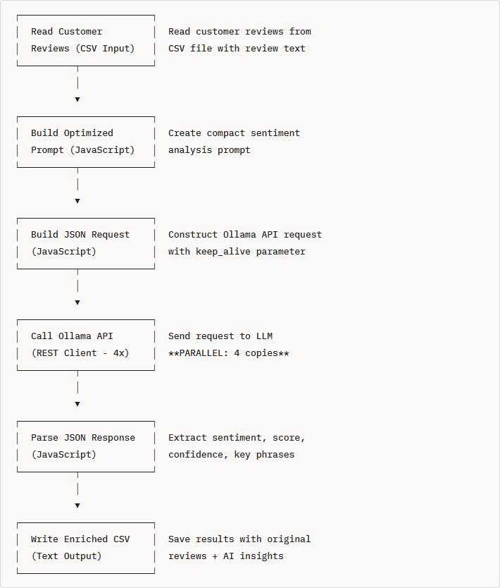

# Sentiment Analysis

> **Warning:**
>
> #### Workshop - Sentiment Analysis
>
> Build a Pentaho Data Integration transformation that reads five customer reviews, asks a local Large Language Model (LLM) served by Ollama for the sentiment of each one, and writes the answers to a CSV file as structured fields.
>
> **What you'll do**
>
> * Check that the Ollama API answers, and read the shape of its response
> * Read the reviews with **CSV file input**
> * Build the prompt and the request body with **Modified JavaScript value**
> * Call Ollama from four parallel copies of **REST client**
> * Parse the model's JSON answer with two **JSON input** steps and write it with **Text file output**
>
> **Prerequisites:**
>
> * Ollama running on `http://localhost:11434` with `llama3.2:3b` pulled, as set up in [Before You Start](../00-before-you-start/guide.md)
> * The LLM Integration [Overview](../05-llm-integration/guide.md): the request and response anatomy this workshop uses
>
> **Estimated time:** 45 minutes

<div align="center">
<figure>

<figcaption>What you build: six steps, with the API call running in parallel copies</figcaption>
</figure>
</div>

:::: tabs

### 1. Sentiment Analysis

> **Note:**
>
> #### What Is Sentiment Analysis?
>
> Sentiment analysis identifies the opinion a piece of text expresses and classifies it as positive, negative or neutral. This workshop asks the LLM for that label, a score, its confidence, the phrases that drove the decision, and a one-sentence summary.

**Example input:**

```text
"This laptop exceeded my expectations! The battery life is incredible and the
performance is blazing fast. Highly recommend for anyone looking for a quality machine."
```

**Example output:**

```json
{
  "sentiment": "positive",
  "score": 0.9,
  "confidence": 95,
  "key_phrases": ["exceeded expectations", "incredible battery", "blazing fast", "highly recommend"],
  "summary": "Customer extremely satisfied with laptop performance and battery life"
}
```

**Where it is used:**

1. **Customer feedback analysis** - categorize thousands of reviews to find satisfaction trends.
2. **Brand monitoring** - track sentiment about a brand across social media and review sites.
3. **Product improvement** - find the features customers like and the ones that need work.
4. **Support prioritization** - route the most negative messages to experienced agents first.
5. **Market research** - understand opinions about competitor products.
6. **Crisis detection** - spot a spike in negative sentiment early.

**Types of sentiment:**

| Type | Values | Example |
| --- | --- | --- |
| Polarity | Positive, negative, neutral | "Terrible quality, waste of money" is negative |
| Granular (scored) | A score from -1.0 (very negative) to +1.0 (very positive) | "Good value for money" scores about +0.5 |
| Emotion | Joy, anger, frustration, disappointment | "Why doesn't this feature work properly?" is frustration |

**Keyword rules compared with an LLM:**

A keyword rule counts words such as "good" and "bad":

```python
# Simple keyword matching
positive_words = ["good", "great", "excellent", "love"]
negative_words = ["bad", "poor", "terrible", "hate"]

if text contains more positive_words:
    sentiment = "positive"
```

| Text | Keyword rule | What the text means |
| --- | --- | --- |
| "This isn't bad" | Negative (contains "bad") | Mildly positive |
| "Oh great, another software bug" | Positive (contains "great") | Negative (sarcasm) |
| "Not good at all" | Positive (contains "good") | Negative (negation) |

An LLM reads the whole sentence, so it can handle context, negation and much sarcasm, explain its reasoning, extract key phrases, and return its answer in the JSON shape you ask for, without labeled training data. It is slower than a rule and its answers can vary between runs, so a pipeline checks what comes back.

**The fields this workshop extracts:**

| Field | Meaning | Example |
| --- | --- | --- |
| `sentiment` | `positive`, `negative` or `neutral` | `"positive"` |
| `score` | -1.0 (very negative) to +1.0 (very positive) | `0.9` |
| `confidence` | How sure the model is, 0 to 100; a low value can mean mixed or ambiguous text | `95` |
| `key_phrases` | The phrases that drove the decision | `["exceeded expectations", "blazing fast"]` |
| `summary` | One sentence on the review's main point | `"Customer extremely satisfied with laptop performance"` |

**The data:** `customer_reviews.csv` holds five reviews. Reviews 1 (Laptop Pro 15) and 4 (Mechanical Keyboard) are clearly positive, 2 (Wireless Mouse) and 5 (Webcam HD Pro) clearly negative, and 3 (USB-C Hub) is mixed: "Good product overall ... though it gets a bit warm".

### 2. Ollama API

> **Note:**
>
> #### Ollama API Endpoint
>
> Ollama serves a REST API at `http://localhost:11434`. A transformation sends one `POST` to `/api/generate` per row, with a JSON body naming the `model`, the `prompt`, `"stream": false` for one complete answer, and `"format": "json"` to make the model answer in JSON.

1. Check that Ollama answers and has the model. In PowerShell, run:

::: tabs

### Windows (PowerShell)

```powershell
(Invoke-RestMethod http://localhost:11434/api/tags).models | Select-Object name
```

### macOS / Linux

```bash
curl http://localhost:11434/api/tags
```

:::

> **Success:** Checkpoint: the list of models includes `llama3.2:3b`.

2. Send one review to the model. In PowerShell, run:

::: tabs

### Windows (PowerShell)

```powershell
$body = @{
  model  = "llama3.2:3b"
  prompt = 'Analyze the sentiment of this review and respond in JSON: "This product is amazing! Best purchase ever." Provide sentiment (positive/negative/neutral) and score (-1 to 1).'
  stream = $false
  format = "json"
} | ConvertTo-Json
Invoke-RestMethod -Uri http://localhost:11434/api/generate -Method Post -ContentType "application/json" -Body $body
```

### macOS / Linux

```bash
curl http://localhost:11434/api/generate -d '{
  "model": "llama3.2:3b",
  "prompt": "Analyze the sentiment of this review and respond in JSON: \"This product is amazing! Best purchase ever.\" Provide sentiment (positive/negative/neutral) and score (-1 to 1).",
  "stream": false,
  "format": "json"
}'
```

:::

The first call can take longer while Ollama loads the model into memory.

<div align="center">
<figure>

<figcaption>One complete answer: the model's JSON sits inside the response field</figcaption>
</figure>
</div>

> **Success:** Checkpoint: one JSON object with `model` `llama3.2:3b` and `done` `true` (PowerShell shows `True`). Its `response` field is a string that holds the model's own JSON, with a `sentiment` and a `score`; the values are the model's and can differ between runs.

The other fields of the answer:

| Field | Meaning |
| --- | --- |
| `created_at` | When the answer was generated |
| `done_reason` | `stop` when the model finished on its own, rather than at a length limit |
| `context` | The token IDs of the exchange; only needed to continue a conversation |
| `total_duration`, `load_duration` | Total time, and time spent loading the model, in nanoseconds |
| `prompt_eval_count`, `prompt_eval_duration` | Tokens in your prompt, and the time to process them |
| `eval_count`, `eval_duration` | Tokens in the answer, and the time to generate them |

### 3. Read the Reviews

> **Note:**
>
> #### Read the Reviews
>
> Create the transformation, give it the parameters its steps read, and read `customer_reviews.csv` with **CSV file input**.

1. Start Spoon with the **Start Pentaho Data Integration** button below, or from a terminal:

::: tabs

### Windows (PowerShell)

```powershell
Set-Location C:\Pentaho\design-tools\data-integration
.\spoon.bat
```

### macOS / Linux

```bash
cd ~/Pentaho/design-tools/data-integration
./spoon.sh
```

:::

<button data-launch="spoon" data-path="">Start Pentaho Data Integration</button>

2. Select **File > New > Transformation** (`Ctrl+N`).
3. Select **File > Save as** and save it as `sentiment_analysis_optimized.ktr` in `C:\Workshop-AI-Specialty\04-llm-integration\06-llm-sentiment-analysis`, next to `customer_reviews.csv`. (On your own machine, download `customer_reviews.csv` from **Lab Files** below into the folder you save in.)
4. Double-click an empty part of the canvas. **Transformation properties** opens.
5. Open the **Parameters** tab and fill the grid:

| Parameter | Default Value | Description |
| --- | --- | --- |
| `INPUT_FILE` | `${Internal.Transformation.Filename.Directory}/customer_reviews.csv` | Input CSV file path |
| `KEEP_ALIVE` | `30m` | Keep model in memory (5m/15m/30m/60m) |
| `MODEL_NAME` | `llama3.2:3b` | Ollama model (3b recommended for Intel CPU) |
| `OLLAMA_URL` | `http://localhost:11434` | Ollama API endpoint |
| `STEP_COPIES` | `4` | Parallel copies (set to CPU cores - 1) |

<div align="center">
<figure>

<figcaption>The five parameters (the screenshot's INPUT_FILE has an older ../data/ folder; use the table's value)</figcaption>
</figure>
</div>

6. Select **OK**.
7. On the **Design** tab, open the **Input** folder and drag **CSV file input** onto the canvas.
8. Double-click **CSV file input**.
9. Set **Step name** to `Read Customer Reviews`.
10. Set **Filename** to `${INPUT_FILE}`.
11. Keep **Delimiter** `,`, **Enclosure** `"`, **NIO buffer size** `50000`, and keep **Lazy conversion?** and **Header row present?** selected.
12. Set **Format** to `mixed` and **File encoding** to `UTF-8`.
13. Fill the **Fields** grid:

| Name | Type | Format | Length | Precision |
| --- | --- | --- | --- | --- |
| `review_id` | Integer | `#` | 15 | 0 |
| `customer_name` | String | | 100 | |
| `product` | String | | 200 | |
| `review_text` | String | | 5000 | |
| `date` | String | | 20 | |

<div align="center">
<figure>

<figcaption>Read Customer Reviews: the file comes from the INPUT_FILE parameter</figcaption>
</figure>
</div>

14. Select **OK**.
15. Save the transformation (`Ctrl+S`).
16. Select **Read Customer Reviews** on the canvas, press `F10` (**Action > Preview**), and select **Quick Launch**.

> **Success:** Checkpoint: **Examine preview data** shows 5 rows, `review_id` `1` to `5`. The first is `Sarah Johnson`, `Laptop Pro 15`, dated `2024-02-15`.

17. Select **Close**.

### 4. Build the Prompt

> **Note:**
>
> #### Modified JavaScript Value
>
> One script builds the prompt from `review_text` and wraps it in the JSON request body Ollama expects, in a field called `json_payload`.

1. On the **Design** tab, open the **Scripting** folder and drag **Modified JavaScript value** onto the canvas.
2. Create a hop from **Read Customer Reviews** to **Modified JavaScript value**: hold `Shift` and drag from one step to the other.
3. Double-click **Modified JavaScript value**.
4. Set **Step name** to `Build Optimized Prompt`.
5. Replace the text in the **Script 1** tab with:

```javascript
// OPTIMIZED PROMPT - 60% shorter than workshop version
// Maintains accuracy while improving speed significantly

var prompt_text = "Analyze sentiment: \"" + review_text + "\"\n" +
                  "JSON format:\n" +
                  "{\n" +
                  "  \"sentiment\": \"positive/negative/neutral\",\n" +
                  "  \"score\": -1.0 to 1.0,\n" +
                  "  \"confidence\": 0-100,\n" +
                  "  \"key_phrases\": [\"phrase1\", \"phrase2\"],\n" +
                  "  \"summary\": \"one sentence\"\n" +
                  "}";

// Get PDI parameters (properly resolve variables)
var model_name = getVariable("MODEL_NAME", "llama3.2:3b");
var keep_alive = getVariable("KEEP_ALIVE", "30m");

// OPTIMIZED API payload with keep_alive for Intel CPU performance
var json_payload = JSON.stringify({
    "model": model_name,
    "prompt": prompt_text,
    "stream": false,
    "format": "json",
    "options": {
        "num_thread": 0,  // Auto-detect optimal threads for Intel CPU
        "num_ctx": 2048   // Optimized context window
    },
    "keep_alive": keep_alive  // Keep model in memory
});
```

What the request body asks of Ollama:

| Key | Value | Why |
| --- | --- | --- |
| `model` | `MODEL_NAME` | The model to run |
| `prompt` | `prompt_text` | The review, and the JSON shape to answer in |
| `stream` | `false` | One complete answer per row, not a token stream |
| `format` | `json` | Constrains the model to answer in valid JSON |
| `options.num_thread` | `0` | Lets Ollama choose the number of CPU threads |
| `options.num_ctx` | `2048` | A context window of 2,048 tokens: enough for one review and its answer, and less memory than a larger window |
| `keep_alive` | `KEEP_ALIVE` | Keeps the model loaded between rows, so it is not reloaded for each review |

6. Fill the **Fields** grid with the two fields the next steps read. (**Get variables** adds all four variables in the script; if you use it, delete the `model_name` and `keep_alive` rows.)

| Fieldname | Type | Replace value 'Fieldname' or 'Rename to' |
| --- | --- | --- |
| `prompt_text` | String | N |
| `json_payload` | String | N |

<div align="center">
<figure>

<figcaption>Build Optimized Prompt: the script and its two output fields</figcaption>
</figure>
</div>

7. Select **OK**.

> **Under the hood:**
>
> #### getVariable() resolved the parameters; ${...} in a script would not
>
> Pentaho Data Integration substitutes `${...}` variables in a step's settings, such as the REST client's **URL**, before the step runs. The text of a JavaScript script is not substituted: `"${MODEL_NAME}"` inside the script stays those literal characters, and Ollama would be asked for a model of that name. `getVariable("MODEL_NAME", "llama3.2:3b")` reads the variable at run time, and returns the second argument when it is not set.
>
> **Why it matters:** the same transformation runs against another model or Ollama server by changing a parameter, with no edit to the script.

8. Select **Build Optimized Prompt** on the canvas, press `F10` (**Action > Preview**), and select **Quick Launch**.

> **Success:** Checkpoint: 5 rows, now with `prompt_text` and `json_payload`. The first row's `json_payload` starts `{"model":"llama3.2:3b","prompt":"Analyze sentiment: \"This laptop exceeded my expectations!`.

9. Select **Close**.

### 5. Call Ollama

> **Note:**
>
> #### REST Client
>
> **REST client** sends each row's `json_payload` to Ollama and adds the answer, the HTTP status code and the response time to the row. Use **REST client**, not **HTTP client**: **HTTP client** sends a `GET`, and `/api/generate` only accepts `POST`.

1. On the **Design** tab, open the **Lookup** folder and drag **REST client** onto the canvas.
2. Create a hop from **Build Optimized Prompt** to **REST client**.
3. Double-click **REST client**.
4. Set **Step name** to `Call Ollama API (Parallel)`.
5. On the **General** tab, set **URL** to `${OLLAMA_URL}/api/generate`, **HTTP method** to `POST` and **Body field** to `json_payload`. Keep **Application type** `TEXT PLAIN`.
6. Under **Output fields**, set **Result field name** to `llm_response`, **HTTP status code field name** to `response_code` and **Response time (milliseconds) field name** to `response_time`.

<div align="center">
<figure>

<figcaption>Call Ollama API (Parallel): a POST of json_payload</figcaption>
</figure>
</div>

7. Select **OK**.
8. Right-click **Call Ollama API (Parallel)** and select **Change Number of Copies to Start...**.
9. In **Nr of copies of step...**, enter `${STEP_COPIES}` and select **OK**. Spoon shows `x${STEP_COPIES}` above the step.

> **Under the hood:**
>
> #### Four copies of the step send four requests at a time
>
> With `STEP_COPIES` at `4`, Pentaho Data Integration starts four copies of **Call Ollama API (Parallel)**, each its own thread, and the hop from **Build Optimized Prompt** hands the rows to them in turn (round robin). Each copy waits for its own answer, so up to four requests are open at once. Ollama runs as many of them in parallel as its settings and the machine's memory allow, and queues the rest.
>
> **Why it matters:** the time per row is the model's, not Pentaho Data Integration's. Parallel copies keep Ollama busy instead of waiting for each answer in turn; the rows can leave the step in a different order than they entered it.

### 6. Parse the Response

> **Note:**
>
> #### JSON Input
>
> Two **JSON input** steps read fields instead of files: the first takes the model's answer out of Ollama's response, the second splits that answer into the five sentiment fields.

1. On the **Design** tab, open the **Input** folder and drag **JSON input** onto the canvas.
2. Create a hop from **Call Ollama API (Parallel)** to **JSON input**.
3. Double-click **JSON input**.
4. Set **Step name** to `Parse JSON Response`.
5. On the **File** tab, select **Source is from a previous step** and set **Select field** to `llm_response`.

<div align="center">
<figure>

<figcaption>Parse JSON Response reads the llm_response field</figcaption>
</figure>
</div>

6. On the **Content** tab, make sure **Ignore missing path** and **Default path leaf to null** are selected.
7. On the **Fields** tab, fill the grid with one row:

| Name | Path | Type |
| --- | --- | --- |
| `sentiment_json` | `$.response` | String |

8. Select **OK**.
9. Drag a second **JSON input** from the **Input** folder onto the canvas.
10. Create a hop from **Parse JSON Response** to the new step.
11. Double-click the new step.
12. Set **Step name** to `Extract Sentiment Fields`.
13. On the **File** tab, select **Source is from a previous step** and set **Select field** to `sentiment_json`.

<div align="center">
<figure>

<figcaption>Extract Sentiment Fields reads the model's own JSON</figcaption>
</figure>
</div>

14. On the **Content** tab, make sure **Ignore missing path** and **Default path leaf to null** are selected.
15. On the **Fields** tab, fill the grid:

| Name | Path | Type | Format | Precision | Decimal |
| --- | --- | --- | --- | --- | --- |
| `sentiment` | `$.sentiment` | String | | | |
| `score` | `$.score` | Number | `#.##` | 2 | `.` |
| `confidence` | `$.confidence` | Integer | `#` | 0 | |
| `key_phrases` | `$.key_phrases` | String | | | |
| `summary` | `$.summary` | String | | | |

16. Select **OK**.

> **Under the hood:**
>
> #### The answer was parsed twice, because it is JSON inside JSON
>
> Ollama's response is a JSON object, and the model's answer is one of its fields, `response`, held as a string. `"format": "json"` makes that string valid JSON, but it is still text inside the outer object. **Parse JSON Response** reads the outer object and copies the string into `sentiment_json`; **Extract Sentiment Fields** parses that string. With **Ignore missing path** selected, a key the model leaves out becomes a null field instead of failing the row.
>
> **Why it matters:** every LLM call in this course returns its answer this way, so every pipeline that reads one has the same two layers to unwrap.

### 7. Write the Results

> **Note:**
>
> #### Text File Output
>
> Write each review with its sentiment fields and the response time to a CSV file next to the transformation. The date and time of the run go into the file name, so each run keeps its own file.

1. On the **Design** tab, open the **Output** folder and drag **Text file output** onto the canvas.
2. Create a hop from **Extract Sentiment Fields** to **Text file output**.
3. Double-click **Text file output**.
4. Set **Step name** to `Write Results`.
5. On the **File** tab, set **Filename** to `${Internal.Transformation.Filename.Directory}/sentiment_results_optimized` and **Extension** to `csv`.
6. Select **Create Parent folder**, **Include date in filename?** and **Include time in filename?**. Keep **Add filenames to result** selected.

<div align="center">
<figure>

<figcaption>Write Results, File tab (the screenshot's ../datasets/ folder is from an older version; use step 5's name)</figcaption>
</figure>
</div>

7. On the **Content** tab, keep **Separator** `,` and **Enclosure** `"`, keep **Header** selected, and set **Format** to `DOS` and **Encoding** to `UTF-8`.
8. On the **Fields** tab, fill the grid. (**Get Fields** adds every field in the stream; if you use it, delete the rows that are not in this table.)

| Name | Type | Format | Precision |
| --- | --- | --- | --- |
| `review_id` | Integer | `#` | |
| `customer_name` | String | | |
| `product` | String | | |
| `review_text` | String | | |
| `date` | String | | |
| `sentiment` | String | | |
| `score` | Number | `#.##` | 2 |
| `confidence` | Integer | `#` | |
| `key_phrases` | String | | |
| `summary` | String | | |
| `response_time` | Integer | `#` | |

9. Select **OK**.
10. Save the transformation (`Ctrl+S`).

### 8. Run

> **Note:**
>
> #### Run the Transformation
>
> Each review is one LLM call. On a CPU-only machine a call takes about 15 to 30 seconds, so allow a few minutes for the five.

1. Press `F9` (**Action > Run**), and select **Run** in the **Run Options** dialog.
2. In **Execution Results**, open the **Step Metrics** tab.

> **Success:** Checkpoint: every step finishes without errors. **Read Customer Reviews** shows 5 under **Written**. **Call Ollama API (Parallel)** has four lines, copies 0 to 3, that between them read the 5 rows. **Write Results** shows 5 under **Written**.

3. Select **Write Results** on the canvas and open the **Preview data** tab.

> **Success:** Checkpoint: 5 rows, one per review, each with a `sentiment` of `positive`, `negative` or `neutral`, a `score` between -1 and 1, a `confidence`, `key_phrases` and a one-sentence `summary`. The labels and numbers are the model's, so they can differ from run to run; reviews 1 and 4 should come back positive and 2 and 5 negative.

4. Find the results file. In PowerShell, run:

::: tabs

### Windows (PowerShell)

```powershell
Get-ChildItem C:\Workshop-AI-Specialty\04-llm-integration\06-llm-sentiment-analysis\sentiment_results_optimized_*.csv
```

### macOS / Linux

```bash
ls sentiment_results_optimized_*.csv
```

Run it in the folder you saved the transformation in.

:::

> **Success:** Checkpoint: a file named `sentiment_results_optimized_<yyyyMMdd>_<HHmmss>.csv`, with the date and time of the run. Its first line is `review_id,customer_name,product,review_text,date,sentiment,score,confidence,key_phrases,summary,response_time`, followed by 5 rows.

5. Tune the run for your machine: press `F9` again and, in the **Run Options** dialog, change the parameter values before you select **Run**.

| Parameter | Values | Effect |
| --- | --- | --- |
| `KEEP_ALIVE` | `5m`, `15m`, `30m`, `60m` | How long Ollama keeps the model loaded after the last request. Longer avoids reloading the model during a long batch, at the cost of memory. |
| `STEP_COPIES` | `1` and up | Parallel API calls. The transformation's own guidance is CPU cores minus 1; more copies use more memory. |
| `MODEL_NAME` | `llama3.2:1b`, `llama3.2:3b`, a larger model | A smaller model answers faster and less accurately; a larger one the other way round. Pull a model with `ollama pull <name>` before you use it. |

::::

## Troubleshooting <!-- no-step -->

<details>
<summary>Connection refused, or Call Ollama API fails at once</summary>

Ollama is not running. Start the Ollama app, or run `ollama serve` in a terminal, and check it with the first command of the **Ollama API** tab.

</details>

<details>
<summary>response_code is not 200</summary>

`llm_response` holds Ollama's error message. A model name Ollama does not have is the usual cause: run `ollama list`, and pull the model or change `MODEL_NAME`. If the model name in the error is the literal text `${MODEL_NAME}`, the script uses `"${MODEL_NAME}"` instead of `getVariable()`.

</details>

<details>
<summary>405 Method Not Allowed</summary>

The step sends a `GET`. Use **REST client** with **HTTP method** `POST`, not **HTTP client**.

</details>

<details>
<summary>Extract Sentiment Fields fails on a row</summary>

The model's answer was not valid JSON. Check that the request body still has `"format": "json"`, then preview **Parse JSON Response** to read `sentiment_json` for that row.

</details>

## Lab Files

Click a file to download. For `.ktr` and `.kjb` files, **Open in Pentaho Data Integration** launches Pentaho Data Integration with the file loaded. If Pentaho Data Integration is already running, the path is copied to your clipboard — switch to Pentaho Data Integration and press `Ctrl+O`, `Ctrl+V`, `Enter`.

The five customer reviews the transformation reads:

[customer_reviews.csv](./files/customer_reviews.csv)

### Solution <!-- no-step -->

The finished transformation for this lab. Open it alongside your own to compare, or run it to see the expected result.

Also on disk at `C:\Workshop-AI-Specialty\04-llm-integration\06-llm-sentiment-analysis\solution`.

[sentiment_analysis_optimized.ktr](./files/sentiment_analysis_optimized.ktr) <button data-launch="spoon" data-path="files/sentiment_analysis_optimized.ktr">Open in Pentaho Data Integration</button> <button data-graph="files/sentiment_analysis_optimized.ktr">View graph</button>

The basic version, for comparison: one copy of the API call, a longer prompt, no `options` or `keep_alive`, and results in `sentiment_results_<date>_<time>.csv` without `response_time`:

[sentiment_analysis.ktr](./files/sentiment_analysis.ktr) <button data-launch="spoon" data-path="files/sentiment_analysis.ktr">Open in Pentaho Data Integration</button> <button data-graph="files/sentiment_analysis.ktr">View graph</button>

The pipeline as first designed, with a separate request step and a JavaScript parser; the solution builds the request in **Build Optimized Prompt** and parses with two **JSON input** steps:

<div align="center">
<figure>

<figcaption>The original design diagram, which differs from the solution's steps</figcaption>
</figure>
</div>
